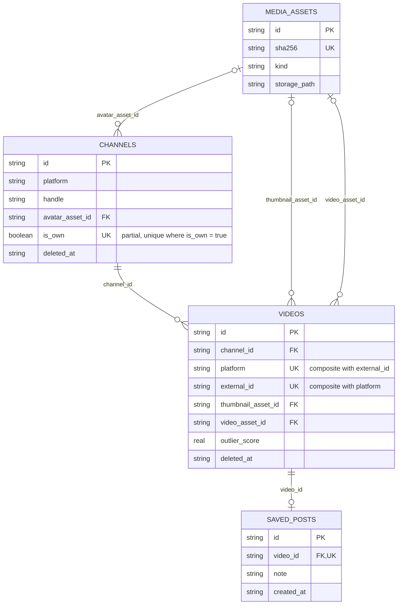
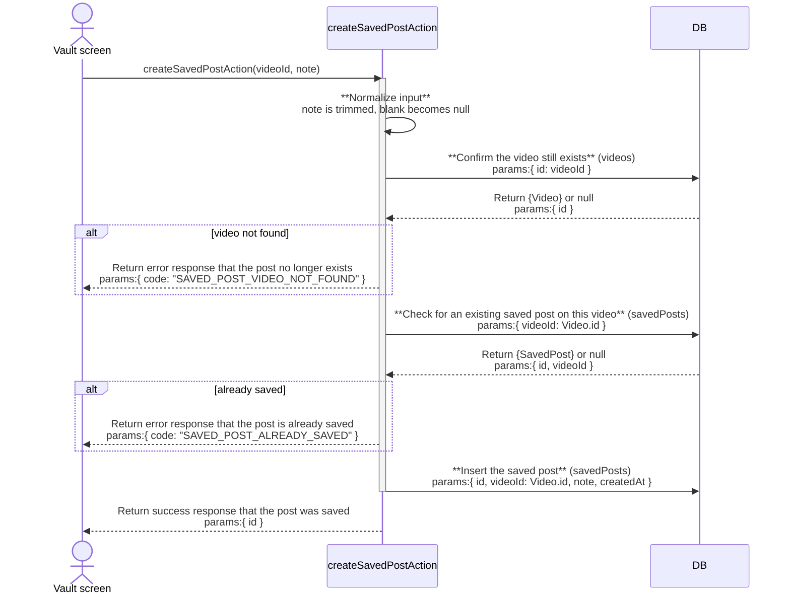

# Drizzle ER and sequence house style

Crowsnest's schema lives in one file, `src/server/db/schema.ts`, as a set of
`sqliteTable(...)` calls. This page is the house style for turning that file
into a Mermaid `erDiagram`, and for turning a DB-backed flow into a Mermaid
`sequenceDiagram`, so every component doc in this repo reads the same way.
It adapts the DB-operation sequence-diagram convention and the render
gotchas from funflow's `core-component-impl` skill from Mongoose collections
to SQLite tables read through Drizzle.

## ER from the drizzle schema

- Each `sqliteTable("snake_case_name", columns, indexesFn)` call is one
  entity. The exported name (camelCase, for example `channels`, `videos`,
  `mediaAssets`, `savedPosts`) is how the rest of the codebase refers to the
  table, through `tables.videos` and `tables.savedPosts` (`export * as
  tables from "./schema"` in `src/server/db/index.ts`). Use that exported
  name as the entity label and as the table name in a sequence-diagram query
  line, not the raw SQL table name, so a reader can jump straight from a
  diagram label to the export it names in `schema.ts`.

- A `.references(() => otherTable.id, { onDelete: ... })` call on a column
  is a relationship. Read the cardinality off the column, not off intuition:
  - A `notNull()` foreign key means "exactly one" on the parent side: the
    symbol next to the parent entity is `||`.
  - A nullable foreign key means "zero or one" on the parent side: the
    symbol next to the parent entity is `|o`.
  - The child side is `o{` (zero or many) unless a unique index also caps
    that foreign key at one row, in which case it is `o|` (zero or one).

  Two real examples from `schema.ts`: `videos.channelId` is `notNull()` and
  carries no uniqueness constraint on the child side, so
  `CHANNELS ||--o{ VIDEOS`. `savedPosts.videoId` is also `notNull()`, but
  `uniqueIndex("saved_posts_video").on(t.videoId)` caps it at one saved post
  per video, so `VIDEOS ||--o| SAVED_POSTS`.

- List indexes as attribute markers, not a separate diagram block. The third
  argument to `sqliteTable` (a function returning an array or object of
  `index()` / `uniqueIndex()` / `primaryKey()` calls) is the index list:
  - A `uniqueIndex(...)` on one column becomes `UK` on that attribute.
  - A `uniqueIndex(...)` on more than one column (a composite unique
    constraint, for example `videos_platform_external` on
    `(platform, external_id)`) becomes `UK` on each participating attribute,
    since a single erDiagram attribute line cannot express "these two
    together are unique." Say so in the prose under the diagram instead.
  - A `uniqueIndex(...).where(sql...)` (a partial unique index, for example
    `channels_single_own`, `idea_source_active`, `sync_jobs_lock_running`) is
    still `UK`, with the partial condition spelled out in the attribute's
    quoted comment, for example `boolean is_own UK "partial, unique where
    is_own = true"`.
  - A plain `index(...)` (a lookup or sort index with no uniqueness
    constraint, for example `videos_channel_posted`, `planned_posts_date`)
    has no erDiagram attribute marker. Call it out in the prose under the
    diagram instead, naming the columns it covers and why, the same way
    `schema.ts` already comments most of them.

## DB-operation sequence diagrams

Actors:

- The human or the screen that triggers the flow is an `actor` (`actor UI`,
  or name the real screen, for example `actor UI as Vault screen`). Never
  activate an actor.
- A server action or route handler (a function in `src/server/actions/*.ts`
  or an API route) is a `participant`, activated for the duration of the
  call with `activate` / `deactivate`. This is crowsnest's equivalent of
  funflow's `API` participant.
- `DB` is a `participant`, never activated. There is one `DB` participant
  regardless of how many tables it holds; table names show up in the
  message text, not as separate participants.
- A long-running background job that the UI starts and then polls (a row in
  `syncJobs`, `framePassJobs`, or `createRuns`) gets its own activated
  `Worker` participant, the same as funflow's convention. A synchronous
  server action, like the worked example below, does not need one.

Notation:

- Every DB query step reads: `**Logic description** (tableName)<br/>params:{
  ... }`, one table name per line, using the exported drizzle name from the
  ER section above, for example `(videos)`, `(savedPosts)`. If one step's
  logic genuinely spans two tables, split it into two query lines rather
  than naming two tables in one line.
- A parameter carried over from an earlier query's result, rather than a
  fresh literal the actor passed in, reads: `key: Table.field`, for example
  `videoId: Video.id`.
- A response from DB reads: `Return {Row}<br/>params:{ ... }`, or `Return
  null<br/>params:{}` for a not-found check.
- The final response back to the human actor is always one of:
  - `Return success response that {what happened}<br/>params:{ ... }`
  - `Return error response that {why}<br/>params:{ code: "..." }`
- A no-input validation or normalization step, one with no DB query and no
  external call, for example trimming a string or defaulting a blank value
  to null, is a self-call on the activated participant: a bold header
  followed by plain rule lines, with no `params:` block:

  ```
  Action->>Action: **Normalize input**<br/>note is trimmed, blank becomes null
  ```

## Mermaid render gotchas

These are the same failure modes funflow's `core-component-impl` skill
documents from rendering hundreds of real diagrams. They apply here
unchanged:

- A bare semicolon in unquoted message, label, or condition text breaks
  parsing wherever it appears, not only inside `Note over` text. Use a comma
  instead, never a semicolon, in an arrow message, a self-call, or an
  `alt`/`opt`/`loop` condition label. A semicolon inside a double-quoted
  `erDiagram` attribute comment is safe.
- HTML entities (`&lt;`, `&gt;`, `&amp;`) and literal `<` or `>` used as
  comparison operators break parsing, whether inside an `alt`/`opt`/`loop`
  condition label or in plain message text. Spell the comparison out in
  words instead, for example "fewer than" or "greater than". This does not
  apply to the `<br/>` tag, which mermaid renders as a real line break and
  which this house style uses throughout.
- Every message needs an explicit arrow (`->>`, `-->>`, and so on). A bare
  `Name: text` line is invalid, even for a self-call: write
  `Action->>Action: text`.
- Message text must be a single physical line. Use `<br/>` for a visual
  break inside the rendered box instead of a raw line break in the source.
- On an `erDiagram` attribute line, multiple keys need a comma
  (`string video_id FK, UK`, never `FK UK`), and an attribute needs an
  actual name before a trailing quoted comment (`string extra_fields
  "tenant-specific data"`, never a bare `string "tenant-specific data"`).
- Quotes are safe inside a `params:{...}` block and inside ordinary message
  text. The risk is specifically the items above, not quoting itself.
- Verify by rendering, never by eyeballing. Extract each block to a `.mmd`
  file and POST it to a live renderer, for example:

  ```
  curl -sS -X POST https://kroki.io/mermaid/svg -H "Content-Type: text/plain" --data-binary @diagram.mmd -o /dev/null -w "%{http_code}\n"
  ```

  Expect `200`. Re-render after every fix pass, not just once: a diagram can
  hide more than one instance of the same mistake, and fixing the one an
  error message points at can still leave a sibling broken.

## Worked example

Both diagrams below are built from the real `channels`, `videos`,
`mediaAssets`, and `savedPosts` tables in `schema.ts`, and the real
`createSavedPostAction` in `src/server/actions/saved-post-actions.ts`.

### ER



`videos_channel_posted`, `videos_outlier_score`, `videos_view_count`, and
`videos_posted_at` are plain, non-unique indexes on `videos` that back the
outlier feed's sort and filter options; they have no erDiagram attribute
marker, which is why `channel_id` above carries only `FK`, not `FK, UK`.

### Sequence: saving a post to the Vault



The two `alt` blocks are each a genuine DB-backed check, not a self-call,
because each one turns on a value only the database can answer, whether the
video row is gone and whether a saved post already exists. The one step
with no DB query, normalizing the incoming note, is the self-call, matching
the no-input validation convention above.
