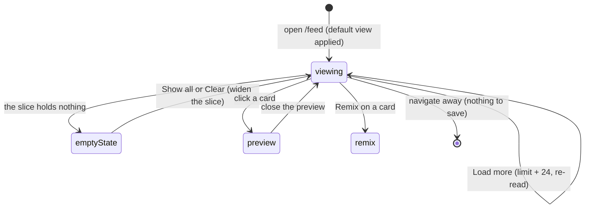

# The outlier feed page

## Summary

The feed is the front door of the core loop: a page of outlier posts from tracked
channels, ranked so the strongest performers sit first, that the user scans to find
something worth remixing. It lives at `/feed` and is the landing page of the app. It is a
[direct server read](../foundations/interaction-model.md#how-an-action-reaches-the-server):
the page queries the database as it renders and shows either a page of cards or an empty
state. There is no server action here and nothing to submit, so it cannot fail as an
action. Everything the user changes about the view, the filters, which slice, how many
posts, grid or list, is carried in the URL, and changing it re reads the page.

Because it needs nothing but the local database, the feed works in every restricted state.
The [LLM proxy](../foundations/interaction-model.md#what-is-unavailable-in-restricted-states)
being down, the Graph token being invalid, and the sidecar not running change nothing about
whether the feed renders. The one thing the sidecar controls is whether new [videos](../foundations/data-model.md#video)
arrive at all: with the sidecar stopped the feed still reads, it just goes stale.

This document owns the feed page itself: the grid and list presentations, the outlier cards
and their score and metrics, the follower band counts, Load more, and the empty states. The
row of filter controls above the page and the saved views are a separate feature, described
in [filters and saved views](filters-and-saved-views.md); this document names them but does
not describe their controls. The quick preview that opens when a card is clicked is described
in [quick preview](quick-preview.md).

## The simple case

The user opens `/feed`. Rather than the whole library, the page opens on the High Conviction
view, a seeded saved filter that keeps only the strongest recent outliers, because the point
of the tool is the outliers and not the archive. A small line above the grid says how many
results the current slice holds, notes that the High Conviction view is on, and offers a
"Show all" link that drops the default and shows everything.

Below that is a grid of cards, one per video, biggest scorer first. Each card shows a
thumbnail with the caption laid over it, the outlier score as the largest number on the card,
the view count and engagement rate, the channel handle and its follower count, and how long
ago the post went up. The user scans down the scores, clicks a card that looks worth a closer
look, and the [quick preview](quick-preview.md) opens over the feed. From a card the user can
also jump straight to a remix or open the channel.

If the grid holds more than the first 24 posts, a "Load more" button sits at the bottom.
Clicking it reloads the page showing 24 more. When the slice is small enough to fit, there is
no button.

## The interaction, event by event

### Arrive

The page reads the database on the server as it renders. It loads the fleets, the saved
filters, and the channel list, works out which slice to show from the URL, and then runs two
reads at once: the page of videos for the slice and the [follower band counts](#the-follower-band-counts).
On a bare `/feed` with no filter in the URL, it applies the High Conviction saved view; once
the URL carries any real filter, that intent is honored as written, including an explicit
"any". Cosmetic parts of the URL (density, grid or list, sort, limit) are not filters, so
toggling one of them alone still counts as a bare visit and keeps the default view.

Nothing is focused and nothing is prefilled, because there is no form. What the user sees is
a snapshot of the database at the moment the page rendered. The default page size is 24, so
at most 24 cards render on arrival however large the slice is.

> Technical note: the default view is not hard coded on the page. The criteria come off the
> seeded High Conviction saved filter row, so changing the seed moves the default without
> touching the page.

### Leave without acting

There is nothing to lose. The feed is a read, so backing out, following a link, or reloading
records nothing and discards nothing. The one thing that persists across a visit is what the
URL carries: a link to `/feed` with filters in the query string reopens the same slice,
because the slice lives in the URL rather than in any saved state on the page. See
[navigation and shell](../foundations/navigation-and-shell.md#deep-links).

### Begin acting

On a browse page, acting means following the page somewhere rather than committing a write.
The three things that count as beginning to act:

- Clicking a card opens the [quick preview](quick-preview.md) over the feed. This is client
  state on the page, not a navigation.
- Clicking Remix on a card, or clicking the thumbnail through to the detail page, leaves the
  feed for the [remix studio](../remix/remix-overview.md) or the [video detail page](video-detail.md).
- Clicking Load more, changing a filter, or changing the sort builds a new URL and re reads
  the page. None of these is a write; each is a fresh read of a different slice.

### While acting

Because there is no server action, there is no in flight write to watch. Following a card
into the preview is instant client state. Load more and filter changes are full page reads:
the browser requests the new URL, the server renders the new slice, and the page repaints
with it. There is no partial or streaming state, no spinner tied to a generation, and nothing
that can be half done. Between the click and the new page there is only the normal navigation
delay.

### Finish

There is nothing to commit. A card click ends with the preview open; a Load more ends with a
larger page rendered; a filter change ends with a different slice rendered. The user lands
back on the feed in every case except following a card through to remix or detail, which
leaves the feed entirely. Nothing is written to the database by anything on this page.

## Grid and list

The feed has two presentations, chosen by the `view` value in the URL.

The grid is the default: cards packed into as many columns as fit, each card a tall 9:16
thumbnail with its metrics beneath. The thumbnail sits desaturated at rest and picks up
contrast on hover, so the grid reads as scannable data first and a photo wall second. A
comfortable density gives larger cards; a compact density packs smaller ones so more fit per
row when scanning a large feed. Density is also a URL value.

The list is a plain data table: a header row of Score, Post, Channel, Views, Posted, and one
thin row per video with no thumbnail. The whole row is the click target for the quick preview.
The list is denser than the grid and trades the thumbnail for more rows on screen.

The toggle controls that switch grid and list, comfortable and compact, and the sort live in
the [filter bar](filters-and-saved-views.md), which owns them. This page owns only what each
presentation shows.

### The outlier card

Each grid card, top to bottom:

- The thumbnail, a 9:16 box. If the post's image has been downloaded it shows; if not, a
  hatched placeholder with a play glyph shows through, meaning "no image yet" rather than an
  error. If the image was downloaded but fails to load, the box shows an explicit
  "Unavailable" treatment, deliberately different from the "nothing downloaded yet"
  placeholder. The caption is laid over the thumbnail on an opaque plate so it stays readable
  against a bright or a dark image. The video duration, if known, sits in the corner.
- The outlier score, the hero of the card: the largest, plainest number, shown as a multiple
  such as 38.0x, always to one decimal. It is coloured amber the moment the post beat its
  channel baseline (a score of 1.0 or more) and stays muted below that. A post with no score
  shows a dash.
- The view count and engagement rate on one line, then the channel handle, its follower
  count, and the relative age of the post. The handle links to the channel page.
- If the post is no longer on the platform (removed by a later sync but kept for its history),
  a line in the warning colour says "No longer on Instagram" rather than the card being hidden.
- A footer, on the full size card only, with a Remix link to the [remix studio](../remix/remix-overview.md)
  and a menu offering Copy link and View on Instagram. There is no save button on the card:
  saving to the vault needs an analysis, which only exists on the [detail page](video-detail.md),
  so the feed card links there rather than pretending to save.

> Technical note: the engagement rate on the card and the engagement filter in the query use
> the same formula, (likes plus comments) divided by views, computed in one place. A post with
> a null view or a null count shows a dash rather than a fabricated zero, and is excluded from
> an engagement filter rather than counted as zero.

The list row shows the same score, the caption (or a dash when there is none), the channel
handle, the view count, and the relative age. A removed post is marked "removed" in the
warning colour in place of the card's longer line.

### The score badge

The score is the whole point of the ranking, so it is worth stating exactly what the colour
means. Amber turns on at 1.0, the moment a post beat its channel baseline. The badge's heat
tiers, a separate scale for how hard it beat, escalate the fill above that: a wash below 5x, a
solid amber from 5x, bolder past 20x. A post with no score is muted with a dash. The same
score and the same colour rule are used on the [detail page](video-detail.md), so a post that
reads amber here reads amber there.

## The follower band counts

Alongside the cards, the feed computes how many posts fall in each follower band of the
current slice: nano for channels under 10k followers, mid for 100k to 1M, and macro for 1M
and up. These counts feed the band chips in the [filter bar](filters-and-saved-views.md),
which is where the user sees and clicks them; this page owns what the numbers mean.

Two things about the counts are easy to misread. First, each band count is computed under
every other active filter with the band itself excluded, so picking one band does not change
what the other bands would have shown. Second, the three bands do not cover every channel: a
channel between 10k and 100k followers (the old micro range, since removed) and a channel
with an unknown follower count fall in no band at all, and show only under "any followers".
The three counts therefore need not sum to the total.

## The empty states

The page has four distinct empty states, chosen so the recovery action fits the reason the
slice came back empty:

- No channels tracked at all. "Nothing to score yet", with a note that a post appears once
  there is a channel and a sync to give it a median, and a link to add a channel.
- Channels exist but none has ever finished a sync. "Nothing to score yet", naming how many
  channels are added and that none has synced, with a link to the channels page to run one.
  This is distinct from the slice simply being empty: there is no baseline for anything to be
  measured against yet.
- A search that matched nothing. "No post matches" the searched words, with a suggestion to
  try other words or clear the search, and a link that clears only the search and keeps the
  rest of the slice.
- A filter slice that came back empty. When the default view is on, "No post clears the High
  Conviction bar yet" with a "Show all" link, because a bare `/feed` would just re apply the
  default and loop back to the same empty state. When a filter was set by hand, "No post
  matches this slice" with a "Clear filters" link and a suggestion to widen the threshold,
  timeframe, or band.

## Variants

| Variant | Set on arrival | Changed while acting |
| --- | --- | --- |
| Record state (video analyzed, saved, removed) | Decides what a card shows, not whether it shows. A removed video still appears, marked "No longer on Instagram". Analyzed or saved state is not shown on the feed card at all; both live on the [detail page](video-detail.md). | No effect. The feed does not re read mid view; a card reflects the record as of the page load until the next navigation or Load more. |
| Attached data present or absent (transcript, analysis) | No effect on the feed. A missing thumbnail asset shows the hatched placeholder; a missing transcript or analysis is invisible here. | No effect. |
| External service availability (LLM proxy, Graph, sidecar) | No effect on rendering. The feed reads only the local database. The sidecar decides whether new videos exist to read; with it stopped the feed still renders, just stale. | No effect. Load more and filter changes read the same local database whatever the services are doing. |
| Keyboard shortcut in play | A card is keyboard reachable: the thumbnail (or a list row) takes focus, and Enter or Space opens the quick preview, the same as a click. Load more, Remix, and the channel link are ordinary links, reached by Tab and followed with Enter. | No effect. There is no in flight state and no key that changes it. |

There is no modifier that changes what a click does. Every change to the feed is a change to
the URL, and the URL fully describes the slice.

## Cancel and interrupt

The feed is a read, so most of these rows are "nothing to lose". The table below fills every
one anyway.

| Event | Before commit (viewing the page) | While in flight (a Load more or filter re-read) |
| --- | --- | --- |
| Explicit cancel or stop | There is nothing to cancel. No action is open, no work is uncommitted. Closing the quick preview returns to the feed unchanged. | A re read is a page navigation; there is no cancel button. Navigating elsewhere abandons it, and nothing was partly written because nothing is written. |
| Navigate away mid action | Leaving the feed loses nothing. The slice is in the URL, so returning to the same URL reopens the same slice. | Abandoning an in flight re read simply lands on wherever the user navigated instead. No half state. |
| Reload or tab or window closed | The page re reads from the URL and shows the same slice. Nothing typed or staged is lost because nothing is staged. | Same. A reload during a re read just runs the read again. |
| A backing service fails mid action | No external service is used, so none can fail the render. A database read error would surface as a server error page rather than an in page failure, since there is no action boundary to catch it. | Same. The re read touches only the local database. |
| The target record changes underneath | The page is a snapshot at load time, so a sync that adds, removes, or rescoring a video after load is not reflected until the next navigation or Load more. A card can therefore show a video a sync has since removed; the next read corrects it. | A Load more or filter re read picks up the current database, so the newly rendered page reflects any change a sync made since the last read. |
| A background job finishes or fails on its own | A sync writing new videos or a cook run finishing does not push into an open feed; the feed does not poll. The change appears on the next navigation or refresh. The shell's failure strip freshens on navigation, not on the feed itself. See [background jobs](../foundations/background-jobs.md). | No effect beyond the fact that the re read reflects whatever the database now holds. |
| A second tab or a double action on the same record | Two feed tabs are independent reads; they do not conflict because neither writes. They can show different slices or different snapshots with no consequence. | A double click on Load more requests the next larger limit twice; both requests read, the last render wins, and the result is the same larger page either way. |

After any interrupt the user is on some page with some slice, and nothing is left half
written, because the feed never writes.

## Interactions with other systems

**Persistence and autosave.** The feed saves nothing per view. What persists is the URL: the
slice, sort, density, and view are all query parameters, so a slice is a link and the browser
history holds the sequence of slices. Saved views (named filter sets) are persisted, but that
is the [filters and saved views](filters-and-saved-views.md) feature, not this page. See
[persistence](../cross-cutting/persistence.md).

**History and undo.** There is nothing to undo, because there is no write. Browser back and
forward move between the URL states the user visited: a previous slice, a smaller Load more
page, the view before a filter change.

**Navigation and refresh.** The feed is URL driven. Filters, sort, density, grid or list, and
Load more all work by changing the query string, which re reads the page. Load more raises the
`limit` in the URL by 24 and re reads, so the larger page is a plain navigation and is
bookmarkable. The feed does not call an explicit refresh of its own; it re reads on
navigation like any [direct server read](../foundations/interaction-model.md#how-an-action-reaches-the-server).
See [navigation and shell](../foundations/navigation-and-shell.md#how-pages-stay-current).

**Background jobs and the sidecar.** The [sidecar sync](../foundations/background-jobs.md)
is the only writer of the videos the feed shows; the user never triggers it from this page.
Videos appear in the feed because a sync ran; they carry the "no longer on the platform"
marker because a later sync soft removed them. With the sidecar stopped the feed reads the
same database and goes stale rather than erroring.

**External services.** None are used to render the feed. The LLM proxy, the Graph API, and
the transcript providers are all irrelevant to whether the feed shows. See
[external services](../cross-cutting/external-services.md).

**Status and failures.** The feed's own "failure" surface is its empty states, which
distinguish no channels, no sync yet, an empty search, and an empty filter slice. Failures
from elsewhere in the app surface in the shell's failure strip, which the feed does not own.
See [status and failures](../cross-cutting/status-and-failures.md).

**Configuration and settings.** The default page size and the Load more step are both 24, set
in the page rather than in user settings. The default view comes from the seeded High
Conviction saved filter, not a literal, so reseeding moves the default. The follower band
bounds (nano under 10k, mid 100k to 1M, macro 1M and up) are fixed in the query layer.

## Edge cases

- The default view is applied only on a bare visit. Toggling density, grid or list, or sort
  without any filter in the URL still counts as bare, so those toggles do not accidentally
  drop the High Conviction view. Adding any real filter drops it.
- The three follower band counts need not sum to the result total: a channel in the old micro
  range (10k to 100k) or with an unknown follower count belongs to no band.
- A post with no outlier score sorts last under the score sort (it has no score to rank by)
  but is still present under the recent sort. Its card shows a dash for the score.
- A removed post is kept, not hidden, so the feed does not silently lose a post that was once
  an outlier. It is marked removed on the card and in the list row.
- A missing thumbnail file and a not yet downloaded thumbnail are shown differently on
  purpose: "Unavailable" for a file that failed to load, the hatched placeholder for one that
  was never downloaded.
- The "results" count is the true size of the current slice before paging, not the number of
  cards on screen, so it can read larger than the visible cards when there are more to load.
- The list view carries no thumbnail at all; it is a data table. The grid and the list show
  the same underlying slice, only presented differently.

## Open questions and verification

- Whether a Load more click and its scroll behavior feel right in the running product (the
  link is set to not scroll to top on navigation) was read from the code but not confirmed by
  hand.
- Whether a database read error on the feed renders a server error boundary or something
  gentler was inferred from the absence of an action boundary and not confirmed by hand.
- The exact behavior when a sync soft removes a video between the page load and a card click
  (whether the card still opens a preview and what the preview shows) is deferred to
  [quick preview](quick-preview.md) and the [detail page](video-detail.md); this page only
  states that the removed card stays visible until the next read.

Verified against this repo commit `4f26fb9`.
