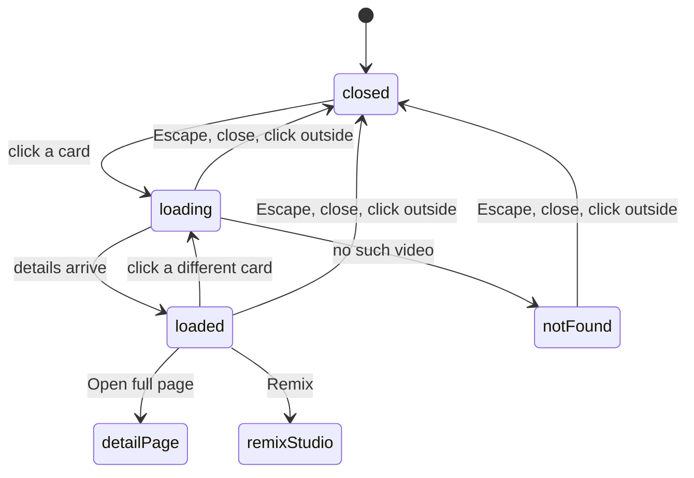

# The quick preview sheet

## Summary

The quick preview sheet is a lightweight look at one video without leaving the feed. Clicking a card in the [feed](feed.md) slides a panel in from the right edge of the screen, titled "Quick preview", holding the video's thumbnail, its channel and caption, its metrics, a short slice of the transcript, and two buttons: "Open full page" and "Remix". It is a read only view. Nothing here is saved, nothing is committed, and the sheet works whether or not the LLM proxy, the Graph API, or the sidecar are running, because everything it shows was already written to the database by an earlier sync or analysis. It is the fast version of the [video detail page](video-detail.md); "Open full page" is the link through to that full page, and "Remix" jumps straight into the remix studio for the same video.

## The simple case

The user is scanning the feed and wants a closer look at one card without committing to the full page. They click the card. A panel slides in from the right. For a moment it shows placeholder bars while the video's details load, then it fills in: the thumbnail with its outlier score, the channel handle, the caption, a row of view, like, and comment counts with how long ago the post went up, and the first few lines of the transcript. If the video has no transcript yet, that section says so and points at the full page. The user reads, then either clicks "Open full page" to see everything, clicks "Remix" to start remixing it, or dismisses the sheet with Escape, the close button, or a click on the dimmed feed behind it, and carries on scanning.

## The interaction, event by event

### Arrive

The sheet opens the moment a card is clicked, before any of the video's details are in hand. It slides in showing three placeholder bars where the thumbnail and text will go. Only then does it ask the server for this video's details. Nothing is prefilled or focused beyond the sheet's own default focus, and nothing about the video is fetched until the sheet opens, so browsing the feed with the sheet closed costs nothing.

> Technical note: the feed grid holds a single "which card is previewed" value. A card sets it to that card's id on click; the sheet is open whenever the value is not empty. The details are fetched lazily through a server read keyed to that id, so the feed page never loads transcripts for every visible card up front.

### Leave without acting

Escape, the close button in the sheet's corner, or a click on the dimmed area behind the sheet all close it. Nothing is recorded. Opening a preview does not add the video to recently viewed; only opening the full detail page does that. Closing during the brief load drops the in flight fetch cleanly, so a result that arrives late for a sheet the user already closed is discarded rather than shown.

### Begin acting

There is nothing to commit here, so "begin acting" means leaving the sheet forward rather than back: clicking "Open full page" or "Remix", or clicking a second card. The first two are navigations away from the feed. The third swaps the previewed video without closing the sheet.

### While acting

While the details load, the sheet shows placeholder bars. Clicking a different card while the sheet is open returns it to those placeholders and loads the new video; the sheet never flashes the previous video's details under the new card's heading, because it only shows details once they match the card currently open. Clicking a button navigates and the sheet unmounts with the page.

### Finish

Nothing is written. "Open full page" lands on the [video detail page](video-detail.md) for the same video, carrying the feed's active filter and sort so the detail page's previous and next navigation resolves against the same ordered set the sheet was opened from. "Remix" lands on the remix studio for the same video. Dismissing the sheet leaves the user exactly where they were in the feed.

## Variants

| Variant | Set on arrival | Changed while acting |
| --- | --- | --- |
| Record state (video analyzed, saved, present or removed) | The sheet shows the same content whether or not the video is analyzed or saved. A video the platform has removed still resolves and previews here, and unlike the card and the detail page the sheet shows no "no longer on the platform" flag for it. Only a video whose row is truly gone shows "This post couldn't be found." | No effect. The details are a snapshot taken when the sheet opened; a state change does not re-read them. |
| Attached data present or absent (transcript, analysis) | A transcript shows as a four line excerpt under a "Transcript" heading. No transcript shows "No transcript yet, open the full page to transcribe." Whether the video is analyzed makes no visible difference; the analysis is not shown in the sheet. | No effect. Adding a transcript elsewhere does not update an open sheet. |
| External service availability (LLM proxy, Graph, sidecar) | No effect. The read needs none of them; it returns whatever was already stored. | No effect. |
| Keyboard shortcut in play | Escape closes the sheet. A card is opened by click or by Enter or Space on its thumbnail. There is no arrow key navigation inside the sheet. | No effect. |

## Cancel and interrupt

| Event | Before commit (sheet open) | While in flight (details loading) |
| --- | --- | --- |
| Explicit cancel or stop | Escape, the close button, or a click outside closes the sheet. There is nothing committed to discard. | Same. Closing drops the pending fetch; a late result is ignored. |
| Navigate away mid action | A sidebar link, or the "Open full page" or "Remix" button, navigates away and the sheet goes with the page. Browser back returns to the feed with the sheet closed. Nothing is lost, since nothing was held. | Same. The navigation wins; the pending fetch is abandoned. |
| Reload or tab or window closed | The open sheet is client only state and is not in the URL, so a reload returns to the feed with no sheet open. Nothing is lost. | Same. |
| A backing service fails mid action | No external service is used. | If the server read itself errors, the sheet stays on its placeholder bars rather than showing the not found message, because a failed fetch is not distinguished from one still in flight. See open questions. |
| The target record changes underneath | A sync that removes the video while the sheet is open does not change what the open sheet shows; it is a snapshot. Opening the sheet after a removal still previews the video, since a removed row is still resolvable by id. | Same. A record change mid fetch is not detected. |
| A background job finishes or fails on its own | No effect. The sheet does not watch runs or renders. | No effect. |
| A second tab or a double action on the same record | A second tab is independent. Opening a second card in the same tab replaces the previewed video and reloads. A double click on the same card re-opens the same video. | Opening another card mid load switches to loading the new one; the earlier fetch's result is dropped if it lands after. |

After any interrupt the user is either still in the feed or on the page they navigated to. Nothing is half written, because nothing is written at all.

## Interactions with other systems

**Persistence and autosave.** Nothing is saved. The previewed video is transient client state, not stored and not in the URL, so it does not survive a reload and cannot be linked to. The sheet does not record the video in recently viewed; that belongs to the full detail page.

**History and undo.** There is nothing to undo. Opening and closing the sheet does not change the URL and is not a browser history entry, so browser back does not close the sheet, it leaves the feed.

**Navigation and refresh.** The sheet never calls a refresh, because it writes nothing. Its two buttons are plain links. Both carry the feed's active filter and sort as a query suffix so the full page lands on the same filtered, ordered set; on the remix link the suffix rides along but the remix page ignores it today. See [navigation and shell](../foundations/navigation-and-shell.md) for the refresh and deep link model.

**Background jobs and the sidecar.** None are triggered. The videos the sheet previews were written by the [sidecar sync](../foundations/background-jobs.md); the sheet only reads a snapshot of one.

**External services.** None. Like the save to vault action, this is a path that needs neither the LLM proxy nor the Graph API nor a transcript provider; the transcript it shows was fetched earlier and stored.

**Status and failures.** A missing video shows an inline "This post couldn't be found." in place of the content. There is no toast; the sheet has no action to succeed or fail. A server read error is the one gap, and it leaves the placeholder bars up. See [status and failures](../cross-cutting/status-and-failures.md).

**Configuration and settings.** None. No setting changes this behavior.

## Edge cases

- Opening the sheet costs one server read per open; scrolling the feed with the sheet closed costs nothing, because the fetch is lazy and keyed to the opened card.
- Switching from one card to another without closing never shows the old video under the new heading. The sheet shows details only while they match the card currently open, so a slow fetch shows placeholders rather than stale content.
- The sheet shows the outlier score, channel, caption, counts, and a transcript excerpt, but not the analysis, the median baseline, the carousel slides, or the save and keep buttons. Those live on the [full detail page](video-detail.md), which is what "Open full page" is for.
- A platform removed video still previews, without the removed warning the card and the detail page show. The only truly empty case is a video whose row no longer exists.

## Open questions and verification

- Whether a failed server read leaves the sheet stuck on its placeholder bars was read from the code but not confirmed by hand. The fetch has no error branch, so a rejected read never resolves the placeholder state into either content or the not found message. This looks like a defect worth a live check and a triage entry.
- Whether closing the sheet mid load reliably drops the late result in the running product, rather than briefly flashing it, was read from the code but not confirmed by hand.
- Whether the "Remix" link's inert filter suffix ever causes a visible difference on the remix page needs a live check; the code says the remix route ignores those params today.

Verified against this repo commit `4f26fb9`.
