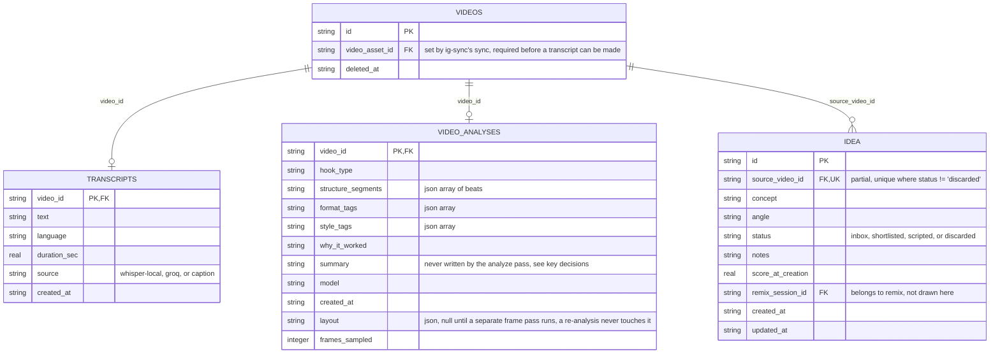
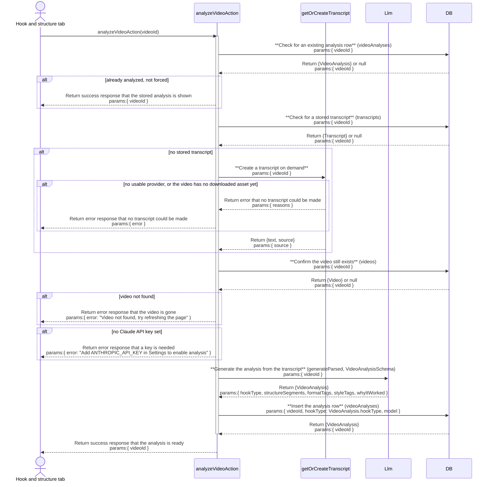

# analyze: architecture

`documents/architect/core-components/analyze/`

Status: shipped and in daily use, a Kit install completing a real analysis with a live Claude key has not been proven end to end.

## 1. Module structure

| File | Export | Role |
| --- | --- | --- |
| `src/components/video/video-detail.tsx` | `AnalysisGate`, `ReanalyzeButton`, `VideoDetail` (default export) | The video detail page. Holds the analyze gate, which picks one of four faces from `hasTranscript`, `hasKey`, and `canTranscribe`, the Re-analyze control by the Beats heading, and the Generate idea button in the action row. Pending state is plain component state, not a transition, so the disabled button is the only thing the wait blocks. |
| `src/app/(shell)/feed/[videoId]/page.tsx` | `VideoDetailPage` (default), `generateMetadata` | The server read that decides the gate's face. Resolves `hasLlmKey()` and `availableTranscriptProviders()` (folded into `canTranscribe`) and threads them, plus the detail read below, into `VideoDetail`. |
| `src/server/queries/video.ts` | `getVideoDetail`, `recordRecentlyViewed` | Assembles the video detail read: the video row, its transcript row (or null), and its analysis row (or null, via `rowToAnalysis`). `hasTranscript` on the page is `detail.transcript !== null`. |
| `src/server/actions/analyze-actions.ts` | `analyzeVideoAction`, `reanalyzeVideoAction` | Thin `"use server"` wrappers over `getOrCreateAnalysis` that translate errors into `{ ok, error }`. They carry no `code` field, unlike most core-loop actions, so the client branches on success or failure only, the open backlog item is B-17a in [backlog to enhance](05-backlog-to-enhance.md). `runFramePassAction` and `getFramePassJobAction` also live in this file but belong to the separate frame pass, not text analysis. |
| `src/server/services/analyze.ts` | `getOrCreateAnalysis`, `rowToAnalysis`, `StoredVideoAnalysis` | The real logic: cache lookup, on-demand transcription, the model call, and the write. Fully covered by `analyze.test.ts`. |
| `src/server/services/prompts/analyze-prompt.ts` | `ANALYZE_SYSTEM`, `buildAnalyzeUser` | The system and user prompts fed to the model for a text analysis pass. |
| `src/server/actions/idea-actions.ts` | `generateIdeaAction` | The `"use server"` wrapper over `generateIdea`. Unlike the analyze actions, it carries a `code` field on every failure (`IDEA_GENERATE_FAILED`, `IDEA_GENERATE_UNKNOWN`). `setIdeaStatusAction`, `createScriptFromIdeaAction`, and `setIdeaNotesAction` also live in this file but belong to the ideas inbox, out of scope for this repo. |
| `src/server/services/ideas.ts` | `generateIdea`, `generateIdeasForNewOutliers` | `generateIdea` reads a video's `video_analyses` row and the single persona, asks the model, and upserts the `idea` row keyed on `sourceVideoId`; it never throws. `generateIdeasForNewOutliers` is the sync's automatic idea pass over a channel's already-analyzed outliers, capped at 20. |
| `src/server/services/auto-analyze.ts` | `autoAnalyzeNewOutliers`, `AUTO_ANALYZE_CAP` | The sync's automatic analyze pass: downloads (if needed) then analyzes a channel's top unanalyzed outliers, capped at 10 (`AUTO_ANALYZE_CAP`). Never throws. |
| `src/server/services/outlier-calc.ts` | `OUTLIER_IDEA_THRESHOLD` | The outlier score (3) both automatic passes gate candidates on. |
| `src/server/llm/schemas.ts` | `VideoAnalysisSchema`, `IdeaSchema`, `StoredAnalysisFields`, `StoredStructureSegment` | `VideoAnalysisSchema` is validated 1:1 against what the text model returns; `IdeaSchema` is `concept` plus `angle`. |
| `src/server/llm/client.ts` | `getLlm`, `resolveModel`, `hasLlmKey`, `NoApiKeyError` | The [llm layer](../llm/01-concept-brief.md) analyze and Generate idea reach the model through. |
| `src/server/transcribe/index.ts` | `getOrCreateTranscript`, `availableTranscriptProviders`, `NoTranscriptProviderError`, `VideoNotDownloadedError` | The cache-first whisper.cpp then Groq chain. `getOrCreateTranscript` throws `VideoNotDownloadedError` when the video has no locally downloaded video asset yet, there is deliberately no remote-URL fallback. |
| `src/server/db/schema.ts` | `transcripts`, `videoAnalyses`, `idea` | `transcripts` and `video_analyses` are one row per video, keyed on `video_id`; `idea` is one row per generated idea, uniqueness enforced by the partial index `idea_source_active`. |

## 2. ER diagram

`video_analyses` carries three more frame-pass provenance columns not shown above, `frame_model`, `frame_pass_at`, and `frame_pass_error`, all owned by the separate frame pass, not by analyze; they are trimmed here to keep the diagram focused on the columns analyze itself writes. `idea.status` has a plain index (`idea_status`) with no erDiagram attribute marker, see indexes below.

## 3. Indexes

| Table | Index | Notes |
| --- | --- | --- |
| idea | idea_status | Plain index on `status`; backs the ideas inbox filtering by inbox, shortlisted, scripted, or discarded, a screen out of scope for this repo. |
| idea | idea_source_active | Partial unique on `source_video_id` where `status != 'discarded'`; the database-level backstop for "at most one non-discarded idea per video". `generateIdea` still does a select-then-update upsert rather than relying on it, because a partial index is not a target `onConflictDoUpdate` can name. |

`transcripts` and `video_analyses` carry no indexes beyond their primary key (`video_id` itself), which doubles as the foreign key into `videos` and the cache key `getOrCreateTranscript` and `getOrCreateAnalysis` both look up by.

## 4. Data flow

**The read.** The detail page reads four facts on the server, does the video have an analysis, does it have a transcript, is the Claude key set, is a transcript provider reachable right now, and `AnalysisGate` picks its face from them. An already-analyzed video shows the result and the Re-analyze control instead of a gate.

**Analyze.** A click runs `analyzeVideoAction`, which calls `getOrCreateAnalysis(videoId)`. A cache hit returns the stored text fields without touching the transcript or the model. On a miss it reads the stored transcript or, if there is none, calls `getOrCreateTranscript` (cache-first whisper.cpp then Groq); that call needs the video's own downloaded video asset and throws `VideoNotDownloadedError` when it is not there, a distinct failure from `NoTranscriptProviderError` (neither provider usable). Once a transcript is in hand, the client is resolved with `getLlm()` (which throws `NoApiKeyError` when unkeyed) and `generateParsed` is called against `VideoAnalysisSchema`. The parsed text fields plus `resolveModel()` are inserted as one `video_analyses` row, there is no partial write. On success the action returns `{ ok: true }`, the client toasts and calls `router.refresh()`; on failure `errorMessage` maps `NoApiKeyError`, `NoTranscriptProviderError`, `VideoNotDownloadedError`, and the SDK's typed errors to a string toast, and nothing is written. Because `canTranscribe` is computed from provider availability alone, not from whether this particular video's asset has downloaded, the gate can offer a live "Transcribe & Analyze" button on a video whose asset is not yet local, in which case the click still fails, with `VideoNotDownloadedError`'s own message surfacing as the toast.

**Re-analyze.** `reanalyzeVideoAction` calls `getOrCreateAnalysis(videoId, { force: true })`, which updates only the text columns (hook, structure, format, style, why) and leaves the layout columns, the frame-pass provenance, and `createdAt` alone, a text pass has seen no frames.

**Generate idea.** `generateIdeaAction` calls `generateIdea`, which reads the video's `video_analyses` row and the single persona, asks the model, and upserts one `idea` row keyed on `sourceVideoId`. It rewrites only an untouched `inbox` idea; a shortlisted or scripted one is left as the user left it. `generateIdea` never throws, a bad reply comes back as `{ id: "", created: false }`, so the same call is safe to run per outlier in the sync's automatic pass.

**The sync's automatic passes.** Near the end of every channel's sync, `sync-engine.ts` calls `autoAnalyzeNewOutliers` then `generateIdeasForNewOutliers`, in that order and never awaited around a throw, because neither function ever throws on its own account. `autoAnalyzeNewOutliers` selects the channel's unanalyzed outliers at or above `OUTLIER_IDEA_THRESHOLD`, top-scorers-first, capped at `AUTO_ANALYZE_CAP` (10), downloads a video asset when one is not yet local, then calls `getOrCreateAnalysis`. `generateIdeasForNewOutliers` runs afterward over the channel's already-analyzed outliers at or above the same threshold, capped at 20, and calls `generateIdea` per candidate, this ordering is why an outlier can gain both an analysis and an idea in the same sync run.

## 5. Sequence: one analyze pass

This is the primary, unanalyzed-video pass. A re-analysis follows the same shape but skips the first cache-hit check by design (`force: true`) and updates the existing row's text columns instead of inserting a new one; the layout columns are never touched, matching the decision below. Generate idea is a separate pass, over the `idea` table, not shown here.

## 6. Key decisions

- **Layout is not analysis.** `StoredVideoAnalysis` is a strict superset of the text model's `VideoAnalysis`; the layout columns are written only by a separate frame pass with its own model and timestamp. `getOrCreateAnalysis` returns the plain text shape, and a re-analysis never touches layout, so a text pass can never misattribute a frame reading it did not do.
- **Cache-first, on-demand, keyed by video id.** The one row per video is the cache; a hit skips the transcript chain and the model entirely. Transcription is created on demand only on a miss, so a freshly synced and downloaded video is analyzable without a separate transcribe step.
- **Analyze actions omit the `code` field.** Unlike most core-loop actions, `analyzeVideoAction` and `reanalyzeVideoAction` return only `{ ok, error }`, so a failure surfaces as a raw string toast the client cannot tell apart, carried as open item B-17a in [backlog to enhance](05-backlog-to-enhance.md). `generateIdeaAction`, by contrast, does carry a `code` field (`IDEA_GENERATE_FAILED`, `IDEA_GENERATE_UNKNOWN`) on every failure.
- **A missing downloaded video asset is a distinct failure from a missing transcript provider.** `getOrCreateTranscript` throws `VideoNotDownloadedError`, not `NoTranscriptProviderError`, when `videos.videoAssetId` is null; there is deliberately no remote-URL fallback, so a caller can never get an empty transcript for a video sync has not downloaded bytes for yet.
- **The `video_analyses.summary` column is never written by the analyze pass.** Confirmed at the data level, filed as B-10 in [feed's backlog to enhance](../feed/05-backlog-to-enhance.md), where the summary's rendering also lives.
- **One idea per video, enforced in the database.** The `idea_source_active` partial index is the backstop; the service does a select-then-update upsert because that partial index is not a target `onConflictDoUpdate` can name.

## 7. Open, not verified

Per [packaging and release](../../shared/packaging-and-release.md), a Kit install has not been proven to complete a real AI analysis with real credentials, and the no-proxy LLM path (hitting the Anthropic API directly, no local router) is unverified end to end.
