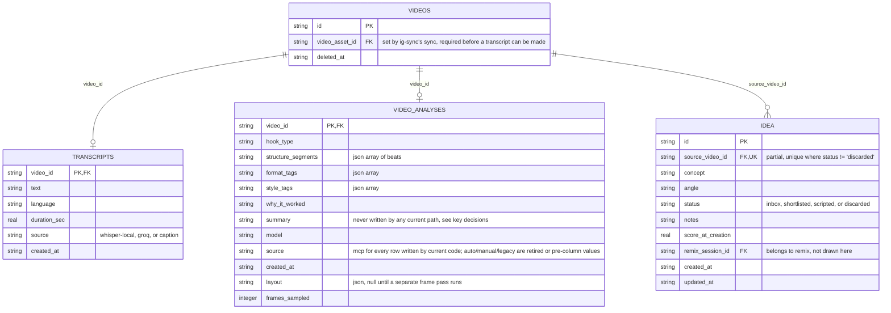
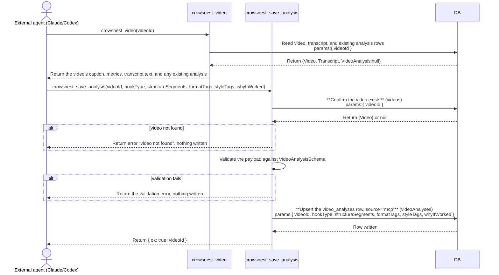

# analyze: architecture

`documents/architect/core-components/analyze/`

Status: shipped and in daily use. Analysis is authored only by an external agent (Claude or Codex) through MCP; there is no internal-model analyze path and no `ANTHROPIC_API_KEY` requirement anywhere in this component (P0 slice 2a). Generate idea is unaffected by that retirement and still needs a Claude key.

## 1. Module structure

| File | Export | Role |
| --- | --- | --- |
| `src/components/video/video-detail.tsx` | `VideoDetail` (default export) | The video detail page. Renders the stored analysis (Hook and structure tab, Why it worked tab) when `detail.analysis` is present, or a plain "No analysis yet" placeholder when it is not. There is no Analyze/Re-analyze button on this page; nothing here calls a model. |
| `src/app/(shell)/feed/[videoId]/page.tsx` | `VideoDetailPage` (default), `generateMetadata` | The server read for the detail page. Reads the video, its transcript, and its analysis (all through `getVideoDetail`) and threads them into `VideoDetail`. |
| `src/server/queries/video.ts` | `getVideoDetail`, `recordRecentlyViewed` | Assembles the video detail read: the video row, its transcript row (or null), and its analysis row (or null, via `rowToAnalysis`). |
| `src/server/services/analyze.ts` | `saveAgentAnalysis`, `rowToAnalysis`, `StoredVideoAnalysis` | The whole of analyze's write path. `saveAgentAnalysis` validates an agent-authored analysis against `VideoAnalysisSchema` and upserts the `video_analyses` row stamped `source: "mcp"`; it never touches the LLM client, `getLlm`, or any model call. `rowToAnalysis` is the shared row-to-shape mapping remix.ts and the `crowsnest_video` MCP tool both read through. |
| `src/server/mcp/mcp-server.ts` | `crowsnest_save_analysis`, `crowsnest_video` | The MCP surface. `crowsnest_save_analysis` is the only way a new analysis is written; it wraps `saveAgentAnalysis` and validates against the same `VideoAnalysisSchema` the retired in-app path used. `crowsnest_video` reads one video's full detail, analysis and transcript text included, for the agent to ground its authoring in. |
| `src/server/actions/idea-actions.ts` | `generateIdeaAction` | The `"use server"` wrapper over `generateIdea`. Carries a `code` field on every failure (`IDEA_GENERATE_FAILED`, `IDEA_GENERATE_UNKNOWN`). `setIdeaStatusAction`, `createScriptFromIdeaAction`, and `setIdeaNotesAction` also live in this file but belong to the ideas inbox, out of scope for this repo. |
| `src/server/services/ideas.ts` | `generateIdea`, `generateIdeasForNewOutliers` | Unchanged by the analyze retirement, still key-gated. `generateIdea` reads a video's `video_analyses` row (however it was written, agent or otherwise) and the single persona, asks the model, and upserts the `idea` row keyed on `sourceVideoId`; it never throws. `generateIdeasForNewOutliers` is the sync's automatic idea pass over a channel's already-analyzed outliers, capped at 20; since the in-app auto-analyze pass is retired, an outlier only reaches this inner join once an external agent has analyzed it through MCP. |
| `src/server/services/outlier-calc.ts` | `OUTLIER_IDEA_THRESHOLD` | The outlier score (3) the ideas pass gates candidates on. |
| `src/server/llm/schemas.ts` | `VideoAnalysisSchema`, `IdeaSchema`, `StoredAnalysisFields`, `StoredStructureSegment` | `VideoAnalysisSchema` is the validation contract both `saveAgentAnalysis` and `crowsnest_save_analysis` check an agent's analysis against; `IdeaSchema` is `concept` plus `angle`, still used by Generate idea's model call. |
| `src/server/llm/client.ts` | `getLlm`, `resolveModel`, `hasLlmKey`, `NoApiKeyError` | The [llm layer](../llm/01-concept-brief.md) Generate idea reaches the model through. No longer imported anywhere in `analyze.ts` or the analyze actions. |
| `src/server/transcribe/index.ts` | `getOrCreateTranscript`, `availableTranscriptProviders`, `NoTranscriptProviderError`, `VideoNotDownloadedError` | The cache-first whisper.cpp then Groq chain. Nothing in the analyze component itself calls it, but the mcp component's `crowsnest_transcribe` tool now does, on demand (after downloading the video), so a transcript can be produced for a video that has none. A transcript reaches `video_analyses`/`crowsnest_video` either from that call or from a `transcripts` row written earlier. |
| `src/server/db/schema.ts` | `transcripts`, `videoAnalyses`, `idea` | `transcripts` and `video_analyses` are one row per video, keyed on `video_id`; `idea` is one row per generated idea, uniqueness enforced by the partial index `idea_source_active`. |

## 2. ER diagram

`video_analyses` carries three more frame-pass provenance columns not shown above, `frame_model`, `frame_pass_at`, and `frame_pass_error`, all owned by the separate frame pass, not by analyze; they are trimmed here to keep the diagram focused on the columns analyze itself writes. `idea.status` has a plain index (`idea_status`) with no erDiagram attribute marker, see indexes below.

## 3. Indexes

| Table | Index | Notes |
| --- | --- | --- |
| idea | idea_status | Plain index on `status`; backs the ideas inbox filtering by inbox, shortlisted, scripted, or discarded, a screen out of scope for this repo. |
| idea | idea_source_active | Partial unique on `source_video_id` where `status != 'discarded'`; the database-level backstop for "at most one non-discarded idea per video". `generateIdea` still does a select-then-update upsert rather than relying on it, because a partial index is not a target `onConflictDoUpdate` can name. |

`transcripts` and `video_analyses` carry no indexes beyond their primary key (`video_id` itself), which doubles as the foreign key into `videos` and the cache key `getOrCreateTranscript` and `saveAgentAnalysis` both look up by.

## 4. Data flow

**The read.** `getVideoDetail` reads the video row, its transcript row (or null), and its analysis row (or null, via `rowToAnalysis`) and hands all three to `VideoDetail`. When `detail.analysis` is present, the Hook and structure and Why it worked tabs render it; when it is not, both tabs render a plain "No analysis yet" placeholder. There is no gate logic, no key check, and no button.

**Write, through MCP.** An external agent (Claude Code, Codex, or any MCP-speaking client connected to crowsnest) calls `crowsnest_video` to read a video's caption, metrics, and full transcript text, forms its own read of the hook, beats, format, style, and why-it-worked, then calls `crowsnest_save_analysis` with those fields. The tool wraps `saveAgentAnalysis`, which validates the payload against `VideoAnalysisSchema` (the identical schema the retired in-app model call used), and either upserts the `video_analyses` row stamped `source: "mcp"` or returns `{ ok: false, error }` without writing anything on a validation failure or an unknown video id. Calling it again for the same video updates the existing row in place. Nothing in this path resolves an LLM client, checks for `ANTHROPIC_API_KEY`, or can throw `NoApiKeyError`; the whole pass is deterministic reads and writes plus one schema check.

**Generate idea.** Unchanged. `generateIdeaAction` calls `generateIdea`, which reads the video's `video_analyses` row (however it was written) and the single persona, asks the model, and upserts one `idea` row keyed on `sourceVideoId`. It rewrites only an untouched `inbox` idea; a shortlisted or scripted one is left as the user left it. `generateIdea` never throws, a bad reply comes back as `{ id: "", created: false }`.

**The sync's automatic idea pass.** Near the end of every channel's sync, `sync-engine.ts` no longer calls an in-app auto-analyze pass; that pass (`auto-analyze.ts`) is retired. `generateIdeasForNewOutliers` itself is untouched and still runs from an explicit call (an on-demand job, not sync's own tail), over the channel's already-analyzed outliers at or above `OUTLIER_IDEA_THRESHOLD`, capped at 20; since nothing in-app writes an analysis anymore, only outliers an agent has already analyzed through MCP are visible to it.

## 5. Sequence: an agent authors an analysis through MCP

A second call for the same video updates the row in place; there is no separate re-analyze path, the agent simply calls `crowsnest_save_analysis` again with a fresh reading.

## 6. Key decisions

- **Analysis is authored only by an external agent, never in-app.** P0 slice 2a removed `getOrCreateAnalysis`, `analyzeVideoAction`, `reanalyzeVideoAction`, and the in-app auto-analyze pass (`auto-analyze.ts`). Crowsnest needs no `ANTHROPIC_API_KEY` to have video analyses; `crowsnest_save_analysis` is the only write path for new rows.
- **Layout is not analysis.** `StoredVideoAnalysis` is a strict superset of the text model's `VideoAnalysis`; the layout columns are written only by a separate frame pass with its own model and timestamp, untouched by this retirement.
- **Same validation contract, different author.** `saveAgentAnalysis` and `crowsnest_save_analysis` validate against the exact `VideoAnalysisSchema` the retired in-app model call validated against, so a `video_analyses` row looks identical downstream (Remix, the detail page, `rowToAnalysis`) regardless of who authored it.
- **`crowsnest_video` carries the raw transcript text.** So an agent has everything it needs to author a grounded analysis in one read, without a second tool call: caption, metrics, the full transcript text (via `getVideoDetail`, which already read the `transcripts` table), and any existing analysis.
- **The `video_analyses.summary` column is still never written.** Confirmed at the data level, filed as B-10 in [feed's backlog to enhance](../feed/05-backlog-to-enhance.md), where the summary's rendering also lives.
- **One idea per video, enforced in the database.** Unchanged. The `idea_source_active` partial index is the backstop; the service does a select-then-update upsert because that partial index is not a target `onConflictDoUpdate` can name.

## 7. Open, not verified

Per [packaging and release](../../shared/packaging-and-release.md), a Kit install has not been proven to complete a real Generate idea call with real credentials; that feature still needs the Claude key. The keyless analyze path introduced in this slice needs no such proof, since it never touches a model or a key.
