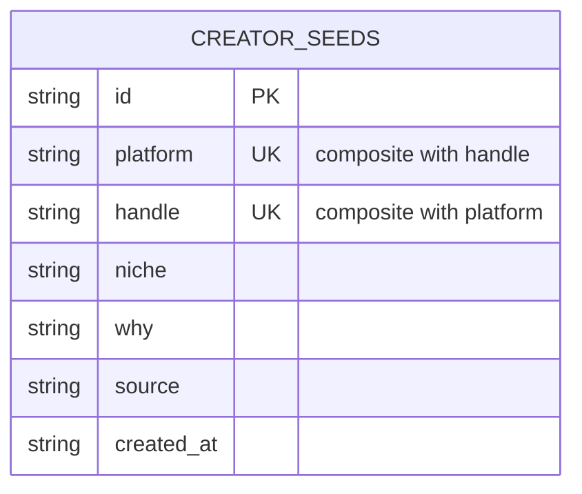
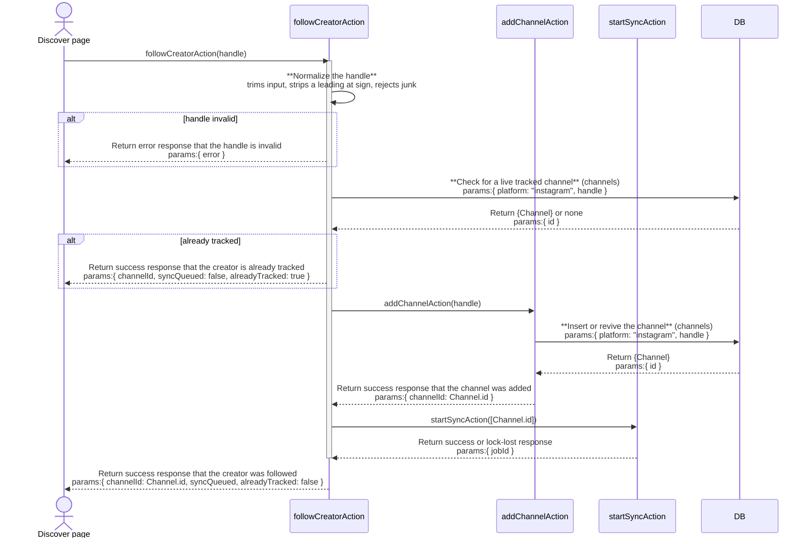
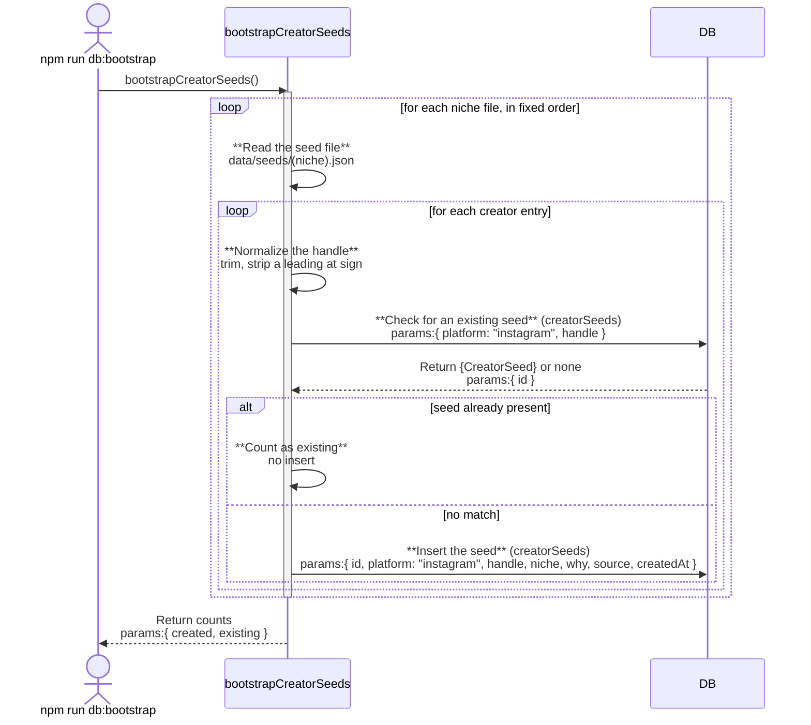

# discover: architecture

`documents/architect/core-components/discover/`

Status: the discover page is shipped and reachable from the nav. The seed picker drop-in is
mounted in the first-run sources step, so a fresh install can follow curated creators before
its first sync.

## 1. Module structure

| File | Export | Role |
| --- | --- | --- |
| `src/server/db/schema.ts` | `creatorSeeds` | The table: `id`, `platform` (default `"instagram"`), `handle`, `niche`, `why`, `source`, `createdAt`; unique index on `(platform, handle)`. |
| `drizzle/0022_cloudy_the_hand.sql` | (migration) | Creates `creator_seeds` and its unique index. |
| `data/seeds/fitness.json`, `finance.json`, `tech.json`, `business.json` | (seed content) | One file per niche, `{ niche, label, creators: [{ handle, why, source }] }`. 118 creators total across the four files (30 fitness, 28 finance, 30 tech, 30 business). |
| `data/seeds/README.md` | (doc) | The curation contract: `why` must describe content style or expertise, never a metric; documents a `scripts/verify-seeds.ts` pre-commit handle check that is not present in this repo today. |
| `src/server/db/bootstrap.ts` | `bootstrapCreatorSeeds` | Reads the four seed files in a fixed order (`SEED_NICHES`, not globbed), trims each handle and strips a leading `@`, inserts one row per creator keyed on `(platform, handle)`. Idempotent: re-running never duplicates a row. Invoked from `npm run db:bootstrap` alongside `bootstrapSystemFilters`. |
| `src/server/queries/discover.ts` | `listCreatorSeeds`, `CreatorSeedRow` | Left-joins `creatorSeeds` to `channels` (matched on `platform = "instagram"`, `handle`, `deletedAt IS NULL`) to compute a `tracked` boolean per seed. Accepts an optional `niche` filter; orders by niche then handle, both ascending. |
| `src/server/actions/discover-actions.ts` | `followCreatorAction` | One-click follow: normalizes the handle (`normalizeHandle`), checks for an existing live `channels` row, and if none exists calls `addChannelAction` then `startSyncAction`. Idempotent: an already-tracked handle is a no-op reporting `alreadyTracked: true`. |
| `src/app/(shell)/channels/discover/page.tsx` | `DiscoverPage` (default) | `force-dynamic` route at `/channels/discover`. Awaits `listCreatorSeeds()` with no niche filter and renders `DiscoverBoard`. |
| `src/components/discover/discover-board.tsx` | `DiscoverBoard` | Client niche tabs (All, fitness, finance, tech, business) that filter the already-fetched seed list in memory; one `CreatorSeedCard` per visible seed. |
| `src/components/discover/creator-seed-card.tsx` | `CreatorSeedCard` | One card: handle, niche badge, `why`, and a Follow button cycling `idle` → `pending` → `tracked`. |
| `src/components/discover/seed-picker.tsx` | `SeedPicker` | A self-contained multi-select variant: checkbox rows, a `maxSelect` cap (default 10), and a single "Follow selected" button that calls `followCreatorAction` once per checked handle. Not imported by any route. |
| `src/components/layout/nav-items.ts` | `NAV_ITEMS` | Adds the Discover entry (`Compass` icon, `Sources` group, `/channels/discover`) right after Channels. |

## 2. ER diagram

`CREATOR_SEEDS` carries no relationship line to `CHANNELS`. A seed's tracked status is
computed at read time by matching `platform` and `handle` in `listCreatorSeeds`'s join, not
by a foreign key; nothing in `creator_seeds` references `channels.id`, and nothing in
`channels` references a seed.

## 3. Indexes

| Table | Index | Notes |
| --- | --- | --- |
| creator_seeds | creator_seeds_platform_handle | Unique on `(platform, handle)`; the bootstrap loader's idempotency key and the read query's join key. |

## 4. Data flow

**Load.** `npm run db:bootstrap` runs `bootstrapCreatorSeeds` alongside
`bootstrapSystemFilters`. For each of the four fixed niches it reads
`data/seeds/<niche>.json`, and for each `{ handle, why, source }` entry it trims the handle
and strips a leading `@`, then checks for an existing row on `(platform: "instagram",
handle)`. A match increments `existing` and inserts nothing; no match inserts a new row with
a fresh id and `createdAt`. Filenames are fixed rather than globbed, so load order is
deterministic across runs.

**Read.** `DiscoverPage` awaits `listCreatorSeeds()` with no niche argument, so it always
fetches the full curated list. The query left-joins `creatorSeeds` to `channels` on
`platform`, `handle`, and `deletedAt IS NULL`, so a soft-deleted channel with the same
handle still reads as untracked rather than dropping the seed row from the join entirely (a
`WHERE` clause would have done the latter; the join predicate is deliberately used instead,
per the regression test in `discover.test.ts`). The result is ordered by niche then handle,
both ascending, and mapped to `CreatorSeedRow` with a `tracked` boolean.

**Filter.** `DiscoverBoard` holds the fetched list in memory and filters it client-side by
the selected niche tab; picking a tab is a `useMemo` recompute, not a new server read. The
query layer's own `niche` filter parameter exists and is exercised by
`discover.test.ts`, but the page never passes it, since the whole list is already on the
client.

**Follow.** `CreatorSeedCard`'s Follow button calls `followCreatorAction(seed.handle)`.
The action normalizes the handle, checks for a live `channels` row on the normalized handle,
and if one exists returns immediately with `alreadyTracked: true` and `syncQueued: false`,
touching nothing else. Otherwise it calls `addChannelAction` (which inserts or revives a
`channels` row) and then `startSyncAction` for that one channel id. `syncQueued` reflects
whether the sync actually won its lock; losing the lock to a sync already running elsewhere
is not treated as a failure of the follow itself.

## 5. Key decisions

- **Follow reuses the channel add and sync paths, not a parallel pipeline.** `followCreatorAction` calls the same `addChannelAction`/`startSyncAction` a manual "Add channel" click calls, mirroring the feed's own manual-import decision to reuse `importReelByUrl` rather than a second write path.
- **Idempotent at every layer.** The bootstrap loader is keyed on `(platform, handle)`; the follow action checks for a live channel before adding one. Re-running the bootstrap or re-following an already-tracked seed is always safe.
- **Tracked status is computed, not stored.** `creator_seeds` has no column recording whether a seed has been followed; `listCreatorSeeds`'s left join answers that question fresh on every read, so a seed's curated content and a user's follow state can never drift out of sync with each other.
- **Niche filtering is client-side.** `DiscoverBoard` fetches the whole list once and filters in memory; the query layer's `niche` parameter exists for callers that want a server-side filter (exercised only by tests today) but the shipped page does not use it.
- **The no-metrics rule for `why` is a curation-time contract, not a runtime check.** `data/seeds/README.md` states the rule; nothing in the schema or the write path enforces it against a bad seed row.

## 6. Sequence: following a discovered creator

An invalid handle and an already-tracked handle both short-circuit before `addChannelAction`
is ever called, so neither path writes a `channels` row or queues a sync.

## 7. Sequence: loading the curated seed list

## 8. Open, not verified

- **Whether `scripts/verify-seeds.ts` exists or runs.** `data/seeds/README.md` states handles
  are "verified against the sidecar by `scripts/verify-seeds.ts` before commit," but no such
  file exists in this repository today. Tracked in the [backlog](05-backlog-to-enhance.md).
- **Whether `SeedPicker` has ever been exercised against a real first-run flow.** It is
  covered by its own component test (`seed-picker.test.tsx`) with a mocked
  `followCreatorAction`, but nothing in the shipped app mounts it, so its behavior inside an
  actual first-run step is unverified.
