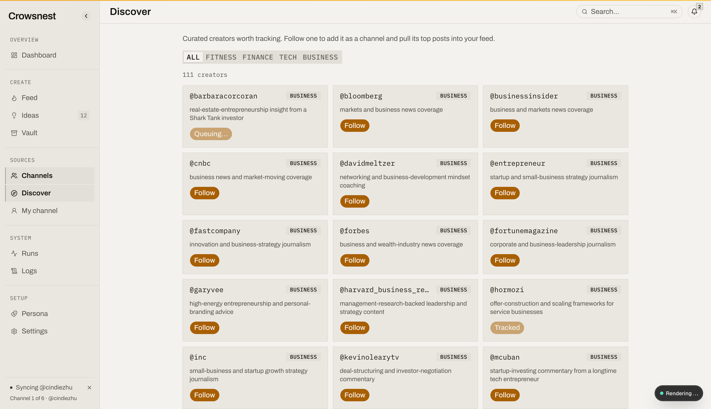

# discover: test cases

Result markers: 🟢 pass, 🔴 bug, 🟡 blocked (missing dependency named in the cell). Rows still reading "not run" were not driven in QA round 1.

How to run this file: start the dev server and open `http://localhost:3001` (never
`127.0.0.1`), on a database that has run `npm run db:bootstrap` at least once, so
`creator_seeds` holds the curated list (118 rows across fitness, finance, tech, and
business). Seed a mix for the tracked-state cases: leave most seeds untracked, and add one
seed's handle as a tracked channel (and separately, one as a soft-deleted channel) to check
the tracked and untracked-after-removal paths. The discover page needs no external service
to render; only Follow's queued sync reaches the Instagram sidecar, and the sync itself, not
the follow call, is what needs the sidecar reachable. Offline route and action tests run
with `vitest` against a temporary SQLite database, covering `listCreatorSeeds` and
`followCreatorAction` (`src/server/queries/discover.test.ts`,
`src/server/actions/discover-actions.test.ts`). Two more `vitest` files exercise the
component layer in jsdom, `creator-seed-card.test.tsx` and `seed-picker.test.tsx`. All four
files, 12 tests total, pass today. Browse-e2e cases are driven with
the `browse` skill against the running dev server, per `references/browse-e2e-qa.md`, using
the real `data-testid` values the shipped markup carries: `creator-seed-card` and
`creator-seed-follow` on the discover page's cards, `discover-niche-filter` on its niche tab
list.

## 1. behavior

### The discover page

| ID | P | Needs | Claim | Setup | Steps | Expected | Result |
| --- | --- | --- | --- | --- | --- | --- | --- |
| DISC-01 | P1 | mouse | The page opens on curated creator cards grouped under niche tabs ([the discover page](03-feature-description.md#2-the-discover-page)). | Bootstrapped `creator_seeds`. | 1. Open `/channels/discover`. 2. Read the tabs and count the cards. | All, Fitness, Finance, Tech, Business tabs are present; the All tab shows every seed as a card with a handle, niche badge, and why text. | not run |
| DISC-02 | P1 | mouse | The niche tabs filter the already-fetched list client-side, with no new server read ([the discover page](03-feature-description.md#2-the-discover-page)). | The discover page open on All. | 1. Click the Fitness tab. 2. Read the URL and the visible cards. | Only fitness-niche cards show; the URL is unchanged, no navigation or reload occurs. | not run |
| DISC-03 | P1 | mouse | Follow transitions Follow to Queuing… to Tracked, disabling the button throughout ([the discover page](03-feature-description.md#2-the-discover-page)). | An untracked seed's card. | 1. Click Follow, `data-testid="creator-seed-follow"`. 2. Watch the button through completion. | The button reads Queuing… and is disabled immediately, then Tracked and stays disabled once the follow resolves. | not run |
| DISC-04 | P1 | mouse | A seed already tracked renders Follow disabled and reading Tracked from first paint, with no click needed ([the discover page](03-feature-description.md#2-the-discover-page)). | A seed whose handle is already a live tracked channel. | 1. Open `/channels/discover`. 2. Find that seed's card. | The card's button reads Tracked and is disabled without any interaction. | not run |
| DISC-05 | P1 | sidecar reachable | Following a creator queues a channel-scoped sync through the same path a manual channel add uses ([the discover page](03-feature-description.md#2-the-discover-page)). | An untracked seed, sidecar running. | 1. Click Follow. 2. Check the channels board and the sync/runs surface for that channel. | The channel appears on `/channels`, tracked, with a sync queued or completed for it. | not run |
| DISC-06 | P2 | mouse | With `creator_seeds` empty, the page shows a message pointing at the bootstrap command instead of an empty grid ([the discover page](03-feature-description.md#2-the-discover-page)). | An empty `creator_seeds` table. | 1. Open `/channels/discover`. | A message naming `npm run db:bootstrap`, no bare empty grid. | not run |
| DISC-07 | P2 | mouse | A niche tab with no matching seeds shows "No creators in this niche" rather than an empty grid ([the discover page](03-feature-description.md#2-the-discover-page)). | A niche filtered down to zero seeds (data manipulation). | 1. Select that niche's tab. | The "No creators in this niche" message shows. | not run |
| DISC-08 | P2 | mouse | An invalid handle fails the follow with a toast and returns the button to idle Follow ([the discover page](03-feature-description.md#2-the-discover-page)). | A seed row whose handle has been edited in the database to something `normalizeHandle` rejects. | 1. Click Follow on that card. | A toast names the reason, and the button returns to the idle "Follow" label rather than staying on "Queuing…". | not run |
| DISC-09 | P3 | mouse | A card never shows a follower count, view count, or any other metric ([the discover page](03-feature-description.md#2-the-discover-page)). | Any card. | 1. Read the full text of a card. | Only the handle, the niche badge, and the why text; no number resembling a stat anywhere on the card. | not run |

Not checkable by hand:

- Whether the join-based tracked check ever drifts from the channels board's own tracked list under concurrent follows, a database-level race better suited to the route and action lens.

### The seed picker

`SeedPicker` has no route to open it from, so nothing here can be driven by mouse or
keyboard against the running app; each claim below is instead grounded in the component's
own jsdom test (`src/components/discover/seed-picker.test.tsx`), run directly against the
component rather than through a browser.

| ID | P | Needs | Claim | Setup | Steps | Expected | Result |
| --- | --- | --- | --- | --- | --- | --- | --- |
| DISC-10 | P2 | jsdom component test | The seed picker is mounted in the first-run sources step, and following a curated creator there is enough to continue with its channel id ([the seed picker](03-feature-description.md#3-the-seed-picker)). | `SourcesStep` with one seed, mocked `followCreatorAction` and `addChannelAction` resolving `ok: true`. | 1. Render `SourcesStep`, follow the seed, then click Continue. | Continue is enabled after the follow with no manual handle, and `onContinue` receives the seed's channel id. | pass (vitest, jsdom, not a browser run) |
| DISC-11 | P2 | jsdom component test | Selecting two seeds and clicking Follow selected calls `followCreatorAction` once per handle and reports only the succeeded channel ids ([the seed picker](03-feature-description.md#3-the-seed-picker)). | Two seeds, a mocked `followCreatorAction` resolving `ok: true` for both. | Render `SeedPicker`, check both rows, click `seed-picker-follow-selected`. | `followCreatorAction` is called with each handle; `onDone` is called with both resulting channel ids. | pass (vitest, jsdom, not a browser run) |
| DISC-12 | P2 | jsdom component test | With `maxSelect=10` and 11 seeds, an 11th selection is blocked and the button label caps at (10) ([the seed picker](03-feature-description.md#3-the-seed-picker)). | 11 unselected seeds, `maxSelect={10}`. | Check 10 rows, then attempt an 11th. | The 11th row stays unchecked and disabled; the follow button reads "(10)". | pass (vitest, jsdom, not a browser run) |

Not checkable by hand:

- Every seed-picker claim above, by a real mouse or keyboard, since there is no UI path to reach it; the jsdom component test is the only verification that exists today.

## 2. route and action

| ID | P | Layer | Claim | Setup | Call | Expected | Result |
| --- | --- | --- | --- | --- | --- | --- | --- |
| ACTION-01 | P1 | drizzle query (`src/server/queries/discover.ts :: listCreatorSeeds`) | A seed's `tracked` flag is true only when its handle has a live `channels` row, and the optional `niche` argument filters the result. | Temp SQLite db, two seeds (`alpha`/tech, `beta`/fitness), `alpha` also inserted as a live tracked channel. | `listCreatorSeeds({ niche: "tech" })`, then `listCreatorSeeds()`. | The niche-filtered call returns one row (`alpha`, `tracked: true`); the unfiltered call includes `beta` with `tracked: false`. | 🟢 covered by vitest (green) |
| ACTION-02 | P1 | drizzle query (`src/server/queries/discover.ts :: listCreatorSeeds`) | A seed whose matching channel is soft-deleted (`deletedAt` set) is still returned, with `tracked: false`, because the join predicate carries the `deletedAt` check rather than a `WHERE` clause. | A seed `gamma` and a soft-deleted channel with the same handle. | `listCreatorSeeds()`. | `gamma` is present in the result with `tracked: false`, not dropped from the list. | 🟢 covered by vitest (green) |
| ACTION-03 | P1 | drizzle query (`src/server/queries/discover.ts :: listCreatorSeeds`) | Results are ordered by niche ascending, then handle ascending. | Seeds `zed`/tech, `amy`/tech, `mid`/business. | `listCreatorSeeds()`. | Order is `[business/mid, tech/amy, tech/zed]`. | 🟢 covered by vitest (green) |
| ACTION-04 | P1 | server action (`src/server/actions/discover-actions.ts :: followCreatorAction`) | A new handle adds the channel and starts a channel-scoped sync. | Temp SQLite db, no existing channel for the handle; `addChannelAction`/`startSyncAction` mocked. | `followCreatorAction("newcreator")`. | `addChannelAction` is called with `"@newcreator"`; `startSyncAction` is called with `[channelId]`; returns `{ ok: true, channelId, syncQueued: true, alreadyTracked: false }`. | 🟢 covered by vitest (green) |
| ACTION-05 | P1 | server action (`src/server/actions/discover-actions.ts :: followCreatorAction`) | An already-tracked handle is a no-op: neither `addChannelAction` nor `startSyncAction` is called. | A live tracked channel for `@existing`. | `followCreatorAction("existing")`. | Returns `{ ok: true, channelId, syncQueued: false, alreadyTracked: true }`; neither helper action is called. | 🟢 covered by vitest (green) |
| ACTION-06 | P1 | server action (`src/server/actions/discover-actions.ts :: followCreatorAction`) | A new handle whose sync loses the lock still reports success, with `syncQueued: false`. | `addChannelAction` resolves ok; `startSyncAction` resolves `{ ok: false, code: "SYNC_ALREADY_RUNNING" }`. | `followCreatorAction("busycreator")`. | Returns `{ ok: true, channelId, syncQueued: false, alreadyTracked: false }`, not an error. | 🟢 covered by vitest (green) |
| ACTION-07 | P1 | server action (`src/server/actions/discover-actions.ts :: followCreatorAction`) | A junk handle fails before touching `addChannelAction` or `startSyncAction`. | No setup needed. | `followCreatorAction("has spaces")`. | Returns `{ ok: false, ... }`; neither helper action is called. | 🟢 covered by vitest (green) |

Not checkable by hand:

- The real `addChannel`/`startSyncAction` round trip against a live sidecar; the rows above exercise `followCreatorAction`'s own branching with those two calls mocked, not the sidecar request itself.
- The `CreatorSeedCard` and `SeedPicker` component tests are jsdom-rendered, not a drizzle query, server action, or API route, so their claims are grounded in the behavior lens above instead of here.

## 3. browse-e2e

| ID | P | Journey | Claim | Setup | Steps | Expected | Result |
| --- | --- | --- | --- | --- | --- | --- | --- |
| E2E-01 | P1 | Discover a creator, follow, find it tracked | Following a creator from the discover page, through the real UI, results in a tracked channel visible on the channels board ([the discover page](03-feature-description.md#2-the-discover-page)). | Dev server up, bootstrapped `creator_seeds`, sidecar reachable, one untracked seed known by handle. | 1. Open `/channels/discover`. 2. Click that niche's tab in the tab list, `data-testid="discover-niche-filter"`. 3. Find the seed's card, `data-testid="creator-seed-card"`. 4. Click Follow on it, `data-testid="creator-seed-follow"`. 5. Wait for the button to read Tracked. 6. Open `/channels` and search for the handle. | After step 5 the button reads Tracked and stays disabled; after step 6 the channel appears on the channels board, tracked. | 🟢  followed @barbaracorcoran from a seed card; button flipped to Tracked, a channels row was created and now shows on the /channels board (a live sync of it still needs the sidecar) |

## 4. security-lite

Discover reaches no external service of its own on render; the niche tabs and the card grid
read only the local database. Follow's one outbound effect is the sync it queues through
`startSyncAction`, the same channel-scoped sync any manual "Add channel" already triggers,
covered by that component's own security-lite surface rather than duplicated here.

| ID | P | Threat | Claim | Setup | Steps | Expected | Result |
| --- | --- | --- | --- | --- | --- | --- | --- |
| SEC-01 | P2 | No buyer data leaving the box | Following a seed sends only the handle to the add-channel and sync paths; no seed content (`why`, `source`) or other stored row leaves the box as part of a follow. | A seed with populated `why` and `source` fields. | 1. Follow that seed while inspecting the calls `followCreatorAction` makes to `addChannelAction` and `startSyncAction`. | Both calls carry only the handle (and, for the sync, the resulting channel id); `why` and `source` are never passed along. | not run |

Security-lite has no rows for secret handling or a license gate: discover reads and writes
only the local database and calls no service directly of its own. The sidecar shared token
is the sync queue's concern, not discover's; see the feed and ig-sync components' own
security-lite sections for that surface.
