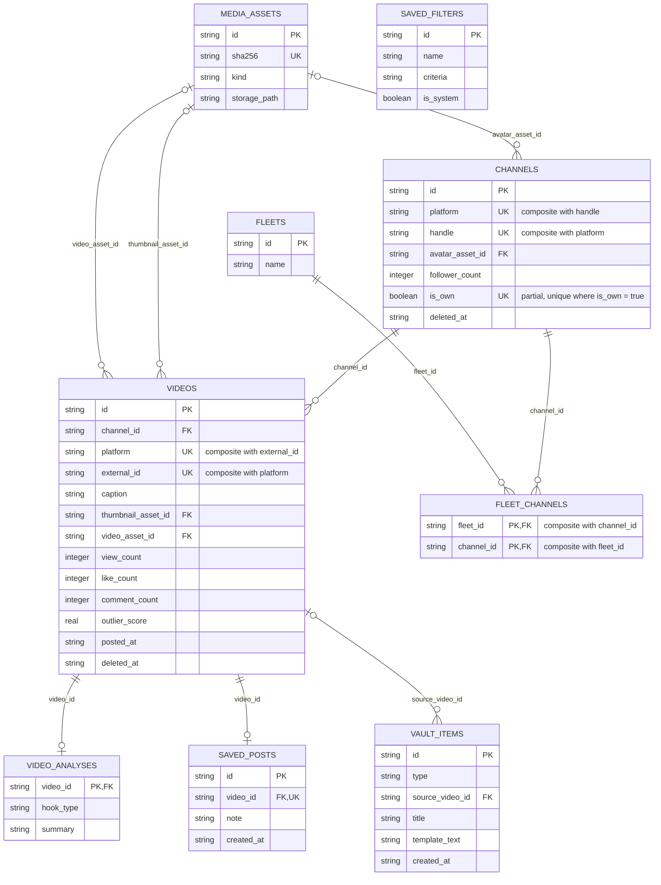
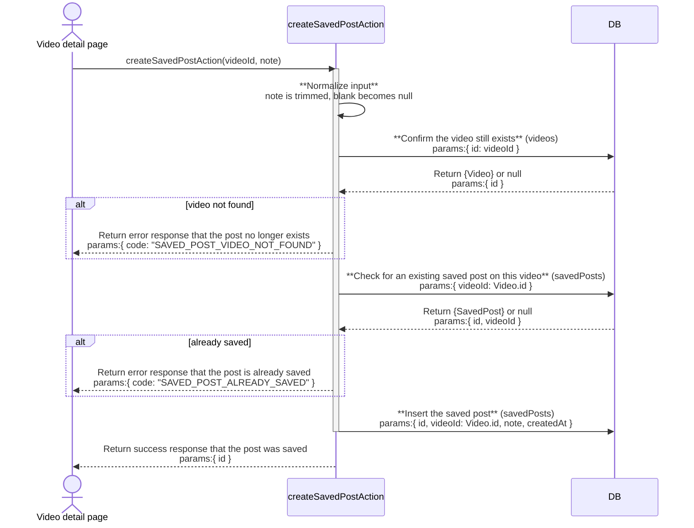
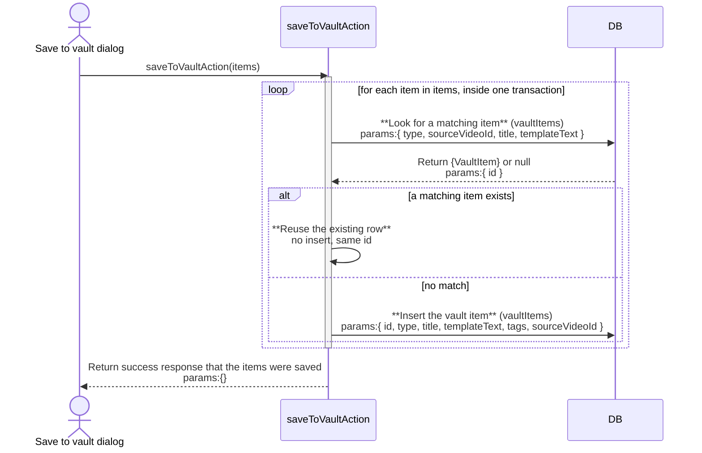
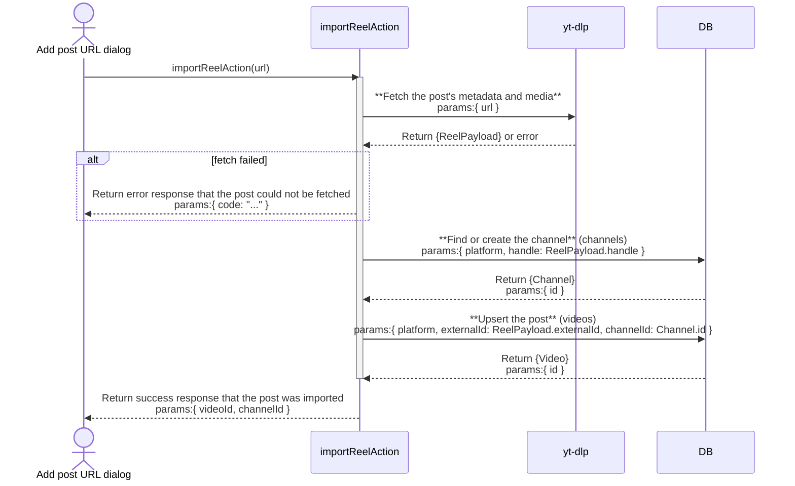

# feed: architecture

`documents/architect/core-components/feed/`

Status: shipped and in daily use.

## 1. Module structure

| File | Export | Role |
| --- | --- | --- |
| `src/app/(shell)/feed/(list)/page.tsx` | `FeedPage` (default) | The feed page itself, an async server component. Resolves the slice from `searchParams`, decides whether to apply the default view, runs the page of videos and the band counts in parallel, and renders one of four empty states or the grid plus Load more. |
| `src/app/(shell)/feed/(list)/loading.tsx` | (default) | The route's loading skeleton, shown while the server component renders. Lives in a `(list)` route group (no URL change) with the page above, so its Suspense boundary does not also wrap the sibling `[videoId]` route: that route's own `notFound()` used to always suspend into this boundary first and commit HTTP 200 before the throw could run. |
| `src/lib/feed-filters.ts` | `FILTER_PARAM_KEYS`, `ORDER_PARAM_KEYS`, `FOLLOWER_BANDS`, `first`, `num`, `bandOrAny`, `numOrAny`, `minEngOrAny`, `analyzedOrAny`, `isFeedEmpty`, `shouldApplyDefaultView`, `resolveFeedCriteria`, `filterQuerySuffix`, `searchParamsFromEntries`, `resolveChipValue`, `currentViewCriteria` | The pure `searchParams` to criteria layer, imported by both the server page and the client filter bar so "a filter param is present" has one definition. `filterQuerySuffix` is the query suffix a card forwards into detail or remix. |
| `src/server/queries/feed.ts` | `getOutlierFeed`, `getFeedBandCounts`, `getSavedFilters`, `feedItemColumns`, `toFeedItem`, types `FeedFilters`/`FeedItem`/`FeedBandCounts`/`SavedFilterRow` | The DB layer. `getOutlierFeed` returns the page of items plus the true slice total; `getFeedBandCounts` computes each follower band under every other active filter; `feedItemColumns`/`toFeedItem` derive `engagementRate` and the `deleted` flag once, so the card and the detail page never compute two different numbers. |
| `src/server/queries/preview-action.ts` | `getVideoPreviewAction` | The lazy, id-keyed server action the quick preview sheet calls when a card is clicked; a thin wrapper over `getVideoDetail`, so the feed never loads transcripts for every card up front. |
| `src/server/queries/video.ts` | `getVideoDetail`, `recordRecentlyViewed` | The video detail page's server read (video, channel, transcript, analysis, carousel children, similar outliers, median baseline sample) and the fire-and-forget recently-viewed write, capped at eight ids (`RECENTLY_VIEWED_MAX`). |
| `src/app/(shell)/feed/[videoId]/page.tsx` | (default) | The video detail page. Renders `src/components/video/video-detail.tsx`. |
| `src/app/(shell)/feed/[videoId]/resolve-feed-nav.ts` | `resolveFeedNav`, `buildFeedFilters` | Resolves the previous/next neighbours and the "N of Total" label against the same filtered, ordered feed slice the card was opened from, capped at 5000 posts (`FEED_ORDER_LIMIT`). |
| `src/components/feed/` | `filter-bar.tsx`, `feed-grid.tsx`, `outlier-card.tsx`, `outlier-badge.tsx`, `feed-list-row.tsx`, `quick-preview-sheet.tsx`, `manage-saved-views-dialog.tsx`, `video-thumb.tsx`, `platform-chip.tsx` | The client surface: the grid and list presentations, the filter bar's controls, the saved-views dialog, and the quick preview sheet. |
| `src/components/video/` | `video-detail.tsx`, `save-post-button.tsx`, `median-baseline.tsx`, `metric-chips.tsx`, `video-player.tsx`, `carousel-viewer.tsx`, `layout-section.tsx` | The video detail page's own components: the keep-this-post button, the median baseline block, the metric chips, and the media viewers. |
| `src/server/actions/saved-view-actions.ts` | `createSavedViewAction`, `renameSavedViewAction`, `deleteSavedViewAction` | Create, rename, and delete a saved view; every mutating action refuses to touch a row marked `isSystem`. |
| `src/server/actions/saved-post-actions.ts` | `createSavedPostAction`, `updateSavedPostNoteAction`, `deleteSavedPostAction` | Keep-this-post: one `saved_posts` row per video, refused if the video is already saved. |
| `src/server/actions/vault-actions.ts` | `createVaultItemAction`, `saveToVaultAction`, `deleteVaultItemAction` | Save to vault. `saveToVaultAction` is the save-to-vault dialog's own entry point: it writes hook, style, or both `vault_items` rows in one `db.transaction`, so a failure on one insert rolls back the rest, and each insert is idempotent (reuses a row with identical type, source video, title, and template text instead of duplicating it on retry). `createVaultItemAction` is the single-item path other components (the remix hook stage, the vault template dialog) call. |
| `src/server/actions/sync-actions.ts` | `importReelAction` | The thin `"use server"` wrapper around `importReelByUrl` that the "Add post URL" dialog calls. |
| `src/server/services/sync-engine.ts` | `importReelByUrl` | Fetches a single reel through the yt-dlp provider (`src/server/providers/ytdlp.ts`) and upserts it into `videos` with the same shape a sidecar sync writes. Not a feed-owned pipeline; the feed only calls it. |
| `src/server/db/bootstrap.ts` | (seed data) | Seeds the two built-in saved views, Balanced (`minScore: 5, sinceDays: 30`) and High Conviction (`minScore: 10, sinceDays: 14, minViews: 500000`), once at install, both marked `isSystem`. |

`src/app/(shell)/feed/[videoId]/remix/page.tsx` also lives under the feed route but is owned by the remix studio, not by the feed; it is named here only because it shares the route prefix.

## 2. ER diagram

`videos_channel_posted`, `videos_outlier_score`, `videos_view_count`, and `videos_posted_at` are plain, non-unique indexes on `videos` that back the feed's sort and filter options, so `channel_id` above carries only `FK`, not `FK, UK`. `saved_filters` carries no foreign key to `videos` at all; a saved view's criteria is a JSON blob of score, views, and timeframe, not a relationship. `SAVED_FILTERS` therefore has no relationship line in the diagram above.

## 3. Indexes

| Table | Index | Notes |
| --- | --- | --- |
| media_assets | media_assets_sha256 | Unique on `sha256`; a re-download of identical bytes collapses to one row and one file, so cache headers can be immutable. |
| channels | channels_platform_handle | Unique on `(platform, handle)`; one row per platform handle. |
| channels | channels_single_own | Partial unique on `is_own` where `is_own = true`; at most one channel can be flagged as the user's own. |
| videos | videos_platform_external | Unique on `(platform, external_id)`; the idempotent upsert key both the sidecar sync and the feed's own "Add post URL" import write through. |
| videos | videos_channel_posted | Plain index on `(channel_id, posted_at)`; backs a single channel's post history in date order. |
| videos | videos_outlier_score | Plain index on `outlier_score`; backs the feed's score sort, the default. |
| videos | videos_view_count | Plain index on `view_count`; backs the feed's views sort, which has no leading `channel_id` filter. |
| videos | videos_posted_at | Plain index on `posted_at`; backs the feed's recent sort, kept separate from `videos_channel_posted` because that one only serves an `ORDER BY posted_at` when a `channel_id` equality filter is also present. |
| saved_posts | saved_posts_video | Unique on `video_id`; makes keep-this-post a per-video toggle, at most one saved row per video. |
| saved_posts | saved_posts_created | Plain index on `created_at`; orders the vault's saved-post list. |

`fleet_channels` carries a composite primary key on `(fleet_id, channel_id)` rather than a separate index; it is the join table's own uniqueness guarantee, not a lookup index. `saved_filters`, `vault_items`, and `video_analyses` carry no indexes beyond their primary key; each is read by a small, targeted query (by name, by source video id, or by video id) that does not need one.

## 4. Data flow

**Arrive.** `FeedPage` awaits `searchParams`, then reads the fleets, saved filters, and channel list in parallel. `shouldApplyDefaultView(sp)` decides whether this is a bare visit: true unless a `FILTER_PARAM_KEYS` param is set or `?all=1` is present, so cosmetic params (density, view, sort, limit) still count as bare. On a bare visit the minScore/minViews/sinceDays come off the seeded High Conviction row's criteria rather than a literal, so reseeding `bootstrap.ts` moves the default without touching the page. Otherwise `resolveFeedCriteria(sp)` maps the URL to criteria as written, honoring an explicit `key=any` as "no condition".

**Read.** The resolved `FeedFilters` go to `getOutlierFeed` (a `videos` joined to `channels`, ordered by score, views, or recent, limited to 24) and `getFeedBandCounts` at once. `buildWhere` assembles the conditions; it deliberately does not exclude soft-removed (`deleted_at`) posts, they stay in results and carry the `deleted` flag so the card can mark them "No longer on Instagram". `total` is the real slice size before paging and drives both the results count and `hasMore`. Band counts are computed one band at a time under every other active filter, which is why the three need not sum to the total.

**Empty states.** The page distinguishes four cases: no channels tracked, channels but none ever synced (no baseline yet), a search that matched nothing, and a filter slice that came back empty, each with its own copy and recovery link, so a default-view empty state escapes via `?all=1` rather than looping back through a bare `/feed`.

**Filter bar.** `filter-bar.tsx` holds no result state: each control calls `router.replace(..., { scroll: false })` to rewrite the URL, and the server page re-reads. The search box debounces (about 350ms) before rewriting. Using any filter drops `limit`, so a narrowed feed restarts at page one. Saved-view create, rename, and delete are the bar's only server writes, through `saved-view-actions.ts`, each followed by `router.refresh()`.

**Card to detail.** `feed-grid.tsx` builds each card's href suffix from `filterQuerySuffix(searchParamsFromEntries(searchParams.entries()))`, the same builder `resolve-feed-nav.ts` uses server-side, so the detail page's prev/next resolve against the same filtered, ordered set the card was clicked from. Clicking a card instead of following its link sets a single `previewId` in `FeedGrid`; the quick preview sheet fetches that id's detail lazily via `getVideoPreviewAction`.

**Keep and save.** On the detail page, `save-post-button.tsx` reads its kept or not-kept state from the page's server load (a prop, not local state) and toggles it through `saved-post-actions.ts` (one `saved_posts` row per video, refused if already saved), then a refresh flips the label. Save to vault writes `vault_items` rows through `vault-actions.ts`, gated on the video having an analysis.

## 5. Sequence: saving a post to the vault (keep this post)

## 6. Sequence: saving a hook or style to the vault

Choosing "Both" writes hook and style in the same call, inside one transaction: a failure on either insert rolls back both, so nothing is ever left half-saved. Each insert is idempotent, keyed on the exact combination of type, source video, title, and template text, so retrying an unchanged submission reuses the row that already landed instead of duplicating it. There is still no cap on vault items, and a resubmission with edited content always creates a new row.

## 7. Sequence: importing a post by URL

This is a foreground request the dialog holds open while it runs, not a background job; a reload during it loses the in-page result, unlike the sidecar sync, which runs detached and reports its own progress.

## 8. Key decisions

- **The slice lives entirely in the URL, not in React state.** A filter change, a sort, a density toggle, and Load more are all `router.replace`/navigations, so a feed is a bookmarkable link and browser history is the slice history. `feed-filters.ts` is the single shared definition of what counts as a filter, so the page and the bar can never drift on it.
- **The default view is data, not a literal.** A bare `/feed` applies the seeded High Conviction saved filter; changing the seed moves the default. `?all=1` is the explicit escape and is deliberately kept out of `FILTER_PARAM_KEYS` so it never rides a detail link.
- **Derived numbers computed in one place.** `toFeedItem` owns the engagement formula, likes plus comments over views, and the `deleted` flag; the same SQL formula gates the engagement filter, so the filter and the shown number never disagree, and a null count is excluded rather than counted as zero.
- **Soft-removed posts are kept, not hidden.** Excluding `deleted_at` posts once made a formerly-outlier post unopenable; the feed now keeps them flagged so the history the tool exists to hold is never silently dropped.
- **The quick preview fetch is lazy and id-keyed.** The sheet loads one video's detail only on open, keyed to the opened card, so scrolling the feed with the sheet closed costs nothing.
- **`?key=any` is an explicit token, not an absent key.** It lets "explicitly no condition" stay distinct from "never set", which is what keeps a cleared control from re-triggering the default view on the next read.
- **The manual import reuses the sidecar's own upsert path.** `importReelByUrl` writes into the same `videos` table with the same upsert shape a sidecar sync uses, rather than a second, parallel write path that could drift from it.
- **The feed list route is its own route group.** `(list)/page.tsx` and `(list)/loading.tsx` sit apart from the sibling `[videoId]` route so the list's Suspense boundary cannot swallow that route's `notFound()` throw, without changing either route's URL.
- **The vault write is one transaction, not a client-side fan-out.** `saveToVaultAction` writes every chosen item inside a single `db.transaction`, with each insert idempotent on its own content, so a partial failure never half-saves and a retry never duplicates.

## 9. Open, not verified

- **The default-view logic is internally inconsistent across the codebase.** `feed/page.tsx` applies the seeded High Conviction saved filter on a bare visit (`shouldApplyDefaultView`), and this is what the running page actually does. But the doc comments on `isFeedEmpty` and `resolveFeedCriteria` in `src/lib/feed-filters.ts`, and on `resolve-feed-nav.ts`, both state that a bare `/feed` visit resolves to the full unfiltered library with no auto-applied default, the opposite of what the page code does. Tracked as `FEED-Q1` in the [backlog](05-backlog-to-enhance.md); the code as shipped applies High Conviction on a bare visit, but the stale comments have not been reconciled or removed.
- **Whether a database read error on the feed page renders a server error boundary or something gentler.** There is no action boundary on this page to force the case from the UI.
