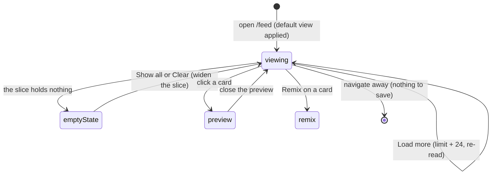
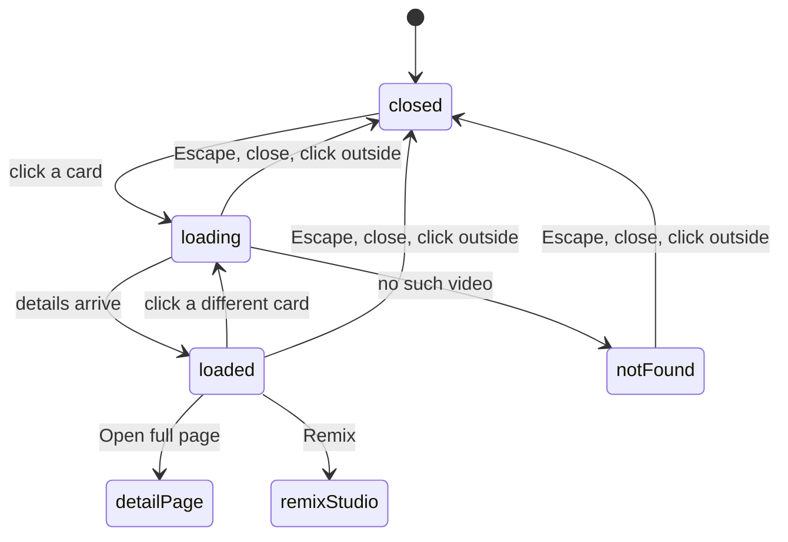

# feed: feature description

## The outlier feed page

### Summary

The feed is the front door of the core loop: a page of outlier posts from tracked
channels, ranked so the strongest performers sit first, that the user scans to find
something worth remixing. It lives at `/feed` and is the landing page of the app. It is a
[direct server read](../../shared/interaction-model.md#how-an-action-reaches-the-server):
the page queries the database as it renders and shows either a page of cards or an empty
state. There is no server action here and nothing to submit, so it cannot fail as an
action. Everything the user changes about the view, the filters, which slice, how many
posts, grid or list, is carried in the URL, and changing it re reads the page.

Because it needs nothing but the local database, the feed works in every restricted state.
The [LLM proxy](../../shared/interaction-model.md#what-is-unavailable-in-restricted-states)
being down, the Graph token being invalid, and the sidecar not running change nothing about
whether the feed renders. The one thing the sidecar controls is whether new [videos](../../shared/data-model.md#video)
arrive at all: with the sidecar stopped the feed still reads, it just goes stale.

This document owns the feed page itself: the grid and list presentations, the outlier cards
and their score and metrics, the follower band counts, Load more, and the empty states. The
row of filter controls above the page and the saved views are a separate feature, described
in [filters and saved views](#the-filter-bar-and-saved-views); this document names them but does
not describe their controls. The quick preview that opens when a card is clicked is described
in [quick preview](#the-quick-preview-sheet).

### The simple case

The user opens `/feed`. Rather than the whole library, the page opens on the High Conviction
view, a seeded saved filter that keeps only the strongest recent outliers, because the point
of the tool is the outliers and not the archive. A small line above the grid says how many
results the current slice holds, notes that the High Conviction view is on, and offers a
"Show all" link that drops the default and shows everything.

Below that is a grid of cards, one per video, biggest scorer first. Each card shows a
thumbnail with the caption laid over it, the outlier score as the largest number on the card,
the view count and engagement rate, the channel handle and its follower count, and how long
ago the post went up. The user scans down the scores, clicks a card that looks worth a closer
look, and the [quick preview](#the-quick-preview-sheet) opens over the feed. From a card the user can
also jump straight to a remix or open the channel.

If the grid holds more than the first 24 posts, a "Load more" button sits at the bottom.
Clicking it reloads the page showing 24 more. When the slice is small enough to fit, there is
no button.

### The interaction, event by event



#### Arrive

The page reads the database on the server as it renders. It loads the fleets, the saved
filters, and the channel list, works out which slice to show from the URL, and then runs two
reads at once: the page of videos for the slice and the [follower band counts](#the-follower-band-counts).
On a bare `/feed` with no filter in the URL, it applies the High Conviction saved view; once
the URL carries any real filter, that intent is honored as written, including an explicit
"any". Cosmetic parts of the URL (density, grid or list, sort, limit) are not filters, so
toggling one of them alone still counts as a bare visit and keeps the default view.

Nothing is focused and nothing is prefilled, because there is no form. What the user sees is
a snapshot of the database at the moment the page rendered. The default page size is 24, so
at most 24 cards render on arrival however large the slice is.

> Technical note: the default view is not hard coded on the page. The criteria come off the
> seeded High Conviction saved filter row, so changing the seed moves the default without
> touching the page.

#### Leave without acting

There is nothing to lose. The feed is a read, so backing out, following a link, or reloading
records nothing and discards nothing. The one thing that persists across a visit is what the
URL carries: a link to `/feed` with filters in the query string reopens the same slice,
because the slice lives in the URL rather than in any saved state on the page. See
[navigation and shell](../../shared/navigation-and-shell.md#deep-links).

#### Begin acting

On a browse page, acting means following the page somewhere rather than committing a write.
The three things that count as beginning to act:

- Clicking a card opens the [quick preview](#the-quick-preview-sheet) over the feed. This is client
  state on the page, not a navigation.
- Clicking Remix on a card, or clicking the thumbnail through to the detail page, leaves the
  feed for the [remix studio](../remix/03-feature-description.md#the-remix-studio) or the [video detail page](#the-video-detail-page).
- Clicking Load more, changing a filter, or changing the sort builds a new URL and re reads
  the page. None of these is a write; each is a fresh read of a different slice.

#### While acting

Because there is no server action, there is no in flight write to watch. Following a card
into the preview is instant client state. Load more and filter changes are full page reads:
the browser requests the new URL, the server renders the new slice, and the page repaints
with it. There is no partial or streaming state, no spinner tied to a generation, and nothing
that can be half done. Between the click and the new page there is only the normal navigation
delay.

#### Finish

There is nothing to commit. A card click ends with the preview open; a Load more ends with a
larger page rendered; a filter change ends with a different slice rendered. The user lands
back on the feed in every case except following a card through to remix or detail, which
leaves the feed entirely. Nothing is written to the database by anything on this page.

### Grid and list

The feed has two presentations, chosen by the `view` value in the URL.

The grid is the default: cards packed into as many columns as fit, each card a tall 9:16
thumbnail with its metrics beneath. The thumbnail sits desaturated at rest and picks up
contrast on hover, so the grid reads as scannable data first and a photo wall second. A
comfortable density gives larger cards; a compact density packs smaller ones so more fit per
row when scanning a large feed. Density is also a URL value.

The list is a plain data table: a header row of Score, Post, Channel, Views, Posted, and one
thin row per video with no thumbnail. The whole row is the click target for the quick preview.
The list is denser than the grid and trades the thumbnail for more rows on screen.

The toggle controls that switch grid and list, comfortable and compact, and the sort live in
the [filter bar](#the-filter-bar-and-saved-views), which owns them. This page owns only what each
presentation shows.

#### The outlier card

Each grid card, top to bottom:

- The thumbnail, a 9:16 box. If the post's image has been downloaded it shows; if not, a
  hatched placeholder with a play glyph shows through, meaning "no image yet" rather than an
  error. If the image was downloaded but fails to load, the box shows an explicit
  "Unavailable" treatment, deliberately different from the "nothing downloaded yet"
  placeholder. The caption is laid over the thumbnail on an opaque plate so it stays readable
  against a bright or a dark image. The video duration, if known, sits in the corner.
- The outlier score, the hero of the card: the largest, plainest number, shown as a multiple
  such as 38.0x, always to one decimal. It is coloured amber the moment the post beat its
  channel baseline (a score of 1.0 or more) and stays muted below that. A post with no score
  shows a dash.
- The view count and engagement rate on one line, then the channel handle, its follower
  count, and the relative age of the post. The handle links to the channel page.
- If the post is no longer on the platform (removed by a later sync but kept for its history),
  a line in the warning colour says "No longer on Instagram" rather than the card being hidden.
- A footer, on the full size card only, with a Remix link to the [remix studio](../remix/03-feature-description.md#the-remix-studio)
  and a menu offering Copy link and View on Instagram. There is no save button on the card:
  saving to the vault needs an analysis, which only exists on the [detail page](#the-video-detail-page),
  so the feed card links there rather than pretending to save.

> Technical note: the engagement rate on the card and the engagement filter in the query use
> the same formula, (likes plus comments) divided by views, computed in one place. A post with
> a null view or a null count shows a dash rather than a fabricated zero, and is excluded from
> an engagement filter rather than counted as zero.

The list row shows the same score, the caption (or a dash when there is none), the channel
handle, the view count, and the relative age. A removed post is marked "removed" in the
warning colour in place of the card's longer line.

#### The score badge

The score is the whole point of the ranking, so it is worth stating exactly what the colour
means. Amber turns on at 1.0, the moment a post beat its channel baseline. The badge's heat
tiers, a separate scale for how hard it beat, escalate the fill above that: a wash below 5x, a
solid amber from 5x, bolder past 20x. A post with no score is muted with a dash. The same
score and the same colour rule are used on the [detail page](#the-video-detail-page), so a post that
reads amber here reads amber there.

### The follower band counts

Alongside the cards, the feed computes how many posts fall in each follower band of the
current slice: nano for channels under 10k followers, mid for 100k to 1M, and macro for 1M
and up. These counts feed the band chips in the [filter bar](#the-filter-bar-and-saved-views),
which is where the user sees and clicks them; this page owns what the numbers mean.

Two things about the counts are easy to misread. First, each band count is computed under
every other active filter with the band itself excluded, so picking one band does not change
what the other bands would have shown. Second, the three bands do not cover every channel: a
channel between 10k and 100k followers (the old micro range, since removed) and a channel
with an unknown follower count fall in no band at all, and show only under "any followers".
The three counts therefore need not sum to the total.

### The empty states

The page has four distinct empty states, chosen so the recovery action fits the reason the
slice came back empty:

- No channels tracked at all. "Nothing to score yet", with a note that a post appears once
  there is a channel and a sync to give it a median, and a link to add a channel.
- Channels exist but none has ever finished a sync. "Nothing to score yet", naming how many
  channels are added and that none has synced, with a link to the channels page to run one.
  This is distinct from the slice simply being empty: there is no baseline for anything to be
  measured against yet.
- A search that matched nothing. "No post matches" the searched words, with a suggestion to
  try other words or clear the search, and a link that clears only the search and keeps the
  rest of the slice.
- A filter slice that came back empty. When the default view is on, "No post clears the High
  Conviction bar yet" with a "Show all" link, because a bare `/feed` would just re apply the
  default and loop back to the same empty state. When a filter was set by hand, "No post
  matches this slice" with a "Clear filters" link and a suggestion to widen the threshold,
  timeframe, or band.

### Variants

| Variant | Set on arrival | Changed while acting |
| --- | --- | --- |
| Record state (video analyzed, saved, removed) | Decides what a card shows, not whether it shows. A removed video still appears, marked "No longer on Instagram". Analyzed or saved state is not shown on the feed card at all; both live on the [detail page](#the-video-detail-page). | No effect. The feed does not re read mid view; a card reflects the record as of the page load until the next navigation or Load more. |
| Attached data present or absent (transcript, analysis) | No effect on the feed. A missing thumbnail asset shows the hatched placeholder; a missing transcript or analysis is invisible here. | No effect. |
| External service availability (LLM proxy, Graph, sidecar) | No effect on rendering. The feed reads only the local database. The sidecar decides whether new videos exist to read; with it stopped the feed still renders, just stale. | No effect. Load more and filter changes read the same local database whatever the services are doing. |
| Keyboard shortcut in play | A card is keyboard reachable: the thumbnail (or a list row) takes focus, and Enter or Space opens the quick preview, the same as a click. Load more, Remix, and the channel link are ordinary links, reached by Tab and followed with Enter. | No effect. There is no in flight state and no key that changes it. |

There is no modifier that changes what a click does. Every change to the feed is a change to
the URL, and the URL fully describes the slice.

### Cancel and interrupt

The feed is a read, so most of these rows are "nothing to lose". The table below fills every
one anyway.

| Event | Before commit (viewing the page) | While in flight (a Load more or filter re-read) |
| --- | --- | --- |
| Explicit cancel or stop | There is nothing to cancel. No action is open, no work is uncommitted. Closing the quick preview returns to the feed unchanged. | A re read is a page navigation; there is no cancel button. Navigating elsewhere abandons it, and nothing was partly written because nothing is written. |
| Navigate away mid action | Leaving the feed loses nothing. The slice is in the URL, so returning to the same URL reopens the same slice. | Abandoning an in flight re read simply lands on wherever the user navigated instead. No half state. |
| Reload or tab or window closed | The page re reads from the URL and shows the same slice. Nothing typed or staged is lost because nothing is staged. | Same. A reload during a re read just runs the read again. |
| A backing service fails mid action | No external service is used, so none can fail the render. A database read error would surface as a server error page rather than an in page failure, since there is no action boundary to catch it. | Same. The re read touches only the local database. |
| The target record changes underneath | The page is a snapshot at load time, so a sync that adds, removes, or rescoring a video after load is not reflected until the next navigation or Load more. A card can therefore show a video a sync has since removed; the next read corrects it. | A Load more or filter re read picks up the current database, so the newly rendered page reflects any change a sync made since the last read. |
| A background job finishes or fails on its own | A sync writing new videos or a cook run finishing does not push into an open feed; the feed does not poll. The change appears on the next navigation or refresh. The shell's failure strip freshens on navigation, not on the feed itself. See [background jobs](../../shared/background-jobs.md). | No effect beyond the fact that the re read reflects whatever the database now holds. |
| A second tab or a double action on the same record | Two feed tabs are independent reads; they do not conflict because neither writes. They can show different slices or different snapshots with no consequence. | A double click on Load more requests the next larger limit twice; both requests read, the last render wins, and the result is the same larger page either way. |

After any interrupt the user is on some page with some slice, and nothing is left half
written, because the feed never writes.

### Interactions with other systems

**Persistence and autosave.** The feed saves nothing per view. What persists is the URL: the
slice, sort, density, and view are all query parameters, so a slice is a link and the browser
history holds the sequence of slices. Saved views (named filter sets) are persisted, but that
is the [filters and saved views](#the-filter-bar-and-saved-views) feature, not this page. See
[persistence](../../shared/persistence.md).

**History and undo.** There is nothing to undo, because there is no write. Browser back and
forward move between the URL states the user visited: a previous slice, a smaller Load more
page, the view before a filter change.

**Navigation and refresh.** The feed is URL driven. Filters, sort, density, grid or list, and
Load more all work by changing the query string, which re reads the page. Load more raises the
`limit` in the URL by 24 and re reads, so the larger page is a plain navigation and is
bookmarkable. The feed does not call an explicit refresh of its own; it re reads on
navigation like any [direct server read](../../shared/interaction-model.md#how-an-action-reaches-the-server).
See [navigation and shell](../../shared/navigation-and-shell.md#how-pages-stay-current).

**Background jobs and the sidecar.** The [sidecar sync](../../shared/background-jobs.md)
is the only writer of the videos the feed shows; the user never triggers it from this page.
Videos appear in the feed because a sync ran; they carry the "no longer on the platform"
marker because a later sync soft removed them. With the sidecar stopped the feed reads the
same database and goes stale rather than erroring.

**External services.** None are used to render the feed. The LLM proxy, the Graph API, and
the transcript providers are all irrelevant to whether the feed shows. See
[external services](../../shared/external-services.md).

**Status and failures.** The feed's own "failure" surface is its empty states, which
distinguish no channels, no sync yet, an empty search, and an empty filter slice. Failures
from elsewhere in the app surface in the shell's failure strip, which the feed does not own.
See [status and failures](../../shared/status-and-failures.md).

**Configuration and settings.** The default page size and the Load more step are both 24, set
in the page rather than in user settings. The default view comes from the seeded High
Conviction saved filter, not a literal, so reseeding moves the default. The follower band
bounds (nano under 10k, mid 100k to 1M, macro 1M and up) are fixed in the query layer.

### Edge cases

- The default view is applied only on a bare visit. Toggling density, grid or list, or sort
  without any filter in the URL still counts as bare, so those toggles do not accidentally
  drop the High Conviction view. Adding any real filter drops it.
- The three follower band counts need not sum to the result total: a channel in the old micro
  range (10k to 100k) or with an unknown follower count belongs to no band.
- A post with no outlier score sorts last under the score sort (it has no score to rank by)
  but is still present under the recent sort. Its card shows a dash for the score.
- A removed post is kept, not hidden, so the feed does not silently lose a post that was once
  an outlier. It is marked removed on the card and in the list row.
- A missing thumbnail file and a not yet downloaded thumbnail are shown differently on
  purpose: "Unavailable" for a file that failed to load, the hatched placeholder for one that
  was never downloaded.
- The "results" count is the true size of the current slice before paging, not the number of
  cards on screen, so it can read larger than the visible cards when there are more to load.
- The list view carries no thumbnail at all; it is a data table. The grid and the list show
  the same underlying slice, only presented differently.


## The filter bar and saved views

### Summary

The filter bar is the row of controls above the [feed](#the-outlier-feed-page) that builds the query the feed runs. It holds a search box, a set of narrowing controls (fleet, minimum score, minimum views, minimum engagement, timeframe, analyzed status, follower band), a sort, layout and density toggles, a saved views dropdown, and an "Add post URL" button. Every choice is written into the URL and the feed re-renders from that URL, so the bar never fetches results itself: it edits the address and the [feed page](#the-outlier-feed-page) reads the new address. This document owns those controls, the [manage saved views dialog](../../shared/glossary.md) reached from the dropdown, and the add-video dialog reached from the button. It does not own the results grid, the counts, or what a bare `/feed` visit shows; that is [the feed page](#the-outlier-feed-page).

The bar lives in the sticky header of `/feed`. It needs no external service: the controls only rewrite the URL, and creating, renaming, or deleting a saved view writes a local row. The one part that reaches outside is the add-video dialog, which fetches a single post before writing it, so it is the only control here that can fail on a service being unreachable.

> Technical note: filter state is held entirely in the URL query string, not in React state. The controls read `useSearchParams()` and call `router.replace(..., { scroll: false })`, so a filter change is a client-side navigation, not a form submit. See [navigation and shell](../../shared/navigation-and-shell.md) for the URL and refresh model.

### The simple case

The user narrows the feed by picking from the bar. Choosing "5x+" from the score control rewrites the URL to carry `minScore=5` and the grid below re-renders to matching posts. Typing in the search box filters by caption, handle, or display name after a short pause. Each follower band shows a live count of how many posts sit in it under the other active filters. When any filter is set, a "Clear filters" button appears and one click drops them all.

To keep a set of filters, the user opens "Saved views", clicks "Save / manage views", names the current filters, and saves. The named view then appears in the dropdown, and picking it later restores those filters. The two built-in views, Balanced and High Conviction, are always there and cannot be renamed or deleted.

To pull a single post into the feed by hand, the user clicks "Add post URL", pastes a post link, and clicks "Import post". The post is fetched and written, the dialog closes, and the feed refreshes with it present.

### The interaction, event by event

```
stateDiagram-v2
    [*] --> browsing
    browsing --> browsing : pick a filter (URL replaced, feed re-renders)
    browsing --> browsing : Clear filters (filter params dropped)
    browsing --> manageOpen : Save / manage views
    manageOpen --> browsing : Escape or close (discard unsaved name)
    manageOpen --> manageOpen : create, rename, delete a view (toast, refresh)
    browsing --> addOpen : Add post URL
    addOpen --> browsing : Escape or close (discard typed URL)
    addOpen --> importing : Import post
    importing --> browsing : success (post written, refresh, dialog closes)
    importing --> addOpen : failure (inline error, dialog stays)
```

#### Arrive

The bar renders from three server reads handed to it: the tracked fleets, the saved views, and a count per follower band computed under every other active filter. It also receives what the page actually filtered by, which is not always what the URL literally says. Each control shows its current value read from the URL, falling back to that applied value when the URL is silent, so the row always states the filter that ran rather than a stale placeholder. The search box shows its own local echo of the URL's query so typing feels instant. Nothing is focused on arrival and no dialog is open.

#### Leave without acting

Leaving the feed without touching a control records nothing beyond whatever the URL already held. A filter change is only made when a control is used. Opening either dialog and closing it again with Escape, a click outside, or the close control discards anything typed: an unsaved view name, an in-progress rename, a pasted URL. None of that is written. The URL filters themselves survive leaving, a reload, and browser back or forward, because they are the address, not component state.

#### Begin acting

Three different actions start real work, and they commit differently.

Picking any filter control commits immediately: the URL is rewritten in place and the feed re-renders. There is no pending state and nothing to confirm, because the change is a navigation, not a server write. The search box is the exception; it waits until typing stops before rewriting the URL.

Opening the manage dialog and typing a name begins a saved-view create; it does not commit until "Save view" is clicked. Editing a view's name begins a rename; deleting asks for a confirm first.

Opening the add-video dialog and pasting a URL begins an import; it does not commit until "Import post" is clicked.

#### While acting

A filter change has no in-flight window worth watching: the URL updates and the grid repaints. The search box holds its typed text locally and rewrites the URL after 350ms of no further keystrokes, so the feed refetches once per pause rather than once per key.

In the manage dialog, a create, rename, or delete runs as a server action: its button is disabled and relabeled ("Saving...", "Deleting...") until it settles. The list does not change optimistically; it re-reads after the write lands.

In the add-video dialog, "Import post" is disabled and relabeled "Importing..." while the single post is fetched and written. This is a foreground request the dialog holds open, not a background job; there is no progress bar, only the disabled button.

> Technical note: the import runs inline in one server action (fetch the post, upsert the video and its channel, recompute scores), so a reload during it loses the in-page result. This is unlike the periodic [sidecar sync](../../shared/background-jobs.md) that normally fills the feed, which runs in the background and reports progress separately.

#### Finish

A filter change is finished the moment the URL is rewritten; the feed page owns what renders next. Using a control also drops the `limit` param, so a narrowed feed starts from its first page rather than keeping a "load more" depth from the previous filter.

A saved-view create, rename, or delete finishes by showing a toast and re-reading the page so the dropdown and the dialog list reflect the change. A create writes a new non-system row; the dialog clears the name field and keeps the dialog open. A rename collapses the edit row back to a label. A delete removes the row.

An import finishes by closing the dialog, showing a "Post imported" toast, and refreshing so the new video can appear in the grid. A failed import keeps the dialog open and shows the reason as an inline alert inside it, not a toast.

### Variants

| Variant | Set on arrival | Changed while acting |
| --- | --- | --- |
| Record state | The URL decides which filters are active and which the "Clear filters" button responds to; the saved views read decides which views the dropdown lists, and whether each is a built-in (Balanced, High Conviction) with no rename or delete, or a user view with both. For an import, whether the post's channel is already tracked decides create versus update. | Picking a filter changes the active set live. Deleting a user view in the dialog removes it from the list without closing. A saved view already applied into the URL is unaffected by later deleting that view, because applying copied its criteria into the URL rather than linking to the row. |
| Attached data present or absent | A saved view carries only the three criteria it can restore (minimum score, minimum views, timeframe); a view with none summarizes as "No filters". The analyzed control keys off whether a post has an analysis, not whether one is loaded here. | Saving a view with all three controls on "any" stores an empty criteria set, which round-trips as "No filters". Adding or removing a criterion before saving changes what the summary line shows. |
| External service availability | The filter controls and the manage dialog need no external service; they read and write local rows only. The add-video dialog needs the post-fetch provider reachable to import. | The LLM proxy, the Graph token, and the sidecar being down have no effect on filtering or on managing views. Only the import can fail on the fetch provider being unreachable or the post being gone. |
| Keyboard shortcut in play | None is armed on arrival; focus is not trapped in the bar. Arrow-key navigation belongs to the [video detail page](#the-video-detail-page), not here. | Typing in the search box drives the debounced filter. Enter in the "Name this view" field saves the view; Enter in a rename field confirms it and Escape cancels the rename; Enter in the add-URL field imports. Escape closes an open dialog. |

There is no modifier that changes what a control does. Each control has one behavior; the only "variant" of a filter is which value is chosen.

### Cancel and interrupt

| Event | Before commit | While in flight |
| --- | --- | --- |
| Explicit cancel or stop | A filter has no cancel: it commits on pick. To undo one, re-pick its "any" value or click "Clear filters". In the manage dialog, Escape or close discards an unsaved name or an open rename; a delete is a two-step confirm whose Cancel backs out. In the add dialog, Escape or close discards the typed URL. | The create, rename, delete, and import buttons are disabled while their write runs, so there is no cancel; the write runs to completion. |
| Navigate away mid action | Leaving the feed carries the committed URL filters forward only where a link forwards them (a card or the detail page); cosmetic params like density and view are dropped. An open dialog is abandoned with nothing saved. | A sidebar link still navigates during a write. The server write may land, but the refresh that would show it does not; the next visit reflects the true state. |
| Reload or tab or window closed | URL filters survive a reload and back or forward, because they are the address. Any open dialog and its typed text are lost. | An in-flight create, rename, delete, or import may or may not have completed; the next load reflects whatever the database holds. |
| A backing service fails mid action | Filtering and managing views use no external service. An import can fail before it starts writing if the post cannot be fetched. | A failed import returns its reason as an inline alert and the dialog stays open. A database error on a view write returns an unexpected-error toast (code `SAVED_VIEW_UNKNOWN`) and the dialog stays open. |
| The target record changes underneath | If a saved view was deleted in another tab, renaming or deleting it here returns "That view no longer exists" (`SAVED_VIEW_NOT_FOUND`). A view applied into the URL is not disturbed by the row later changing. | Re-importing a post that already exists updates the existing video rather than duplicating it, and still reports success. |
| A background job finishes or fails on its own | A [sidecar sync](../../shared/background-jobs.md) adding or removing videos changes the counts and the grid only after the next navigation or refresh; the controls themselves are unaffected. A sync removing a channel does not touch a saved view, whose criteria are score, views, and date, not a channel. | Same. A sync running while a dialog is open has no effect on the dialog. |
| A second tab or a double action on the same record | Two tabs both saving a view of the same name both succeed; view names are not deduplicated (only the two built-in names are reserved, and only against a second built-in). | The Save, Rename, Delete, and Import buttons are disabled during their own write, so a double click cannot start a second one. |

### Interactions with other systems

**Persistence and autosave.** Nothing in the bar autosaves. Filters persist because they live in the URL, so a bookmarked or shared feed URL restores them. A saved view is the deliberate way to keep a filter set by name; it is a durable row written only on "Save view". A typed view name, a rename in progress, and a pasted import URL are held in the dialog and discarded on close. See [persistence](../../shared/persistence.md).

**History and undo.** Browser back and forward move between filter states, since each change is a URL replace. There is no undo for saving, renaming, or deleting a view; a delete is guarded by a two-step confirm instead. An import has no undo from here.

**Navigation and refresh.** Every control rewrites the URL with `router.replace` and no scroll, and the [feed page](#the-outlier-feed-page) re-renders from it. The dialogs call [`router.refresh`](../../shared/navigation-and-shell.md) after a write so the dropdown, the list, and the grid reflect it without a manual reload.

**Background jobs and the sidecar.** The feed is normally filled by the [sidecar sync](../../shared/background-jobs.md). The add-video dialog is a separate, manual, foreground import of one post; it does not start a background job and reports no progress.

**External services.** Filtering and managing views reach no external service. The import fetches a single post through the post-fetch provider; when that is unreachable or the post is gone, the import fails with a reason. See [external services](../../shared/external-services.md).

**Status and failures.** A saved-view create, rename, or delete reports success and failure as toasts. An import reports success as a toast but failure as an inline alert inside its dialog. There is no failure strip surface owned here. See [status and failures](../../shared/status-and-failures.md).

**Configuration and settings.** The score, views, engagement, timeframe, and band thresholds are fixed option lists, not user settings. The built-in views Balanced and High Conviction are seeded once at install and marked built-in; the product configures them, the user does not. There is no platform control: the feed is Instagram only, so the platform param exists in the URL and schema but no control writes it.

### Edge cases

- The "any" option of the score, views, engagement, timeframe, and band controls is written to the URL as an explicit `key=any` token rather than dropping the key. This lets "explicitly no condition" stay distinct from "never set", so the feed does not reapply a default the moment a control is cleared. The [feed page](#the-outlier-feed-page) owns what that distinction means for a bare visit.
- The layout and density toggles and the sort control are not filters. They rewrite the URL but do not count toward "any filters set", so they do not surface the "Clear filters" button, do not reset the load-more depth, and do not ride along into a detail page link.
- The follower band counts sum to less than the feed total when channels have no follower count or fall between the bands; a channel with an unknown or in-between follower count matches no band chip and still shows under "Any followers".
- A saved view can only restore the three criteria it stores. A view saved while a search term, an engagement floor, an analyzed filter, or a band were set does not restore those; picking the view sets only score, views, and timeframe.
- The add-video dialog is the same dialog the channels board uses to add a channel; the feed opens it straight to its "Paste post URL" tab. Its other tab tracks a whole channel by handle, which is outside this control's purpose.


## The quick preview sheet

### Summary

The quick preview sheet is a lightweight look at one video without leaving the feed. Clicking a card in the [feed](#the-outlier-feed-page) slides a panel in from the right edge of the screen, titled "Quick preview", holding the video's thumbnail, its channel and caption, its metrics, a short slice of the transcript, and two buttons: "Open full page" and "Remix". It is a read only view. Nothing here is saved, nothing is committed, and the sheet works whether or not the LLM proxy, the Graph API, or the sidecar are running, because everything it shows was already written to the database by an earlier sync or analysis. It is the fast version of the [video detail page](#the-video-detail-page); "Open full page" is the link through to that full page, and "Remix" jumps straight into the remix studio for the same video.

### The simple case

The user is scanning the feed and wants a closer look at one card without committing to the full page. They click the card. A panel slides in from the right. For a moment it shows placeholder bars while the video's details load, then it fills in: the thumbnail with its outlier score, the channel handle, the caption, a row of view, like, and comment counts with how long ago the post went up, and the first few lines of the transcript. If the video has no transcript yet, that section says so and points at the full page. The user reads, then either clicks "Open full page" to see everything, clicks "Remix" to start remixing it, or dismisses the sheet with Escape, the close button, or a click on the dimmed feed behind it, and carries on scanning.

### The interaction, event by event



#### Arrive

The sheet opens the moment a card is clicked, before any of the video's details are in hand. It slides in showing three placeholder bars where the thumbnail and text will go. Only then does it ask the server for this video's details. Nothing is prefilled or focused beyond the sheet's own default focus, and nothing about the video is fetched until the sheet opens, so browsing the feed with the sheet closed costs nothing.

> Technical note: the feed grid holds a single "which card is previewed" value. A card sets it to that card's id on click; the sheet is open whenever the value is not empty. The details are fetched lazily through a server read keyed to that id, so the feed page never loads transcripts for every visible card up front.

#### Leave without acting

Escape, the close button in the sheet's corner, or a click on the dimmed area behind the sheet all close it. Nothing is recorded. Opening a preview does not add the video to recently viewed; only opening the full detail page does that. Closing during the brief load drops the in flight fetch cleanly, so a result that arrives late for a sheet the user already closed is discarded rather than shown.

#### Begin acting

There is nothing to commit here, so "begin acting" means leaving the sheet forward rather than back: clicking "Open full page" or "Remix", or clicking a second card. The first two are navigations away from the feed. The third swaps the previewed video without closing the sheet.

#### While acting

While the details load, the sheet shows placeholder bars. Clicking a different card while the sheet is open returns it to those placeholders and loads the new video; the sheet never flashes the previous video's details under the new card's heading, because it only shows details once they match the card currently open. Clicking a button navigates and the sheet unmounts with the page.

#### Finish

Nothing is written. "Open full page" lands on the [video detail page](#the-video-detail-page) for the same video, carrying the feed's active filter and sort so the detail page's previous and next navigation resolves against the same ordered set the sheet was opened from. "Remix" lands on the remix studio for the same video. Dismissing the sheet leaves the user exactly where they were in the feed.

### Variants

| Variant | Set on arrival | Changed while acting |
| --- | --- | --- |
| Record state (video analyzed, saved, present or removed) | The sheet shows the same content whether or not the video is analyzed or saved. A video the platform has removed still resolves and previews here, and unlike the card and the detail page the sheet shows no "no longer on the platform" flag for it. Only a video whose row is truly gone shows "This post couldn't be found." | No effect. The details are a snapshot taken when the sheet opened; a state change does not re-read them. |
| Attached data present or absent (transcript, analysis) | A transcript shows as a four line excerpt under a "Transcript" heading. No transcript shows "No transcript yet, open the full page to transcribe." Whether the video is analyzed makes no visible difference; the analysis is not shown in the sheet. | No effect. Adding a transcript elsewhere does not update an open sheet. |
| External service availability (LLM proxy, Graph, sidecar) | No effect. The read needs none of them; it returns whatever was already stored. | No effect. |
| Keyboard shortcut in play | Escape closes the sheet. A card is opened by click or by Enter or Space on its thumbnail. There is no arrow key navigation inside the sheet. | No effect. |

### Cancel and interrupt

| Event | Before commit (sheet open) | While in flight (details loading) |
| --- | --- | --- |
| Explicit cancel or stop | Escape, the close button, or a click outside closes the sheet. There is nothing committed to discard. | Same. Closing drops the pending fetch; a late result is ignored. |
| Navigate away mid action | A sidebar link, or the "Open full page" or "Remix" button, navigates away and the sheet goes with the page. Browser back returns to the feed with the sheet closed. Nothing is lost, since nothing was held. | Same. The navigation wins; the pending fetch is abandoned. |
| Reload or tab or window closed | The open sheet is client only state and is not in the URL, so a reload returns to the feed with no sheet open. Nothing is lost. | Same. |
| A backing service fails mid action | No external service is used. | If the server read itself errors, the sheet stays on its placeholder bars rather than showing the not found message, because a failed fetch is not distinguished from one still in flight. See open questions. |
| The target record changes underneath | A sync that removes the video while the sheet is open does not change what the open sheet shows; it is a snapshot. Opening the sheet after a removal still previews the video, since a removed row is still resolvable by id. | Same. A record change mid fetch is not detected. |
| A background job finishes or fails on its own | No effect. The sheet does not watch runs or renders. | No effect. |
| A second tab or a double action on the same record | A second tab is independent. Opening a second card in the same tab replaces the previewed video and reloads. A double click on the same card re-opens the same video. | Opening another card mid load switches to loading the new one; the earlier fetch's result is dropped if it lands after. |

After any interrupt the user is either still in the feed or on the page they navigated to. Nothing is half written, because nothing is written at all.

### Interactions with other systems

**Persistence and autosave.** Nothing is saved. The previewed video is transient client state, not stored and not in the URL, so it does not survive a reload and cannot be linked to. The sheet does not record the video in recently viewed; that belongs to the full detail page.

**History and undo.** There is nothing to undo. Opening and closing the sheet does not change the URL and is not a browser history entry, so browser back does not close the sheet, it leaves the feed.

**Navigation and refresh.** The sheet never calls a refresh, because it writes nothing. Its two buttons are plain links. Both carry the feed's active filter and sort as a query suffix so the full page lands on the same filtered, ordered set; on the remix link the suffix rides along but the remix page ignores it today. See [navigation and shell](../../shared/navigation-and-shell.md) for the refresh and deep link model.

**Background jobs and the sidecar.** None are triggered. The videos the sheet previews were written by the [sidecar sync](../../shared/background-jobs.md); the sheet only reads a snapshot of one.

**External services.** None. Like the save to vault action, this is a path that needs neither the LLM proxy nor the Graph API nor a transcript provider; the transcript it shows was fetched earlier and stored.

**Status and failures.** A missing video shows an inline "This post couldn't be found." in place of the content. There is no toast; the sheet has no action to succeed or fail. A server read error is the one gap, and it leaves the placeholder bars up. See [status and failures](../../shared/status-and-failures.md).

**Configuration and settings.** None. No setting changes this behavior.

### Edge cases

- Opening the sheet costs one server read per open; scrolling the feed with the sheet closed costs nothing, because the fetch is lazy and keyed to the opened card.
- Switching from one card to another without closing never shows the old video under the new heading. The sheet shows details only while they match the card currently open, so a slow fetch shows placeholders rather than stale content.
- The sheet shows the outlier score, channel, caption, counts, and a transcript excerpt, but not the analysis, the median baseline, the carousel slides, or the save and keep buttons. Those live on the [full detail page](#the-video-detail-page), which is what "Open full page" is for.
- A platform removed video still previews, without the removed warning the card and the detail page show. The only truly empty case is a video whose row no longer exists.


## The keep this post button

### Summary

Keep this post saves a video to a shortlist the user can come back to. It is a single star button in the action row of the [video detail page](#the-video-detail-page), next to the save to vault dialog, which is a different feature (that one lifts a hook or a layout out of the analysis into a reusable template; this one keeps the whole post with a short note). The button is a toggle. When the video is not kept it reads "Keep this post" and opens a small dialog; when it is kept it reads "Kept" with a filled star and removing is one click. It writes a [saved post](../../shared/glossary.md) row and needs no external service, so it works whether or not the LLM proxy, the Graph API, or the sidecar are running.

### The simple case

On a video detail page the user clicks "Keep this post". A dialog opens with one optional field, a note that answers "why it is worth keeping". The user types a line or leaves it blank, then clicks "Keep". The dialog closes, a toast says "Kept in the vault", and the button changes to "Kept" with a filled star.

To undo, the user clicks "Kept". The row is removed, a toast says "Removed from the vault", and that toast carries an Undo action that puts the row back with its original note. The button returns to "Keep this post".

### The interaction, event by event

```
stateDiagram-v2
    [*] --> notKept
    notKept --> dialogOpen : click Keep this post
    dialogOpen --> notKept : Cancel, Escape, click outside (discard note)
    dialogOpen --> keeping : click Keep
    keeping --> kept : success (row written, toast)
    keeping --> dialogOpen : error (toast, dialog stays)
    kept --> removing : click Kept
    removing --> notKept : success (row deleted, undo toast)
    notKept --> kept : Undo (re-create row)
```

#### Arrive

The detail page decides which button to show from a server read, not from anything the button fetches itself. When the page loads it looks up whether this video already has a saved post, and hands the button either the saved row (its id and note) or nothing. If there is a row, the button renders "Kept" straight away. If not, it renders "Keep this post". Nothing opens until the user clicks.

#### Leave without acting

Opening the dialog and closing it again with Cancel, Escape, or a click outside records nothing. No row is written. The note the user typed stays in the field if they reopen the dialog in the same page visit, because the field is only cleared after a successful keep, not on cancel. A page reload clears it.

#### Begin acting

Clicking "Keep" starts the write. The note is trimmed; a blank or whitespace only note is sent as no note at all. The button pair is disabled from this instant so a second click cannot start a second write.

#### While acting

The dialog stays open and both buttons are disabled. The Keep button's label changes to "Keeping". Nothing else on the page changes yet. There is no spinner beyond the label.

#### Finish

On success the dialog closes, the note field clears, a toast says "Kept in the vault", and the page re-reads so the button flips to "Kept" without a manual reload. On failure the dialog stays open, the typed note is kept, and a toast shows the reason (the post is already saved, the post no longer exists, or an unexpected error). Removing works the same way in reverse: clicking "Kept" deletes the row, re-reads the page, and shows a "Removed from the vault" toast whose Undo action re-creates the row with the note it had.

> Technical note: the button's kept or not kept state is a prop off the page's server read, not local state. The refresh after a keep or a remove is what flips it. Between the write landing and the refresh completing there is a brief window where the button label and the database disagree.

### Variants

| Variant | Set on arrival | Changed while acting |
| --- | --- | --- |
| Record state (video saved or not) | Decides the whole button: "Kept" if a saved row exists, "Keep this post" if not. | If the same video is saved in another tab while this dialog is open, this tab still shows "Keep this post" and the Keep click returns "already saved". |
| Attached data present or absent (transcript, analysis) | No effect. Keeping a post does not depend on it having a transcript or an analysis. | No effect. |
| External service availability (LLM proxy, Graph, sidecar) | No effect. The write needs none of them. | No effect, except that the sidecar can delete the underlying video (see interrupt row 5). |
| Keyboard shortcut in play | Escape closes the dialog. | Enter inside the note field inserts a newline; it does not submit. There is no keyboard submit. |

Changing a variant mid action is limited to the note field's own text. There is no modifier that changes what Keep does.

### Cancel and interrupt

| Event | Before commit (dialog open) | While in flight (keeping or removing) |
| --- | --- | --- |
| Explicit cancel or stop | Cancel, Escape, or a click outside closes the dialog and discards nothing committed. The note text survives a reopen in the same visit. | The buttons are disabled, so there is no cancel; the write runs to completion. |
| Navigate away mid action | Leaving the page abandons the open dialog. Nothing is saved. | A sidebar link still navigates. The server write may land, but the refresh that flips the button does not; the next visit shows the true state. |
| Reload or tab or window closed | The open dialog and any typed note are lost. Nothing is saved. | The write may or may not have completed. On next load the button reflects whatever the database holds. |
| A backing service fails mid action | No external service is used. If the underlying video was removed between page load and the click, Keep returns "That post no longer exists." | A database error returns an unexpected error and a toast; the dialog stays open with the note intact. |
| The target record changes underneath | If the video is deleted by a sync, Keep returns "That post no longer exists" and any existing saved row is already gone (the saved row is removed with its video). | Same. A delete of an already removed row is treated as success, so an Undo that races a cascade does not error. |
| A background job finishes or fails on its own | No effect. | No effect. |
| A second tab or a double action on the same record | Two tabs both showing "Keep this post": the first Keep wins, the second returns "That post is already saved" and the dialog stays open. | A double click is blocked by the disabled state. Remove then Undo re-creates the row. |

After an interrupt the user stays where they are. Nothing is left half written: the row either exists or it does not, capped at one per video.

### Interactions with other systems

**Persistence and autosave.** The note is not autosaved. It lives in the dialog until the user clicks Keep, and is discarded on cancel. The saved row itself is durable once written.

**History and undo.** Remove is undoable through its toast, which re-creates the row with the original note if the user clicks Undo before the toast closes. Keeping is not given a separate undo; the user removes a kept post by clicking "Kept". There is no global undo stack.

**Navigation and refresh.** The button reads its state from the page's server load, so after a keep or a remove the page is re-read and the button flips without a manual reload. See [navigation and shell](../../shared/navigation-and-shell.md) for the refresh model.

**Background jobs and the sidecar.** The sidecar sync can delete the underlying video, which removes the saved row with it. Nothing else here touches background jobs.

**External services.** None. This is the one action in the core loop that needs neither the LLM proxy nor the Graph API nor a transcript provider.

**Status and failures.** Success and failure both surface as toasts. There is no inline error inside the dialog; a failed keep leaves the dialog open and shows the reason as a toast.

**Configuration and settings.** None. No setting changes this behavior.

### Edge cases

- Reopening the dialog after cancelling shows the note the user typed before, because the field is cleared only on a successful keep. A reload clears it.
- A whitespace only note is stored as nothing, and the vault renders it as a dash rather than a blank.
- Removing a row that is already gone is a no-op success, so a stale Undo, a double remove, or an Undo that races a video deletion does not error.
- Save is one row per video. A second keep on an already saved video is refused rather than duplicated, which the user only meets in a race between two tabs, since the button hides Keep once a video is kept.
- This button is deliberately separate from the save to vault dialog beside it. Both are called saving; one produces a shortlist entry, the other a reusable template. They are documented separately.


## The save to vault dialog

### Summary

Save to vault lifts a reusable template out of a video's analysis. Where [keep this post](#the-keep-this-post-button) keeps the whole video on a shortlist, this dialog takes the shape of what worked, its hook, its structure and style, or both, and writes it back as a [vault item](../../shared/glossary.md) the remix can draw on later. It is an outline button reading "Save to vault" with a bookmark icon, in the same action row of the [video detail page](#the-video-detail-page), directly next to the star keep button. The two are deliberately separate: one produces a shortlist entry, the other a template you write from. This dialog is gated on the video having an [analysis](../analyze/03-feature-description.md#analyze-and-reanalyze-a-video), because everything it offers is prefilled from that analysis. Without one the button is disabled and a tooltip says to analyze the video first. The write itself needs no external service; it stores a `vaultItems` row and returns.

### The simple case

On an analyzed video detail page the user clicks "Save to vault". A dialog opens on a three way choice, Hook, Style, or Both, starting on Hook. Below the choice sit editable fields already filled in from the analysis: for a hook, a title, a template line, and a comma separated tag list; for a style, the same three. The user reads the suggestion, edits the title or the template text, adjusts the tags, and clicks "Save". The dialog closes, a toast says "Saved hook to Vault" (or style, or "Saved hook and style to Vault"), and the page refreshes. The new template now shows up in the remix [hook stage](../remix/03-feature-description.md#the-hook-stage) seed select and, for a style, in the [style stage](../remix/03-feature-description.md#the-style-stage) structure select.

There is nothing to undo from here. Removing a vault item is done later on the vault page, which is outside the core loop.

### The interaction, event by event

```
stateDiagram-v2
    [*] --> closed
    closed --> dialogOpen : click Save to vault (analysis present)
    closed --> closed : button disabled (no analysis)
    dialogOpen --> dialogOpen : switch Hook / Style / Both, edit fields
    dialogOpen --> closed : Escape or click outside (discard edits)
    dialogOpen --> saving : click Save
    saving --> closed : success (row(s) written, toast, refresh)
    saving --> dialogOpen : error (toast, dialog stays, fields intact)
```

#### Arrive

The button appears only when the page's server read carried an analysis for this video. If it did, the button is live; if not, it renders disabled with a tooltip, "Analyze this video first to save hook/style templates". Opening the dialog fills the fields from the analysis right away, computed on the client from the analysis already on the page, with no further fetch. The hook title is the analysis hook type in title case followed by "Hook"; the hook template is the first structure note with " for {topic}" appended, or a generic "A {hook type} hook about {topic}" when there is no note; the hook tags start as the hook type. The style title joins the structure labels; the style template joins the labels and the style tags into one line, or a generic "Describe the structure and editing style." when the analysis carries neither; the style tags start as the analysis style tags. The choice starts on Hook and the Save button is enabled from the first paint.

#### Leave without acting

Closing the dialog with Escape or a click outside records nothing. No row is written. The edits the user made to the fields survive if they reopen the dialog in the same page visit, because the fields are React state initialized once and never reset on close. The choice they left it on (Hook, Style, or Both) also survives a reopen. A page reload throws all of that away and recomputes the suggestions from the analysis.

#### Begin acting

Clicking "Save" starts the write. What gets written is decided at that instant from the current choice: Hook writes one hook item, Style writes one style item, Both writes one of each in parallel. The title, template text, and tags are read from the fields as they stand at the click; tags are split on commas, trimmed, and blanks dropped. The Save button is disabled from this instant so a second click cannot start a second write.

#### While acting

The Save button reads "Saving…" and is disabled. The choice toggle and the text fields are not disabled, but editing them mid write has no effect on the write in flight, because its values were captured at the click. Nothing else on the page changes yet. There is no spinner beyond the button label.

#### Finish

On success the dialog closes, a toast names what was saved, and the page re-reads so any surface that counts vault items (the dashboard, the remix selects on the next visit) reflects the new rows. On failure the dialog stays open, the fields keep their text, and a toast shows the error. The fields are never cleared, on success or failure, so a second Save on a reopened dialog with the same text would write a second copy.

> Technical note: Both fires the two inserts with `Promise.all` and reports the first failure it finds. If one insert succeeds and the other fails, the succeeded row is already committed but the toast shows only the error and the dialog stays open. Clicking Save again then re-inserts both, duplicating the one that already landed. There is no dedupe and no cap on vault items.

### Variants

| Variant | Set on arrival | Changed while acting |
| --- | --- | --- |
| Record state (video analyzed or not) | Decides whether the button exists at all: live when the page loaded an analysis, disabled with a tooltip when it did not. Whether the video is kept or not (the sibling star) has no bearing here. | If the analysis is removed underneath an open dialog, the dialog keeps its prefilled and edited values (they are in state) and Save still writes, as long as the video row still exists. |
| Attached data present or absent (transcript, analysis) | The analysis is the source of every prefilled field. A rich analysis yields specific suggestions; a sparse one falls back to the generic hook and style lines. A transcript is not read directly once an analysis exists. | No effect. The captured field values are whatever the analysis produced when the dialog opened, plus any edits. |
| External service availability (LLM proxy, Graph, sidecar) | No effect on the write, which needs none of them. The gate is indirect: an analysis only exists because the LLM proxy produced one earlier. | No effect, except that a sync can delete the source video (see interrupt row 5). |
| Keyboard shortcut in play | Escape closes the dialog. The Hook/Style/Both toggle takes arrow keys for its own focus movement. | Enter in a field does not submit; there is no keyboard submit. Enter in the template textarea inserts a newline. |

Switching Hook, Style, or Both before Save is the one mid dialog choice that changes what is written. Switching it during the write does not, because the write already captured the choice.

### Cancel and interrupt

| Event | Before commit (dialog open) | While in flight (saving) |
| --- | --- | --- |
| Explicit cancel or stop | Escape or a click outside closes the dialog and discards nothing committed. Edited field text survives a reopen in the same visit. There is no Cancel button; the footer holds only Save. | The Save button is disabled, so there is no cancel; the write runs to completion. |
| Navigate away mid action | Leaving the page abandons the open dialog. Nothing is saved. | A sidebar link still navigates. The insert may land, but the refresh that would surface it does not; the next visit shows the true state. |
| Reload or tab or window closed | The open dialog and any edited text are lost. Nothing is saved. | The write may or may not have completed. On next load the vault holds whatever the database committed. |
| A backing service fails mid action | No external service is used. | A database error returns and surfaces as a toast; the dialog stays open with fields intact. For Both, a partial write can result (see the technical note). |
| The target record changes underneath | If the analysis is removed, the open dialog is unaffected and Save still works. If the source video is deleted, the insert may fail on the source video reference; see open questions. | Same. A committed vault item keeps its content even after its source video is later deleted; the source link is cleared to none rather than the item being removed. |
| A background job finishes or fails on its own | No effect. | No effect. |
| A second tab or a double action on the same record | Two saves, from two tabs or two reopenings, both succeed and create two separate rows. There is no "already saved" state and no toggle; the button always reads "Save to vault". | A double click on Save is blocked by the disabled state. Reopening and saving again is not blocked and duplicates freely. |

After an interrupt the user stays where they are. Because there is no cap and no dedupe, an interrupted or repeated save leaves either zero rows or one row per insert attempted, never a half written row, but possibly duplicates.

### Interactions with other systems

**Persistence and autosave.** Nothing here is autosaved. The fields live in the dialog until Save; there is no blur save and no draft. The vault item rows are durable once written. See [persistence](../../shared/persistence.md).

**History and undo.** The save has no undo. Unlike the keep button's remove toast, this dialog offers no Undo action. A vault item is removed later on the vault page, which is out of the core loop.

**Navigation and refresh.** A successful save calls `router.refresh()` so vault counts and the remix selects pick up the new rows on the next read. The dialog itself does not change the URL. See [navigation and shell](../../shared/navigation-and-shell.md).

**Background jobs and the sidecar.** The sidecar sync can delete the source video. A vault item's link to its source video is cleared to none when that happens; the item itself survives. Nothing else here touches background jobs. See [background jobs](../../shared/background-jobs.md).

**External services.** None for the write. The dialog only exists because an analysis exists, and that analysis needed the [LLM proxy](../../shared/external-services.md) earlier, but saving a template calls no service.

**Status and failures.** Success and failure both surface as toasts. There is no inline error inside the dialog; a failed save leaves it open and shows the reason as a toast.

**Configuration and settings.** None. No setting changes this behavior.

### Edge cases

- The fields never reset. Reopening the dialog after a cancel, or after a successful save, shows the last text the user had, not a fresh suggestion. Only a page reload recomputes the prefill from the analysis.
- There is no validation. An empty title or empty template text saves an empty vault item; a blank tag field saves no tags. The dialog does not stop the user.
- Both is two independent inserts. A partial failure commits one and reports the other as an error, and a retry duplicates the one that landed. This is the one place the dialog can leave the vault in a surprising state.
- Saving the same video twice, or the same choice twice, always creates new rows. There is no per video or per template cap, unlike the keep button's one row per video.
- This dialog is deliberately separate from the star keep button beside it, which the code comment on `save-post-button.tsx` states in the same words: both are called saving, one produces a template you write from, the other a shortlist you come back to. They are documented separately.


## The video detail page

### Summary

The video detail page is where the user studies one [video](../../shared/glossary.md) up close before deciding what to do with it. It lives at `/feed/{videoId}` and is reached by opening a card in the [feed](#the-outlier-feed-page), by clicking a card in this page's own similar outliers row, or by any link that carries a video id (the recently viewed list, a channel grid, a vault card). It is a [direct server read](../../shared/interaction-model.md): the page queries the database as it renders and shows what it finds, so it has no action of its own to fail and no loading spinner for its own content. It works whether or not the LLM proxy, the Graph API, or the sidecar are running, because rendering the page needs none of them; only the actions launched from it (analyze, generate idea, download) touch those services, and each is documented on its own.

The page is a two column reading surface. The left column holds the media and everything measured about the post: the player or carousel, the outlier score, the raw numbers, the [engagement chips](#the-left-column), the [median baseline](#the-median-baseline), the caption, and the channel link. The right column holds the text: a summary, then tabs for the transcript, the hook and structure, why it worked, and the layout. A sticky action row at the bottom of the right column is the exit: Remix this, and beside it the smaller keep, save, copy, and generate actions. A header row above both columns carries the back link, the position in the feed, and the previous and next controls.

Several things on this page are their own documents and are only named here, not restated: the [keep this post button](#the-keep-this-post-button), [analyzing the video](../analyze/03-feature-description.md#analyze-and-reanalyze-a-video) (the analysis gate, the transcript and hook and why and layout content, the reanalyze and frame pass buttons), and [generating an idea](../analyze/03-feature-description.md#generate-an-idea) from the video. This document owns the page as a whole: the media viewers, the metric chips, the median baseline, the arrow key navigation to the previous and next video in feed order, and recording the video as recently viewed.

### The simple case

The user clicks a card in the feed. The detail page opens with the media on the left, capped so the six numbers under it stay above the fold, the outlier score badged over the media and printed large under the baseline bar. The right column shows the transcript tab by default. The user reads the transcript, clicks through to Hook and structure and Layout, glances at how this post compares to the channel's own baseline, and then either presses the right arrow key to move to the next video in the same feed order without going back to the grid, or clicks Remix this to start working on it. Opening the page also quietly records the video in the recently viewed list.

### The interaction, event by event

```
stateDiagram-v2
    [*] --> viewing : page loads (server read, recorded as recently viewed)
    viewing --> viewing : switch tab, play or download media, page a carousel
    viewing --> adjacent : ArrowLeft or ArrowRight, or prev or next (loads the neighbour)
    adjacent --> viewing : the neighbour page loads
    viewing --> elsewhere : follow a link (Remix, channel, a similar card, Feed)
    viewing --> notFound : the video id does not resolve
```

#### Arrive

The page reads everything it shows in one pass on the server: the video and its channel, the transcript and analysis if they exist, the carousel children, the similar outliers (capped at five, scored by tag overlap), the median baseline sample, whether any transcript provider is usable, whether a Claude key is present, whether this video already has a saved post, and the previous and next neighbours in feed order. If the video id does not resolve, the page renders a not found body.

> Technical note: the page and its metadata fetch the same video once; React's `cache()` dedupes them to a single database round trip. A missing video calls `notFound()`, which renders the correct not found content, but a code comment records that the HTTP status stays 200 here rather than 404, a known gap tied to an interaction between `generateMetadata` and `notFound()` in this Next version. The content is right; only the status code is wrong.

The transcript tab is selected on arrival. Nothing is focused for typing. The left column media renders per the video's media type: a carousel gets the [carousel viewer](#the-media), a video gets the [player](#the-media), and a photo gets its thumbnail behind an image icon. If the video was soft removed by a sync, a banner sits above both columns saying the post is no longer on the platform and that the media below is the last copy that was downloaded.

Opening the page also records the video as recently viewed. This is fire and forget: the page never waits on it, so a slow or failing write cannot delay the render.

> Technical note: `recordRecentlyViewed` writes a JSON array of video ids to `app_settings`, most recent first, deduped so re-viewing a video moves it to the front rather than adding a copy, capped at eight (`RECENTLY_VIEWED_MAX`). The dashboard reads only the front four, leaving headroom for ids whose videos are deleted before they are read. Any error is swallowed and logged at debug, never surfaced.

#### Leave without acting

Reading the page, switching tabs, playing the video, or paging through a carousel commits nothing about the user's session beyond the recently viewed row already written on arrival. Leaving by any means (the Feed link, a sidebar link, browser back) records nothing further. The page holds no dirty state and does not register with the [navigation blocker](../../shared/navigation-and-shell.md), so leaving is always immediate. The tab the user was on, the carousel slide they had open, and the download state of the player are client only and are lost on leave.

#### Begin acting

There is no single write that this page commits. Acting here means one of three things: moving to a neighbour (an arrow key or the prev and next controls, which load the adjacent video), following a link (Remix this, the channel, a similar card, View on platform, or Copy link), or launching one of the owned-elsewhere actions from a tab or the action row (analyze, download, frame pass, generate idea, keep, save to vault). Moving to a neighbour is a full navigation to `/feed/{neighbourId}` carrying the same filter query string, so the neighbour resolves against the same feed order.

#### While acting

Moving to a neighbour navigates the whole page; the new video's server read replaces everything, including the recently viewed write for the new id. There is no in-page transition beyond the browser loading the next route. The player and carousel keep their own small in-place states while the page stays put: the player shows an idle download button, a spinner while a download is in flight, or the real error on a failed download; the carousel shows one slide at a time with a position indicator. Actions launched from the tabs or the action row show their own pending labels and are documented in their own files.

#### Finish

The page itself finishes nothing durable except the recently viewed row it wrote on arrival. A neighbour move finishes as the next page load. A link finishes by landing the user on the target. The owned-elsewhere actions each commit their own row and refresh the page so the change appears; see their documents.

### Variants

| Variant | Set on arrival | Changed while acting |
| --- | --- | --- |
| Record state (video analyzed, saved, present or removed) | Decides what the right column shows: an analyzed video fills the summary and the hook, why, and layout tabs and enables the save to vault and generate idea actions; an unanalyzed one shows the [analysis gate](../analyze/03-feature-description.md#analyze-and-reanalyze-a-video) in those tabs. A saved video shows the button as Kept (see [keep this post](#the-keep-this-post-button)). A removed video shows the removed banner but still renders from the last downloaded copy. | Changing the record (analyzing, keeping, downloading) refreshes the page so the new state appears. Moving to a neighbour loads a different record entirely. |
| Attached data present or absent (transcript, analysis) | A present transcript fills the transcript tab and shows its word count and source; absent, the tab points the user to the analysis gate. A present analysis fills the summary and the hook, why, and layout content; absent, those tabs show the gate. See [analysis](../analyze/03-feature-description.md#analyze-and-reanalyze-a-video). | A transcript or analysis produced by an owned action appears after the refresh that action triggers. |
| External service availability (LLM proxy, Graph, sidecar) | No effect on rendering the page; the read is local. Whether a transcript provider is usable is read on arrival and passed to the analysis gate. A Claude key's presence is read on arrival and decides which gate variant shows. The Graph API is not used by this page. | The sidecar can soft remove the underlying video, which shows on the next load as the removed banner. Proxy or key state only matters when an owned action is launched. |
| Keyboard shortcut in play | Left and right arrow keys page to the previous and next video in feed order. The handler is skipped while a text input, textarea, or contenteditable has focus, so typing is never eaten. | A carousel post claims the arrow keys for its own slide navigation while it is on screen and blocks the page-level move, including at the first and last slide, so the arrows page the carousel rather than the feed. |

### Cancel and interrupt

| Event | Before commit (viewing) | While in flight (a neighbour move or an owned action) |
| --- | --- | --- |
| Explicit cancel or stop | There is nothing to cancel; the page is a read. Escape does nothing at the page level. | A neighbour move cannot be cancelled once the arrow or button fires; the browser navigates. An owned action's cancel behavior is its own document's. |
| Navigate away mid action | Leaving is immediate; the page registers no blocker and holds no unsaved work. The recently viewed row for this video is already written. | Leaving during a player download or an owned action follows that feature's leave behavior; the page-level navigation still works. |
| Reload or tab or window closed | Client-only state (the open tab, the carousel slide, an in-progress download) is lost. The recently viewed row and any committed rows persist. | A reload during a neighbour move just lands on whichever URL won. An owned action in flight follows its own document. |
| A backing service fails mid action | Rendering needs no service, so the page still loads. If the video id no longer resolves, the page shows the not found body. | The player surfaces a download failure as an inline error with the button still present to retry; other actions surface failures as toasts, per their documents. |
| The target record changes underneath | The page reflects the database at load time. If a sync soft removes the video, the next load shows the removed banner and still renders the last downloaded copy. If the feed order changed, the position label and the prev and next hrefs are computed from the order at this load. | A neighbour move re-reads the order fresh, so it reflects any change since the current page loaded. |
| A background job finishes or fails on its own | A sync or a cook run finishing elsewhere has no in-page effect; its result shows on the next navigation or refresh. | No effect on a neighbour move. An owned action watching its own job is its document's concern. |
| A second tab or a double action on the same record | Two tabs on the same video read independently. Opening the same video in a second tab writes the recently viewed row again, which only bumps it to the front. | A double arrow press pages twice; each press is a full navigation. Double-launching an owned action is that document's concern. |

After any interrupt the user is either still on the page or on the page they navigated to. The only thing this page writes on its own, the recently viewed row, is idempotent per video and capped at eight, so nothing is left half written.

### Interactions with other systems

**Persistence and autosave.** The only thing the page persists on its own is the recently viewed list, written on arrival, deduped, capped at eight. It is not user-facing on this page; it feeds the dashboard's recently viewed row. The open tab, the carousel slide, and the player's download state are client only and not saved. See [persistence](../../shared/persistence.md).

**History and undo.** Nothing this page does on its own can be undone, because the only write is the recently viewed bump, which has no user-facing undo. Browser back and forward move between videos and between filter states in the usual way; the prev and next controls and the arrow keys are ordinary navigations that back and forward reverse.

**Navigation and refresh.** The prev and next controls, the arrow keys, and the back link are navigations that carry the feed's filter query string forward, so a neighbour resolves against the same order the user was browsing. The order is computed on the server from the filter params on the URL, capped at five thousand posts (`FEED_ORDER_LIMIT`); a video that falls outside that slice, or outside the filtered set, gets no position label and no prev or next rather than a made-up number. A bare visit with no filter params resolves against the full library, so any real post has a real neighbour. Owned actions on the page use `router.refresh()` to show their result; see [navigation and shell](../../shared/navigation-and-shell.md).

> Technical note: `resolveFeedNav` runs the same feed query the feed page runs, finds this video's index, and hands back the neighbour hrefs and an "N of Total" label. Cosmetic params (density, view, limit) are stripped from the forwarded hrefs; the sort order is kept, because the neighbour must walk the same order. If the index is not found, all three come back null.

**Background jobs and the sidecar.** The sidecar sync writes and soft removes videos. A removed video still resolves here by id and shows the removed banner, unlike the feed, which hides it. Nothing else on this page touches background jobs directly; the cook run and the frame pass are launched from other surfaces or documented separately. See [background jobs](../../shared/background-jobs.md).

**External services.** Rendering the page needs no external service. The [LLM proxy](../../shared/external-services.md) is needed only by the analyze and generate idea actions; the transcript providers only by analysis; the player's download only by the sidecar media fetch. The Graph API is not used here. When a service is down, the page still renders and only the dependent action reports the failure.

**Status and failures.** The page has no failure strip of its own; failures belong to the actions launched from it and surface as toasts or inline messages there. The removed banner and the empty states (no transcript, no analysis, no similar outliers, no channel data to measure against) are shown inline. See [status and failures](../../shared/status-and-failures.md).

**Configuration and settings.** The median baseline reads `scoreMinUsablePosts` to decide whether the channel has enough posts to have a normal; below it, the baseline says how many posts exist and how many are needed rather than drawing a fake bar. The recently viewed cap is a fixed constant, not a setting. See [persistence](../../shared/persistence.md).

### The left column

Under the media sit six numbers the page guarantees are visible without scrolling: view count, duration, posted time, and follower count in one mono row, then the metric chips below. The metric chips show likes, comments, and an engagement rate computed as likes plus comments over views, as a percentage to one decimal. A missing value renders as a dash, never a zero; the engagement rate is a dash unless views is above zero and both counts are present.

The outlier score is badged over the media and printed large again by the baseline. Below the numbers come the caption, a link to the channel page, a View on platform link that opens the original post in a new tab, and a Copy link button that writes the post URL to the clipboard and toasts, or toasts a permission error if the clipboard write is refused.

### The median baseline

The baseline block explains the score. It prints the multiplier large, colored to signal whether the post beat its channel's baseline (score at or above 1.0). Below it, a log-scaled bar from 0.2x to 12x places this post against a tick at 1.0x, and a histogram shows the sample the baseline was computed from, with this post's own bar picked out. The block states the method (median, mean, or trimmed mean), the window it was taken over, the sample size, and a confidence word (low, medium, high) derived from the sample size. When the channel has fewer than the required posts, the block says so with the real count instead of drawing a baseline. When the channel row itself is missing, it says there is no data to measure against.

### The media

A video post renders in the [player](#the-media). Videos are fetched on demand, so a video with no downloaded file yet is the normal state, not an error: the player shows the thumbnail dimmed behind a Download button, a spinner while the download runs, the real video once it lands (without waiting on the server refresh), or the real error with the button still present to retry.

A carousel post renders in the carousel viewer: children in position order, one visible at a time, with prev and next buttons, a "n / total" indicator, and left and right arrow keys that page the slides. Each child is an image or a video per its own media type, so a carousel can mix both. A video child with no downloaded file is labeled honestly rather than given a dead button, because only the top-level post has an on-demand download wired up. An empty carousel says it has no items.

### The similar outliers

Below both columns, a full-width row shows up to five other videos scored by tag overlap with this one, each a compact card that opens that video's detail page on click. When there are none, the row says to analyze more videos to see patterns.

### Edge cases

- A carousel on screen owns the left and right arrow keys outright, including at its first and last slide, so the keys never leak through to page the feed while a carousel is open. This is by design: the carousel's key listener runs before the page's and marks the event handled.
- The arrow keys are ignored while a text input has focus, so a search box or any future field on the page keeps its keystrokes.
- The position label and the prev and next controls are absent, not wrong, when the video falls outside the resolved feed slice or past the five thousand post cap. A made-up position is treated as worse than none.
- The recently viewed write happening on every load means opening the same video twice does not grow the list; it just moves the id to the front.
- A soft removed video is reachable here by id and shows its last downloaded media, while the same video is gone from the feed and from the similar outliers of other videos.
- The not found body renders with a 200 status rather than 404, a known gap noted in the code; the user still sees a correct not found page.
- The Copy as prompt action in the bottom row builds a structured prompt from whatever the video has and copies it, degrading section by section when analysis is missing, so it works regardless of analysis state. The Save to Vault dialog next to the keep button is disabled with a tooltip until the video is analyzed, because it lifts hook and style templates out of the analysis.
