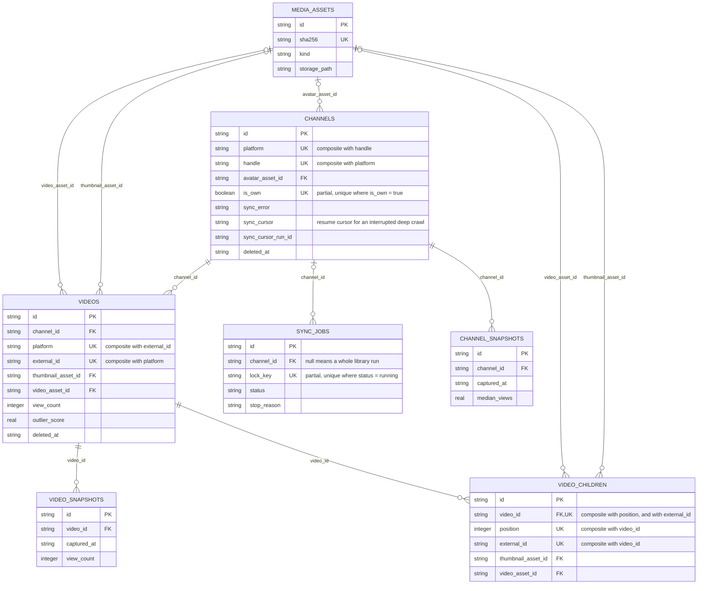
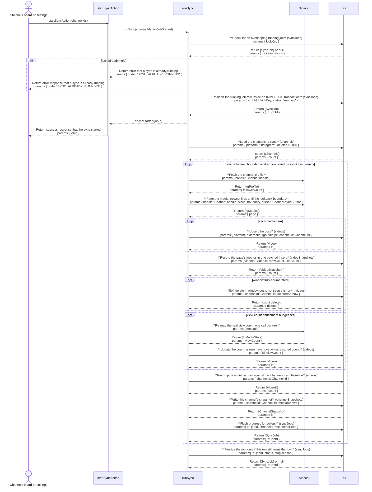

# ig-sync: architecture

`documents/architect/core-components/ig-sync/`

Status: shipped and in daily use, blocked for buyer installs by an onboarding bug that writes an empty `IG_PASSWORD`.

## 1. Module structure

### The Python sidecar (`services/ig/`)

| File | Export | Role |
| --- | --- | --- |
| `crowsnest_ig/app.py` | FastAPI app: `/health`, `/login`, `/challenge/resolve`, `/two-factor`, `/login-by-session`, `/logout`, `/profile`, `/medias`, `/resolve-media`, `/media-stats`, `/download` | The HTTP surface. `require_token` guards every route but `/health` with a constant time compare of `X-IG-Token`; every failure renders as `{"error": {...}}`, never a silently empty result. |
| `crowsnest_ig/config.py` | `Config`, `load_env_file` | Loads and validates the environment once at import. `load_env_file` parses `.env.local` in Python, never by sourcing a shell script, because a real password can contain a quote, `$`, or a backtick. Refuses to start on a bad or missing required value. |
| `crowsnest_ig/session.py` | `SessionManager` | The one long lived, authenticated `instagrapi` client behind a re entrant lock, with login, challenge, and two factor brokering plus one shot session recovery. |
| `crowsnest_ig/mapping.py` | `apply_lookback`, `children_from_media` | DTO mapping, the 3 consecutive lookback boundary, and carousel child extraction. |
| `crowsnest_ig/media.py` | download helpers | Content addressed download into `MEDIA_ROOT`. |
| `crowsnest_ig/ratelimit.py` | backoff and cooldown helpers | Backoff pacing and a cooldown deadline persisted next to the session file. |
| `crowsnest_ig/errors.py` | `IgError` and the `IG_*` taxonomy | Maps instagrapi exceptions onto crowsnest's typed error codes. |
| `crowsnest_ig/device.py` | device pinning | Keeps one stable device profile per session, so the client does not look like a different device on every call. |
| `crowsnest_ig/logging.py` | redacting structured logger | Structured logs with secrets redacted before they are written. |
| `README.md` | (docs) | The operator's reference: the ToS and ban warning, the env schema, the endpoint contracts, and the error code table. |

### The Node side that talks to it (`src/server/`)

| File | Export | Role |
| --- | --- | --- |
| `ig/client.ts` | `igClient`, `mapMedia`, `mapProfile`, `IgProfile`, `IgMedia`, `IgMediasPage`, `IgHealth` | The HTTP client for the sidecar. Every call has a timeout (`AbortSignal.timeout`); a failure is a typed `IgError`, never `[]`. The wire mappers are the boundary where snake_case JSON becomes the TypeScript shape and a missing required field becomes a loud `IG_DRIFT`. `mapHealth` is an internal helper, not exported. |
| `ig/errors.ts` | `IgError`, `IG_ERROR_CODES`, `fromEnvelope`, `SyncAlreadyRunningError`, `classifyIgError`, `IgErrorClass` | The error envelope decoder, the typed error taxonomy, and the `transient`/`auth`/`challenge`/`fatal` classification that the sync engine's retry logic and the run-detail UI both read. |
| `ig/assets.ts` | `ensureAsset`, `tryEnsureAsset` | Downloads a thumbnail, avatar, or video into the app's own media store, content addressed by sha256. |
| `services/sync-engine.ts` | `runSync`, `addChannel`, `requestCancel`, `recomputeChannelScores`, `normalizeHandle` | The sync itself: locking, a bounded worker pool over channels, per channel page walk with cursor resume, upsert, carousel children, soft delete, the view count enrichment pass, and outlier rescoring. |
| `services/sync-batch.ts` | `insertVideoSnapshots`, `VideoSnapshotInsert` | Batches a page's `video_snapshots` rows into one multi-row insert. `runSync` falls back to inserting the page one row at a time when the batch throws, so a single poison row costs one item, not the whole page. |
| `actions/sync-actions.ts` | `startSyncAction`, `startViewCountBackfillAction`, `getSyncProgressAction`, `getChannelSyncProgressAction`, `cancelSyncAction`, `addChannelAction`, `getLatestSyncJob` | The thin `"use server"` wrappers the UI calls. |
| `services/accounts.ts` | `listAccounts`, `getAccount`, `getDefaultAccount`, `addAccount`, `updateAccount`, `removeAccount`, `setChannelAccount`, `setAccountCooldown`, `resolveAccountForChannel`, `accountAvailable`, `planAccountSync`, `accountChildEnv`, `accountPassword` | Multi-account sync (v0.3): the account model, sticky channel assignment, per-account cooldown, and the pure scheduler `planAccountSync` (groups channels by account, splits available from paused or cooling-down ones). `accountChildEnv` is the per-account sidecar env hook. See [multi-account](../../shared/multi-account.md). |
| `actions/account-actions.ts` | `listAccountsAction`, `addAccountAction`, `setAccountStatusAction`, `removeAccountAction` | The `"use server"` wrappers the Settings Accounts section calls (`components/settings/accounts-section.tsx`). |
| `queries/runs.ts` | `getLastRunHealth`, `LastRunHealth` | The most recent sync run's health (status, timings, counts, gaps, whether it is stalled), excluding backfill rows; returns honest nulls when the database has never synced. Consumed by the `crowsnest_channel_stats` MCP tool (`mcp-server.ts`); no dashboard page reads it directly. |
| `config.ts` | `IG_SERVICE_URL`, `LOOKBACK_DAYS`, `MAX_ITEMS_PER_SYNC`, `SYNC_CONCURRENCY`, `SYNC_MAX_RETRIES`, `SYNC_RETRY_BASE_MS`, `EAGER_VIDEO_DOWNLOAD` | The Node side env defaults: `IG_SERVICE_URL` (`http://127.0.0.1:8765`), `LOOKBACK_DAYS` (30), `MAX_ITEMS_PER_SYNC` (200), `SYNC_CONCURRENCY` (1, clamped 1 to 16, DB-overridable through the `syncConcurrency` setting), `SYNC_MAX_RETRIES` (3), `SYNC_RETRY_BASE_MS` (1000), `EAGER_VIDEO_DOWNLOAD` (false). |
| `../cli/service-darwin.ts` | LaunchAgent management | Keeps the sidecar (and the Next server) alive across a reboot; `scripts/ig-service.sh` is the wrapper that loads `.env.local` and execs the module. |

`importReelByUrl` (also in `sync-engine.ts`) and its `importReelAction` wrapper fetch a single reel through the yt-dlp provider (`src/server/providers/ytdlp.ts`), not through this sidecar. It writes into the same `videos` table with the same upsert shape, but it is a feed owned import path, not an ig-sync feature; see [feed](../feed/01-concept-brief.md).

## 2. ER diagram

## 3. Indexes

| Table | Index | Notes |
| --- | --- | --- |
| media_assets | media_assets_sha256 | Unique on `sha256`; a re download of identical bytes collapses to one row and one file, so cache headers can be immutable. |
| channels | channels_platform_handle | Unique on `(platform, handle)`; one row per platform handle. |
| channels | channels_single_own | Partial unique on `is_own` where `is_own = true`; at most one channel can be flagged as the user's own. |
| videos | videos_platform_external | Unique on `(platform, external_id)`; the idempotent upsert key a sync writes through. |
| videos | videos_channel_posted | Plain index on `(channel_id, posted_at)`; backs a single channel's post history in date order. |
| videos | videos_outlier_score | Plain index on `outlier_score`; backs the feed's score sort. |
| videos | videos_view_count | Plain index on `view_count`; backs the feed's unscoped views sort, which has no leading `channel_id` filter. |
| videos | videos_posted_at | Plain index on `posted_at`; backs the feed's unscoped recent sort, kept separate from `videos_channel_posted` because that one only serves an `ORDER BY posted_at` when a `channel_id` equality filter is also present. |
| video_children | video_children_video_position | Unique on `(video_id, position)`; keeps a carousel's children in order and upserts idempotently by position. |
| video_children | video_children_video_external | Unique on `(video_id, external_id)`; idempotent child upsert keyed on Instagram's own child id. |
| sync_jobs | sync_jobs_lock_running | Partial unique on `lock_key` where `status = 'running'`; the single flight lock a sync run holds. `lock_key` is a channel id for a per channel run or the literal `__library__` for a whole library run, because SQLite treats NULLs as distinct in a unique index and a nullable `channel_id` would not have locked two library runs against each other. |
| sync_jobs | sync_jobs_started | Plain index on `started_at`; orders the job history. |

`channel_snapshots` and `video_snapshots` carry no indexes beyond their primary key; both are written once per sync and read by channel id or video id through the existing `videos_channel_posted`/foreign key path.

## 4. Data flow

**One session, over localhost.** The sidecar holds exactly one authenticated `instagrapi` `Client`. It is the only process in crowsnest that logs in to Instagram or ever sees an Instagram CDN URL. The Next.js app reaches it at `IG_SERVICE_URL` (default `http://127.0.0.1:8765`), sending the shared secret `IG_SERVICE_TOKEN` as an `X-IG-Token` header on every request; the sidecar binds loopback only and refuses any other host at boot. Credentials (`IG_USERNAME`, `IG_PASSWORD`) are read by the sidecar process alone from `.env.local` and are never sent to or rendered by the app.

**A sync run** (`runSync` in `sync-engine.ts`):

1. **Acquire the DB lock.** An `IMMEDIATE` SQLite transaction checks for an overlapping `running` job and inserts a `sync_jobs` row. Concurrency is settled by the database, not an in process flag: two runs may hold locks only when their channel sets are disjoint, because two runs on one channel corrupt each other's soft delete.
2. **Per channel, through a bounded worker pool** (`syncConcurrency`, default 1, env `SYNC_CONCURRENCY`, DB-overridable, clamped 1 to 16): fetch the profile (`GET /profile`), download the avatar, then page the media newest first (`GET /medias`) until the lookback boundary. The sidecar still serializes every real Instagram call behind its own process-global lock (`SessionManager` in `session.py`), so raising the pool size never produces concurrent Instagram traffic; it only overlaps one channel's local work (thumbnail download, DB writes, scoring) with the next channel's fetch. At `syncConcurrency = 1` a single worker drains the channel list in order, the same as the old sequential walk. The stop condition is a date (`LOOKBACK_DAYS`, default 30), not a count; `MAX_ITEMS_PER_SYNC` (default 200) is only a safety cap. Pinned posts appear first and out of order, so the walk stops only after 3 consecutive out of window items, and a pinned item never counts toward that streak. A channel resumes from a persisted cursor (`channels.syncCursor`/`syncBoundary`/`syncCursorAt`/`syncCursorRunId`) when a prior run left it mid-window (item cap, cancel, or a channel error) and that cursor is younger than the lookback window; otherwise the walk starts fresh from the top.
3. **Upsert each post** keyed on `(platform, external_id)`. Carousels are one `videos` row with `video_children` rows, not separate posts. Thumbnails download into the app's own media store; video is on demand on first play unless `EAGER_VIDEO_DOWNLOAD` is set. Before a page's items are written, one lookup (`storedThumbs`) finds which post and carousel slide thumbnails are already stored, and only the missing ones are fetched, in parallel on one process-wide queue (`thumbQueue`, 4 in flight across every channel worker). A known post keeps the thumbnail it has; a post whose earlier download failed has no stored thumbnail and is retried. These are CDN fetches through the sidecar's `/download`, which does not take the Instagram session lock, so the queue adds no Instagram API calls. The page's heartbeat is flushed after each download, so a slow page cannot look dead to the reaper. A page's `video_snapshots` rows are written in one multi-row insert (`insertVideoSnapshots`) rather than one per item; if the batch throws, the page falls back to inserting one row at a time so a single poison row costs one item, not the rest of the page.
4. **Soft delete** in window posts that did not come back this run, but only when the run actually enumerated the whole window (`stop_reason` lookback or exhausted), saw at least one item, and was not itself resumed from a cursor. A resumed run only walked the remainder below its cursor, never the posts above it, so it cannot tell which of those are gone; a run that saw zero items refuses to interpret an empty fetch as deletions.
5. **View count enrichment** (off unless `viewCountEnrichPerChannel` is greater than zero): the listing endpoint returns `play_count: 0` for other creators' reels, so the newest N `clips` are re read one at a time through `POST /media-stats` (`media_info_v1`) to get the real number.
6. **Rescore**: `recomputeChannelScores` reads `videos.view_count`, computes each post's outlier score against the channel's own baseline, and writes a `channel_snapshots` row. Sync stops here: it mirrors Instagram metadata and assets and nothing else, and stamps `lastSuccessfulSyncAt` on a clean finish. Auto analyze and idea generation are no longer part of the sync path (they downloaded and transcribed full videos and issued LLM calls per channel); they stay exported for an explicit user action or a queued job to run.
7. **Finalize** the job row, but only if this run still owns it (a reaper may have declared it dead). Status is `success`, `partial` (a survivor plus a gap, or a cancel that left work undone), or `failed` (every channel failed). A channel gap's error code is classified by `classifyIgError` into `transient`, `auth`, `challenge`, or `fatal`; only `transient` was worth retrying, and the run-detail view shows the class next to the gap.

**Asset serving.** Downloaded bytes are content addressed (`<sha256[0:2]>/<sha256>.<ext>` under `MEDIA_ROOT`), deduped, and served by the app so the browser never renders a signed Instagram URL that expires within hours. `POST /resolve-media` re resolves a single post's currently valid URLs before an on demand video download.

**Detached start.** `startSyncAction` returns the moment the lock is won (job id in hand, via `onJobStarted`) and lets the run finish under Next's `after()`, so the browser never holds a POST open for a minutes long sync. It accepts an optional `channelIds` array and syncs exactly those channels, which is the one seam every trigger reuses: a card's Sync now passes a single id, the channels board's multi-select Sync selected passes the ticked ids, and the scheduler and settings pass none for a whole library sweep. Selecting which channels to sync is board-local UI state (`components/channels/`), never a column, so it adds no table and no engine path. Assigning a channel to an account, by contrast, is a persisted column (`channels.accountId`, v0.3 multi-account), which is a different thing from the per-run selection above. Progress and cancel both go through the `sync_jobs` row: `getSyncProgressAction` polls it, `cancelSyncAction` sets `cancel_requested`, and the engine notices co operatively at the next page or channel boundary, keeping everything already committed.

## 5. Sequence: one sync pass

## 6. Key decisions

- **Python sidecar, not in process.** instagrapi is Python, and its `Client` holds the session, the pinned device profile, and the cookie jar. A process per call design would re authenticate constantly, and a storm of logins is exactly what gets an account challenged. A long lived sidecar is the only shape where one warm session, request pacing, and session recovery are real code paths. (Concept brief; `services/ig/README.md`.)
- **instagrapi despite the ToS risk.** Instagram's Basic Display API shut down 2024-12-04 and the Graph API cannot enumerate an arbitrary creator's media. instagrapi drives the private mobile API, which is against Instagram's Terms and can get the account rate limited, challenged, or banned, a disclosed trade off, which is why it is meant for a burner account. This also replaced a paid vendor (Apify) so the product depends on no third party.
- **A failure is never an empty result.** Both the sidecar and the Node client return a typed `IG_*` error and let the caller decide. An empty list on error would silently bury a channel.
- **Zero means not disclosed, not zero.** Instagram returns `play_count: 0`/`view_count: 0` for other creators' reels in many contexts. Taking that literally once zeroed a genuine 2.27M view reel and would drive every outlier score to zero, so a zero is mapped to null and never overwrites a count already stored.
- **Drift is a decision, not a surprise.** instagrapi is pinned `==2.18.9`; required fields (`pk`, `code`, `taken_at`, `media_type`) missing or mistyped raise `IG_DRIFT` with the raw payload; unknown new fields are ignored.
- **Config refuses to boot half configured.** The sidecar exits 78 (`EX_CONFIG`) on any bad or missing required value rather than answering requests it cannot honor. `IG_USERNAME` and `IG_PASSWORD` must be set together, the failure mode the onboarding bug below trips.
- **Loopback only, shared secret authenticated.** The sidecar refuses a non loopback `IG_SERVICE_HOST`, and `IG_SERVICE_TOKEN` (min 16 chars) is the only thing between a local process and the Instagram session. The session blob is written mode 0600.
- **Bounded concurrency over channels, not full parallelism.** `session.py`'s `SessionManager` holds one process-global re entrant lock and enforces its cooldown inside it, so every real Instagram call is already serialized regardless of how many Node requests arrive. Raising `syncConcurrency` therefore cannot create concurrent Instagram traffic; the only win is pipelining one channel's local work against the next channel's fetch, measured at 1.02x. Default 1, because that overlap is negligible against the sidecar's process-global lock while a second worker doubles native transcription memory. The knob stays (ceiling 16) for anyone who wants to opt in.
- **Multi-account is additive and honest about its limit (v0.3).** `services/accounts.ts` adds an account model (`ig_accounts`), sticky channel assignment (`channels.accountId`), and a pure scheduler (`planAccountSync`) that groups a sync by account and keeps one account's cooldown or failure from stopping the others. It is additive: with a single default account, `planAccountSync` returns one group with every channel, so the path above is byte-for-byte unchanged. Within an account, the sidecar's process-global lock still serializes every call (the rate-limit safety is preserved, not weakened). Across accounts, v0.3 runs sequentially with isolated per-account state; it does not yet run live bounded-parallel traffic across separate sidecars, because verifying that needs live per-account credentials. The per-account sidecar hooks (`accountChildEnv`, the account's `port` and `sessionPath`) exist for that next step. Nothing is called parallel that is not. See [multi-account](../../shared/multi-account.md).
- **Resume cursor lives on `channels`, not a new run-scoped table.** An interrupted deep crawl (item cap, cancel, or a channel error) needs to remember exactly one thing across runs: where to continue. Four nullable columns on the row a sync already reads and writes is smaller than a new table, and a TTL guard (the cursor must be younger than the lookback window) keeps a long-abandoned crawl from resuming a boundary that no longer covers today's window. A cap that trips on the run's very first fetch has no request cursor of its own to persist (nothing was requested to reach it); it falls back to that page's own next-page cursor, which the sidecar's `/medias` now reports even on a `cap` stop (previously nulled, treating `cap` as terminal like `lookback`/`exhausted`), so the next run advances past the page instead of re-fetching its same truncated head forever.
- **Batched snapshot inserts, with a per-row fallback.** A page's `video_snapshots` rows go in one multi-row insert instead of one per item. If the batch throws, the page retries one row at a time so a single poison row costs one item, not the rest of the page, the same failure-isolation guarantee the per-item upsert already made.
- **Automatic sync is one in-process interval, cadence-gated on the newest job row.** `sync-scheduler.ts` mirrors `publish-scheduler.ts`: one `setInterval` started from `server.ts`, a reentrancy guard, and a tick that never throws. Each tick reads `syncCadenceMinutes` (0 disables it), reads the newest `sync_jobs` row, and starts a library sweep only when no sync is running and the cadence has elapsed since that row's `startedAt`. The cadence clock is that job row, not a new table, so a manual sync also defers the next scheduled one and the marker survives a restart. The swept run passes `skipFreshWithinMinutes` equal to the cadence, so it only walks channels that are actually stale.
- **`lastSuccessfulSyncAt` is the only trusted completion time.** It is stamped at the end of a channel sync that finished without a user cancel, unlike `lastSyncedAt`, which is written near the start right after the profile call and so reads fresh for a channel cancelled mid-walk. A library sweep with `skipFreshWithinMinutes > 0` drops channels synced within that window, but never drops a channel that has never had a clean sync (its `lastSuccessfulSyncAt` is null).

## 7. Open, not verified

- **The sidecar won't start onboarding bug** (`evidence/10-onboarding-bugs.md`, BUG 1): `kai kit init`'s masked `IG_PASSWORD` prompt returned empty on a real TTY, so `.env.local` was written with `IG_PASSWORD=` (length 0). The sidecar then refuses to start, `IG_USERNAME and IG_PASSWORD must be set together`, exit 78 `EX_CONFIG`, and launchd crash loops it, so port 8765 never comes up and IG sync is dead for every buyer. The root cause is in the CLI prompt (`src/cli/kai.ts`), not the sidecar; `config.py` is proven correct. This is a hard blocker for the IG half of the product.
- **No live sync has been proven end to end.** Per `documents/architect/shared/packaging-and-release.md`, a Kit install has not been shown to complete a live Instagram sync with real credentials; the buyer test that exercised the installer left the Instagram fields blank.
- **Live only paths are untested offline** (`services/ig/README.md`): a real `/login`, challenge or two factor round trip, a genuine Instagram issued rate limit, and a real CDN asset download. The SMS preference challenge branch in particular has never run against Instagram.
- **Performance, measured deterministically; live numbers still pending.** `scripts/bench-sync-concurrency.ts` runs the real engine against a stub sidecar. Two findings. First, the real win is fewer requests, not more workers: a repeat sync of an unchanged channel (5 pages of 6 posts) drops from 37 Instagram requests and 1615 ms to 9 requests and 393 ms once the incremental walk stops at the first all known page, a 76 percent request cut. Second, concurrency barely moves wall clock on today's single session sidecar: a 5 channel sync at `syncConcurrency` 1 versus 2 is 1.02x, because every Instagram call queues behind the sidecar's one process global lock (the model that lets calls overlap shows 1.67x, the ceiling a future per session sidecar would reach). The knob is safe and future proofing, not a win now. A live run against three real channels through the running sidecar confirms the incremental win end to end: a cold sync (full walk of all three) took 56.0s and downloaded 84 assets across 56 posts seen, and an immediate repeat took 26.9s with 41 assets across 30 posts seen and created zero, stopping at `upToDate` on every channel. That is 2.1x faster on the repeat with about half the asset downloads, on real Instagram, with no challenge and no gaps.
