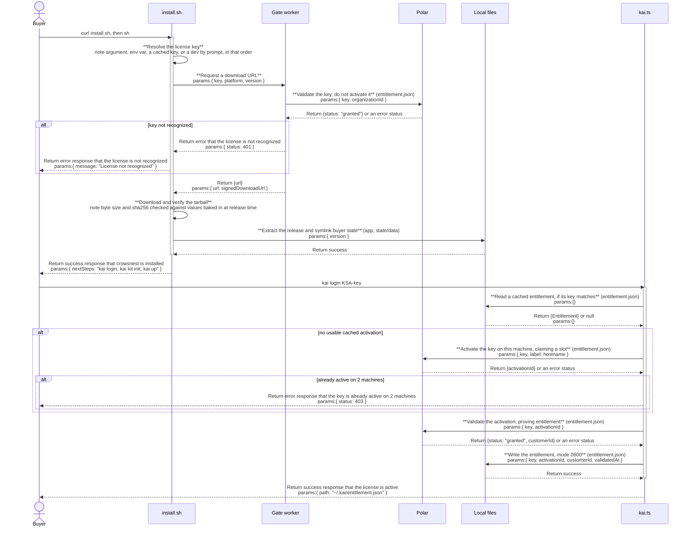

# kit: architecture

`documents/architect/core-components/kit/`

Status: shipped and installable, blocked for a live Instagram sync by an onboarding bug that writes an empty IG_PASSWORD.

## 1. Module structure

### Packaging (`packaging/`)

| File | Export | Role |
| --- | --- | --- |
| `platforms.json` | (data) | One key per platform (today just `darwin-arm64`), pinning node, python build standalone, and uv versions. CI and the installer template both read this file, so a new platform is a new key plus its wheels, not a script rewrite. |
| `build-bundle.sh` | (script) | Builds one platform's tarball from `platforms.json`, then self tests it: a relocatability lint, native module load, python import, and a server boot. |
| `install.sh.template`, `gen-install.sh` | (script) | The buyer installer template and the release time step that bakes that release's version, sha256, and byte size into a concrete `install.sh`. |
| `release.sh` | (script) | Refuses a version with no matching `## <version>` section in `CHANGELOG.md`, then runs `build-bundle.sh`, generates `install.sh`, and uploads the tarball, `install.sh`, and `latest.json` to R2. |
| `worker/src/index.ts` | Cloudflare Worker `fetch` handler | The gate: `GET /install.sh` and `GET /latest.json` (public, no secret in either object), `POST /download` (validates a key against Polar, mints a 15 minute HMAC token), `GET /dl` (verifies the token, streams the tarball from the R2 binding). |
| `README.md`, `CHANGELOG.md` | (docs) | What is live today and how to cut a release. |

### The CLI (`src/cli/`)

| File | Export | Role |
| --- | --- | --- |
| `kai.ts` | CLI entry point | All ten commands (`login`, `status`, `kit init`, `up`, `start`, `stop`, `mcp`, `doctor`, `update`, `rollback`) plus the internal `_postupdate` hook the installer calls after an update. Owns the `ask()` prompt helper that both non-secret and secret (masked) prompts go through. |
| `mcp-register.ts` | MCP client registration | The pure, tested bits behind `kai mcp`: the Codex `config.toml` upsert, the streamable-HTTP response parser (JSON or SSE), the config generators, and the side-effecting registration for Claude Code (via its CLI) and Codex. |
| `license.ts` | `login`, `activate`, `validate`, `readEntitlement`, `writeEntitlement`, `entitlementPath`, `LicenseError` | Talks to Polar's customer portal endpoints directly, with no bearer token; the license key itself is the credential. Caches the result as `~/.kai/entitlement.json`. |
| `service-darwin.ts` | `services`, `start`, `stop`, `running`, `installed` | The one macOS specific module: writes and loads LaunchAgent plists for the Next.js server and the Instagram sidecar. |
| `runtime.ts` | `appRoot`, `bundleRoot`, `isBundle`, `nodeBin`, `uvBin`, `pythonBin`, `tsxBin`, `igDir`, `igVenvPython`, `stateDir`, `logDir`, `wheelhouse` | Shared path and mode helpers. `isBundle` is true when sibling `bin/node` exists next to the app directory, the signal that this process is running from an installed tarball rather than the dev repo. `bundleRoot` is the directory one level above `appRoot` that carries the bundle's sibling `bin/`, `runtime/`, and `wheelhouse` dirs; `pythonBin` resolves to the bundled `runtime/python/bin/python3` in a bundle or the host's `python3` otherwise. |

### Related script

| File | Role |
| --- | --- |
| `scripts/fix-node-pty-perms.mjs` | Runs as the `postinstall` npm hook, which fires during the `npm ci` step `kai kit init` runs in the dev repo (a bundle install skips `npm ci` entirely, since its `node_modules` already ships pruned). |

## 2. Entitlement and state files

The Kit touches no application database table: `kai kit init` runs the same `migrate.ts` and `bootstrap.ts` scripts the dev repo uses to create every table in `src/server/db/schema.ts`, but it does not itself own or write into any of them. Its own persistent state lives entirely in flat files on disk, not in SQLite rows.

| File | Location | Written by | Read by |
| --- | --- | --- | --- |
| `entitlement.json` | `~/.kai/entitlement.json` (or `$KAI_HOME/entitlement.json` if set), mode 0600 | `kai login`, via `writeEntitlement` in `license.ts` | Every license gated command (`kai kit init`, `kai up`, `kai start`, `kai doctor`, `kai update`), via `readEntitlement` |
| `.env.local` | `<app>/.env.local`, symlinked from `~/.kai/state/env.local` after a first install | `kai kit init`, via `setEnv` in `kai.ts`, mode 0600 | The Next.js server and the Instagram sidecar at boot; never read by the CLI itself after writing it |
| `state/data` | `~/.kai/state/data`, symlinked into `<app>/data` | The install script, on first extract | The SQLite database the app opens, which is what `migrate.ts`/`bootstrap.ts` actually populate |
| version directories and `current` | `~/.kai/app/v<version>`, `~/.kai/app/current` (a symlink) | The installer, on every install or update | Every `kai` command, to resolve `appRoot` |
| LaunchAgent plists | `~/Library/LaunchAgents/com.crowsnest.server.plist`, `com.crowsnest.ig.plist` | `kai start`/`kai up`, via `service-darwin.ts` | launchd |

`install.sh.template` and `license.ts` read the cached license key from two different paths: the installer checks `$STATE/entitlement.json` (`~/.kai/state/entitlement.json`) to reuse a key on an update, while `kai login` writes and reads `~/.kai/entitlement.json`, one directory up. This mismatch is carried into section 6 below rather than stated as settled behavior.

## 3. Data flow

**Install.** The buyer's `curl | sh` fetches `install.sh` from R2 through the gate worker on a route that needs no license, since the script itself holds no secret. The script resolves a license key (an argument, `KAI_LICENSE_KEY`, a cached key, or a `/dev/tty` prompt), POSTs it to the gate's `/download` route, and on a valid key gets back a 15 minute signed R2 URL. It downloads the tarball, verifies its byte size and sha256 against values baked into the script at release time, extracts it to `~/.kai/app/v<version>`, symlinks `~/.kai/state` into it, builds the Instagram sidecar's Python virtual environment from the bundled wheelhouse with no network, flips `~/.kai/app/current` to the new version, and links `~/.local/bin/kai`.

**License and download gate.** These are two separate checks against Polar, on purpose. The gate worker's `/download` route only validates the key, it never activates it, so a download or reinstall never spends one of the buyer's two activation slots. `kai login <key>` is the separate call that actually activates the key and caches the result as `~/.kai/entitlement.json`. Every other license gated command reads that cached file rather than calling Polar again.

**Kit init.** `kai kit init` requires a cached entitlement first. It writes `.env.local` from `.env.example` (or edits it in place if present), prompts for the Instagram account (`IG_USERNAME`, then `IG_PASSWORD` if a username was given, the latter meant to be masked), generates `IG_SERVICE_TOKEN` if it is still the placeholder value, prompts for an optional `ANTHROPIC_API_KEY`, and asks for `VAULT_PATH` (default `~/.crowsnest/vault`), creating the directory. It then runs the database migrations and bootstrap scripts directly through `node -> tsx` (never through `npm run`, which would resolve to the buyer's own node if one happened to be on PATH), calls the same routine as `kai up`, and finally runs `kai mcp` to register the MCP server so the buyer's agent can drive crowsnest right away.

**MCP registration.** `kai mcp` probes the live `/api/mcp` endpoint with a real tools/list, registers the server with Claude Code (via its CLI at user scope, remove then add so it is idempotent) and Codex (an idempotent upsert of `~/.codex/config.toml`), and prints copy-paste config for Claude Desktop and any generic MCP client. `kai mcp --print` only prints, never writes. It is never fatal: a failed client registration still leaves the printed config as the manual fallback, and `kai doctor` reports whether the endpoint answers.

**Up and the services.** `kai up` and `kai start` hand off to `service-darwin.ts`, which writes and loads LaunchAgents for the Next.js server and the Instagram sidecar so both survive a reboot or a closed terminal. `kai up` then polls `http://localhost:3000` for up to 25 seconds and opens it in the default browser on success; on failure it prints the tail of the relevant log and points at `kai doctor`.

**Release.** A maintainer pushes a tag (`git tag v0.2.1 && git push origin v0.2.1`). The release workflow builds the arm64 bundle, bakes the fresh tarball's size and sha256 into `install.sh`, and uploads the tarball, `install.sh`, and `latest.json` to R2. It refuses to run if `packaging/CHANGELOG.md` has no matching `## <version>` section. `kai update` re-runs the same `install.sh` against the newer version and preserves `~/.kai/state` through the same symlink scheme used on first install.

## 4. Sequence: install and license

`Files` stands in for both the flat entitlement file and the symlinked buyer state directory, the closest thing this component has to the DB participant in a schema backed component's sequence diagram; it is never activated, the same convention `references/drizzle-er-and-sequence.md` uses for `DB`.

## 5. Key decisions

- **Ship `next build` output plus a pruned `node_modules` (production dependencies and `tsx`), not a compiled standalone server.** The app runs through a custom `server.ts` and several `tsx` scripts (migrate, bootstrap); a standalone build would mean precompiling the server and rewriting that script family. The pruned bundle approach costs tarball size but keeps the buyer's runtime identical to how the app already runs in development, so a release is a tag push rather than a parallel build pipeline to maintain.
- **The download gate validates only; `kai login` activates.** Keeping these separate means a buyer can redownload or reinstall as often as they want without spending a Polar activation slot; activation is spent only by an explicit `kai login`.
- **The tarball's sha256 and byte size are baked into `install.sh` at release time**, so even a compromised worker or R2 bucket cannot serve a tampered build that still passes the installer's own verification.
- **Buyer state lives outside the versioned install directory**, at `~/.kai/state`, symlinked into whichever version is current. This is what lets `kai update` swap `~/.kai/app/current` to a new version without touching the buyer's database, config, or downloaded media.
- **Runtime pins are data, not code.** `packaging/platforms.json` is the one file CI and the installer template both read for node, python build standalone, and uv versions per platform, so supporting a new platform later is a new key and a wheelhouse build, not a script rewrite.
- **Apple Silicon only for v1.** `install.sh` detects a real Intel Mac, as opposed to Rosetta, and refuses with a refund pointer rather than attempting an unsupported build. Intel, Windows, and Linux are explicitly future work.
- **Prompts read through one readline interface's async iterator, not `question()`.** `question()` drops lines when stdin is a pipe, so `kai kit init < answers` (piped, non interactive) works because the iterator queues the lines instead of losing them; this is also the code path where the onboarding secret prompt bugs in section 6 live.

## 6. Open, not verified

- **`kai kit init`'s masked IG_PASSWORD prompt returns empty on a real terminal** (`documents/archive/evidence/10-onboarding-bugs.md`, BUG 1). `.env.local` is written with `IG_PASSWORD=` (length 0); `IG_USERNAME`, the non secret prompt just before it, saves fine. The Instagram sidecar then refuses to start, "IG_USERNAME and IG_PASSWORD must be set together", exit 78 (`EX_CONFIG`), and launchd's KeepAlive crash loops it, so port 8765 never comes up. The piped path (`kit init < answers`) is unaffected, which is why this is a real terminal specific defect rather than a general one. The root cause is in `src/cli/kai.ts`'s `ask()` helper, not the sidecar; the sidecar's own config loading is proven correct. This is a hard blocker for the Instagram half of the product for every buyer who runs `kit init` interactively.
- **The same secret prompt path fails to suppress echo for `ANTHROPIC_API_KEY`** (`documents/archive/evidence/10-onboarding-bugs.md`, BUG 2), so the key is printed as typed and lands in terminal scrollback. The key is still saved correctly; this is a security and UX defect, not a functional blocker.
- **No live install has been proven to complete a real Instagram sync or a real AI analysis with real credentials.** Per `documents/architect/shared/packaging-and-release.md`, the one buyer test that exercised the real installer hit BUG 1 before Instagram sync could run at all, so the Instagram half was never exercised end to end with real credentials.
- **The entitlement path the installer reads for a cached key on update does not match where `kai login` writes it.** `install.sh.template` reads `$STATE/entitlement.json` (`~/.kai/state/entitlement.json`); `license.ts` writes `~/.kai/entitlement.json`. This has not been proven to bite in the field against a real second release; it may simply fall back to prompting for the key again on update.
- **The no proxy LLM path is unverified end to end.** The app defaults to reaching the real Anthropic API directly with no local proxy; a live analysis run through a fresh Kit install has not confirmed this path end to end.
- **`kai update`'s default install URL points at a custom domain that is not set up.** It defaults to `https://get.crowsnest.sh/install.sh`; the live install URL is the raw `crowsnest-gate.kaiships.workers.dev` subdomain. An update on a machine without `KAI_INSTALL_URL` set would hit an unconfigured host. Not yet proven in the field.
