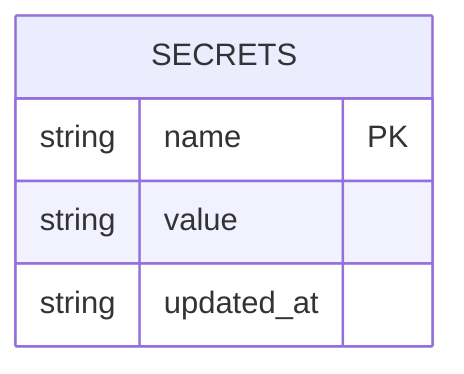
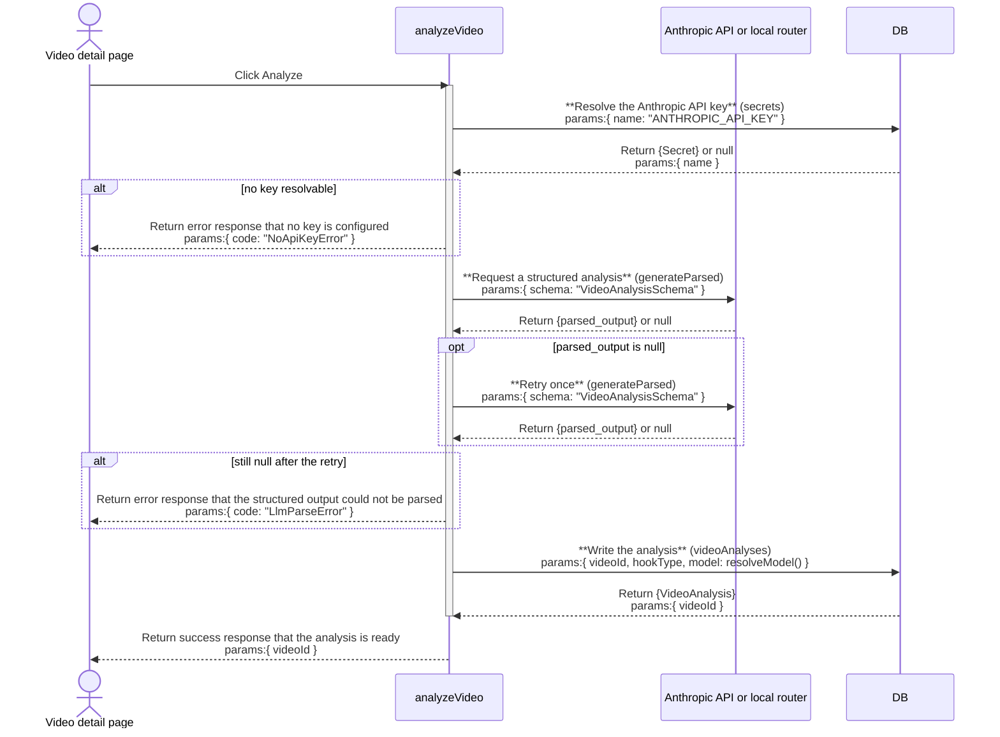

# llm: architecture

`documents/architect/core-components/llm/`

Status: shipped and in use by analyze and remix, the no-proxy path has not been proven to complete a live generation end to end.

## 1. Module structure

| File | Export | Role |
| --- | --- | --- |
| `src/server/llm/client.ts` | `LlmClient`, `AnthropicLlmClient`, `CompatLlmClient`, `NoApiKeyError`, `LlmParseError`, `resolveModel`, `hasLlmKey`, `isCompatMode`, `getLlm`, `resetLlmClient`, `_createLlm`, `_createCompatLlm` | The whole layer: the client interface, its two implementations, the model resolver, the key check, the compat-mode check, the lazy singleton, the cache reset, and the test-only constructor seams. Nothing else in the app constructs an Anthropic client. |
| `src/server/llm/schemas.ts` | `VideoAnalysisSchema`, `HookOptionsSchema`, `OutlineSchema`, `IdeaSchema`, `VideoLayoutSchema`, `BeatLayoutSchema`, `VideoLayoutFieldSchema`, `LegacyFlatVideoLayoutSchema`, `asBeatLayout` | The Zod schemas every structured call validates against. `VideoAnalysisSchema` (analyze), `HookOptionsSchema` and `OutlineSchema` (remix), `IdeaSchema` (ideas). The layout schemas describe the shape a future frame pass would produce; no caller constructs a `VideoLayout` today. These are the enforced contract; the prompts describe the same shape in prose. |
| `src/server/llm/error-message.ts` | `llmErrorMessage` | The one place the typed `@anthropic-ai/sdk` error hierarchy is mapped to a user-facing string. Checked most-specific-first: `AuthenticationError`, then `RateLimitError`, then `APIConnectionError`, then the base `APIError`. `NoApiKeyError` is deliberately not handled here; it is not an SDK class, and every call site gives it its own feature-specific message first. |
| `src/server/llm/generation-probe.ts` | `probeLlmGeneration`, `GenerationProbeState`, `GenerationProbeResult` | The health check that actually calls `generateText` (a one-word prompt, `maxTokens: 8`) rather than only pinging, and classifies the result into `up`, `reachable_unverified`, or `down`. |
| `src/server/llm/router-control.ts` | process supervisor for the local 9router proxy | Starts, tracks by pid, and stops only the pid it started; probes reachability. Not part of the request path; it manages the proxy the compat client talks to. |
| `src/server/secrets/store.ts` | `getSecret`, `setSecret`, `clearSecret`, `secretStatus`, `MANAGED_SECRETS` | `getSecret` (database first, environment fallback) resolves the API key. A key set through Settings takes effect without a restart because the database row wins over the environment variable. Shared by every managed secret in the app, not owned by llm alone. |
| Callers | | `src/server/services/analyze.ts`, `src/server/services/remix.ts`, and `src/server/services/ideas.ts` invoke the client; `src/server/actions/settings-actions.ts` and `src/server/actions/router-actions.ts` drive `ping` and the probe. |

## 2. ER diagram

The llm layer owns no table of its own. It is a stateless request-time layer: every call it makes starts from a caller's own data (a transcript, a session field) and ends either with a returned value the caller persists, or a thrown error the caller maps to a user-facing state. The one row it reads is the Anthropic API key, held in the shared `secrets` table that `src/server/secrets/store.ts` owns.

`secrets` is keyed by `name` (for example `ANTHROPIC_API_KEY`), so a key lookup is a primary-key read, not a scan. The table has no foreign keys and no relationship to any table the llm layer's callers own; it is a flat lookup shared across all eight managed secrets in the app, of which the Anthropic key is one.

## 3. Indexes

| Table | Index | Notes |
| --- | --- | --- |
| secrets | primary key on `name` | Every read `getLlm()` makes (`getSecret("ANTHROPIC_API_KEY")`) is already a primary-key lookup; no additional index exists or is needed. |

## 4. Data flow

**Which client is built.** `getLlm()` throws `NoApiKeyError` immediately if no key is resolvable, so no request is ever attempted without a credential. With a key it constructs a single Anthropic instance and wraps it: `CompatLlmClient` when `LLM_BASE_URL` is set (`isCompatMode()`), `AnthropicLlmClient` otherwise. The instance is cached as a module-level singleton; `resetLlmClient()` nulls it so the next call re-resolves the key and base URL from scratch. The key comes from `getSecret("ANTHROPIC_API_KEY")` and is passed explicitly to the constructor, because a zero-arg `new Anthropic()` would read only `process.env` and never see a database-only key. `LLM_BASE_URL` is not a managed secret, so it is read straight from the environment.

**Which model.** `resolveModel()` returns `process.env.CLAUDE_MODEL ?? "claude-sonnet-5"`. The default is Claude Sonnet 5 (`claude-sonnet-5`, 1M context, $2 input and $10 output per 1M tokens; verified against the claude-api skill's current model table, the cheapest of the Sonnet and Opus tier). The resolver is exported so a caller that persists which model produced a result, `analyze.ts` writing `model: resolveModel()` onto the `video_analyses` row, reuses the same logic rather than re-deriving it.

**The native path (`AnthropicLlmClient`).** `generateText` calls `messages.create` and concatenates only `type === "text"` blocks. `generateParsed` calls `messages.parse` with `output_config: { format: zodOutputFormat(schema) }`, the SDK's native structured-output support, and returns `response.parsed_output`. On a `null` parsed output it retries once, then throws `LlmParseError`; a non-2xx failure raises a typed SDK error from `.parse()` itself and is not retried. No `temperature`, `top_p`, or `thinking` parameter is sent: Sonnet 5 rejects non-default sampling parameters, and omitting `thinking` runs adaptive thinking, which is already the default. `max_tokens` defaults to 2048.

**The compat path (`CompatLlmClient`).** A local OpenAI-compatible router (9router) at `LLM_BASE_URL` translates the Anthropic streaming wire format but not the non-streaming one, and ignores `output_config.format` because the free backing models have no structured-output support. So this client always streams and reads the result via `finalMessage()`, and implements `generateParsed` as prompt-engineered JSON: the JSON Schema is appended to the system prompt, and `parseLooseJson` strips markdown fences and any prose around the outermost `{...}` before `JSON.parse` and Zod validation, the same one-retry-then-`LlmParseError` contract as the native path. Its default `max_tokens` is 8192, higher than native because routed models spend a large share of the budget on `thinking` tokens.

**The key check (`ping`).** Both clients implement `ping` as a `messages.countTokens` call, which costs nothing and consumes no generation quota. It succeeds only if the key is valid and reachable, and throws the same typed SDK errors otherwise. It backs the Settings Test button through `testAnthropicKeyAction`.

**The generation probe.** `probeLlmGeneration` runs `ping` and a real `generateText` concurrently, each independently timed out. Non-empty generated text means `up`, the only state that proves the configured model actually generates; a passing ping with failed generation means `reachable_unverified`; neither answering means `down`. This exists because in compat mode a passing `count_tokens` (tokenized locally by the router) does not prove `/v1/messages` works; the router can fail with a 410 for the same model.

## 5. Sequence: reaching the model for one grounded generation call

The example below follows `analyzeVideo` (`src/server/services/analyze.ts`) calling `client.generateParsed` for a video's structured breakdown, the same key-resolution and retry mechanics every caller of this layer goes through.

`generateParsed`'s key resolution and retry happen inside `getLlm()` and the client itself; the diagram surfaces them as steps on `analyzeVideo` because that is the caller a reader traces the request through, the same convention the module structure table above uses for "nothing else constructs an Anthropic client." A non-2xx SDK error (an `AuthenticationError` or a connection failure) is not shown as a separate branch here because it propagates untouched, unlike the null-parsed-output case, which is retried once inside the layer before it reaches the caller.

## 6. Key decisions

- **One client interface, two implementations, picked at runtime by `LLM_BASE_URL`.** Callers inject a fake `LlmClient` in tests (`opts?.llm ?? getLlm()`), so every service test runs with zero live API calls. Neither caller knows or cares which real client is behind the interface.
- **The key gate lives in the layer, not in every caller.** `getLlm()` throws `NoApiKeyError` before any request, so the distinction between "no credential, nothing attempted" and "credential present, request failed" is held in one place. Callers map the two to different user-facing surfaces, a block panel reason in remix, a key alert in analyze, via `llmErrorMessage`.
- **Structured output is native where it can be and prompt-engineered where it cannot.** The native path trusts the SDK's `zodOutputFormat`; the compat path cannot, because the router drops `output_config.format`, so it asks for JSON in the system prompt and parses by hand. Both keep the identical one-retry-then-fail contract so callers see the same `LlmParseError` regardless of route.
- **The key is resolved through the secret store, not the environment alone.** `getSecret` is database first, so a key entered in Settings takes effect immediately; `resetLlmClient()` (called on any key change) drops the cached client so the new key is picked up without a server restart.
- **A key is required on both paths.** `LLM_BASE_URL` only changes where the request is routed, not whether a key is needed. There is no fully keyless path through this layer the way there is for local transcription (whisper.cpp).
- **The layer owns the request and the retry; callers own the failure.** It does not decide what a failure looks like on screen, does not own transcription, and does not own the Graph API metrics; those are separate external dependencies with their own failure surfaces (see [external services](../../shared/external-services.md)).

## 7. Open, not verified

- **The no-proxy path is unproven end to end.** Per [packaging and release](../../shared/packaging-and-release.md), a real Kit install talking straight to the Anthropic API with its default model, no local router in front of it, has not been shown to complete a live analysis or remix generation with real credentials.
- **A live onboarding bug affects this layer's one input.** `kai kit init`'s `ANTHROPIC_API_KEY` prompt is meant to be masked (`ask({ secret: true })`, `src/cli/kai.ts:151`) but echoes the key in plaintext on a real TTY, landing it in terminal scrollback. This is a security and UX issue in the CLI's onboarding prompt, not a functional blocker in this layer; `getLlm()` and the secret store behave the same whether the key reached `.env.local` cleanly or not.
