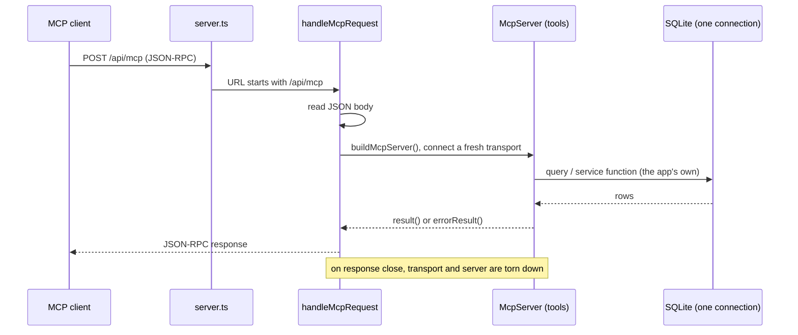

# mcp: architecture

`documents/architect/core-components/mcp/`

Status: shipped, mounted in-process at `/api/mcp` over the app's one SQLite connection, exposing 19 `crowsnest_*` tools (seven read, twelve remix).

## 1. Module structure

| File | Export | Role |
| --- | --- | --- |
| `src/server/mcp/mcp-server.ts` | `buildMcpServer`, `result`, `errorResult`, `mediaInfoFor`, `MediaInfo` | The server factory and the tool contract. `buildMcpServer` constructs an `McpServer` and registers all 19 `crowsnest_*` tools, each a thin wrapper over an existing query or service function. `result`/`errorResult` are the output contract; `mediaInfoFor` is the media handoff helper. |
| `src/server/mcp/http.ts` | `handleMcpRequest` | Bridges the app's raw Node http server to the MCP streamable HTTP transport. Reads the JSON body on POST, builds a fresh server and a stateless transport per request, and tears both down when the response closes. A thrown error becomes a JSON-RPC 500 envelope, never an unhandled crash. |
| `server.ts` (repo root) | (the app server) | Routes any request whose URL starts with `/api/mcp` to `handleMcpRequest`, in-process; everything else goes to Next. This is what keeps the MCP on the app's one SQLite connection. |

The server owns no schema and no migration. Every table it touches belongs to another component and is reached only through that component's query or service function.

## 2. In-process mount

The MCP is not a separate service. `server.ts` is the app's own Node http server: it prepares Next, then, before handing a request to Next, checks the URL. A request to `/api/mcp` goes to `handleMcpRequest`; everything else goes to the Next request handler.

Because the tool handlers call the app's own query and service functions, and those hold the single SQLite connection the app already opened, the MCP reads and writes through that one connection. It never opens a second. On a single-user SQLite database that tolerates one writer, a second process would race the app's writes; the in-process mount is what forecloses that.

The transport is stateless: `handleMcpRequest` builds a new `McpServer` and a new `StreamableHTTPServerTransport` (with `sessionIdGenerator: undefined`) for each request and closes both when the response closes. There is no session table and no cross-request state in the server itself; state lives in the database the tools read and write. This is enough for a single local user driving tools and sidesteps session bookkeeping.

## 3. The tool contract

Every tool is registered with `registerTool(name, { title, description, inputSchema }, handler)`. The input schema is a Zod object; the handler is async and returns through one of two helpers.

**`result(value)`** returns the value two ways at once:

- `content: [{ type: "text", text: JSON.stringify(value, null, 2) }]`, for a text-only client.
- `structuredContent: value`, for a client that reads structured output.

The two always agree because they are the same value serialized once. A client can rely on either.

**`errorResult(payload)`** returns a typed failure: the same JSON-text-plus-`structuredContent` pair, with `isError: true`. The handler returns it; it does not throw. A missing video, an unknown post, a missing remix session, or metrics with no own channel set all come back as an error result the caller can read, not an exception crossing the MCP boundary. Only an unexpected throw inside the transport layer becomes a JSON-RPC 500 in `handleMcpRequest`, and even that is caught and rendered as an envelope.

## 4. Read tools versus write tools

The 19 tools split by whether they change data.

- **Read tools (7):** `crowsnest_feed`, `crowsnest_video`, `crowsnest_brief`, `crowsnest_scripts`, `crowsnest_ideas`, `crowsnest_metrics`, `crowsnest_plans`. Each wraps a query function and returns rows. `crowsnest_plans` is read-only: it lists planned posts but never creates or changes one.
- **Remix tools (12):** the `crowsnest_remix_*` chain. Some are reads (`crowsnest_remix_state`), some create or advance a session (`crowsnest_remix_session`, `crowsnest_remix_set_prompt`, `crowsnest_remix_choose_hook`, `crowsnest_remix_style`, `crowsnest_remix_save_script`, `crowsnest_remix_finish`), and some call the model to generate (`crowsnest_remix_hooks`, `crowsnest_remix_outline`, `crowsnest_remix_variants`, `crowsnest_remix_regenerate_variant`). The generate tools need the LLM proxy; the rest do not. The only planned post the MCP ever writes is the one `crowsnest_remix_finish` creates or reuses, and that write goes through the remix service, on the same connection, exactly as the dashboard's finish does.

Stage progression on the session is left to the service functions (finish sets the stage); the tools do not manage the dashboard's stepper, because that only affects how the UI renders the session.

## 5. Pagination

The two unbounded list tools, `crowsnest_scripts` and `crowsnest_ideas`, take `limit` and `offset` and return `{ total, count, items }`. `total` is the full match count, `count` is the number returned, `items` is the page. The slice is done in memory: the tool reads the whole list from its query function (`getScripts`, `listIdeas`), which take no pagination arguments, then slices `[offset, offset + limit]`. For a local single-user SQLite vault that is fine; the ceiling is called out in [backlog to enhance](05-backlog-to-enhance.md). `crowsnest_feed` paginates through the feed query's own `limit`/`offset`, which the query pushes into SQL.

## 6. Media paths from stored rows

`crowsnest_video` and `crowsnest_brief` return media alongside the row, through `mediaInfoFor(assetId)`:

- A null or missing id returns null.
- Otherwise it reads the `media_assets` row (`getAsset`) and returns `{ path, byteSize, durationSec }`, where `byteSize` and `durationSec` come straight off the row.
- `path` is resolved from the stored `storagePath` (`resolveAssetPath`); if that throws, `path` is null rather than an error.

`mediaInfoFor` never stats or reads the file, and never throws across the MCP boundary. The handoff a client gets is the media the app already downloaded and recorded, addressed by its on-disk path, so the producer opens a local file instead of an expiring URL. `crowsnest_video` returns both `media` (the video asset) and `thumbnail`; `crowsnest_brief` returns the same pair nested under its source video when the brief has one.

## 7. Key decisions

- **In-process, not a second service.** SQLite tolerates one writer. Mounting the server in the app's own process keeps every tool call on the one connection the app holds, so the MCP is never a second writer. (`server.ts`, `http.ts`.)
- **Stateless transport, fresh per request.** A single local user does not need session bookkeeping; a new server and transport per request, torn down on close, is simpler and cannot leak state between requests. (`http.ts`.)
- **Typed error results, not throws.** A failure a caller should handle (not found, no session, metrics unavailable) is an `errorResult` with a payload, not an exception. The MCP boundary stays clean and machine-readable. (`errorResult` in `mcp-server.ts`.)
- **One value, two encodings.** `result` serializes once into both JSON text and `structuredContent` so a text-only client and a structured client always see the same thing. (`result` in `mcp-server.ts`.)
- **Media from the stored row, never the file.** `mediaInfoFor` reads path, size, and duration off the `media_assets` row and never touches disk, so it is fast and cannot throw on a missing file; a broken stored path degrades to a null `path`. (`mediaInfoFor` in `mcp-server.ts`.)
- **Thin wrappers, no second logic.** Every tool calls the same query or service function the dashboard uses, so the MCP surface and the UI cannot drift apart and a business rule lives in exactly one place. (`mcp-server.ts`.)
