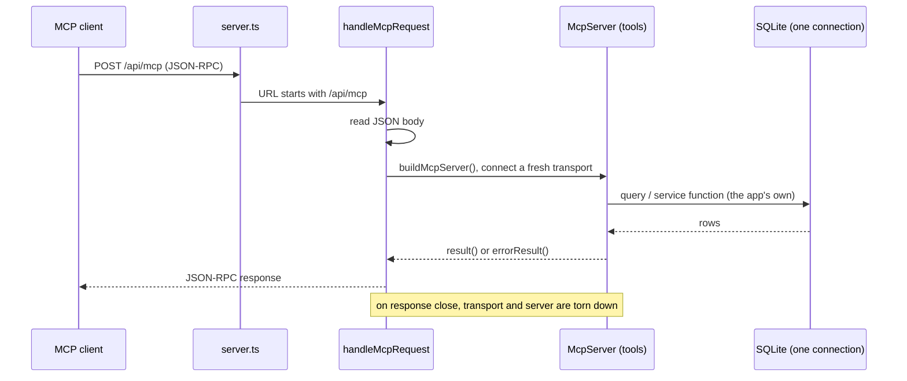
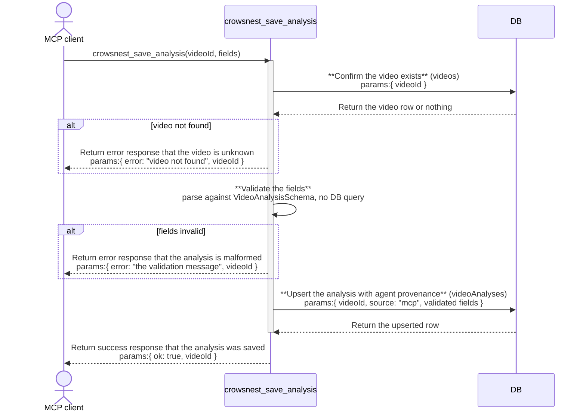
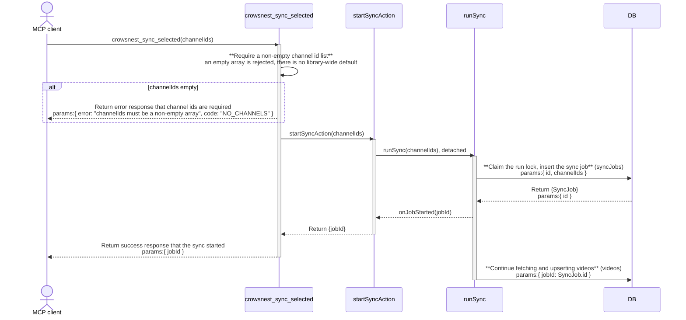

# mcp: architecture

`documents/architect/core-components/mcp/`

Status: shipped, mounted in-process at `/api/mcp` over the app's one SQLite connection, exposing 30 `crowsnest_*` tools: seven data reads, eleven remix tools, nine monthly and weekly planning tools (four research reads, four sync-control tools including sidecar readiness, one analysis write), two content-artifact tools (one write, one read), and one on-demand transcription tool (`crowsnest_transcribe`), plus a prior-period comparison on `crowsnest_metrics`. The content-artifact tools (`crowsnest_save_artifact`, `crowsnest_artifacts`) persist and read back agent-authored artifacts (angles, an outlier library, an idea bank, a monthly plan, briefs) with provenance, keyless. The planning tool set is recorded in section 9 and specified in [the monthly-planning spec](../../../planning/spec/2026-09-06-mcp-monthly-planning.md).

The remix chain is keyless (P0 slice 2b): its three generate stages (`crowsnest_remix_hooks`, `crowsnest_remix_outline`, `crowsnest_remix_variants`) never call an internal model. Each returns the stage's assembled `{ system, user, context }` prompt for the calling agent to fulfill itself; the agent writes the result back through `crowsnest_remix_choose_hook` (a hook), `crowsnest_remix_outline` called again with an `outline` argument (the same tool, bidirectional: no argument returns the prompt, an `outline` argument saves it), and `crowsnest_remix_save_script` (a full script). Saving the outline back matters because `crowsnest_remix_variants`' script prompt reads `session.outline`: without it the script prompt would silently fall back to its "no outline beats yet" placeholder instead of the agent's real beats. No `ANTHROPIC_API_KEY` and no LLM proxy are needed anywhere in the MCP remix chain. The in-app remix dashboard is unchanged and still calls the internal model directly, per [remix](../remix/02-architecture.md#9-mcp-vs-in-app-two-remix-paths).

## 1. Module structure

| File | Export | Role |
| --- | --- | --- |
| `src/server/mcp/mcp-server.ts` | `buildMcpServer`, `result`, `errorResult`, `mediaInfoFor`, `MediaInfo` | The server factory and the tool contract. `buildMcpServer` constructs an `McpServer` and registers all 30 `crowsnest_*` tools, each a thin wrapper over an existing query, action, or service function, except the three remix generate tools, which wrap a pure prompt-builder instead of a service function that calls a model. `result`/`errorResult` are the output contract; `mediaInfoFor` is the media handoff helper. |
| `src/server/transcribe/index.ts` | `getOrCreateTranscript` (among others) | The cache-first whisper.cpp then Groq chain. Returns the stored `transcripts` row if one exists, otherwise transcribes the downloaded video asset and persists it. Backs `crowsnest_transcribe`. |
| `src/server/actions/media-actions.ts` | `downloadVideoAction` | Fetches a video on demand: re-resolves a fresh Instagram URL through the sidecar and downloads the bytes, or returns the existing asset id when already stored (idempotent). `crowsnest_transcribe` calls it first so a not-yet-downloaded video can still be transcribed. |
| `src/server/queries/research.ts` | `getResearchSet`, `getOutlierPack`, `OwnBenchmarkRow`, `ResearchOutlier` | The research read bundles behind `crowsnest_research_set` and `crowsnest_outlier_pack`. Both call `getOutlierFeed` (never re-implementing the feed SQL) and join each item to its `video_analyses` row, then pair the competitor outliers with the own-channel `reachIndex` benchmark from `getOwnPosts`. |
| `src/server/services/analyze.ts` | `saveAgentAnalysis` (among others) | Validates agent-authored fields against `VideoAnalysisSchema` and upserts the `video_analyses` row stamped `source = "mcp"`, never calling the LLM. Backs `crowsnest_save_analysis`. |
| `src/server/mcp/http.ts` | `handleMcpRequest` | Bridges the app's raw Node http server to the MCP streamable HTTP transport. Reads the JSON body on POST, builds a fresh server and a stateless transport per request, and tears both down when the response closes. A thrown error becomes a JSON-RPC 500 envelope, never an unhandled crash. |
| `server.ts` (repo root) | (the app server) | Routes any request whose URL starts with `/api/mcp` to `handleMcpRequest`, in-process; everything else goes to Next. This is what keeps the MCP on the app's one SQLite connection. |

The MCP server owns no schema and no migration. It reaches the sync actions (`startSyncAction`, `getSyncProgressAction`, `cancelSyncAction`), the sidecar health action (`getIgStatusAction`), the channel and run queries (`getChannelsList`, `getChannelDetail`, `getChannelMedianBasis`, `getLastRunHealth`), the research bundles (`getResearchSet`, `getOutlierPack`), `saveAgentAnalysis`, the on-demand transcription chain (`downloadVideoAction`, `getOrCreateTranscript`), and the content-artifacts service (`saveArtifact`, `listArtifacts`, `getArtifact`), each already belonging to another component. Two schema changes back these tools, both owned elsewhere: the `source` column on `video_analyses` (analyze component, migration `0027`), and the `content_artifacts` table that the content-artifacts service owns (migration `0028`). The MCP tools write and read those tables through their services; they do not define them.

## 2. In-process mount

The MCP is not a separate service. `server.ts` is the app's own Node http server: it prepares Next, then, before handing a request to Next, checks the URL. A request to `/api/mcp` goes to `handleMcpRequest`; everything else goes to the Next request handler.

Because the tool handlers call the app's own query and service functions, and those hold the single SQLite connection the app already opened, the MCP reads and writes through that one connection. It never opens a second. On a single-user SQLite database that tolerates one writer, a second process would race the app's writes; the in-process mount is what forecloses that.

The transport is stateless: `handleMcpRequest` builds a new `McpServer` and a new `StreamableHTTPServerTransport` (with `sessionIdGenerator: undefined`) for each request and closes both when the response closes. There is no session table and no cross-request state in the server itself; state lives in the database the tools read and write. This is enough for a single local user driving tools and sidesteps session bookkeeping.

## 3. The tool contract

Every tool is registered with `registerTool(name, { title, description, inputSchema }, handler)`. The input schema is a Zod object; the handler is async and returns through one of two helpers.

**`result(value)`** returns the value two ways at once:

- `content: [{ type: "text", text: JSON.stringify(value, null, 2) }]`, for a text-only client.
- `structuredContent: value`, for a client that reads structured output.

The two always agree because they are the same value serialized once. A client can rely on either.

**`errorResult(payload)`** returns a typed failure: the same JSON-text-plus-`structuredContent` pair, with `isError: true`. The handler returns it; it does not throw. A missing video, an unknown post, a missing remix session, or metrics with no own channel set all come back as an error result the caller can read, not an exception crossing the MCP boundary. Only an unexpected throw inside the transport layer becomes a JSON-RPC 500 in `handleMcpRequest`, and even that is caught and rendered as an envelope.

## 4. Read tools versus write tools

The 30 tools split by whether they change data.

- **Data read tools (7):** `crowsnest_feed`, `crowsnest_video`, `crowsnest_brief`, `crowsnest_scripts`, `crowsnest_ideas`, `crowsnest_metrics`, `crowsnest_plans`. Each wraps a query function and returns rows. `crowsnest_plans` is read-only: it lists planned posts but never creates or changes one. `crowsnest_video` returns the video's full transcript text (`transcript.text`, via `getVideoDetail`) alongside its caption, metrics, and any existing analysis, so an agent authoring a fresh analysis through `crowsnest_save_analysis` has everything it needs from this one call.
- **Remix tools (11):** the `crowsnest_remix_*` chain, keyless end to end. Some are reads (`crowsnest_remix_state`), some create or advance a session (`crowsnest_remix_session`, `crowsnest_remix_set_prompt`, `crowsnest_remix_choose_hook`, `crowsnest_remix_style`, `crowsnest_remix_finish`), and three are prompt providers (`crowsnest_remix_hooks`, `crowsnest_remix_outline`, `crowsnest_remix_variants`): each returns the stage's assembled `{ system, user, context }` prompt (`buildHookPrompt`/`buildOutlinePrompt`/`buildScriptPrompt` in `services/remix.ts`, reusing the same `*_SYSTEM`/`build*User` builders the in-app generate functions use) instead of calling an internal model. The calling agent fulfills each prompt itself and writes the result back: a hook via `crowsnest_remix_choose_hook`, an outline via `crowsnest_remix_outline` called again with an `outline` argument (bidirectional, like the hooks/choose_hook pair, but folded into one tool: no argument returns the prompt, an `outline` argument persists it via `updateStage`), and a full script via `crowsnest_remix_save_script` (which now takes the agent's own `script` text, not a variant index, since there is no crowsnest-generated variant to index into). Saving the outline back is not optional bookkeeping: `buildScriptPrompt` reads the session's persisted `outline` to build the script prompt, so a caller that never calls `crowsnest_remix_outline` with its outline gets a script prompt with no beats in it. No tool in this chain needs `ANTHROPIC_API_KEY` or the LLM proxy. `crowsnest_remix_regenerate_variant` is retired: there is nothing crowsnest-generated left to regenerate, so the agent just re-fulfills `crowsnest_remix_variants`' prompt, optionally with a different `steer`. The only planned post the MCP ever writes is the one `crowsnest_remix_finish` creates or reuses, and that write goes through the remix service, on the same connection, exactly as the dashboard's finish does.
- **Research read tools (4):** `crowsnest_channels`, `crowsnest_channel_stats`, `crowsnest_research_set`, `crowsnest_outlier_pack`. Reads that pull the planning landscape and the two working-set bundles, each bundle pairing competitor outliers (`outlierScore`) with the own-channel `reachIndex` benchmark. No write.
- **Sync-control tools (4):** `crowsnest_sync_selected` and `crowsnest_sync_cancel` start and stop a scoped channel sync (a side effect, not a database write of the MCP's own); `crowsnest_sync_status` reads its progress. `crowsnest_ig_status` reads Instagram sidecar readiness (reachable, logged in, the exact bootstrap command) through the same `getIgStatusAction` Settings' sidecar control uses, so an agent can check before it syncs instead of learning the sidecar is down from a failed sync. All four wrap actions the dashboard already uses.
- **Agent analysis write (1):** `crowsnest_save_analysis` upserts a `video_analyses` row stamped `source = "mcp"` through `saveAgentAnalysis`, on the same connection, with no LLM call. Since P0 slice 2a retired the in-app Analyze button and its internal-model path, this is the only way a new video analysis is written at all; crowsnest itself needs no `ANTHROPIC_API_KEY` for a video to have one.
- **Transcribe action (1):** `crowsnest_transcribe` fetches a video and transcribes it on demand, writing a `transcripts` row. It composes two paths that already exist: `downloadVideoAction` (idempotent, downloads the bytes if the video is not already stored) then `getOrCreateTranscript` (cache-first whisper.cpp then Groq). Both the download side effect and the transcript write go through their owning components, on the same connection. Since sync never downloads video bytes and the auto-analyze pass that once transcribed was retired in P0 slice 2a, this is the only path that produces a transcript on request. It needs a live IG sidecar session to download a new video and at least one transcript provider to transcribe it; either being absent is a handled error result. Not keyless in the Groq case (`GROQ_API_KEY`), but local whisper.cpp needs no key.

Stage progression on the session is left to the service functions (finish sets the stage); the tools do not manage the dashboard's stepper, because that only affects how the UI renders the session.

## 5. Pagination

The two unbounded list tools, `crowsnest_scripts` and `crowsnest_ideas`, take `limit` and `offset` and return `{ total, count, items }`. `total` is the full match count, `count` is the number returned, `items` is the page. The slice is done in memory: the tool reads the whole list from its query function (`getScripts`, `listIdeas`), which take no pagination arguments, then slices `[offset, offset + limit]`. For a local single-user SQLite vault that is fine; the ceiling is called out in [backlog to enhance](05-backlog-to-enhance.md). `crowsnest_feed` paginates through the feed query's own `limit`/`offset`, which the query pushes into SQL.

## 6. Media paths from stored rows

`crowsnest_video` and `crowsnest_brief` return media alongside the row, through `mediaInfoFor(assetId)`:

- A null or missing id returns null.
- Otherwise it reads the `media_assets` row (`getAsset`) and returns `{ path, byteSize, durationSec }`, where `byteSize` and `durationSec` come straight off the row.
- `path` is resolved from the stored `storagePath` (`resolveAssetPath`); if that throws, `path` is null rather than an error.

`mediaInfoFor` never stats or reads the file, and never throws across the MCP boundary. The handoff a client gets is the media the app already downloaded and recorded, addressed by its on-disk path, so the producer opens a local file instead of an expiring URL. `crowsnest_video` returns both `media` (the video asset) and `thumbnail`; `crowsnest_brief` returns the same pair nested under its source video when the brief has one.

## 7. Key decisions

- **In-process, not a second service.** SQLite tolerates one writer. Mounting the server in the app's own process keeps every tool call on the one connection the app holds, so the MCP is never a second writer. (`server.ts`, `http.ts`.)
- **Stateless transport, fresh per request.** A single local user does not need session bookkeeping; a new server and transport per request, torn down on close, is simpler and cannot leak state between requests. (`http.ts`.)
- **Typed error results, not throws.** A failure a caller should handle (not found, no session, metrics unavailable) is an `errorResult` with a payload, not an exception. The MCP boundary stays clean and machine-readable. (`errorResult` in `mcp-server.ts`.)
- **One value, two encodings.** `result` serializes once into both JSON text and `structuredContent` so a text-only client and a structured client always see the same thing. (`result` in `mcp-server.ts`.)
- **Media from the stored row, never the file.** `mediaInfoFor` reads path, size, and duration off the `media_assets` row and never touches disk, so it is fast and cannot throw on a missing file; a broken stored path degrades to a null `path`. (`mediaInfoFor` in `mcp-server.ts`.)
- **Thin wrappers, no second logic.** Every tool calls the same query or service function the dashboard uses, so the MCP surface and the UI cannot drift apart and a business rule lives in exactly one place. (`mcp-server.ts`.)
- **The remix generate tools return a prompt, not a generation.** Crowsnest is a deterministic data and action layer; an MCP agent brings its own reasoning. `buildHookPrompt`/`buildOutlinePrompt`/`buildScriptPrompt` assemble exactly what `generateHooks`/`generateOutline`/`generateVariants` would have sent to the model (same `*_SYSTEM` constant, same `build*User` call, same session fields), and return it instead of calling `getLlm`. The in-app functions are untouched and still call the model for the dashboard's own remix page. (`services/remix.ts`.)

## 8. Open, not verified

- **The streamable HTTP transport and the `/api/mcp` route are not exercised end to end.** Most of the vitest suite (`src/server/mcp/mcp-server.test.ts`) tests the tool handlers directly, reaching them through the server's private `_registeredTools` registry, and tests the contract helpers and `mediaInfoFor` in isolation. `src/server/mcp/mcp-roundtrip.test.ts` now stands up a real SDK `Client` over a linked `InMemoryTransport` pair and drives `tools/list` and `tools/call` through it, so the wire shape is proven over a real transport. That harness does not use the streamable HTTP transport or the real `/api/mcp` route in `server.ts`; that an actual MCP client connecting over HTTP gets a well-formed JSON-RPC response, and that the per-request server-and-transport teardown behaves under a real HTTP connection, is asserted from the code but not proven by a test.
- **No live MCP client run is proven.** The Reel Factory handoff, a client calling the read tools and then the remix chain against a running crowsnest, has not been shown to complete end to end over a real network connection. `mcp-remix-keyless.test.ts` proves the whole `crowsnest_remix_*` chain function-level (session through finish and brief) with `ANTHROPIC_API_KEY` unset, but that is still the private `_registeredTools` registry, not a real client over `/api/mcp`.
- **The endpoint carries no credential check of its own.** `handleMcpRequest` performs no authentication; reachability is governed only by which interface `server.ts` binds (the `HOST` environment variable). Whether that is the intended trust boundary for a machine with other local processes is recorded, not verified, in [test cases](04-test-cases.md#4-security-lite).
- **`channel_stats.lastRun` is the last sync run overall, not the requested channel's.** `getLastRunHealth` takes no channel id, so `crowsnest_channel_stats` reports the most recent sync of any channel, not one scoped to the queried channel. The doc states this as the tool's real behavior; a per-channel run health is carried as an enhancement in [backlog to enhance](05-backlog-to-enhance.md).

## 9. Monthly and weekly planning tools

The monthly and weekly planning tool set is shipped and reachable over `/api/mcp`. It is specified in [the monthly-planning spec](../../../planning/spec/2026-09-06-mcp-monthly-planning.md). It keeps the existing contract: every new tool is a thin wrapper over an existing query or action, returning through `result()` on success and `errorResult()` on a handled failure.

### Tools and their backing functions

| Tool | Backs onto | Role |
| --- | --- | --- |
| `crowsnest_channels` | `getChannelsList` (`queries/channels.ts`) | The tracked channels and their fleets. Returns `{ channels }`. |
| `crowsnest_channel_stats` | `getChannelDetail`, `getChannelMedianBasis` (`queries/channels.ts`), `getLastRunHealth` (`queries/runs.ts`) | One channel's detail and baseline, median basis, and last sync health. Returns `{ detail, basis, lastRun }`; an unknown id is an error result. |
| `crowsnest_research_set` | `getResearchSet` (`queries/research.ts`), which calls `getOutlierFeed` (`queries/feed.ts`) joined with `videoAnalyses`, plus `getOwnPosts` (`queries/own-channel.ts`) | A broad reading bundle: outliers with their analyses, alongside the own channel's `reachIndex` benchmark. Returns `{ outliers, ownBenchmark }`. |
| `crowsnest_outlier_pack` | `getOutlierPack` (`queries/research.ts`) with the same own benchmark block, plus `mediaInfoFor` for the handoff | A tight top N shortlist with the media handoff, plus a rising mode (short `sinceDays`, ranked by recency) for the weekly refresh. Returns `{ items, ownBenchmark }`. |
| `crowsnest_sync_selected` | `startSyncAction` (`actions/sync-actions.ts`) | Starts a sync scoped to the given channel ids and returns `{ jobId }`. Requires a non-empty id array (code `NO_CHANNELS` otherwise). A sidecar-down failure (code `IG_SERVICE_DOWN`) carries `bootstrap: "npm run ig:service"` in the error result, added at the MCP boundary; `startSyncAction` itself is unchanged. |
| `crowsnest_sync_status` | `getSyncProgressAction` (`actions/sync-actions.ts`) | The run's progress by job id, wrapped as `{ progress }`; null progress for an unknown job is not an error. |
| `crowsnest_sync_cancel` | `cancelSyncAction` (`actions/sync-actions.ts`) | Cooperative cancel by job id. Returns `{ ok, jobId, requested }`, `requested` false when nothing was running. |
| `crowsnest_ig_status` | `getIgStatusAction` (`actions/ig-actions.ts`) | Instagram sidecar readiness: reachable, logged in, and the bootstrap command, reusing the exact health probe Settings' sidecar control renders. Never an error result; even "sidecar down" is a successful read of that fact. |
| `crowsnest_save_analysis` | `saveAgentAnalysis` (`services/analyze.ts`), which validates against `VideoAnalysisSchema` (`llm/schemas.ts`) and upserts `videoAnalyses` | The agent authors the analysis; the tool validates the fields and upserts the row with `source = "mcp"`. No in-app model call. |
| `crowsnest_metrics` (changed) | `getOwnChannelOverview(windowDays, { offsetDays })` (`queries/own-channel.ts`) | Gained a prior-period comparison: returns `{ current, previous, posts }` so the agent reads this window against the one before it (month over month). |

Own performance and competitor performance stay different units. The own posts score on `reachIndex`, competitors on `outlierScore`; the research tools return both rather than inventing a single shared number.

### The one schema change, and who owns it

The MCP still owns no schema and no migration. The single change these tools need is a nullable `source` text column on `video_analyses` (values `mcp`, `auto`, `manual`, with rows written before the column backfilled `legacy`). It shipped in migration `0027`, which adds the column and sets existing rows to `legacy`. The column lives on the analyze component's `videoAnalyses` table, not on any MCP table; `crowsnest_save_analysis` writes it but does not define it. Remix (`describeSourceStructure`) and Ideas read the same table unchanged, so they consume the agent-authored row with no change.

### Saving an agent-authored analysis

`saveAgentAnalysis` first reads the `videos` row to confirm the id exists, then validates the incoming fields against `VideoAnalysisSchema`, and only if both hold upserts the `videoAnalyses` row stamped with agent provenance. An existing row for the video is updated in place; otherwise a new row is inserted.

### Starting a scoped sync

`crowsnest_sync_selected` rejects an empty channel id array (there is no library-wide default) before calling `startSyncAction`, which starts the run detached and returns once the `syncJobs` lock row is claimed, so the tool hands back a job id the caller then polls with `crowsnest_sync_status`.

### Sidecar readiness, and the bootstrap contract

An external MCP agent has no browser and no Settings page, so a sync attempt against a down sidecar used to be its first signal that the sidecar even exists. `crowsnest_ig_status` closes that gap without adding a second health probe: it calls the same `getIgStatusAction` the Settings page's Instagram section and sidecar control already call, and shapes the same result two ways.

- **The sidecar answered** (`getIgStatusAction` returns `ok: true`): `{ reachable: true, loggedIn, retryAfterSec?, bootstrap }`. `retryAfterSec` is present only while an Instagram rate-limit cooldown is still in effect (`IgHealth.cooldownUntil` in the future), computed as whole seconds remaining.
- **The sidecar did not answer** (`ok: false`): `{ reachable: false, loggedIn: null, bootstrap, error, code }` when the code is `IG_SERVICE_DOWN`. Any other failure code (`IG_DRIFT`, `IG_SERVICE_UNAUTHORIZED`, ...) still means the process answered, so `reachable` stays `true` even though `ok` was `false`.

Neither branch is an MCP error result: determining "the sidecar is down" is itself a successful read, exactly as `crowsnest_sync_status` returning null progress for an unknown job is not an error. `bootstrap` is always the literal string `"npm run ig:service"` (the same command `scripts/ig-service.sh` documents and the sidecar control button spawns programmatically), present on every response so the agent never has to branch to find it.

The same string is threaded through `crowsnest_sync_selected`'s failure path: when `startSyncAction` returns `code: "IG_SERVICE_DOWN"`, the tool's `errorResult` adds `bootstrap` before returning. This is added at the MCP boundary only; `startSyncAction` and the sync engine's error classification (`classifyIgError`, [ig-sync architecture](../ig-sync/02-architecture.md)) are unchanged.
