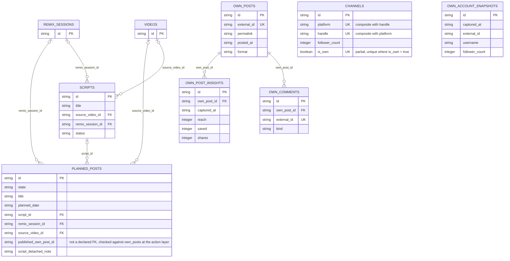
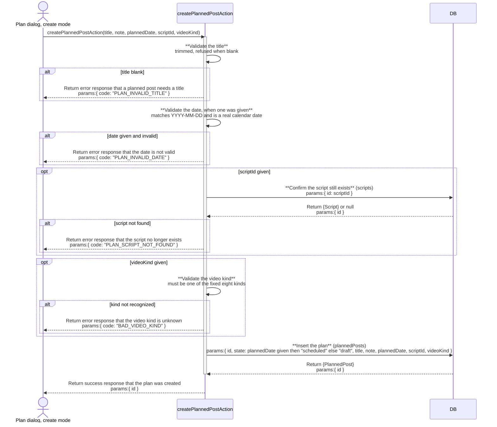
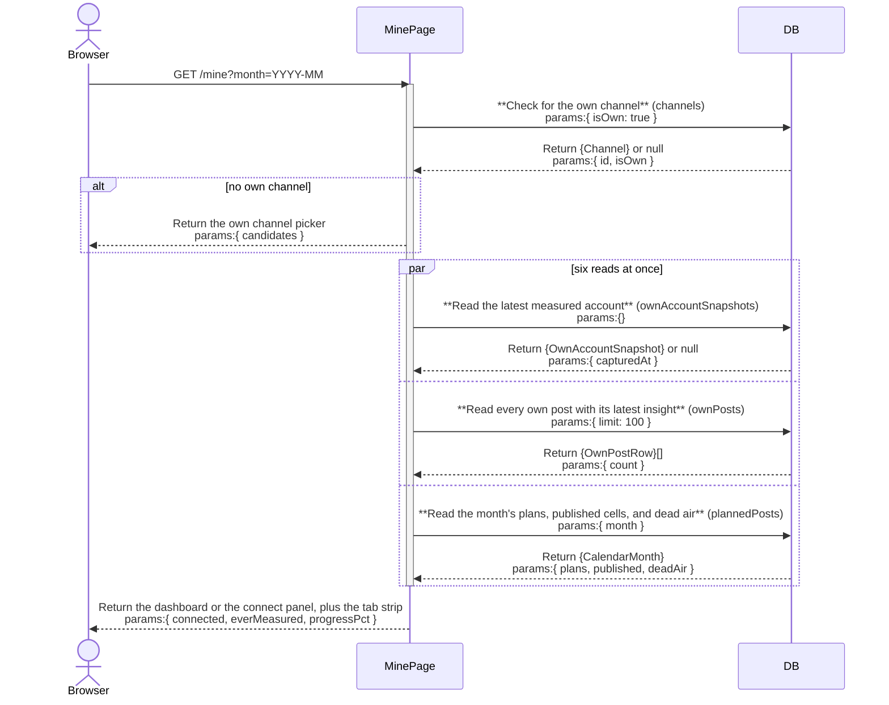

# mine: architecture

`documents/architect/core-components/mine/`

Status: shipped and in daily use. A plan edit's four-write sequence has no rollback, the delete undo is lossy, and there is no UI control to clear the own channel once set; none of these block the page from working, and each is tracked in the backlog.

## 1. Module structure

| File | Export | Role |
| --- | --- | --- |
| `src/app/(shell)/mine/page.tsx` | `MinePage` (default) | The page frame. Reads the own channel first (the first gate), then fires six reads at once and decides what to render. |
| `src/app/(shell)/mine/[postId]/studio/page.tsx` | `StudioPage` (default) | The studio entry for one planned post; hands off to the [studio](../studio/02-architecture.md) component through `getStudioBrief`. |
| `src/components/mine/own-channel-picker.tsx` | `OwnChannelPicker` | The no-own-channel gate: lists tracked channels not already own, with a "This is me" button per row. |
| `src/components/mine/graph-connect-panel.tsx` | `GraphConnectPanel` | The Graph token gate: states what is missing, or offers "Check connection" and "Measure now". |
| `src/components/mine/own-stat-tiles.tsx` | `OwnStatTiles` | The six metrics tiles (followers, reach, saves, shares, median reach, posts measured), each carrying its own sample size. |
| `src/components/mine/reach-by-post-bars.tsx` | `ReachByPostBars`, `OwnPostList` | The overview strip's reach bars (oldest first) and the Posts tab's flat list (newest first); both read the same `OwnPostRow[]`. |
| `src/components/mine/own-weekday-rhythm.tsx` | `OwnWeekdayRhythm` | The Metrics tab: average reach by weekday, with a post count per bar. |
| `src/components/mine/mine-calendar.tsx` | `MineCalendar` | The Month tab: the grid, the day detail panel, and the two writes it owns directly (mark published, delete). |
| `src/components/mine/plan-dialog.tsx` | `PlanDialog` | Create or edit one planned post; owns the up-to-four-action edit sequence. |
| `src/server/queries/own-channel.ts` | `getOwnChannelOverview`, `getOwnPosts`, `getPostsWithLatestInsights`, `getOwnPostInsightHistory`, `getOwnComments` | Pure reads over the own-channel table set. `getPostsWithLatestInsights` joins each `own_posts` row to its latest `own_post_insights` row in application code, and is reused by `planned-posts.ts` for reconciliation and published cells so there is exactly one join implementation. |
| `src/server/queries/planned-posts.ts` | `getPlannedPosts`, `getPlannedPostById`, `getCalendarMonth`, `scriptExists`, `getPlansCarryingScript` | Planned-post reads. `getCalendarMonth` is the one call the page's Month tab needs: plans in range, undated drafts, published cells, and dead-air runs, all in one round trip. `missed` and `reconciledOwnPostId` are computed here on every read, never stored. |
| `src/server/queries/channels.ts` | `getOwnChannel`, `getChannelsList` | `getOwnChannel` is the first gate; `getChannelsList` supplies the picker's candidate rows. Owned jointly with the channels board and ig-sync, not by mine alone. |
| `src/server/queries/vault.ts` | `getScripts` | Read-only, to populate the plan dialog's script select. |
| `src/server/actions/planned-post-actions.ts` | `createPlannedPostAction`, `updatePlannedPostAction`, `schedulePlannedPostAction`, `unschedulePlannedPostAction`, `attachScriptToPlanAction`, `detachScriptFromPlanAction`, `markPlanPublishedAction`, `deletePlannedPostAction` | The eight writes against `planned_posts`. `markPlanPublishedAction` is the only place `state` is ever set to `published`; nothing else in this module, or anywhere else in crowsnest, sets it. |
| `src/server/actions/channel-actions.ts` | `setOwnChannelAction`, `unsetOwnChannelAction`, `removeChannelAction` | `setOwnChannelAction` backs the picker; `unsetOwnChannelAction` exists but no control on this page calls it. Shared with the channels board, not owned by mine alone. |
| `src/server/actions/graph-actions.ts` | `checkGraphTokenAction`, `measureOwnChannelAction` | The two Graph actions the connect panel calls. `measureOwnChannelAction` is the only writer of `own_account_snapshots`, `own_posts`, `own_post_insights`, and `own_comments`. |
| `src/server/services/own-metrics.ts` | `computeOwnMedianReach`, `indexAgainstOwnMedian` | The own-channel median math: a trailing 20-post window, gated on `scoreMinUsablePosts` (default 5, shared with channel-side scoring), computed over reach, never a view count. |
| `src/server/services/video-kind.ts` | `VIDEO_KINDS`, `isVideoKind` | The fixed eight-item allow-list a planned post's `videoKind` is validated against. |

## 2. ER diagram

`CHANNELS` and `OWN_ACCOUNT_SNAPSHOTS` carry no declared foreign key to any table above; mine joins them to the rest of its data in application code (`getOwnChannel`'s `isOwn` read, and `getOwnChannelOverview`'s "latest snapshot" read), not through a schema relation. `REMIX_SESSIONS` and `VIDEOS` are shown as stub entities, columns owned and detailed by the remix and feed components respectively; mine only holds a nullable reference to each. `channel_snapshots`, the tracked-channel history table ig-sync writes, is a different table from `own_account_snapshots` above and is not read by any file in this module; the [ig-sync](../ig-sync/02-architecture.md#2-er-diagram) ER diagram covers it. `persona`, the single-row audience and voice settings table, is likewise outside this diagram: it is read only by `/persona` and by idea and script generation, never by mine's own queries or actions.

`published_own_post_id` on `planned_posts` is a plain text column, not a `.references()` foreign key in `schema.ts`. `markPlanPublishedAction` validates it against `own_posts` by hand when it is non-null, which is why the diagram marks it as an application-level check rather than drawing it as a relationship.

## 3. Indexes

| Table | Index | Notes |
| --- | --- | --- |
| planned_posts | planned_posts_date | Plain index on `plannedDate`; backs the calendar's month-range read and the undated-drafts filter. |
| own_posts | own_posts_external | Unique on `externalId`; the idempotent upsert key `measureOwnChannelAction` writes through. |
| own_posts | own_posts_posted | Plain index on `postedAt`; backs the newest-first post list and the reach-by-post ordering. |
| own_post_insights | own_post_insights_post_captured | Plain composite index on `(ownPostId, capturedAt)`; backs "latest insight per post" and the per-post insight history. |
| own_account_snapshots | own_account_snapshots_captured | Plain index on `capturedAt`; backs the "most recent snapshot" read the header and stat tiles use. |
| own_comments | own_comments_external | Unique on `externalId`; the idempotent comment upsert key. |
| channels | channels_single_own | Partial unique on `isOwn` where `isOwn = true`; the structural guarantee behind `getOwnChannel` that at most one channel is ever "mine". |

`scripts` and `channels_platform_handle` (the unique index on `channels`' `(platform, handle)`) are covered in the [ig-sync](../ig-sync/02-architecture.md#3-indexes) architecture doc, since ig-sync writes both `channels` and `scripts`' source video path; mine only reads through them.

## 4. Data flow

**Arrive.** `MinePage` reads `getOwnChannel()` first. If there is none, it renders `OwnChannelPicker` over the tracked channels not already own and stops there, no other work. If there is one, it runs six reads in one `Promise.all`: `checkGraphTokenAction`, `getOwnChannelOverview`, `getOwnPosts({ limit: 100 })`, `getScripts` (for the plan dialog), the `scoreMinUsablePosts` setting, and `getCalendarMonth(month)` for the `?month=YYYY-MM` in the URL. From those it derives three facts: `everMeasured` (an `own_account_snapshots` row exists), `connected` (token state `ok` and ever measured), and the progress percent (`totalPosts / scoreMinUsablePosts`, capped at 100).

**The two gates.** The metrics band is gated so real numbers are never faked and never hidden. Token not configured, or invalid and never measured: only `GraphConnectPanel` renders where the metrics would be. Token invalid but measured before: the panel stacks above the real historical tiles, progress, and reach bars, rather than hiding them. Token ok and measured: the full band renders, no panel. The tab strip (Month, Posts, Metrics) renders below a divider in every case, opening on Month, which is client-only state, not a deep link, and resets on reload.

**Planner.** `getCalendarMonth` returns the month's plans, undated drafts, published cells (from `own_posts`), and dead-air runs (three or more elapsed days with nothing published, truncated at today). The calendar's day panel owns two writes, `markPlanPublishedAction` and `deletePlannedPostAction`; both call a router refresh so the grid re-reads. Creating or editing a plan opens `plan-dialog.tsx`. A create is one write. An edit is a sequence of up to four separate actions in a fixed order (title and note, then date, then script, then video kind), each fired only if that field changed; there is no single patch action.

**Own-channel measurement.** `measureOwnChannelAction` runs one full measurement on demand: fetch the account, write an `own_account_snapshots` row, then upsert every post (`own_posts`, keyed on `externalId`) with one `own_post_insights` row per post measured, then fetch and upsert comments (`own_comments`, keyed on `externalId`). Account or posts failing is a hard failure; comments failing after posts succeeded returns `ok: true, partial: true`, since "posts measured, comments did not" is a real, useful partial result, not a run that failed.

## 5. Sequence: planning a post

## 6. Sequence: opening the my channel page

The three parallel branches above stand in for the page's full `Promise.all`, which also checks the Graph token, loads the vault's scripts for the plan dialog, and reads the `scoreMinUsablePosts` setting; those three do not touch the tables this diagram is about and are omitted here for readability.

## 7. Key decisions

- **Two independent gates, neither faked.** The own channel flag and the Graph token are checked separately; a missing token renders `GraphConnectPanel`, a plain statement of what is missing, never a spinner or zeros. A token that fails now and a channel measured before are different facts, so the panel stacks over real numbers rather than replacing them.
- **Missed is derived on read, never stored.** The stored `state` column is only ever `draft`, `scheduled`, or `published`; `getCalendarMonth`/`getPlannedPosts` compute `missed` from today's date, so a reschedule cannot leave a stale missed cell behind, and marking a past plan published reads it as published, never missed, because published is checked before missed in the cell-kind precedence.
- **A plan edit is a sequence with no rollback.** There is no single patch action for a planned post, so a mid-sequence failure leaves a partial edit and one inline error that does not say which writes landed (B-04). The design values applying only changed fields over atomicity for a single-user local app.
- **Own-channel insights are a separate table set by design, not a flag on channels.** A flag on `channels` would put own posts inside the outlier feed and channel scoring by default, and every consumer would need an exclusion clause someone would eventually forget. Separation makes "own posts never appear in the outlier feed" a structural fact instead of a convention.
- **Own posts are read-only; the Graph measurement is the only writer.** The instagrapi sidecar writes tracked videos, never own posts, so a sync never changes this page. Own posts and planned posts are separate tables, never auto-linked; publishing is always a manual mark.
- **No auto-publish, no reminders.** A planned post is a dated intention only; the plan dialog carries no time or target-length field even though the record can hold both.
- **No UI to clear the own channel.** `unsetOwnChannelAction` exists but no control on the page calls it (B-15); the delete Undo re-creates a plan lossily, dropping id and several links (B-09). See [05-backlog-to-enhance](05-backlog-to-enhance.md).

## 8. Open, not verified

- **Whether the Graph API's rate limit or comment classifier behavior matches this document under real production load.** The measurement flow, its partial-comments-failure path, and the classifier version stamping are read from code; none have been exercised against a live account at scale as part of this rewrite.
- **Whether a plan's edit sequence interleaving across two tabs (the last-write-wins-per-field claim) has been observed directly, as opposed to read off the code.** The four-action sequence in `plan-dialog.tsx` is confirmed by reading the source; a live two-tab race has not been reproduced.
