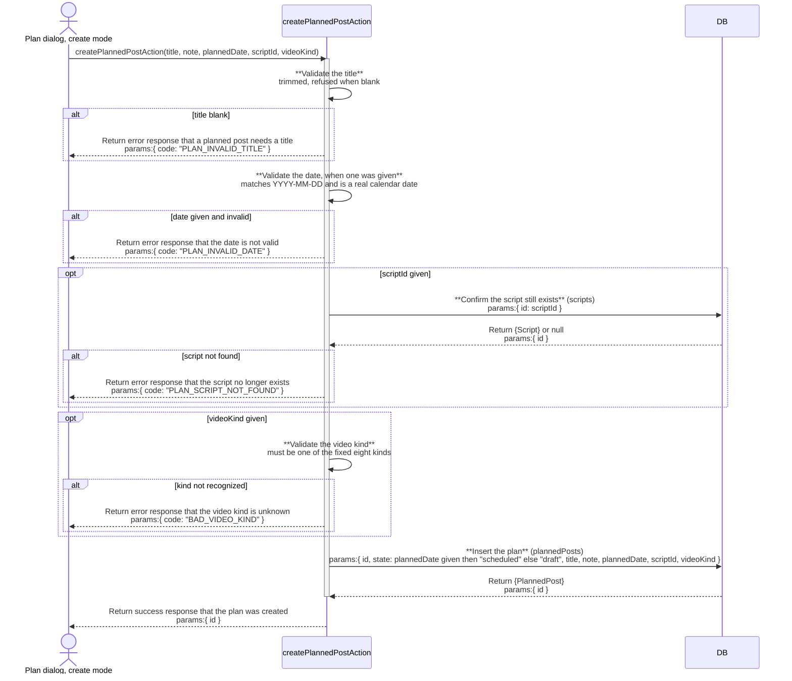
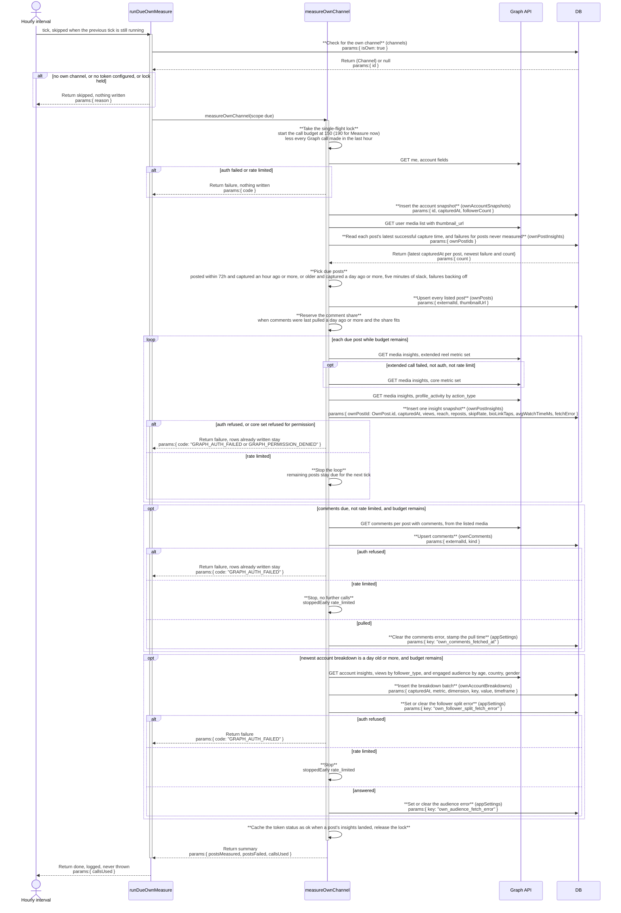
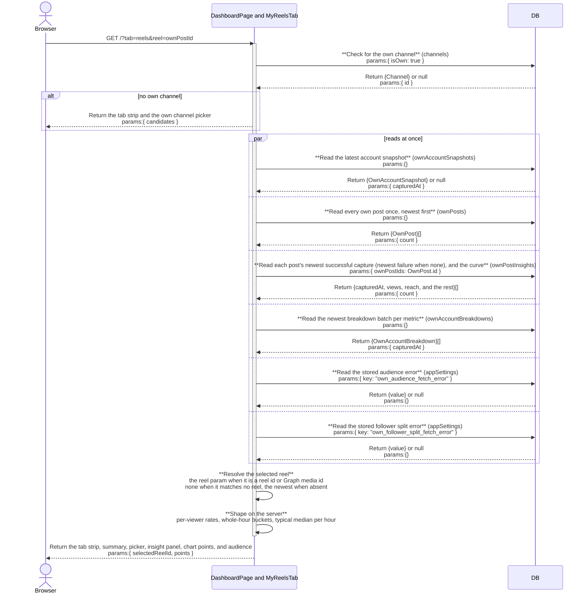

# mine: architecture

`documents/architect/core-components/mine/`

Status: shipped. Dashboard tabs with `/mine` redirecting (feature 9), My reels (features 10 to 13), and scheduled measurement (feature 14) run in code; the newer Graph metric names and units are unverified against a real call (section 9).

## 1. Module structure

| File | Export | Role |
| --- | --- | --- |
| `src/app/(shell)/(loaded)/page.tsx` | `DashboardPage` (default) | The Dashboard route, owned by the dashboard component. Awaits `searchParams` (`tab`, `month`, `reel`; a repeated key arrives as an array and its first value is used), renders `DashboardTabs`, then only the active tab's server component, so each tab's reads run only when that tab is open. A missing or unknown `tab` means Overview. |
| `src/components/dashboard/dashboard-tabs.tsx` | `DashboardTabs`, `resolveDashboardTab` | The tab strip as three link buttons (`dashboard-tab-overview`, `dashboard-tab-reels`, `dashboard-tab-calendar`) that set `?tab=`; the active one carries `aria-current="page"`. Rendered above every state of every tab. |
| `src/components/dashboard/overview-tab.tsx` | `OverviewTab` | The research Dashboard body, including its twelve reads and the `readAndBumpDashboardLastVisit` write, which runs on Overview only. |
| `src/components/mine/calendar-tab.tsx` | `CalendarTab`, `ownChannelPicker` | The own-channel gate plus the calendar reads (`getCalendarMonth`, `getScripts`) and the publish config flags (`bucketConfigured`, `graphConfigured`, dry run), rendering `MineCalendar`; those flags are the [publish](../publish/02-architecture.md#1-module-structure) component's concern. `ownChannelPicker` is the no-own-channel gate shared with My reels. |
| `src/components/mine/month-param.ts` | `validMonth`, `mineRedirectTarget` | `YYYY-MM` validation with a real month, and the `/mine` redirect target: always a same-origin path, carrying only a valid `month`. |
| `src/app/(shell)/(loaded)/mine/route.ts` | `GET` | A redirect only: `redirect(mineRedirectTarget({ month }))`, no reads. A route handler rather than a page, because a page in the `(loaded)` group streams under `loading.tsx` and would deliver the redirect in a 200 body; the handler answers a real 307 with a `Location` header. |
| `src/components/mine/my-reels-tab.tsx` | `MyReelsTab` | The My reels server component: own-channel gate, token gate, the account summary (header, `OwnStatTiles`, progress, `ReachByPostBars`), `ReelPicker`, `ReelInsightPanel`, `AccountAudience`, then `OwnPostList` and `OwnWeekdayRhythm` as sections. |
| `src/components/mine/own-channel-picker.tsx` | `OwnChannelPicker` | Lists tracked channels not already own, with a "This is me" button per row. |
| `src/components/mine/graph-connect-panel.tsx` | `GraphConnectPanel` | The Graph token gate: states what is missing, or offers "Check connection" and "Measure now" (calls `checkGraphTokenAction` and `measureOwnChannelAction`). After Measure now it calls `router.refresh()` whatever the outcome, then toasts the error or the summary. |
| `src/components/mine/own-stat-tiles.tsx` | `OwnStatTiles` | The six metrics tiles (followers, reach, saves, shares, median reach, posts measured), each carrying its own sample size. |
| `src/components/mine/reach-by-post-bars.tsx` | `ReachByPostBars`, `OwnPostList` | The reach bars (oldest first) and the flat post list (newest first); both read the same `OwnPostRow[]`. |
| `src/components/mine/own-weekday-rhythm.tsx` | `OwnWeekdayRhythm` | Average reach by weekday, with a post count per bar. |
| `src/components/mine/reel-picker.tsx` | `ReelPicker`, `ReelPickerItem` | Newest-first reel list as links setting `?reel=<ownPostId>` (`reels-picker-item`): thumbnail, posted date, latest views. |
| `src/components/mine/reel-insight-panel.tsx` | `ReelInsightPanel` | Summary tiles, interaction strip, what impacts your views, actions after viewing, the views chart, the not-available placeholders, and measured-at lines, from one server-shaped object. |
| `src/components/mine/reel-views-over-time.tsx` | `ReelViewsOverTime` | Client chart on `src/components/ui/chart.tsx` (recharts): the reel's views and "Your typical reel" by hours since posting (`reels-views-chart`). Receives only the already-shaped point list for the selected reel. |
| `src/components/mine/account-audience.tsx` | `AccountAudience` | Followers vs non-followers and the Age, Country, Gender tabs, labelled whole account. A stored audience error reading "Not enough" shows the API-threshold message; any other stored error keeps the last stored rows under a "Last refresh failed" note. |
| `src/components/mine/mine-calendar.tsx` | `MineCalendar` | The month grid, the day detail panel, the publish lifecycle on the cell and panel, and the writes it fires directly (mark published, delete, cancel scheduled publish, retry failed publish). Month links carry `tab=calendar` alongside `month=`. Opens `plan-dialog.tsx`, `publish-dialog.tsx`, and `confirm-dialog.tsx`. |
| `src/components/mine/plan-dialog.tsx` | `PlanDialog` | Create or edit one planned post; a saved edit goes through the single `savePlanEditAction`. |
| `src/components/mine/publish-dialog.tsx` | `PublishDialog` | Upload an mp4, write a caption, then publish now or schedule, calling `uploadPlanVideoAction`, `setPlanCaptionAction`, `publishNowAction`, and `schedulePublishAction`. The pipeline it feeds is the [publish](../publish/02-architecture.md#1-module-structure) component. |
| `src/components/mine/confirm-dialog.tsx` | `ConfirmDialog` | A designed destructive confirm shared by "cancel scheduled publish" and "delete a plan carrying a video". |
| `src/server/queries/own-channel.ts` | `getOwnChannelOverview`, `getOwnPosts`, `getPostsWithLatestInsights`, `getOwnPostInsightHistory`, `getOwnComments`, `getOwnReels`, `getReelViewHistory`, `getAccountBreakdowns`, `newestCaptureByPost`, `OWN_AUDIENCE_FETCH_ERROR_KEY`, `OWN_FOLLOWER_SPLIT_FETCH_ERROR_KEY`, types `OwnReel`, `BreakdownEntry` | Pure database reads over the own-channel table set; none calls the Graph API. `getPostsWithLatestInsights` joins each `own_posts` row to its newest successful `own_post_insights` row, picked in SQL with a `max(captured_at)` join, falling back to the newest failed row only when a post has no successful capture, so a later failed capture never hides the last good numbers while a never-measured failure still shows; the calendar (`planned-posts.ts`), Overview, and the MCP metrics read it. `getOwnReels`: reels only (`productType` is `REELS`) from that join, newest first, each with its `externalId`, `thumbnailUrl`, and newest successful insight row (`latestOk`). `getOwnChannelOverview`, `getOwnPosts`, and `getOwnReels` each take an optional preloaded join result, so My reels reads it once; with none they load it themselves, and their return shapes are the same either way. `getReelViewHistory`: `(ownPostId, postedAt, capturedAt, views)` for reel snapshots captured within `REEL_CURVE_HOURS` (168) of posting, filtered in SQL, the input to the curve. `OwnMetric.missingSampleSize` counts posts measured without error that still lack the metric, so a partial sum is labelled, not passed off as the window total. `getAccountBreakdowns`: the newest captured batch per metric from `own_account_breakdowns`, sorted by value, plus the stored audience error and the stored follower split error. |
| `src/server/queries/planned-posts.ts` | `getPlannedPosts`, `getPlannedPostById`, `getCalendarMonth`, `scriptExists`, `getPlansCarryingScript` | Planned-post reads. `getCalendarMonth` returns plans in range, undated drafts, published cells, and dead-air runs in one call. `missed` and `reconciledOwnPostId` are computed on every read, never stored. |
| `src/server/queries/channels.ts` | `getOwnChannel`, `getChannelsList` | `getOwnChannel` is the first gate; `getChannelsList` supplies the picker's candidates. Shared with the channels board and ig-sync. |
| `src/server/queries/vault.ts` | `getScripts` | Read-only, to populate the plan dialog's script select. |
| `src/server/actions/planned-post-actions.ts` | `createPlannedPostAction`, `updatePlannedPostAction`, `savePlanEditAction`, `schedulePlannedPostAction`, `unschedulePlannedPostAction`, `attachScriptToPlanAction`, `detachScriptFromPlanAction`, `markPlanPublishedAction`, `deletePlannedPostAction`, `uploadPlanVideoAction`, `setPlanCaptionAction`, `schedulePublishAction`, `cancelScheduledPublishAction`, `publishNowAction`, `retryFailedPublishAction` | The fifteen writes against `planned_posts`. The six publish lifecycle writes call `revalidatePath("/")`. |
| `src/server/actions/channel-actions.ts` | `setOwnChannelAction`, `unsetOwnChannelAction`, `removeChannelAction` | `setOwnChannelAction` backs the picker; `unsetOwnChannelAction` exists but no control calls it. Shared with the channels board. |
| `src/server/actions/graph-actions.ts` | `checkGraphTokenAction`, `measureOwnChannelAction` | `measureOwnChannelAction` is a thin wrapper: `measureOwnChannel({ scope: "all" })`, then `revalidatePath("/")` whatever the outcome, because a failed run can still have written rows and changed the token state. |
| `src/server/graph/client.ts` | `graphClient`, `graphCallLedger`, `graphCallsInLastHour`, `isGraphConfigured`, `isPermanentFailure`, `mapInsights`, `mapBioLinkTaps`, `mapAccount`, `redactToken`, `BIO_LINK_ACTION`, types `GraphMedia`, `GraphBreakdownRow`, `GraphAccountBreakdowns` | Graph API client against `graph.instagram.com`, version from `IG_GRAPH_API_VERSION` (default `v21.0`). Every HTTP call goes through one transport (`graphRequest`), which notes it on the shared call ledger before sending: a running `total` and the timestamps of the last hour, on `globalThis.__crowsnestOwnMeasure` next to the measure lock. So measurement, `checkToken`, the account read, and the publish container create, poll, and publish all count, and no caller keeps its own tally. `graphCallsInLastHour` reads the rolling hour. `fetchMedia` lists up to 50 media with `thumbnail_url`. `fetchPostInsights` requests the extended set (reels: the extended reel set, which leaves out `follows` and `profile_visits` because Meta lists them for FEED and STORY media only; other media: the core set plus `follows` and `profile_visits`), falls back once to the core set when that call fails for any reason other than auth or rate limit, logging Graph's own error message as `graph.insights.extended_fallback` so a refused metric is visible, then, for a reel, reads `profile_activity` with `breakdown=action_type` for bio link taps. `fetchAccountBreakdowns` reads the account follower split and engaged-audience demographics; a non-fatal follower split failure is logged as `graph.breakdowns.split_failed` and returned as `splitError`; when the split call is itself the run-ending auth or rate-limit stop, `splitError` is left undefined, so nothing is stored. `fetchComments` takes the run's media list (id, permalink, comment count) and reads comments per post with comments, with no media list call of its own. All three return an auth or rate-limit failure as `stop` rather than throwing: `fetchComments` stops at the first fatal per-media call and returns the comments so far, and `fetchAccountBreakdowns` returns the rows so far. For insights, an auth or rate-limit failure comes back as `stop` next to the insights already fetched (null when none), so a fatal on `profile_activity` still keeps the reel's numbers. A scope refusal on the core-set fallback also comes back as `stop` (`GRAPH_PERMISSION_DENIED`): code 200 to 299, or a code 10 whose message names a permission or scope, means the token lacks the insights grant, so every post would fail the same way. Code 10 on one media is usually "(#10) Not enough viewers for the media to show insights", which stays that post's `insights.error` and enters the failure backoff. A refused extended set that succeeds on the core set stays non-fatal. Any other failure becomes that post's `insights.error`. A failure is classified by HTTP status and error code, never by the error `type`: rate limit is HTTP 429 or code 4, 17, 32, 613, or 80000 to 80014 (80002 is Instagram's business use case throttle, sent as HTTP 400) and wins first; auth is HTTP 401 or code 190 or 102; a failure Meta marks `is_transient: true`, or code 1, 2, or 9007 (media not ready), is `unknown` (`GRAPH_UNKNOWN`), which the publish scheduler retries; permission is code 10 or 200 to 299; any other non-transient 4xx (code 100 invalid parameter, a bad `video_url` or caption) is `invalid_request` (`GRAPH_INVALID_REQUEST`, error class `invalid_request`), which the publish scheduler does not retry because the same request fails the same way. Meta sends `type: "OAuthException"` on nearly every error, including an unsupported metric (code 100) and a permission refusal, and those must stay per-post failures so the core-set fallback runs. On the account call a permission refusal throws `GRAPH_PERMISSION_DENIED` (error class `auth`), and `checkToken` reports `permission_denied`, which the connect panel and Settings show as a missing permission needing a new token. `isPermanentFailure` reclassifies a stored `fetch_error` (`HTTP <status>: <body>`) with the same rules, so the due rule can tell a non-transient `invalid_request` apart. `BIO_LINK_ACTION` is the `profile_activity` action counted as a bio link tap (`BIO_LINK_CLICKED`); Graph omits zero-valued action types, so a successful call without it maps to 0, and only a failed call leaves bio link taps null. The service composes these calls; there is no single "fetch posts with insights" call. |
| `src/server/services/own-measure.ts` | `measureOwnChannel`, `isDue`, `toFailure`, `messageOf`, `OWN_MEASURE_CALL_BUDGET`, `OWN_MEASURE_MANUAL_CALL_BUDGET`, types `MeasureScope`, `MeasureSummary`, `MeasureResult` | The one writer of `own_account_snapshots`, `own_posts`, `own_post_insights`, `own_comments`, and `own_account_breakdowns`. Takes a scope (`all`, or `due` posts only), counts every Graph call against a per-run budget (150 for `due`, 190 for `all`), cut to at most 200 minus every Graph call the process made in the last hour minus 10 headroom (`limitedByRecentCalls` on the summary says when it was cut). A run's `callsUsed` is the ledger's growth since the run started. It holds a single-flight lock shared by the manual and scheduled paths: a `due` run finding it held returns `MEASURE_BUSY`, an `all` run waits. Comments run on every `all` run and on a `due` run once `own_comments_fetched_at` is 24 hours old. A run that ends in `GRAPH_AUTH_FAILED` drops the cached token status. The due rule reads each post's latest successful capture through `newestCaptureByPost` (exported from `own-channel.ts`), the same pick My reels reads. The lock and the ledger live on `globalThis.__crowsnestOwnMeasure`, because tsx `server.ts` (the scheduler) and the Next bundle (Measure now) each load their own copy of the module in one process. |
| `src/server/graph/token-status.ts` | `cachedTokenStatus`, `rememberTokenStatus`, `invalidateTokenStatus` | Process-wide cache of `graphClient.checkToken()` on `globalThis.__crowsnestTokenStatus` (shared by the tsx scheduler and the Next bundle), so a My reels render or reel picker click does not call Graph. Definitive states (`ok`, `not_configured`, `auth_failed`, `permission_denied`) are kept five minutes; transient ones (`rate_limited`, `network`, `unknown`) 30 seconds. Dropped when a token secret is saved or cleared (`secrets-actions.ts`) and when a measurement ends in an auth failure. A measurement that landed at least one post's insights writes `ok` with the account username (the account and media calls work without the insights grant, so a run with none leaves the cache alone); a run stopped by a permission refusal writes `permission_denied`, because a live account check would still read `ok`. `checkGraphTokenAction` (Check connection, Test token) always checks live and refreshes it. A remembered `permission_denied` stands over an `ok` live check (`/me` cannot see the insights permission, on a live or an expired-cache check alike) until a measurement lands a post's insights or the token secret changes. |
| `src/server/services/own-measure-scheduler.ts` | `runDueOwnMeasure`, `startOwnMeasureScheduler`, types `OwnMeasureSchedulerDeps`, `OwnMeasureTickResult` | The scheduled tick, same shape as `sync-scheduler.ts`: hourly interval (`OWN_MEASURE_SCHEDULER_INTERVAL_MS` override) plus one tick 30 seconds after start, `let running` guard shared by both, stop clears both timers, never throws, logs codes and counts only. Skips with no own channel, no configured token, or the lock held. Calls `measureOwnChannel({ scope: "due" })`. |
| `src/server/services/reel-insights.ts` | `shapeReelInsights`, `perViewerRate`, `selectReel`, `hoursSincePosted`, `typicalViewsCurve`, types `OwnReelSnapshot`, `ReelSnapshotPoint`, `ViewsPoint`, `InsightItem`, `RateItem`, `ShapedReelInsights` | Pure functions, no database, no network: per-viewer rates (null when reach or the metric is null, or reach is zero), the selected-reel fallback, whole-hour buckets, and the median-of-other-reels curve. |
| `src/server/services/own-metrics.ts` | `computeOwnMedianReach`, `indexAgainstOwnMedian` | Own-channel median reach over a trailing 20-post window, gated on `scoreMinUsablePosts`. |
| `server.ts` | boot | Starts `startOwnMeasureScheduler()` beside the publish and sync schedulers, in its own try/catch. |
| `src/components/layout/nav-items.ts` | `NAV_ITEMS` | Has no "My channel" entry; the own-account views are Dashboard tabs. |
| `src/components/layout/topbar.tsx` | `getPageTitle` | Not mine's. Its title table still maps `/mine` to the title "My channel", a row no request reaches now that `/mine` answers a 307. |
| `src/server/services/sync-scheduler.ts`, `src/server/services/publish-scheduler.ts` | `startSyncScheduler`, `startPublishScheduler` | Not mine's; the in-process scheduler pattern the measurement scheduler copies. |
| `src/server/mcp/mcp-server.ts` | `crowsnest_metrics` tool | Not mine's; reads `getOwnChannelOverview` and `getOwnPosts`, so it is a downstream reader of the own-channel queries. `profileVisits` and `followsFromPost` report `wired: true`, requested for feed posts only (reels do not report them), with `missingSampleSize` for measured posts that lack them; `watchTimeSec` stays `wired: false`. |

## 2. ER diagram

`CHANNELS`, `OWN_ACCOUNT_SNAPSHOTS`, and `OWN_ACCOUNT_BREAKDOWNS` carry no declared foreign key; mine joins them in application code. The own-channel tables hold no reference to `channels`: there is one Graph token, so there is one own account. `REMIX_SESSIONS` and `VIDEOS` are stubs owned by the remix and feed components. `published_own_post_id` is a plain text column that `markPlanPublishedAction` checks against `own_posts` by hand.

### 2.1 Migration 0030

`drizzle/0030_pale_kabuki.sql`, generated with `drizzle-kit generate` from `schema.ts`, all additive, no data rewritten:

- `own_posts`: add nullable `thumbnail_url` text.
- `own_post_insights`: add nullable `reposts` integer, `skip_rate` real, `bio_link_taps` integer, `avg_watch_time_ms` real, `total_watch_time_ms` real.
- New table `own_account_breakdowns` with index `own_account_breakdowns_metric_captured` on `(metric, captured_at)`.

Column choices:

- **Reuse `profile_visits` and `follows_from_post`.** Both existed, nullable, and had never been written before the rework, so no stored value changed meaning. They start receiving the `profile_visits` and `follows` metrics. Renaming `follows_from_post` would cost a table rebuild in SQLite for no reader benefit.
- **New `avg_watch_time_ms` instead of reusing `watch_time_sec`.** The API returns milliseconds, and `watch_time_sec` does not say average or total. Storing the raw unit avoids a lossy conversion. `watch_time_sec` stays, always null, and nothing reads a value from it.
- **Store `total_watch_time_ms` though no block shows it.** A snapshot cannot be re-fetched for a past hour, so a metric not stored at capture time is lost for good; one nullable column is the cheap side of that trade.
- **One generic `own_account_breakdowns` table instead of an audience table plus a views-split table.** Both account-level reads return the same shape (metric, breakdown dimension, key, value) and are read the same way (newest batch per metric). One table, one writer, one reader. A "refused for lack of volume" result is not a row; it is stored as an `app_settings` key (`own_audience_fetch_error`), the same pattern `own_comments_fetch_error` already uses.
- **No new table for the views-over-time series.** `own_post_insights` already keeps one row per post per measurement, so the series is a read over it.

## 3. Indexes

| Table | Index | Notes |
| --- | --- | --- |
| planned_posts | planned_posts_date | Plain index on `plannedDate`; backs the calendar's month-range read and the undated-drafts filter. |
| own_posts | own_posts_external | Unique on `externalId`; the idempotent upsert key the measurement writes through. |
| own_posts | own_posts_posted | Plain index on `postedAt`; backs newest-first lists, the reel picker included. |
| own_post_insights | own_post_insights_post_captured | Plain composite on `(ownPostId, capturedAt)`; backs "latest insight per post", one reel's history, and the views-over-time read. |
| own_account_snapshots | own_account_snapshots_captured | Plain index on `capturedAt`; backs the "most recent snapshot" read. |
| own_comments | own_comments_external | Unique on `externalId`; the idempotent comment upsert key. |
| channels | channels_single_own | Partial unique on `isOwn` where `isOwn = true`; at most one channel is ever own. |
| own_account_breakdowns | own_account_breakdowns_metric_captured | Plain composite on `(metric, capturedAt)`; backs "newest batch per metric" for the audience blocks. |

`channels_platform_handle` and the `scripts` indexes are covered in the [ig-sync](../ig-sync/02-architecture.md#3-indexes) doc.

## 4. Data flow

**Dashboard tabs.** `DashboardPage` awaits `searchParams`, picks the tab, renders `DashboardTabs`, then exactly one of `OverviewTab`, `MyReelsTab`, or `CalendarTab`. Each is an async server component that runs its own reads, so opening My reels never runs Overview's sidecar and model pings, and opening Overview never touches the own-channel tables. `/mine` redirects to `/?tab=calendar`, carrying a valid `month`. The planner and graph writes revalidate `/`.

**Calendar tab.** `getOwnChannel` gates it (picker when none). Then `getCalendarMonth(month)` and `getScripts()` run together and `MineCalendar` renders with the publish flags. Plan and publish writes behave exactly as shipped.

**My reels tab.** `getOwnChannel` gates it. `cachedTokenStatus` (the token check, cached five minutes, 30 seconds for a transient state) decides the connect panel: a missing token, or a failing token with nothing ever measured, shows the panel alone; a failing token over earlier measurements stacks the panel above the stored numbers. Reads: `getPostsWithLatestInsights` once, from which `getOwnChannelOverview`, `getOwnPosts({ limit: 100 })`, and `getOwnReels` derive, plus `getReelViewHistory`, `getAccountBreakdowns`, and `scoreMinUsablePosts`. `getOwnReels` gives each reel its newest successful snapshot (no `fetch_error`), picked in SQL, so a failed capture never hides the last good numbers or their measured-at; a reel with only failed captures reads as not measured. The selected reel is `?reel=` when it matches a reel's `ownPostId` or its Graph media id (`externalId`), and the newest reel when there is no `?reel=`. A `?reel=` that matches no reel selects none. When it names an own post that is not a reel (a hand mark can point a plan at a carousel or image), the panel says which format it is, that it has no reel insights, and links to its Instagram permalink (`reels-not-a-reel`). Otherwise (a reel not in `own_posts` yet) it reads "This reel hasn't been measured yet" (`reels-unmeasured-link`). The picker keeps listing reels either way. The calendar's published-plan "view post" link opens `/?tab=reels&reel=<publishedOwnPostId>`, which holds `own_posts.id` for a hand mark and the Graph media id for an auto-publish, so both resolve. `shapeReelInsights` builds the panel object and `typicalViewsCurve` builds the chart points on the server; only the selected reel's shaped points cross to the client chart.

**Typical reel curve.** For every reel other than the selected one, each snapshot is bucketed at whole hours since `postedAt` (floor). Where one reel has several snapshots in one bucket, the latest counts. The typical value at hour `h` is the median of those reels' views at `h`, and is null where no other reel has a snapshot at `h`. Only snapshots within `REEL_CURVE_HOURS` (168, the first 7 days, matching the Instagram app's views over time) count, filtered in SQL, so the chart carries at most 168 points whatever the reel's age.

**Measurement.** `measureOwnChannel(scope)` takes the lock, fetches the account and inserts an `own_account_snapshots` row, lists media, upserts every listed post into `own_posts` (now with `thumbnail_url`) before any insights call, and for each post in scope that returns insights inserts one `own_post_insights` row, and sets `lastMeasuredAt` only when those insights carry no error. For reels in scope it requests `views, reach, likes, comments, shares, saved, total_interactions, reposts, ig_reels_avg_watch_time, ig_reels_video_view_total_time, reels_skip_rate`; `follows` and `profile_visits` are left out because Meta does not report them for reels, and one refused name would fail the whole call. If that call fails for a reason other than auth or rate limit, it retries once with the core set plus `views`, so one unsupported metric never blanks the post. A second call reads `profile_activity` with `breakdown=action_type` for bio link taps; a success without the bio link action stores 0, and a failure leaves `bio_link_taps` null. Non-reels follow the same due rule, request the core set (`reach, saved, shares, total_interactions, comments, likes`) plus `follows` and `profile_visits`, and fall back once to the core set. Once a day it also reads `views` with `breakdown=follower_type, metric_type=total_value, period=day` (Meta's documented shape; without `since` and `until` the API looks back 24 hours) and `engaged_audience_demographics` with `breakdown` age, country, and gender and `timeframe=this_month`, writing `own_account_breakdowns` only when the whole batch finished: the reader shows the newest batch per metric, so a batch cut short by a rate limit after some dimensions is not stored and would otherwise hide the last full one; the next tick retries. A failed follower split is stored under `own_follower_split_fetch_error` and cleared by the next good split. Comments run on every `all` run and on a `due` run when `own_comments_fetched_at` is missing or 24 hours old. They reuse the run's media list, run after the posts and before the breakdowns, and are skipped only when the run was rate limited or the remaining budget cannot cover them; the stored comments error names which: Instagram rate limited the run, earlier measurements spent most of the last hour's calls, or this run's budget was spent. A successful pull clears the comments error and stamps `own_comments_fetched_at`. An auth failure while pulling comments or breakdowns fails the run with `GRAPH_AUTH_FAILED` (rows already written stay); a rate limit there sets `stoppedEarly` to `rate_limited` and makes no further calls. Calls are counted by the client transport, never by the service. A run that finishes with at least one post's insights landed writes `ok` into the token status cache; one with none leaves a remembered permission refusal in place.

**Scope and budget.** `all` is "Measure now": every listed post. `due` is the scheduled tick: a reel is due when posted within the last 72 hours and its latest successful capture is an hour old or more, or when older and its latest successful capture is 24 hours old or more. Each wait has five minutes of slack, so a tick landing just before the hour still measures. A post with no successful capture is due at once, then backs off after a failure: one retry an hour after the first failure, then daily from the newest failure; when the stored error is a non-transient `invalid_request` (code 100, for example a post from before the business account conversion) it waits daily from the first failure. So a post that keeps failing adds about one failed row a day, not one an hour. Due-ness is derived from `own_post_insights` on every tick, so no scheduler state is stored and a post skipped for budget is simply still due next tick. Every Graph call counts against a per-run budget, under Instagram's 200 calls per hour per user: 150 for a scheduled run, 190 for "Measure now", each cut to 200 minus the calls spent in the last hour minus 10 when earlier runs used more. Before each post the run reserves the calls that post needs (two for a reel, the insights call and `profile_activity`, one otherwise) plus the comment share (one call per post with comments, when comments are due), but only when that share fits the budget at all; when it cannot, nothing is reserved, the posts get the whole budget, and comments are skipped with the budget cause. A rare core-set fallback can add one call, and the rate-limit stop guards that edge. The run stops cleanly when a post would pass the budget or a call is rate limited; rows already written stay. An auth refusal, or a permission refusal of a post's core metric set, mid-run returns a failure with `GRAPH_AUTH_FAILED` or `GRAPH_PERMISSION_DENIED`, keeping rows already written, so "Measure now" shows it and the scheduler logs failed. A post whose insights call throws for any other reason is logged, counted failed, and stored as a failed `own_post_insights` row carrying the error message, so it backs off like any failed capture, and the others continue. A `GRAPH_NOT_CONFIGURED` throw mid-run (the token removed) ends the run with `ok: false` instead of failing every post. The account breakdowns run only when the run did not stop early, four calls of budget remain, and the newest stored batch is 24 hours old or more.

## 5. Sequence: planning a post

## 6. Sequence: scheduled measurement tick

"Measure now" runs the same service with scope `all`: every listed post is in scope, and comments are always due, with their call share reserved ahead of the posts when it fits. Whatever the outcome, the action revalidates `/` and the panel calls `router.refresh()`, so rows a failed run wrote still show. When a scheduled run holds the lock, "Measure now" waits for it to finish, then runs.

## 7. Sequence: reading My reels

The parallel block omits the cached token check and the `scoreMinUsablePosts` setting. The overview numbers, the post list and weekday chart (`getOwnPosts({ limit: 100 })`), and the reel picker all derive from the one own-post read.

## 8. Key decisions

- **Tabs in the URL, one tab's reads per request.** `?tab=` on a server component means a reload, back button, or shared link lands on the same tab, and the page runs only the active tab's queries, so Overview's load cost does not grow. `readAndBumpDashboardLastVisit` stays inside `OverviewTab`; running it on another tab would reset "new since your last visit" without the user seeing Overview.
- **`/mine` redirects rather than rendering.** In-app plan links (remix finish, vault script dialog) point straight at `/?tab=calendar`. The route stays as a redirect so old links and bookmarks keep working, landing on the Calendar tab, and it is a route handler rather than a page: a page in `(loaded)` streams under `loading.tsx`, which turns `redirect()` into a 200 with a meta refresh.
- **Chart data shaped on the server.** Per the design-system rule, the client chart receives only the selected reel's point list, never the snapshot rows. The curve and rates live in the pure `reel-insights.ts`, testable without a database.
- **One measurement service, two triggers.** The scheduled tick and "Measure now" call the same `measureOwnChannel`, so there is one writer of the own-channel tables and one place the metric set and fallback live. The single-flight lock covers both, so a manual click during a tick cannot double the Graph calls.
- **Due-ness derived, not stored.** The hourly-then-daily rule reads each post's latest successful `capturedAt` (through `newestCaptureByPost`, the same pick My reels reads; a failed capture does not count, but a never-measured post's failures set its backoff), so the scheduler keeps no state, survives a restart unchanged, and a manual measurement also defers the next scheduled one for those posts.
- **A per-run call budget, not a retry loop.** 150 calls per scheduled run leaves headroom under the 200 per hour limit; "Measure now" gets 190 so a full account is measured in one click. Each post reserves the calls it actually needs, not the fallback worst case. A process-wide hourly ledger, kept by the client transport, cuts each run's budget by every Graph call made in the last hour (earlier runs, Check connection, publishes), so a Measure now after a scheduled sweep stays under the limit. A rate-limited run stops; posts left over stay due, and the toast says the run stopped early and why.
- **Comments reserve their share when it fits.** Comments cost one call per post with comments, so they are reserved before the post loop and refreshed daily on scheduled runs; spending the budget on insights first starved them on any full account. A share that cannot fit is not reserved, since holding it would starve the posts for comments that never run.
- **Extended metrics with a one-step fallback.** Requesting newer metrics (`reposts`, `reels_skip_rate`) in the same call as the core set risks one unsupported name failing the whole call, so the reel set asks only for metrics Meta documents for reels, and every fallback logs Graph's message. One retry with the core set keeps the numbers that worked before the rework, costing at most one extra call per post, where per-metric calls would cost thirteen.
- **Account-wide numbers never read as per-reel.** Follower split and demographics exist only at the account level in the API, so they live in their own table and their own block with a whole-account label.
- **Two gates, neither faked.** Unchanged: no own channel shows the picker, a bad token shows the connect panel, and a token failing now stacks over real historical numbers instead of hiding them.
- **Own-channel tables stay separate from `channels`/`videos`.** Unchanged: own posts can never enter the outlier feed or channel scoring.
- **Missed is derived on read, a plan edit is one atomic action, and the delete Undo is lossless.** Unchanged from the shipped planner: `createPlannedPostAction` accepts the deleted plan's `id` and `state` so Undo restores the row as it was, with "missed" re-deriving and "publishing" or "failed" falling back to the create default.
- **Every journey surface carries its testid.** The new components carry the testids 03 names (`dashboard-tab-*`, `reels-*`), and the older ones carry theirs (`mine-stat-tile`, `mine-reach-bars`, `mine-post-row`, `mine-weekday-bar`, `mine-connect-*`, `mine-delete-undo`, `plan-dialog-*`). The old Month, Posts, Metrics strip is removed, so `mine-tab-*` are superseded by `dashboard-tab-*`.

## 9. Open, not verified

- **Live metric names and units.** `IG_GRAPH_API_VERSION` defaults to `v21.0`. Whether `reposts`, `reels_skip_rate`, and the account `views` follower split return at that version, and that `ig_reels_avg_watch_time` and `ig_reels_video_view_total_time` are milliseconds and `reels_skip_rate` a percentage, come from Meta's documentation, not a live response. The core-set fallback keeps the older numbers either way.
- **Bio link action name.** `BIO_LINK_CLICKED` as the `profile_activity` action for a bio link tap is taken from the documentation; Graph omits zero-valued action types, so a different live name would read as 0 taps.
- **Account views split window.** No `since` or `until` is sent, so per Meta's documentation the split covers the last 24 hours (stored `timeframe` "day"); not confirmed against a live response.
- **Throttle and transient codes.** Code 80002 as HTTP 400, `is_transient`, and code 9007 come from Meta's documentation and community reports, not a live response.
- **The ledger is in memory.** The transport counts every Graph call the process makes, but a restart forgets the last hour's calls, so a run right after a restart can start with more budget than Instagram has left; the 10-call headroom and the rate-limit stop cover that. A publish or token check running alongside a measurement also lands in that run's `callsUsed`. Not exercised live.
