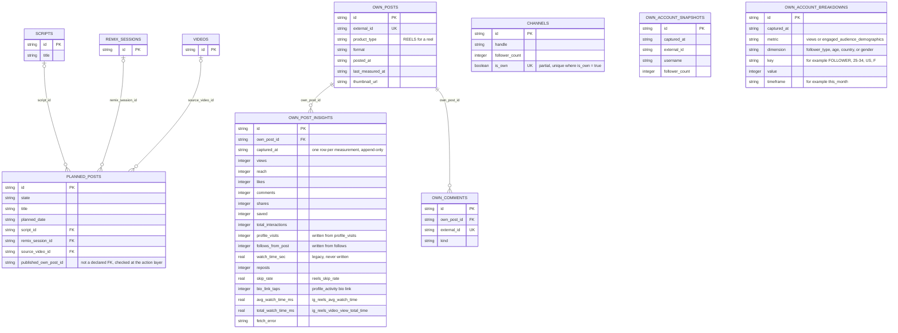
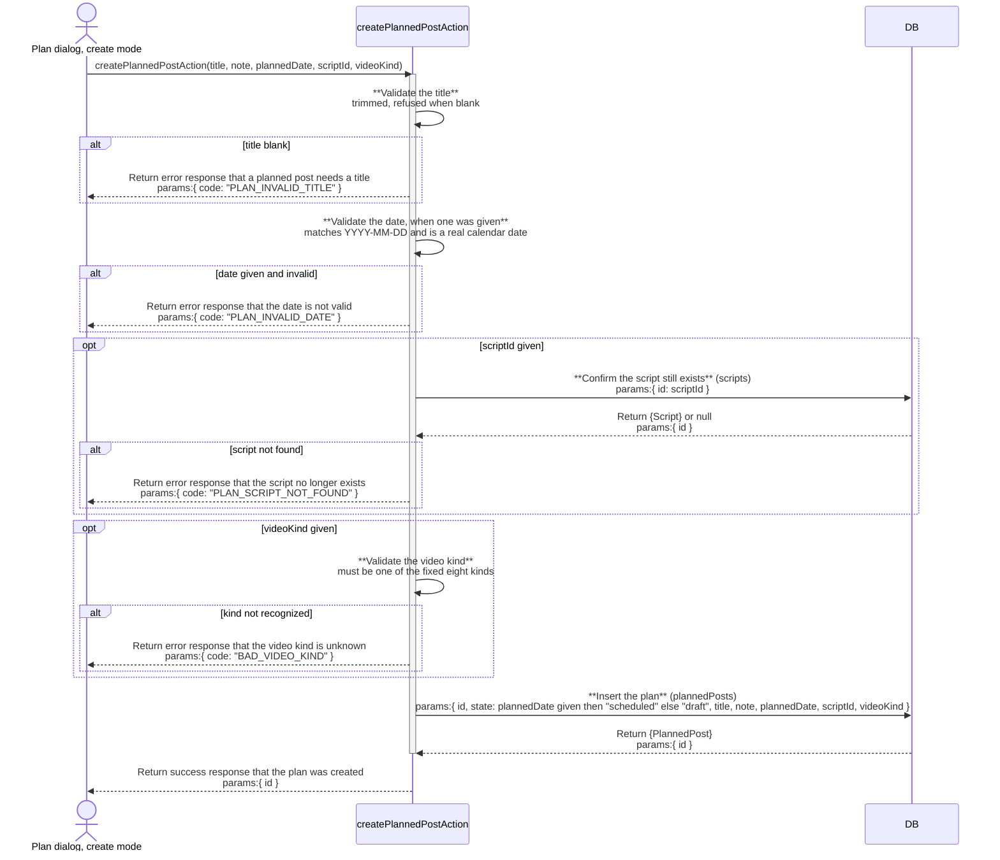
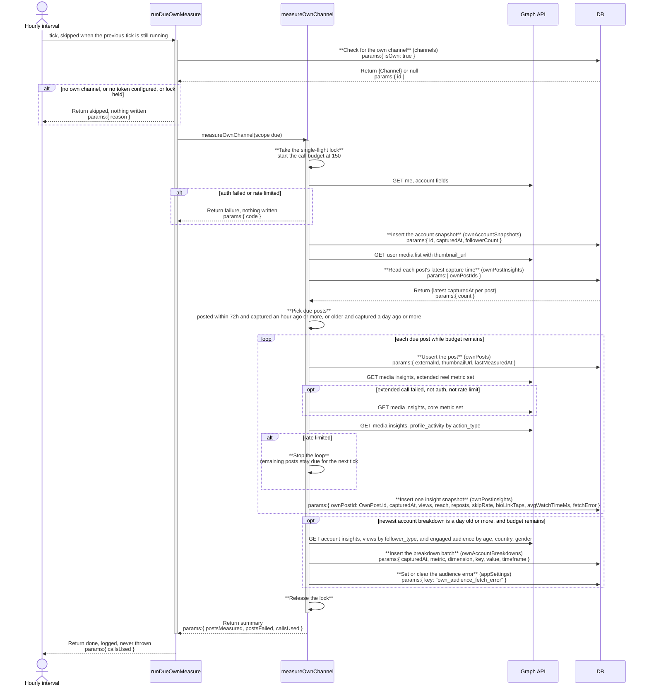
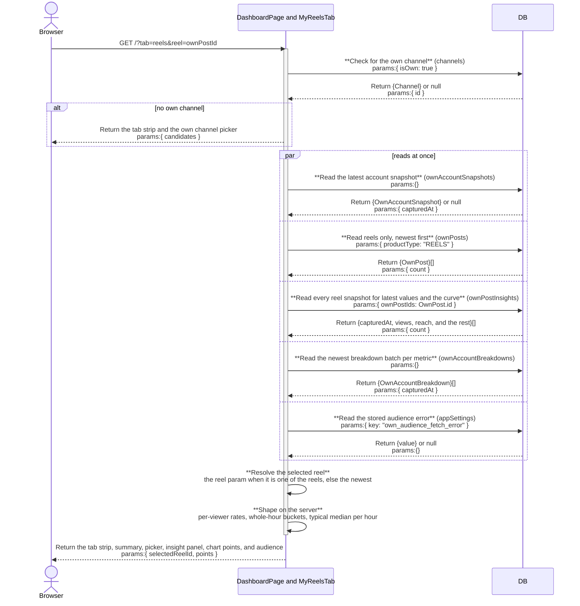

# mine: architecture

`documents/architect/core-components/mine/`

Status: shipped. Dashboard tabs with `/mine` redirecting (feature 9), My reels (features 10 to 13), and scheduled measurement (feature 14) run in code; the newer Graph metrics and the live scheduled cadence are unverified against a real call (section 9).

## 1. Module structure

| File | Export | Role |
| --- | --- | --- |
| `src/app/(shell)/(loaded)/page.tsx` | `DashboardPage` (default) | The Dashboard route, owned by the dashboard component. Awaits `searchParams` (`tab`, `month`, `reel`), renders `DashboardTabs`, then only the active tab's server component, so each tab's reads run only when that tab is open. A missing or unknown `tab` means Overview. |
| `src/components/dashboard/dashboard-tabs.tsx` | `DashboardTabs`, `resolveDashboardTab` | The tab strip as three link buttons (`dashboard-tab-overview`, `dashboard-tab-reels`, `dashboard-tab-calendar`) that set `?tab=`; the active one carries `aria-current="page"`. Rendered above every state of every tab. |
| `src/components/dashboard/overview-tab.tsx` | `OverviewTab` | The research Dashboard body, including its twelve reads and the `readAndBumpDashboardLastVisit` write, which runs on Overview only. |
| `src/components/mine/calendar-tab.tsx` | `CalendarTab`, `ownChannelPicker` | The own-channel gate plus the calendar reads (`getCalendarMonth`, `getScripts`) and the publish config flags (`bucketConfigured`, `graphConfigured`, dry run), rendering `MineCalendar`; those flags are the [publish](../publish/02-architecture.md#1-module-structure) component's concern. `ownChannelPicker` is the no-own-channel gate shared with My reels. |
| `src/components/mine/month-param.ts` | `validMonth`, `mineRedirectTarget` | `YYYY-MM` validation with a real month, and the `/mine` redirect target: always a same-origin path, carrying only a valid `month`. |
| `src/app/(shell)/(loaded)/mine/page.tsx` | `MinePage` (default) | A redirect only: `redirect(mineRedirectTarget(searchParams))`, no reads. The `(loaded)` group streams (`loading.tsx`), so the redirect is delivered in the streamed response rather than as a `Location` header. |
| `src/components/mine/my-reels-tab.tsx` | `MyReelsTab` | The My reels server component: own-channel gate, token gate, the account summary (header, `OwnStatTiles`, progress, `ReachByPostBars`), `ReelPicker`, `ReelInsightPanel`, `AccountAudience`, then `OwnPostList` and `OwnWeekdayRhythm` as sections. |
| `src/components/mine/own-channel-picker.tsx` | `OwnChannelPicker` | Lists tracked channels not already own, with a "This is me" button per row. |
| `src/components/mine/graph-connect-panel.tsx` | `GraphConnectPanel` | The Graph token gate: states what is missing, or offers "Check connection" and "Measure now" (calls `checkGraphTokenAction` and `measureOwnChannelAction`). |
| `src/components/mine/own-stat-tiles.tsx` | `OwnStatTiles` | The six metrics tiles (followers, reach, saves, shares, median reach, posts measured), each carrying its own sample size. |
| `src/components/mine/reach-by-post-bars.tsx` | `ReachByPostBars`, `OwnPostList` | The reach bars (oldest first) and the flat post list (newest first); both read the same `OwnPostRow[]`. |
| `src/components/mine/own-weekday-rhythm.tsx` | `OwnWeekdayRhythm` | Average reach by weekday, with a post count per bar. |
| `src/components/mine/reel-picker.tsx` | `ReelPicker` | Newest-first reel list as links setting `?reel=<ownPostId>` (`reels-picker-item`): thumbnail, posted date, latest views. |
| `src/components/mine/reel-insight-panel.tsx` | `ReelInsightPanel` | Summary tiles, interaction strip, what impacts your views, actions after viewing, the views chart, the not-available placeholders, and measured-at lines, from one server-shaped object. |
| `src/components/mine/reel-views-over-time.tsx` | `ReelViewsOverTime` | Client chart on `src/components/ui/chart.tsx` (recharts): the reel's views and "Your typical reel" by hours since posting (`reels-views-chart`). Receives only the already-shaped point list for the selected reel. |
| `src/components/mine/account-audience.tsx` | `AccountAudience` | Followers vs non-followers and the Age, Country, Gender tabs, labelled whole account, or the API-threshold message. |
| `src/components/mine/mine-calendar.tsx` | `MineCalendar` | The month grid, the day detail panel, the publish lifecycle on the cell and panel, and the writes it fires directly (mark published, delete, cancel scheduled publish, retry failed publish). Month links carry `tab=calendar` alongside `month=`. Opens `plan-dialog.tsx`, `publish-dialog.tsx`, and `confirm-dialog.tsx`. |
| `src/components/mine/plan-dialog.tsx` | `PlanDialog` | Create or edit one planned post; a saved edit goes through the single `savePlanEditAction`. |
| `src/components/mine/publish-dialog.tsx` | `PublishDialog` | Upload an mp4, write a caption, then publish now or schedule, calling `uploadPlanVideoAction`, `setPlanCaptionAction`, `publishNowAction`, and `schedulePublishAction`. The pipeline it feeds is the [publish](../publish/02-architecture.md#1-module-structure) component. |
| `src/components/mine/confirm-dialog.tsx` | `ConfirmDialog` | A designed destructive confirm shared by "cancel scheduled publish" and "delete a plan carrying a video". |
| `src/server/queries/own-channel.ts` | `getOwnChannelOverview`, `getOwnPosts`, `getPostsWithLatestInsights`, `getOwnPostInsightHistory`, `getOwnComments`, `getOwnReels`, `getReelViewHistory`, `getAccountBreakdowns` | Pure database reads over the own-channel table set; none calls the Graph API. `getPostsWithLatestInsights` joins each `own_posts` row to its latest `own_post_insights` row in application code and is reused by `planned-posts.ts`. `getOwnReels`: reels only (`productType` is `REELS`), newest first, each with its latest insight row and `thumbnailUrl`. `getReelViewHistory`: `(ownPostId, postedAt, capturedAt, views)` for every reel snapshot, the input to the curve. `getAccountBreakdowns`: the newest captured batch per metric from `own_account_breakdowns`, sorted by value, plus the stored audience error. |
| `src/server/queries/planned-posts.ts` | `getPlannedPosts`, `getPlannedPostById`, `getCalendarMonth`, `scriptExists`, `getPlansCarryingScript` | Planned-post reads. `getCalendarMonth` returns plans in range, undated drafts, published cells, and dead-air runs in one call. `missed` and `reconciledOwnPostId` are computed on every read, never stored. |
| `src/server/queries/channels.ts` | `getOwnChannel`, `getChannelsList` | `getOwnChannel` is the first gate; `getChannelsList` supplies the picker's candidates. Shared with the channels board and ig-sync. |
| `src/server/queries/vault.ts` | `getScripts` | Read-only, to populate the plan dialog's script select. |
| `src/server/actions/planned-post-actions.ts` | `createPlannedPostAction`, `updatePlannedPostAction`, `savePlanEditAction`, `schedulePlannedPostAction`, `unschedulePlannedPostAction`, `attachScriptToPlanAction`, `detachScriptFromPlanAction`, `markPlanPublishedAction`, `deletePlannedPostAction`, `uploadPlanVideoAction`, `setPlanCaptionAction`, `schedulePublishAction`, `cancelScheduledPublishAction`, `publishNowAction`, `retryFailedPublishAction` | The fifteen writes against `planned_posts`. The six publish lifecycle writes call `revalidatePath("/")`. |
| `src/server/actions/channel-actions.ts` | `setOwnChannelAction`, `unsetOwnChannelAction`, `removeChannelAction` | `setOwnChannelAction` backs the picker; `unsetOwnChannelAction` exists but no control calls it (B-15). Shared with the channels board. |
| `src/server/actions/graph-actions.ts` | `checkGraphTokenAction`, `measureOwnChannelAction` | `measureOwnChannelAction` is a thin wrapper: `measureOwnChannel({ scope: "all" })`, then `revalidatePath("/")` on success. |
| `src/server/graph/client.ts` | `graphClient`, `isGraphConfigured`, `mapInsights`, `mapBioLinkTaps`, `mapAccount`, `redactToken` | Stateless Graph API client against `graph.instagram.com`, version from `IG_GRAPH_API_VERSION` (default `v21.0`). `fetchMedia` lists up to 50 media with `thumbnail_url`. `fetchPostInsights` requests the extended reel metric set, falls back once to the core set when that call fails for any reason other than auth or rate limit, then reads `profile_activity` with `breakdown=action_type` for bio link taps; non-reels make one core call. `fetchAccountBreakdowns` reads the account follower split and engaged-audience demographics. Auth and rate-limit failures throw so the run can stop; any other failure becomes that post's `insights.error`. The service composes these calls; there is no single "fetch posts with insights" call. |
| `src/server/services/own-measure.ts` | `measureOwnChannel`, `isDue`, `toFailure`, `messageOf`, `OWN_MEASURE_CALL_BUDGET` | The one writer of `own_account_snapshots`, `own_posts`, `own_post_insights`, `own_comments`, and `own_account_breakdowns`. Takes a scope (`all`, or `due` posts only), counts every Graph call against a per-run budget of 150, and holds a module-level single-flight lock shared by the manual and scheduled paths: a `due` run finding it held returns `MEASURE_BUSY`, an `all` run waits. |
| `src/server/services/own-measure-scheduler.ts` | `runDueOwnMeasure`, `startOwnMeasureScheduler` | The scheduled tick, same shape as `sync-scheduler.ts`: hourly interval (`OWN_MEASURE_SCHEDULER_INTERVAL_MS` override), `let running` guard, never throws, logs codes and counts only. Skips with no own channel, no configured token, or the lock held. Calls `measureOwnChannel({ scope: "due" })`. |
| `src/server/services/reel-insights.ts` | `shapeReelInsights`, `perViewerRate`, `selectReel`, `hoursSincePosted`, `typicalViewsCurve` | Pure functions, no database, no network: per-viewer rates (null when reach or the metric is null, or reach is zero), the selected-reel fallback, whole-hour buckets, and the median-of-other-reels curve. |
| `src/server/services/own-metrics.ts` | `computeOwnMedianReach`, `indexAgainstOwnMedian` | Own-channel median reach over a trailing 20-post window, gated on `scoreMinUsablePosts`. |
| `server.ts` | boot | Starts `startOwnMeasureScheduler()` beside the publish and sync schedulers, in its own try/catch. |
| `src/components/layout/nav-items.ts` | `NAV_ITEMS` | Has no "My channel" entry; the own-account views are Dashboard tabs. |
| `src/server/services/sync-scheduler.ts`, `src/server/services/publish-scheduler.ts` | `startSyncScheduler`, `startPublishScheduler` | Not mine's; the in-process scheduler pattern the measurement scheduler copies. |
| `src/server/mcp/mcp-server.ts` | `crowsnest_metrics` tool | Not mine's; reads `getOwnChannelOverview` and `getOwnPosts`, so it is a downstream reader of the own-channel queries. `profileVisits` and `followsFromPost` report `wired: true`; `watchTimeSec` stays `wired: false`. |

## 2. ER diagram

`CHANNELS`, `OWN_ACCOUNT_SNAPSHOTS`, and `OWN_ACCOUNT_BREAKDOWNS` carry no declared foreign key; mine joins them in application code. The own-channel tables hold no reference to `channels`: there is one Graph token, so there is one own account. `REMIX_SESSIONS` and `VIDEOS` are stubs owned by the remix and feed components. `published_own_post_id` is a plain text column that `markPlanPublishedAction` checks against `own_posts` by hand.

### 2.1 Migration 0030

`drizzle/0030_pale_kabuki.sql`, generated with `drizzle-kit generate` from `schema.ts`, all additive, no data rewritten:

- `own_posts`: add nullable `thumbnail_url` text.
- `own_post_insights`: add nullable `reposts` integer, `skip_rate` real, `bio_link_taps` integer, `avg_watch_time_ms` real, `total_watch_time_ms` real.
- New table `own_account_breakdowns` with index `own_account_breakdowns_metric_captured` on `(metric, captured_at)`.

Column choices:

- **Reuse `profile_visits` and `follows_from_post`.** Both existed, nullable, and had never been written before the rework, so no stored value changed meaning. They start receiving the `profile_visits` and `follows` metrics. Renaming `follows_from_post` would cost a table rebuild in SQLite for no reader benefit.
- **New `avg_watch_time_ms` instead of reusing `watch_time_sec`.** The API returns milliseconds, and `watch_time_sec` does not say average or total. Storing the raw unit avoids a lossy conversion. `watch_time_sec` stays, always null, and nothing reads a value from it.
- **Store `total_watch_time_ms` though no block shows it.** A snapshot cannot be re-fetched for a past hour, so a metric not stored at capture time is lost for good; one nullable column is the cheap side of that trade.
- **One generic `own_account_breakdowns` table instead of an audience table plus a views-split table.** Both account-level reads return the same shape (metric, breakdown dimension, key, value) and are read the same way (newest batch per metric). One table, one writer, one reader. A "refused for lack of volume" result is not a row; it is stored as an `app_settings` key (`own_audience_fetch_error`), the same pattern `own_comments_fetch_error` already uses.
- **No new table for the views-over-time series.** `own_post_insights` already keeps one row per post per measurement, so the series is a read over it.

## 3. Indexes

| Table | Index | Notes |
| --- | --- | --- |
| planned_posts | planned_posts_date | Plain index on `plannedDate`; backs the calendar's month-range read and the undated-drafts filter. |
| own_posts | own_posts_external | Unique on `externalId`; the idempotent upsert key the measurement writes through. |
| own_posts | own_posts_posted | Plain index on `postedAt`; backs newest-first lists, the reel picker included. |
| own_post_insights | own_post_insights_post_captured | Plain composite on `(ownPostId, capturedAt)`; backs "latest insight per post", one reel's history, and the views-over-time read. |
| own_account_snapshots | own_account_snapshots_captured | Plain index on `capturedAt`; backs the "most recent snapshot" read. |
| own_comments | own_comments_external | Unique on `externalId`; the idempotent comment upsert key. |
| channels | channels_single_own | Partial unique on `isOwn` where `isOwn = true`; at most one channel is ever own. |
| own_account_breakdowns | own_account_breakdowns_metric_captured | Plain composite on `(metric, capturedAt)`; backs "newest batch per metric" for the audience blocks. |

`channels_platform_handle` and the `scripts` indexes are covered in the [ig-sync](../ig-sync/02-architecture.md#3-indexes) doc.

## 4. Data flow

**Dashboard tabs.** `DashboardPage` awaits `searchParams`, picks the tab, renders `DashboardTabs`, then exactly one of `OverviewTab`, `MyReelsTab`, or `CalendarTab`. Each is an async server component that runs its own reads, so opening My reels never runs Overview's sidecar and model pings, and opening Overview never touches the own-channel tables. `/mine` redirects to `/?tab=calendar`, carrying a valid `month`. The planner and graph writes revalidate `/`.

**Calendar tab.** `getOwnChannel` gates it (picker when none). Then `getCalendarMonth(month)` and `getScripts()` run together and `MineCalendar` renders with the publish flags. Plan and publish writes behave exactly as shipped.

**My reels tab.** `getOwnChannel` gates it. `checkGraphTokenAction` decides the connect panel: a missing token, or a failing token with nothing ever measured, shows the panel alone; a failing token over earlier measurements stacks the panel above the stored numbers. Reads: `getOwnChannelOverview`, `getOwnPosts({ limit: 100 })`, `getOwnReels`, `getReelViewHistory`, `getAccountBreakdowns`, and `scoreMinUsablePosts`. The selected reel is `?reel=` when it matches a reel id, else the newest reel. `shapeReelInsights` builds the panel object and `typicalViewsCurve` builds the chart points on the server; only the selected reel's shaped points cross to the client chart.

**Typical reel curve.** For every reel other than the selected one, each snapshot is bucketed at whole hours since `postedAt` (floor). Where one reel has several snapshots in one bucket, the latest counts. The typical value at hour `h` is the median of those reels' views at `h`, and is null where no other reel has a snapshot at `h`. Hours run from zero to the selected reel's newest measured hour, so the payload is bounded by that reel's age.

**Measurement.** `measureOwnChannel(scope)` takes the lock, fetches the account and inserts an `own_account_snapshots` row, lists media, upserts `own_posts` (now with `thumbnail_url`), and for each post in scope inserts one `own_post_insights` row. For reels in scope it requests `views, reach, likes, comments, shares, saved, total_interactions, reposts, follows, profile_visits, ig_reels_avg_watch_time, ig_reels_video_view_total_time, reels_skip_rate`. If that call fails for a reason other than auth or rate limit, it retries once with the core set plus `views`, so one unsupported metric never blanks the post. A second call reads `profile_activity` with `breakdown=action_type` for bio link taps; its failure leaves `bio_link_taps` null. Non-reels follow the same due rule and make one core call (`reach, saved, shares, total_interactions, comments, likes`). Once a day it also reads `views` with `breakdown=follower_type, metric_type=total_value, period=day` and `engaged_audience_demographics` with `breakdown` age, country, and gender and `timeframe=this_month`, writing `own_account_breakdowns`. Comments run only on the `all` scope, and are skipped (with the stored comments error set) when the run stopped early or the remaining budget cannot cover one media list call plus one call per post with comments.

**Scope and budget.** `all` is "Measure now": every listed post. `due` is the scheduled tick: a reel is due when posted within the last 72 hours and its latest capture is an hour old or more, or when older and its latest capture is 24 hours old or more. A post with no capture is due. Due-ness is derived from `own_post_insights` on every tick, so no scheduler state is stored and a post skipped for budget is simply still due next tick. Every Graph call counts against a per-run budget of 150, under Instagram's 200 calls per hour per user; before each post the run reserves the worst case (three calls for a reel, one otherwise) and stops cleanly when that would pass the budget or a call is rate limited or refused for auth; rows already written stay. A post whose insights call throws for any other reason is logged and skipped, and the others continue. The account breakdowns run only when the run did not stop early, four calls of budget remain, and the newest stored batch is 24 hours old or more.

## 5. Sequence: planning a post

## 6. Sequence: scheduled measurement tick

"Measure now" runs the same service with scope `all`: every listed post is in scope, and comments are fetched and upserted after the posts when the budget allows. When a scheduled run holds the lock, "Measure now" waits for it to finish, then runs.

## 7. Sequence: reading My reels

The parallel block omits the token check, `getOwnPosts({ limit: 100 })` for the post list and weekday chart, and the `scoreMinUsablePosts` setting.

## 8. Key decisions

- **Tabs in the URL, one tab's reads per request.** `?tab=` on a server component means a reload, back button, or shared link lands on the same tab, and the page runs only the active tab's queries, so Overview's load cost does not grow. `readAndBumpDashboardLastVisit` stays inside `OverviewTab`; running it on another tab would reset "new since your last visit" without the user seeing Overview.
- **`/mine` redirects rather than rendering.** Every inbound `/mine` link (remix finish, vault script dialog) is about the plan, so it lands on the Calendar tab. The route stays as a redirect so old links keep working.
- **Chart data shaped on the server.** Per the design-system rule, the client chart receives only the selected reel's point list, never the snapshot rows. The curve and rates live in the pure `reel-insights.ts`, testable without a database.
- **One measurement service, two triggers.** The scheduled tick and "Measure now" call the same `measureOwnChannel`, so there is one writer of the own-channel tables and one place the metric set and fallback live. The single-flight lock covers both, so a manual click during a tick cannot double the Graph calls.
- **Due-ness derived, not stored.** The hourly-then-daily rule reads each post's latest `capturedAt`, so the scheduler keeps no state, survives a restart unchanged, and a manual measurement also defers the next scheduled one for those posts.
- **A per-run call budget, not a retry loop.** 150 calls per run leaves headroom under the 200 per hour limit. A rate-limited run stops; posts left over stay due.
- **Extended metrics with a one-step fallback.** Requesting newer metrics (`reposts`, `reels_skip_rate`) in the same call as the core set risks one unsupported name failing the whole call. One retry with the core set keeps the numbers that worked before the rework, costing at most one extra call per post, where per-metric calls would cost thirteen.
- **Account-wide numbers never read as per-reel.** Follower split and demographics exist only at the account level in the API, so they live in their own table and their own block with a whole-account label.
- **Two gates, neither faked.** Unchanged: no own channel shows the picker, a bad token shows the connect panel, and a token failing now stacks over real historical numbers instead of hiding them.
- **Own-channel tables stay separate from `channels`/`videos`.** Unchanged: own posts can never enter the outlier feed or channel scoring.
- **Missed is derived on read, a plan edit is one atomic action, and the delete Undo is lossless.** Unchanged from the shipped planner: `createPlannedPostAction` accepts the deleted plan's `id` and `state` so Undo restores the row as it was, with "missed" re-deriving and "publishing" or "failed" falling back to the create default.
- **B-16 is closed.** The new components carry the testids 03 names (`dashboard-tab-*`, `reels-*`), and the older ones carry theirs (`mine-stat-tile`, `mine-reach-bars`, `mine-post-row`, `mine-weekday-bar`, `mine-connect-*`, `mine-delete-undo`, `plan-dialog-*`). The old Month, Posts, Metrics strip is removed, so `mine-tab-*` are superseded by `dashboard-tab-*`.

## 9. Open, not verified

- **Metric availability on this account and API version.** `IG_GRAPH_API_VERSION` defaults to `v21.0`; whether `reposts`, `reels_skip_rate`, `profile_activity` with `breakdown=action_type`, and the account `views` follower split are returned at that version, or need a version bump, is not proven against a live call. The fallback keeps the core set either way.
- **Units and shape of the new metrics.** That `ig_reels_avg_watch_time` and `ig_reels_video_view_total_time` are milliseconds, that `reels_skip_rate` is a percentage, and the exact action type name for a bio link tap in `profile_activity`, are taken from Meta's documentation, not a live response.
- **Account views split window.** The `since` and `until` range sent with `metric_type=total_value, period=day` is not settled; the stored `timeframe` records whatever range is sent.
- **Call budget in practice.** The 150-call budget assumes about 50 listed posts at up to three calls each on a daily sweep. A manual "Measure now" in the same hour as a daily sweep can together pass 200; the rate-limit stop is the only guard, and it has not been exercised live.
- **Thumbnail lifetime.** `thumbnail_url` is an Instagram CDN link that may expire; the daily sweep refreshes it, but how long a stored link stays valid is not measured.
- **Dead published link.** `MineCalendar` links a published plan to `/mine/<publishedOwnPostId>`, a route that does not exist and that the `/mine` redirect does not cover (B-17).
- **Breakdown refusals retry each tick.** When every account breakdown call is refused, no row lands, so the next tick retries (four calls an hour). A stored refusal timestamp would stop that if the budget ever gets tight.
- **The scheduled cadence live.** Hourly and daily measurement is proven in tests with a mocked client only; the configured token is rejected, so no scheduled run has written real rows.
- **Graph rate limit and comment classifier under load.** The measurement flow, its partial-comments path, and classifier version stamping are read from code, not exercised against a live account at scale.
