# mine: test cases

Result markers: 🟢 pass, 🔴 bug, 🟡 blocked (missing dependency named in the cell). Rows still reading "not run" have not been driven yet.

How to run these: start the dev server and open `http://localhost:3001` (never `127.0.0.1`) for the behavior and browse-e2e cases. mine lives on the Dashboard at `/`, on two tabs: My reels (`/?tab=reels`, features 3, 4, 7, and 10 to 13) and Calendar (`/?tab=calendar`, features 5, 6, and 8). Rows for features 2 to 8 that record a result without naming a journey were driven on the earlier `/mine` page, before these surfaces moved onto the Dashboard. Seed one tracked channel; for a full run mark it own (or use the picker's "This is me" from a fresh database). Route and action cases run with `vitest` against a temporary SQLite database, covering `own-channel.ts`, `planned-posts.ts`, `planned-post-actions.ts`, `channel-actions.ts`, `graph-actions.ts`, `src/server/graph/client.ts`, `src/server/services/own-measure.ts`, `src/server/services/own-measure-scheduler.ts`, and `src/server/services/reel-insights.ts`; the Graph client is mocked in those tests, so no live Instagram Graph token is required for that lens. For the behavior and browse-e2e lenses, a Graph token that has measured the account at least once is needed to exercise the connected state; clearing or corrupting `IG_GRAPH_TOKEN`/`IG_GRAPH_USER_ID` (Settings > API keys first, `.env.local` second) is how the connect panel and gated states are reached. Seed a handful of planned posts spread across a draft with no date, a scheduled future date, and a scheduled past date, plus one plan carrying a script and one marked published, so the calendar cells exercise every state. For My reels, seed own reels (`own_posts` with a reel product type) with several `own_post_insights` snapshot rows each at known hours since posting, plus one non-reel post. Needs column values: `mouse` and `keyboard` are the input; `graph-invalid` means the token is cleared or rejected; `graph-measured` means the account was measured at least once before; `graph-live` means a real, accepted Graph token; `second-tab` is a second tab on the same session, not a second browser.

Browse-e2e cases are driven with the `browse` skill against the running dev server, per `references/browse-e2e-qa.md`. Every surface a journey below names carries its `data-testid`, including the Dashboard tab strip and the My reels testids `03-feature-description.md` names for features 9 to 13.

## 1. behavior

| ID | P | Needs | Claim | Setup | Steps | Expected | Result |
| --- | --- | --- | --- | --- | --- | --- | --- |
| MINE-01 | P1 | mouse | With no channel marked own the My reels and Calendar tabs are a picker; marking one switches it to the dashboard or connect panel ([choose your own channel](03-feature-description.md#2-choose-your-own-channel)). | Tracked channels present, none marked own. | 1. Open `/?tab=reels`. 2. Click "This is me" on a channel. 3. Wait for the refresh. | Before: a picker listing tracked channels. After: a toast names the handle and the tab shows the account summary or the connect panel, not the picker. | 🟢 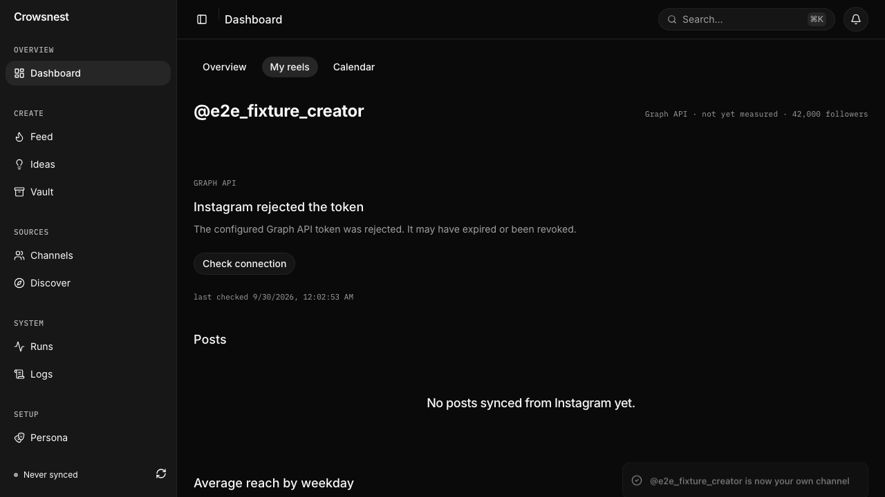 via E2E-01: `mine-seed.ts no-own` renders the picker, "This is me" leaves it for the connect panel and tiles |
| MINE-02 | P1 | mouse | There is no control on the My reels or Calendar tab to clear the own channel ([choose your own channel](03-feature-description.md#2-choose-your-own-channel)). | Own channel set, dashboard showing. | 1. Look over the header, the tabs, and the whole tab for an unset or clear control. | No such control exists anywhere on the page. | 🟢 pass (browser): no clear/unset control found anywhere on the page (see test-shots/MINE-02.png) |
| MINE-03 | P1 | graph-invalid | With the token missing or failing, only the connect panel renders where the metrics would be ([view your own channel dashboard](03-feature-description.md#3-view-your-own-channel-dashboard)). | Own channel set, token cleared, account never measured. | 1. Open `/?tab=reels`. 2. Look where the metrics band would be. | Only the connect panel renders: no stat tiles, no progress bar, no reach bars. Header and the Dashboard tab strip still show. | 🟢 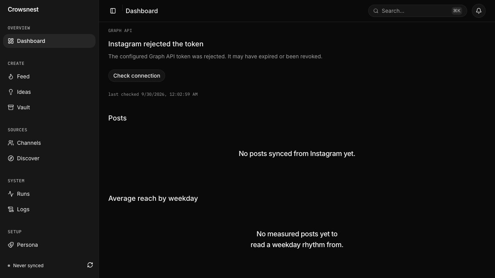 via E2E-07: junk token, never measured, so the connect panel stands alone with no stat tiles; Posts and weekday still render below |
| MINE-04 | P1 | graph-invalid, graph-measured | A token invalid now but measured before stacks the connect panel over the real historical numbers instead of hiding them ([view your own channel dashboard](03-feature-description.md#3-view-your-own-channel-dashboard)). | Own channel measured at least once, then the token invalidated. | 1. Open `/?tab=reels`. 2. Read the metrics area. | The stat tiles, progress bar, and reach bars still show the last measured figures, with the connect panel and its problem text above them. | 🟢 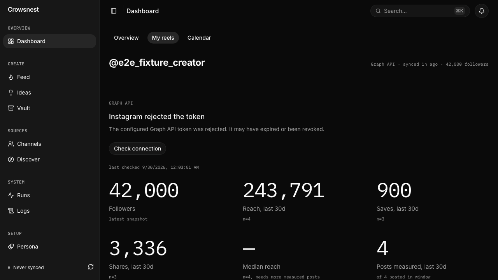 via E2E-08: the rejected-token panel sits above the stored tiles (42,000 followers) |
| MINE-05 | P2 | mouse | The header reads "Graph API, synced" with a relative time when measured, or "Graph API, not yet measured" when not ([view your own channel dashboard](03-feature-description.md#3-view-your-own-channel-dashboard)). | Own channel set; one run measured, one never measured. | 1. Open `/?tab=reels` on a measured account, read the mono line. 2. Repeat on a never-measured account. | Measured: "Graph API, synced" plus a relative time. Never measured: "Graph API, not yet measured". | 🟢 pass (browser) for the measured half: header read "Graph API · synced 22d ago"; the never-measured half is not reachable (only one own channel exists, already measured) (see test-shots/MINE-05.png) |
| MINE-06 | P2 | mouse | A missing reach shows as a dash, never a zero, across the stat tiles, the reach bars, and the post list ([view your own channel dashboard](03-feature-description.md#3-view-your-own-channel-dashboard), [browse own posts and weekday metrics](03-feature-description.md#4-browse-own-posts-and-weekday-metrics)). | An own post whose insights call failed or never ran. | 1. Find that post in the reach-by-post strip. 2. Find it in the Posts list. | Both show a dash, never a zero height bar or a printed 0. | 🟢 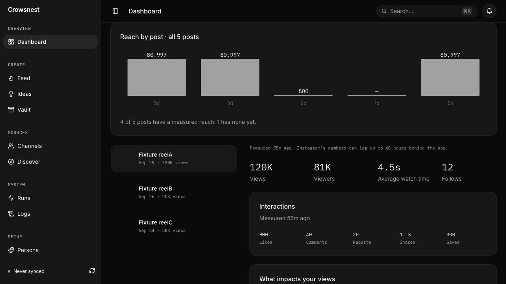 a post with no insights row reads a dash in the reach strip and the Posts list, never 0 (production `server.ts` on a spare port, temp DB) |
| MINE-07 | P2 | mouse | Clicking a post row in the Posts list opens its Instagram permalink in a new tab and leaves the page unchanged ([browse own posts and weekday metrics](03-feature-description.md#4-browse-own-posts-and-weekday-metrics)). | Measured account with posts. | 1. Click Posts. 2. Click a row. | A new browser tab opens the post's Instagram permalink; the My reels tab stays on Posts, nothing else changes. | 🟢 pass (browser): each row is a real `target="_blank"` anchor to its `instagram.com/reel|p/...` permalink (see test-shots/MINE-07.png) |
| MINE-08 | P1 | mouse | With no script selected, Save stays disabled until "I don't have a script yet" is ticked or a script is chosen ([plan a post](03-feature-description.md#5-plan-a-post)). | Plan dialog open in create mode, title typed, no script chosen. | 1. Type a title, leave the script blank. 2. Observe Save. 3. Tick the checkbox. | Save is disabled while unticked and no script is chosen; ticking it, or choosing a script, enables Save. | 🟢 pass (browser) (see test-shots/MINE-08.png) |
| MINE-09 | P1 | mouse | The date decides the state at save: present writes scheduled, absent writes draft, a past date is accepted and reads missed on the calendar ([plan a post](03-feature-description.md#5-plan-a-post)). | Create mode. | 1. Create with a future date. 2. Create with the date cleared. 3. Create with a past date. | Future: scheduled plan, toast "Planned". Cleared: draft, toast "Saved as a draft". Past: accepted, reads "missed" on the calendar. | 🟢 pass (browser): future date wrote state=scheduled with toast "Planned"; date cleared wrote state=draft with toast "Saved as a draft" under Undated drafts; a past date (2026-08-20) wrote state=scheduled and the calendar cell for that day read "missed" (see test-shots/MINE-09.png) |
| MINE-10 | P1 | mouse | An edit that fails on one part (a script that does not exist) writes nothing, and one inline error shows, because the edit is one call ([plan a post](03-feature-description.md#5-plan-a-post)). | An existing plan in edit mode, a script id that no longer exists. | 1. Change title and date and the script. 2. Save. 3. Reload the calendar. | Title and date stay as they were; one red inline error shows. | 🟢 covered by vitest (green), `planned-post-edit.test.ts`: a failing part leaves every other field unchanged; the browser cannot inject the failure |
| MINE-11 | P1 | mouse | A plan marked published in the past reads as published, not missed, on the calendar ([manage the month calendar](03-feature-description.md#6-manage-the-month-calendar)). | A past-dated scheduled plan. | 1. Open its day panel. 2. Click "mark published, no post linked". 3. Reload and read the cell. | The cell reads as published (a filled corner marker), never as a red missed day. | 🟢 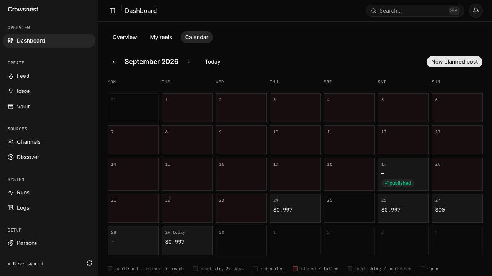 a plan dated 10 days back read "missed"; after "mark published, no post linked" and a reload the cell reads ✓ published (production `server.ts` on a spare port, temp DB) |
| MINE-12 | P1 | mouse | The delete Undo re-creates the plan losslessly: same id, remix link, source link, video kind, time, target length, and state ([manage the month calendar](03-feature-description.md#6-manage-the-month-calendar)). | A fully linked plan (remix session, source video, script, video kind, time, target length). | 1. Delete it from the day panel. 2. Click Undo in the toast. 3. Compare the restored plan to the original. | The restored plan matches the original field for field, including its id and published state. | 🟢 covered by vitest (green), `planned-post-actions.test.ts` ("re-creates a deleted plan losslessly", "Undo restores a published plan's state"); the browser delete and Undo round trip is E2E-10 |
| MINE-13 | P2 | graph-invalid | With no measurement the grid renders every plan and a line says the published and dead-air cells are unavailable, with nothing erroring ([manage the month calendar](03-feature-description.md#6-manage-the-month-calendar)). | Own channel set, token cleared or never measured. | 1. Open the Calendar tab (`/?tab=calendar`). 2. Read the grid and any line above it. | Plans render normally; published and dead-air cells and legend entries are absent, with an explanatory line; no error. | 🟢 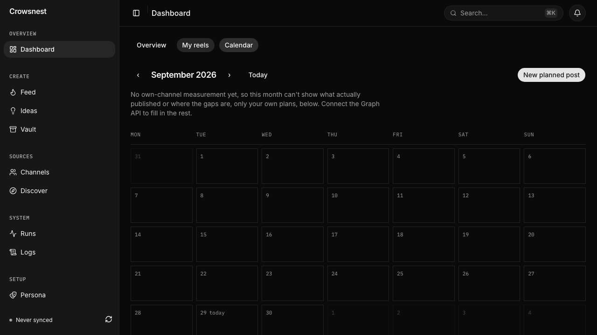 via E2E-07: never measured, the line above the grid explains the missing published and dead-air cells, no error; plans in this state are not driven |
| MINE-14 | P2 | mouse | The reconciliation prompt waits for a click and stops appearing once the plan is marked published by hand ([manage the month calendar](03-feature-description.md#6-manage-the-month-calendar)). | A plan and an own post sharing a date, plan not yet marked. | 1. Open that day's panel. 2. Read the prompt. 3. Mark published, reopen. | The prompt asks whether to mark published against the post and waits for a click; after marking by hand it no longer appears. | 🟢 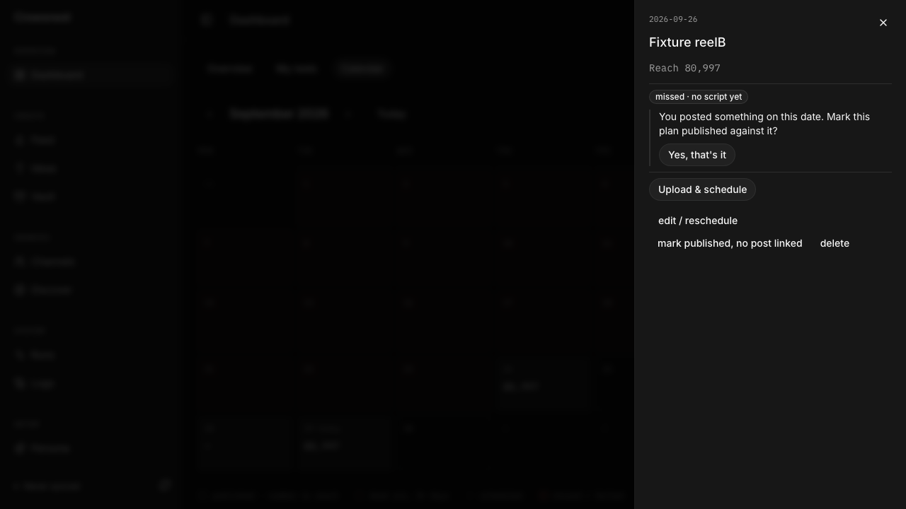 the prompt "Mark this plan published against it?" waits for a click; after "Yes, that's it" the reopened panel reads published and the prompt is gone (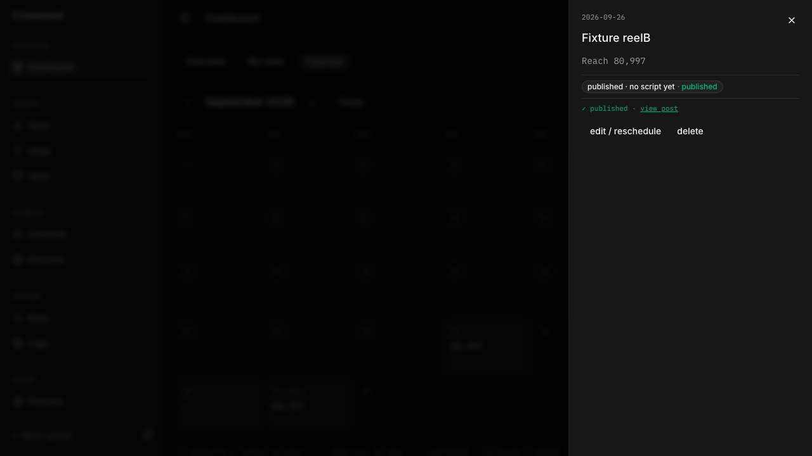) (production `server.ts` on a spare port, temp DB) |
| MINE-15 | P2 | mouse | "Check connection" and "Measure now" each disable their own button while running, and "Measure now" shows only when the token is ok and nothing has been measured ([connect and measure the Graph API](03-feature-description.md#7-connect-and-measure-the-graph-api)). | Connect panel showing, token ok, never measured. | 1. Click "Check connection", observe its label. 2. Click "Measure now", observe its label and that it disappears once measured. | Buttons read "Checking…"/"Measuring…" while running and disable; "Measure now" appears only in the connected-but-unmeasured state. | 🟡 blocked: Graph token rejected, release gate ("Measure now" needs a token that checks ok; the offline check answers too fast to observe "Checking…") |
| MINE-16 | P1 | mouse | The Dashboard shows three tabs, Overview, My reels, and Calendar, and the chosen tab lives in `?tab=` so a reload lands on the same tab ([dashboard tabs](03-feature-description.md#9-dashboard-tabs-and-the-mine-redirect)). | Own channel set. | 1. Open `/`. 2. Click My reels. 3. Reload. 4. Click Calendar, then press Back. | `/` opens on Overview. After step 2 the URL reads `?tab=reels`; the reload stays on My reels; Back returns to My reels. | 🟢 pass (E2E-14) for the three tabs and `?tab=` across a reload; the Back step is not driven |
| MINE-17 | P2 | keyboard | A missing or unknown `tab` value opens Overview ([dashboard tabs](03-feature-description.md#9-dashboard-tabs-and-the-mine-redirect)). | Any state. | 1. Open `/?tab=nonsense`. 2. Open `/`. | Both open on Overview, with no error. | 🟢 pass (E2E-21 and ACTION-17) |
| MINE-18 | P1 | keyboard | `/mine` redirects to the Calendar tab and keeps its month ([dashboard tabs](03-feature-description.md#9-dashboard-tabs-and-the-mine-redirect)). | Own channel set. | 1. Open `/mine`. 2. Open `/mine?month=2026-08`. | Step 1 lands on `/?tab=calendar`. Step 2 lands on `/?tab=calendar&month=2026-08`, showing August 2026. | 🟢 pass (E2E-15 and ACTION-16) |
| MINE-19 | P1 | mouse | The calendar's previous, next, and today month controls keep `tab=calendar` in the URL ([edge cases](03-feature-description.md#16-edge-cases)). | Calendar tab open. | 1. Click next month. 2. Click previous month. 3. Click today. | Each click leaves the URL on `tab=calendar` with the new `month=`; the page never falls back to Overview. | 🟢 pass (E2E-15 for next and previous; vitest in `mine-calendar.test.tsx` for the hrefs; Today shares the same link shape) |
| MINE-20 | P2 | mouse | The "My channel" entry is gone from the sidebar, and the tab strip renders above every state, including the own-channel picker and Overview's empty state ([dashboard tabs](03-feature-description.md#9-dashboard-tabs-and-the-mine-redirect)). | No own channel set; separately, no tracked channels. | 1. Read the sidebar. 2. Open `/?tab=reels`. 3. With no tracked channels, open `/`. | No "My channel" sidebar entry. The picker and Overview's empty state both render under the tab strip. | 🟢 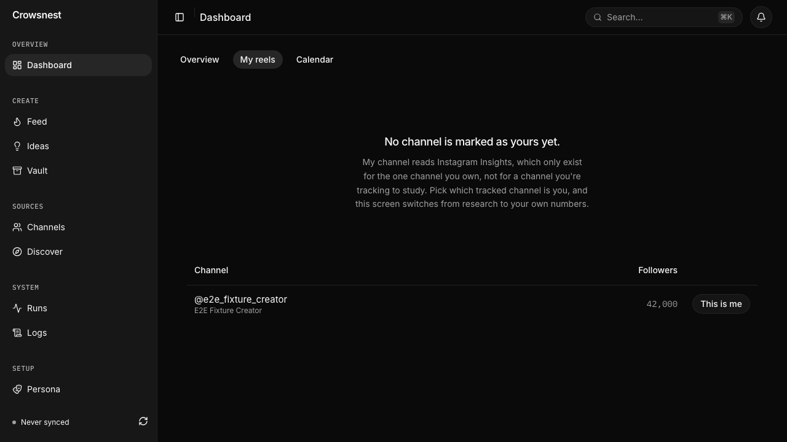 no "My channel" link in the sidebar; the picker renders under the tab strip; with no tracked channels (first-run skipped) Overview's "No channels are being watched" state renders under the tabs too (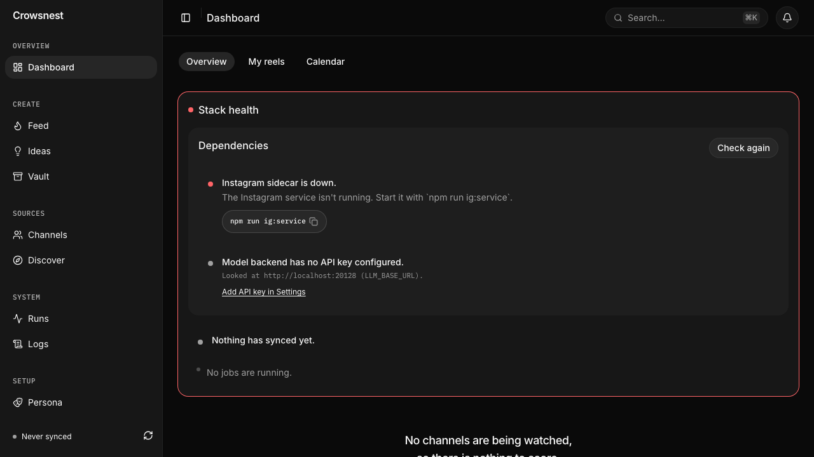) |
| MINE-21 | P2 | mouse | Opening Overview makes no Graph API call, and opening My reels runs no sidecar or model ping ([dashboard tabs](03-feature-description.md#9-dashboard-tabs-and-the-mine-redirect)). | Own channel set, token set, dev server log visible. | 1. Open `/?tab=overview`, read the server log. 2. Open `/?tab=reels`, read the server log. | Step 1 logs no Graph request; step 2 logs no sidecar health or model ping. | 🟢 outbound-fetch probe preloaded into the server: opening `/?tab=overview` made no `graph.instagram.com` request (only the sidecar health and model ping the Overview health card owns); opening `/?tab=reels` made one `graph.instagram.com/v21.0/me` token check and no sidecar or model request |
| MINE-22 | P1 | mouse, graph-measured | My reels lists only reels, newest first, each with a thumbnail, posted date, and latest stored views; picking one writes `?reel=<id>` ([pick a reel](03-feature-description.md#10-pick-a-reel)). | Three seeded reels on different dates plus one carousel post. | 1. Open `/?tab=reels`. 2. Read the picker. 3. Click the second reel. | Three picker items, newest first; the carousel is absent from the picker (it still shows in the post list). The URL gains `reel=<second id>` and the insight panel shows that reel. | 🟢 pass (E2E-16: three reels, carousel absent from the picker) |
| MINE-23 | P2 | keyboard, graph-measured | With no `reel`, or a `reel` that is not one of the user's reels, the newest reel is selected ([pick a reel](03-feature-description.md#10-pick-a-reel)). | Seeded reels. | 1. Open `/?tab=reels`. 2. Open `/?tab=reels&reel=does-not-exist`. | Both show the newest reel's insight panel, with no error. | 🟢 pass (E2E-21 and ACTION-19) |
| MINE-24 | P2 | mouse, graph-measured | An own channel with no reels, only other posts, shows an empty picker that says so, while the post list still shows every post ([edge cases](03-feature-description.md#16-edge-cases)). | Seeded own posts, none a reel. | 1. Open `/?tab=reels`. | The picker reads as empty with an explanation; no insight panel; the post list shows every seeded post. | 🟢 pass (E2E-22) |
| MINE-25 | P1 | mouse, graph-measured | The summary tiles show Views, Viewers, Average watch time in seconds, and Follows; the interaction strip shows Likes, Comments, Reposts, Shares, and Saves ([read one reel's insights](03-feature-description.md#11-read-one-reels-insights)). | A reel snapshot with `views` 120,000, `reach` 80,997, `ig_reels_avg_watch_time` 4,500 ms, and every interaction metric set. | 1. Pick the reel. 2. Read the tiles and the strip. | Four tiles; Average watch time reads 4.5 seconds, not 4,500. Five interaction values match the snapshot. | 🟢 pass (E2E-17; `reels-ui.test.tsx` reads 4.5s) |
| MINE-26 | P1 | mouse, graph-measured | Share, like, save, repost, and comment rates are the metric divided by reach ([read one reel's insights](03-feature-description.md#11-read-one-reels-insights)). | A reel snapshot with 1,112 shares and a reach of 80,997. | 1. Pick the reel. 2. Read Share rate under What impacts your views. | Share rate reads 1.4%. The other four rates read their metric over 80,997, rounded the same way. | 🟢 pass (E2E-17 reads 1.4%) |
| MINE-27 | P1 | mouse, graph-measured | With reach zero or missing, every derived rate is a dash, never 0% ([read one reel's insights](03-feature-description.md#11-read-one-reels-insights)). | One reel snapshot with `reach` 0, another with `reach` null. | 1. Pick each reel. 2. Read the five derived rates. | All five read as a dash on both reels. | 🟢 pass (E2E-23 for reach 0; ACTION-20 for reach null) |
| MINE-28 | P2 | mouse, graph-measured | Skip rate comes first, carries an "estimated" label, and is the API value, not derived ([read one reel's insights](03-feature-description.md#11-read-one-reels-insights)). | A reel snapshot with `reels_skip_rate` set. | 1. Pick the reel. 2. Read What impacts your views. | Order is Skip rate, Share, Like, Save, Repost, Comment rate. Skip rate shows the stored value with an "estimated" label. | 🟢 pass (E2E-17 and ACTION-21) |
| MINE-29 | P2 | mouse, graph-measured | Actions after viewing shows Follows, Profile visits, and Bio link taps, with bio link taps taken from `profile_activity`'s bio link action ([read one reel's insights](03-feature-description.md#11-read-one-reels-insights)). | A reel snapshot with follows, profile visits, and a stored bio link tap count. | 1. Pick the reel. 2. Read Actions after viewing. | Three rows with the stored values; a missing one reads as a dash. | 🟢 pass (E2E-17, three action rows) |
| MINE-30 | P2 | mouse, graph-measured | The "Not available from the Instagram API" block names the retention curve, when people liked, and top sources, each saying the API does not provide it ([read one reel's insights](03-feature-description.md#11-read-one-reels-insights)). | Any measured reel. | 1. Pick a reel. 2. Read the unavailable block. | Three labelled placeholders, no chart and no estimate in any of them. | 🟢 pass (E2E-17, three unavailable rows) |
| MINE-31 | P2 | mouse, graph-measured | Every block shows when it was measured, and the panel says Instagram's data can lag up to 48 hours ([read one reel's insights](03-feature-description.md#11-read-one-reels-insights)). | A reel with a known snapshot capture time. | 1. Pick the reel. 2. Read each block's measured-at stamp. | Each block's stamp matches the snapshot's capture time; the 48 hour lag note is visible. | 🟢 pass (E2E-17, measured-at line with the 48 hour note; each card repeats the stamp) |
| MINE-32 | P1 | mouse, graph-measured | Views over time plots only real measurements by whole hours since posting, next to a "Your typical reel" median of the other reels, with gaps where nothing was measured ([compare views over time](03-feature-description.md#12-compare-views-over-time)). | Selected reel with snapshots at hours 1, 2, and 5; two other reels with snapshots at hours 1 and 2 only. | 1. Pick the selected reel. 2. Read the chart. | The reel line has points at 1, 2, and 5 and none at 3 or 4. The typical line has points at 1 and 2 (the median of the two other reels) and a gap at 5. | 🟢 pass (ACTION-24 for the exact points; E2E-18 for the chart) |
| MINE-33 | P1 | mouse, graph-measured | Followers vs non-followers and Audience details carry a "Whole account, not this reel" label, and Audience details switches between Age, Country, and Gender ([see account-wide audience](03-feature-description.md#13-see-account-wide-audience)). | Seeded account-wide follower split and engaged audience results. | 1. Open `/?tab=reels`. 2. Read both blocks. 3. Click Age, Country, Gender. | Both labels always visible; each tab shows its top results; both blocks show a measured-at stamp. | 🟢 pass (E2E-19) |
| MINE-34 | P2 | mouse, graph-measured | An account under 100 engagements gets an explanation of the API threshold instead of an empty chart ([see account-wide audience](03-feature-description.md#13-see-account-wide-audience)). | Seeded audience refusal for lack of volume. | 1. Open `/?tab=reels`. 2. Read Audience details. | The block explains the 100 engagements threshold; no empty chart renders. | 🟢 pass (E2E-24) |
| MINE-35 | P2 | graph-invalid, graph-measured | A rejected token over an account measured before shows the connect panel above the picker and the stored reel insights, never hiding them ([pick a reel](03-feature-description.md#10-pick-a-reel)). | Seeded reels and snapshots; token set to a junk value. | 1. Open `/?tab=reels`. | Connect panel on top; picker and insight panel still show the stored numbers and their measured-at stamps. | 🟢 pass (E2E-25) |
| MINE-36 | P2 | graph-live | Scheduled measurement adds snapshots on its own: new reels hourly, older ones daily, visible as advancing measured-at stamps ([scheduled measurement](03-feature-description.md#14-scheduled-measurement)). | A real token, a reel posted within 72 hours, app left running over an hour. | 1. Note the reel's measured-at stamp. 2. Wait past the next hourly run, reload. | The stamp advances and the views over time chart gains a point, with no click on Measure now. | 🟡 blocked: Graph token rejected, release gate |

Not checkable by hand:

- Whether the header follower count (`channels.followerCount`) and the Followers stat tile (`own_account_snapshots.followerCount`) visibly disagree in practice, and how often.
- Whether the checkbox copy's "gets flagged stale after 30 days" is meant to describe a feature not yet built, since no code path in this repository currently computes or renders a stale flag.
- Whether the derived rates match the Instagram app for reels other than the worked 1,112 over 80,997 example; that needs the app open beside a live reel.

## 2. route and action

| ID | P | Layer | Claim | Setup | Call | Expected | Result |
| --- | --- | --- | --- | --- | --- | --- | --- |
| ACTION-01 | P1 | server action (`src/server/actions/channel-actions.ts :: setOwnChannelAction`) | Setting a new own channel unmarks whatever previously held the flag inside one transaction. | Two channels, one currently marked own. | `setOwnChannelAction(otherChannelId)`. | The other channel's `isOwn` reads true; the previous one reads false; never both true. | 🟢 covered by vitest (green) |
| ACTION-02 | P1 | server action (`src/server/actions/channel-actions.ts :: unsetOwnChannelAction`) | Clearing the own channel leaves no channel marked own, without assigning it elsewhere. | A channel marked own. | `unsetOwnChannelAction()`. | The previously own channel's `isOwn` reads false; no other channel becomes own. | 🟢 covered by vitest (green) |
| ACTION-03 | P1 | server action (`src/server/actions/planned-post-actions.ts :: createPlannedPostAction`) | A blank or whitespace-only title is refused; the title is trimmed before the check. | None. | `createPlannedPostAction({ title: "   " })`. | Returns `{ ok: false, code: "PLAN_INVALID_TITLE" }`; no row inserted. | 🟢 covered by vitest (green) |
| ACTION-04 | P1 | server action (`src/server/actions/planned-post-actions.ts :: createPlannedPostAction`) | A date present at create writes a scheduled plan; a blank date writes a draft; a past date is accepted. | None. | `createPlannedPostAction` with a future date, then with no date, then with a past date. | First two rows read `state: "scheduled"` and `state: "draft"` respectively; the past-dated row also reads `state: "scheduled"` in storage (missed is derived, not stored). | 🟢 covered by vitest (green) |
| ACTION-05 | P1 | server action (`src/server/actions/planned-post-actions.ts :: markPlanPublishedAction`) | Marking published with a null own-post id still reads back as published, and a past-dated plan marked published reads as published, not missed. | A dateless plan; a past-dated scheduled plan. | `markPlanPublishedAction(id, null)` on each. | Both rows read `state: "published"`; `getPlannedPosts()` derives `state: "published"` for the past-dated one, never `"missed"`. | 🟢 covered by vitest (green) |
| ACTION-06 | P1 | server action (`src/server/actions/planned-post-actions.ts :: markPlanPublishedAction`) | An own-post id that does not exist is refused before the plan is touched. | A plan, no matching `own_posts` row for the given id. | `markPlanPublishedAction(id, "does-not-exist")`. | Returns `{ ok: false, code: "PLAN_OWN_POST_NOT_FOUND" }`; the plan's `state` and `publishedOwnPostId` are unchanged. | 🟢 covered by vitest (green) |
| ACTION-07 | P1 | server action (`src/server/actions/planned-post-actions.ts :: attachScriptToPlanAction`, `detachScriptFromPlanAction`) | Detaching writes a dated note; attaching a new script clears any prior detach note. | A plan carrying a script. | `detachScriptFromPlanAction(id, "wrong take")`, then `attachScriptToPlanAction(id, otherScriptId)`. | After detach: `scriptId` null, `scriptDetachedNote` contains "wrong take". After attach: `scriptId` set, `scriptDetachedNote` null. | 🟢 covered by vitest (green) |
| ACTION-08 | P2 | server action (`src/server/actions/planned-post-actions.ts :: detachScriptFromPlanAction`) | Detaching from a plan that carries no script is refused. | A plan with no script. | `detachScriptFromPlanAction(id)`. | Returns `{ ok: false, code: "PLAN_NO_SCRIPT" }`. | 🟢 covered by vitest (green) |
| ACTION-09 | P1 | server action (`src/server/actions/planned-post-actions.ts :: createPlannedPostAction`) | A `videoKind` outside the fixed eight-item list is refused. | None. | `createPlannedPostAction({ title: "Plan", videoKind: "not-a-real-kind" })`. | Returns `{ ok: false, code: "BAD_VIDEO_KIND" }`; no row inserted. | 🟢 covered by vitest (green) |
| ACTION-10 | P1 | drizzle query (`src/server/queries/planned-posts.ts :: getCalendarMonth`) | Dead air is computed over runs of three or more elapsed days with nothing published, and never extends past today. | An own-posts history with a 4-day gap ending before today, and one ending after today. | `getCalendarMonth(month)`. | The gap ending before today appears as one dead-air run of at least 3 days; the run touching today is truncated at today. | 🟢 covered by vitest (green) |
| ACTION-11 | P1 | drizzle query (`src/server/queries/planned-posts.ts :: getPlannedPosts`) | `reconciledOwnPostId` is set only when a dated, not-yet-published plan shares its date with an own post; it is never set once the plan is published. | A dated unpublished plan and an own post on the same date; the same plan then marked published. | `getPlannedPosts()` before and after marking published. | Before: `reconciledOwnPostId` set to the own post's id. After: `reconciledOwnPostId` reads null (the field is only computed while `publishedOwnPostId` is null). | 🟢 covered by vitest (green) |
| ACTION-12 | P1 | server action (`src/server/actions/graph-actions.ts :: measureOwnChannelAction`) | Comments failing after the account and posts succeed still returns `ok: true, partial: true`, and posts and insights land regardless. | Graph client mocked to succeed on account and posts, throw on comments. | `measureOwnChannelAction()`. | Returns `{ ok: true, partial: true, ... }`; `own_account_snapshots` and `own_posts`/`own_post_insights` rows exist; `own_comments_fetch_error` is set in `app_settings`. | 🟢 covered by vitest (green) |
| ACTION-13 | P1 | server action (`src/server/actions/graph-actions.ts :: measureOwnChannelAction`) | The account call failing is a hard failure with no rows written. | Graph client mocked to throw on `fetchAccount`. | `measureOwnChannelAction()`. | Returns `{ ok: false, code: ... }`; no `own_account_snapshots` row is inserted. | 🟢 covered by vitest (green) |
| ACTION-14 | P2 | server action (`src/server/actions/graph-actions.ts :: checkGraphTokenAction`) | `checkGraphTokenAction` never throws; a not-configured token is a successful "not configured" answer, not a failure. | No Graph token set. | `checkGraphTokenAction()`. | Returns `{ ok: true, status: { state: "not_configured", ... } }`. | 🟢 covered by vitest (green) |
| ACTION-15 | P2 | drizzle query (`src/server/queries/own-channel.ts :: getOwnChannelOverview`) | `profileVisits` and `followsFromPost` are requested and report `wired: true`; `watchTimeSec`, never requested, reports `wired: false` rather than a zero value. | Any measured account. | `getOwnChannelOverview()`. | `watchTimeSec` reports `wired: false` and `value: null`; reach, saved, shares, profile visits, and follows report `wired: true`. | 🟢 covered by vitest (green), `own-channel.test.ts` |
| ACTION-16 | P1 | pure function (`src/components/mine/month-param.ts :: mineRedirectTarget`, called by the `/mine` route handler `src/app/(shell)/(loaded)/mine/route.ts`) | `/mine` redirects to `/?tab=calendar`, carrying only a valid `month`. | None. | Render the route with `searchParams` `{}`, `{ month: "2026-08" }`, `{ month: "junk" }`, and `{ month: "2026-08", reel: "x", next: "https://evil.example" }`. | Redirects to `/?tab=calendar`, `/?tab=calendar&month=2026-08`, `/?tab=calendar`, and `/?tab=calendar&month=2026-08` respectively. | 🟢 covered by vitest (green), `month-param.test.ts` |
| ACTION-17 | P1 | pure function (`src/components/dashboard/dashboard-tabs.tsx :: resolveDashboardTab`) | The `tab` param resolves to `overview`, `reels`, or `calendar`, and anything else to `overview`. | None. | Resolve the tab for `undefined`, `"reels"`, `"calendar"`, `"REELS"`, and `"x"`. | `overview`, `reels`, `calendar`, `overview`, `overview`. | 🟢 covered by vitest (green), `dashboard-tabs.test.ts` |
| ACTION-18 | P1 | server action (`src/server/actions/planned-post-actions.ts`, `graph-actions.ts`) | Planner and measurement writes revalidate `/`, not `/mine`. | `revalidatePath` spied. | Each planner action and `measureOwnChannelAction()` on a success path. | Every success path calls `revalidatePath("/")`; none calls it with `"/mine"`. | 🟢 covered by vitest (green), `graph-actions.test.ts` and `planned-post-actions.test.ts` |
| ACTION-19 | P1 | drizzle query and pure function (`src/server/queries/own-channel.ts :: getOwnReels`, `src/server/services/reel-insights.ts :: selectReel`) | The picker returns only reels, newest first, each with its latest stored views, and falls back to the newest reel for a missing or foreign `reel` id. | Three own reels with two snapshots each, one carousel post. | Read the picker with `reel` unset, set to the second reel, and set to `"does-not-exist"`. | Three reels, newest first, views from each reel's latest snapshot; selected ids: newest, second, newest. | 🟢 covered by vitest (green), `own-channel.test.ts` and `reel-insights.test.ts` |
| ACTION-20 | P1 | pure function (`src/server/services/reel-insights.ts :: perViewerRate`) | A rate is the metric divided by `reach`, and null when `reach` is 0 or null or the metric is null. | None. | Derive rates for `{ shares: 1112, reach: 80997 }`, `{ shares: 5, reach: 0 }`, `{ shares: 5, reach: null }`, `{ shares: null, reach: 100 }`. | 0.0137 (displays 1.4%), null, null, null. | 🟢 covered by vitest (green), `reel-insights.test.ts` |
| ACTION-21 | P2 | pure function (`src/server/services/reel-insights.ts :: shapeReelInsights`) | Average watch time converts milliseconds to seconds, and skip rate passes through untouched with an estimated flag. | None. | Derive from `{ ig_reels_avg_watch_time: 4500, reels_skip_rate: 0.42 }`. | Watch time 4.5 seconds; skip rate 0.42, flagged estimated; never recomputed from other metrics. | 🟢 covered by vitest (green), `reel-insights.test.ts` |
| ACTION-22 | P1 | Graph client (`src/server/graph/client.ts :: fetchPostInsights`, `mapBioLinkTaps`) | Bio link taps come from `profile_activity` with `breakdown=action_type`, taking the bio link action, and are null when that action is absent. | Mocked Graph responses: one with a bio link action value 7, one with only other actions. | Fetch reel insights for each. | Bio link taps 7, then null; the request carries `breakdown=action_type`. | 🟢 covered by vitest (green), `client.test.ts` |
| ACTION-23 | P1 | Graph client (`src/server/graph/client.ts :: fetchPostInsights`) | One metric the API refuses for a reel is stored null without zeroing or dropping the reel's other metrics. | Mocked Graph response rejecting only `reels_skip_rate` for a reel. | Measure the reel. | The snapshot row has `reels_skip_rate` null and every other requested metric set to its real value; the reel's `error` stays null or names only that metric. | 🟢 covered by vitest (green), `client.test.ts`: the extended call is refused, the core retry keeps every core metric, skip rate and reposts stay null |
| ACTION-24 | P1 | pure function (`src/server/services/reel-insights.ts :: typicalViewsCurve`) | Points are whole hours since posting from real snapshots only, and the typical line is the median of other reels measured at that same hour, with a gap where none were. | Selected reel posted at T with snapshots at T+1h10m, T+2h, T+5h; reels B and C with snapshots at hours 1 and 2 only. | Read the series for the selected reel. | Reel points at hours 1, 2, 5 and nothing else. Typical points at hours 1 and 2 equal the median of B and C; no typical point at hour 5; the selected reel never feeds its own typical line. | 🟢 covered by vitest (green), `reel-insights.test.ts` |
| ACTION-25 | P2 | Graph client (`src/server/graph/client.ts :: fetchAccountBreakdowns`) | Account-wide follower split uses `views` with `breakdown=follower_type`, and audience uses `engaged_audience_demographics`; a lack-of-volume refusal returns a threshold state, not an empty list. | Mocked Graph responses: a normal demographics payload, then a refusal for lack of volume. | Fetch the account audience twice. | First: top results per Age, Country, Gender. Second: a threshold state the block can explain; no rows presented as a real empty audience. | 🟢 covered by vitest (green), `client.test.ts` |
| ACTION-26 | P1 | service (`src/server/services/own-measure.ts :: measureOwnChannel`, `isDue`) | Reels posted in the last 72 hours are due every hour, older ones once a day. | Reels posted 2 hours, 71 hours, and 5 days ago; last measured 61 minutes ago for the first two and 23 hours ago for the third. | One tick at `now` with injected deps, the shape `runDueSync(now, deps)` uses. | The two new reels are measured; the 5 day old reel is not. A second tick 25 hours later measures it. | 🟢 covered by vitest (green), `own-measure.test.ts` |
| ACTION-27 | P1 | service (`src/server/services/own-measure-scheduler.ts :: runDueOwnMeasure`) | A tick does nothing and writes nothing with no own channel, no token, or a rejected token. | Three runs: no `isOwn` channel; no token; mocked Graph returning `auth_failed` on the first call. | One tick per setup. | No `own_*` rows written in any run; the Graph mock sees zero calls in the first two and one call in the third. | 🟢 covered by vitest (green), `own-measure-scheduler.test.ts` |
| ACTION-28 | P1 | service (`src/server/services/own-measure.ts :: measureOwnChannel`, single-flight lock) | Only one tick runs at a time. | A mocked Graph call that stays pending. | Start a tick, then start a second before the first resolves. | The second tick returns without calling the Graph mock; one set of snapshot rows is written. | 🟢 covered by vitest (green), `own-measure.test.ts` |
| ACTION-29 | P1 | service (`src/server/services/own-measure.ts :: measureOwnChannel`) | Every Graph call, account-wide ones included, counts toward a budget under 200 calls per hour, and a tick that would exceed it stops early. | 250 due reels; the Graph mock counts calls. | Run ticks across one simulated hour. | Total Graph calls in the hour stay under 200; reels left over are measured in a later hour. | 🟢 covered by vitest (green), `own-measure.test.ts`: 250 due reels, at most 150 calls, leftovers measured the next hour |
| ACTION-30 | P1 | service (`src/server/services/own-measure.ts :: measureOwnChannel`) | A rate-limited run stops at once without retrying in a loop, and already written rows stay. | Graph mock returns rate limited on the fifth reel. | One tick. | Four reels have a new snapshot; no call after the rate limit; stored rows and their measured times are untouched otherwise. | 🟢 covered by vitest (green), `own-measure.test.ts` |
| ACTION-31 | P2 | service (`src/server/services/own-measure.ts :: measureOwnChannel`) | One reel failing does not stop the others. | Graph mock throws a non-rate-limit error on one of three reels. | One tick. | The two others get new snapshot rows; the failing one gets none. | 🟢 covered by vitest (green), `own-measure.test.ts` |
| ACTION-32 | P2 | service (`src/server/services/own-measure.ts :: measureOwnChannel`) | Each tick adds a new `own_post_insights` row per measured reel rather than overwriting the last. | A reel with one existing snapshot. | Two ticks an hour apart. | The reel has three snapshot rows with distinct capture times. | 🟢 covered by vitest (green), `own-measure.test.ts` |

Not checkable by hand:

- Whether two tabs saving overlapping edit sequences on the same plan interleave writes across the sequence as the code implies, as opposed to the seeded/simulated single-process form these cases exercise.
- Live Graph API behavior beyond what the mocked client in these tests exercises: a real rejected token, a real rate limit, real account/post/comment payload shapes, and whether `reels_skip_rate`, `reposts`, and `profile_activity` return for this account at all.

## 3. browse-e2e

Coverage: mine has thirteen built (`●`) features (2 to 14), with one happy-path journey each below: 2 (E2E-01), 3 (E2E-04), 4 (E2E-05), 5 and 6 (E2E-02, E2E-03), 7 (E2E-06), 8 (E2E-12), 9 (E2E-14, E2E-15), 10 (E2E-16), 11 (E2E-17), 12 (E2E-18), 13 (E2E-19), 14 (E2E-20). Corner-case types covered, seven distinct: `empty` (E2E-07, E2E-22), `auth` (E2E-08, E2E-13, E2E-25), `invalid` (E2E-09, E2E-21), `stale` (E2E-10), `boundary` (E2E-11, E2E-23), `failure` (E2E-24), `repeat` (E2E-26).

Offline journeys for My reels run against seeded `own_*` rows with `IG_GRAPH_TOKEN` set to a junk value, so the "rejected but measured before" state renders the stored rows under the connect panel (the same deterministic state E2E-08 uses). The e2e server preloads `scripts/e2e/graph-offline.mjs`, which answers every `graph.instagram.com` request with a rejected-token error, so no journey reaches Instagram. They assert on the stored rows, not on a live read. `scripts/seed-e2e.ts` writes the junk token; each My reels journey first runs `npx tsx scripts/e2e/mine-seed.ts <reels|reach-zero|no-reels|audience-refused>` to reset the own-channel rows to its variant. Every offline row's script is checked in. `mine-seed.ts` also carries the calendar and edge variants: `empty` (no own rows, no plans, never measured), `plan` (one scheduled plan today), `posts-101`, `no-own` (`channels.isOwn` cleared), and `no-graph` (Graph secrets removed, one plan). The 4b run drove every offline journey against a production `server.ts` on a spare port over a temporary copy of the fixture DB.

Types not given a row, with the reason:

- `network`: mine's only external call is the Graph API; an unreachable Graph mid-run is a `live` path covered at the action layer (ACTION-13, ACTION-30), not through `browse`.
- `concurrency`: the scheduler's single-flight is not visible in the UI (ACTION-28), and the connect panel's buttons disable themselves in flight (MINE-15); no two-tab race is observable from the browser.

Existing testids the offline journeys use: `own-channel-picker-choose`, `mine-calendar-day` (with `data-id` = the date), `mine-calendar-plan-day`, `plan-dialog-title`, `plan-dialog-save`, `mine-calendar-mark-published`, `mine-calendar-scheduled`, `mine-calendar-published`, `mine-plan-delete`, `mine-confirm-delete-plan-confirm`, `mine-plan-open-publish`, `publish-dialog`, `publish-dialog-file`, `publish-dialog-caption`, `publish-dialog-submit`, `publish-dialog-not-configured`, `mine-plan-scheduled-at`, `mine-plan-published`.

| ID | P | Feat | Type | Mode | Journey | Setup | Steps | Expected | Script | Result |
| --- | --- | --- | --- | --- | --- | --- | --- | --- | --- | --- |
| E2E-01 | P1 | 2 | happy | offline | Mark a tracked channel as your own from the picker | Dev server up. A seed variant with at least one tracked channel and `channels.isOwn` cleared on every row, so `/?tab=reels` renders the picker (the shared e2e seed marks a channel own; this journey needs that flag unset). | Arrive on `/?tab=reels` (renders the picker). Act: click "This is me" on a row, `data-testid="own-channel-picker-choose"` (shared across rows; scope by the row's handle text, or add a per-row `data-id`). | The page leaves the picker: `data-testid="own-channel-picker-choose"` is no longer present, and `assert_text` no longer reads the picker copy "This is me"; `assert_url_contains "tab=reels"` still holds (account summary or connect panel now render). | `scripts/e2e/mine-e2e-01.sh` | 🟢  `mine-seed.ts no-own`; the picker leaves, URL keeps `tab=reels` (browse script, production `server.ts` on a spare port, temp DB, Graph answered offline by `graph-offline.mjs`) |
| E2E-02 | P1 | 5,6 | happy | offline | Plan a post from an empty calendar day, then find it on the grid | Dev server up, own channel set (shared e2e seed), Calendar tab open, no `planned_posts` seeded so every day renders open. | Arrive on `/?tab=calendar`. Act: click an empty day, `data-testid="mine-calendar-day"` with `data-id="<YYYY-MM>-15"`; click "Plan something for this day", `data-testid="mine-calendar-plan-day"`; type a title, `data-testid="plan-dialog-title"`; tick the scriptless-plan ack checkbox (`[data-slot="checkbox"]` within the open dialog; carries no `data-testid` yet); click "Create plan", `data-testid="plan-dialog-save"`. | `assert_text "Planned"` (dated) or "Saved as a draft" (undated); the dialog closes; the target day cell (`data-testid="mine-calendar-day"`, `data-id` for the date) shows the plan title via `assert_text`. | `scripts/e2e/mine-e2e-02.sh` | 🟢 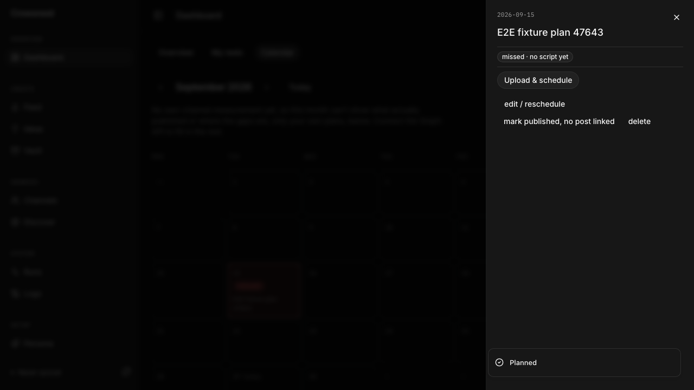 plan created on the 15th, toast "Planned", title on the grid (browse script, production `server.ts` on a spare port, temp DB, Graph answered offline by `graph-offline.mjs`) |
| E2E-03 | P1 | 6 | happy | offline | Mark a plan published from the day panel, then confirm the cell updates | Dev server up, own channel set, one scheduled plan seeded on a day in the current month. | Arrive on `/?tab=calendar`. Act: click the plan's day cell, `data-testid="mine-calendar-day"` (`data-id` for the date); click "mark published, no post linked", `data-testid="mine-calendar-mark-published"`. | `assert_text "Marked published, no post linked"`; after the re-read the cell shows the published marker, `data-testid="mine-calendar-published"`, and no `data-testid="mine-calendar-failed"` for that date. | `scripts/e2e/mine-e2e-03.sh` | 🟢 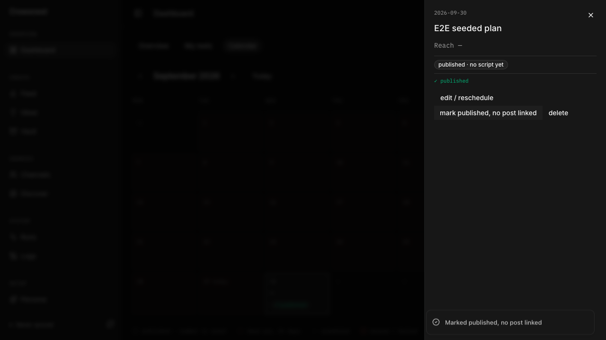 `mine-seed.ts plan`; toast "Marked published, no post linked", cell shows ✓ published, no failed badge (browse script, production `server.ts` on a spare port, temp DB, Graph answered offline by `graph-offline.mjs`) |
| E2E-04 | P1 | 3 | happy | live | View the connected dashboard: stat tiles, median progress, reach-by-post bars | Dev server up, own channel set, a valid `IG_GRAPH_TOKEN`/`IG_GRAPH_USER_ID`, and the account measured at least once so tiles hold data (renders the dashboard, not the connect panel). | Arrive on `/?tab=reels` with the token ok and a measurement present. Act: read the metrics band. | Six stat tiles render, `data-testid="mine-stat-tile"` (shared, count six); the median progress caption reads via `assert_text` (either "median active, based on the last N measured posts" or "N / 5 posts before a median reach appears"); the reach-by-post strip renders, `data-testid="mine-reach-bars"`. | `none` (live: needs a real Graph token and measurement) | 🟡 blocked: Graph token rejected, release gate |
| E2E-05 | P1 | 4 | happy | offline | Browse own posts, then switch to the weekday metrics chart | Dev server up, own channel set, a handful of `own_posts` rows seeded in the fixture DB (Posts and Metrics render regardless of the Graph token). | Arrive on `/?tab=reels`. Act: scroll to the Posts section and read a post row, `data-testid="mine-post-row"` (shared); scroll to Average reach by weekday. | The Posts section lists the seeded posts, at least one `data-testid="mine-post-row"` present; the weekday chart shows, at least one `data-testid="mine-weekday-bar"` present. | `scripts/e2e/mine-e2e-05.sh` | 🟢 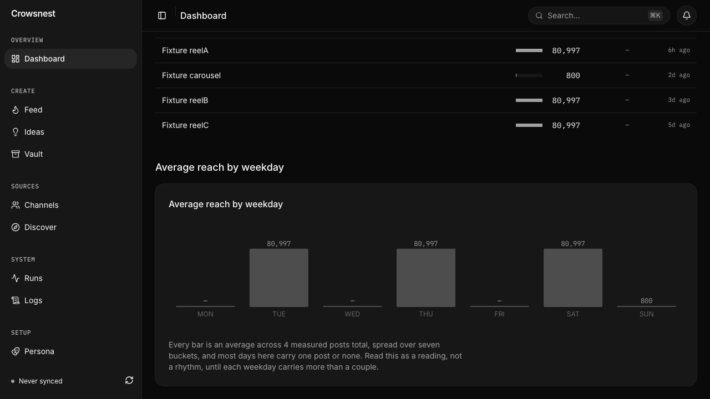 `mine-seed.ts reels`; 4 post rows, weekday bars drawn (browse script, production `server.ts` on a spare port, temp DB, Graph answered offline by `graph-offline.mjs`) |
| E2E-06 | P1 | 7 | happy | live | Check the Graph connection, then measure the account | Dev server up, own channel set, a valid Graph token, account not yet measured (so "Measure now" is offered). | Arrive on `/?tab=reels` with the connect panel showing, `data-testid="mine-connect-panel"`. Act: click "Check connection", `data-testid="mine-connect-check"`; once ok and the page refreshes, click "Measure now", `data-testid="mine-connect-measure"`. | After the check, `assert_text` reads the connected status copy; after "Measure now" completes a toast names the measured post count via `assert_text`, and on reload the dashboard tiles render, `data-testid="mine-stat-tile"` present. | `none` (live: needs a real Graph token and account) | 🟡 blocked: Graph token rejected, release gate |
| E2E-07 | P2 | 4,6 | empty | offline | Zero-data state across posts, metrics, and the calendar | Dev server up, own channel set, no `planned_posts` and no `own_posts` rows seeded. | Arrive on `/?tab=reels`. Act: read the Posts and Average reach by weekday sections; click the Calendar tab, `data-testid="dashboard-tab-calendar"`. | Posts empty state via `assert_text "No posts synced from Instagram yet."`; Metrics empty state via `assert_text "No measured posts yet to read a weekday rhythm from."`; the calendar renders with no plan markers (no `data-testid="mine-calendar-scheduled"` and no `data-testid="mine-calendar-published"` anywhere on the grid). | `scripts/e2e/mine-e2e-07.sh` | 🟢   `mine-seed.ts empty`; both empty-state lines, then Calendar with no scheduled or published marker (browse script, production `server.ts` on a spare port, temp DB, Graph answered offline by `graph-offline.mjs`) |
| E2E-08 | P1 | 3,7 | auth | offline | An invalid token stacks the connect panel over the real historical numbers | Dev server up, own channel set, `own_account_snapshots`/`own_posts` seeded (measured before), and `IG_GRAPH_TOKEN` set to a non-empty junk value so `configured` is true but the live check cannot return ok (it fails the same way with or without network, so the stacking state is deterministic offline). | Arrive on `/?tab=reels` (the failing check leaves state not ok while everMeasured is true, so the page stacks the panel over the tiles). Act: read the metrics band and the panel above it. | The connect panel renders naming the problem, `data-testid="mine-connect-panel"`; the stat tiles still show the last measured figures, `data-testid="mine-stat-tile"` present (the failed live check does not hide the historical numbers). | `scripts/e2e/mine-e2e-08.sh` | 🟢  `mine-seed.ts reels`; connect panel above the stat tiles, 42,000 followers still shown (browse script, production `server.ts` on a spare port, temp DB, Graph answered offline by `graph-offline.mjs`) |
| E2E-09 | P1 | 5 | invalid | offline | A blank or whitespace-only plan title keeps Save disabled | Dev server up, own channel set, plan dialog open in create mode from an empty day. | Arrive on `/?tab=calendar`. Act: click an empty day, `data-testid="mine-calendar-day"`; click "Plan something for this day", `data-testid="mine-calendar-plan-day"`; tick the scriptless-plan ack (`[data-slot="checkbox"]`); type only spaces into the title, `data-testid="plan-dialog-title"`. | Save stays disabled: `data-testid="plan-dialog-save"` carries the `disabled` attribute (the trimmed blank title fails `canSave`), so no plan row is written. | `scripts/e2e/mine-e2e-09.sh` | 🟢 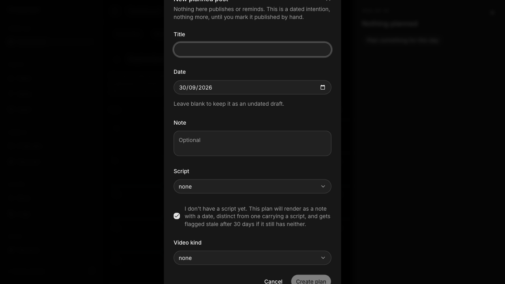 a real title enables Create plan, spaces only disables it (browse script, production `server.ts` on a spare port, temp DB, Graph answered offline by `graph-offline.mjs`) |
| E2E-10 | P2 | 6 | stale | offline | Delete a plan then Undo, and the grid reconciles to the re-created plan | Dev server up, own channel set, one scheduled plan seeded on a day in the current month. | Arrive on `/?tab=calendar`. Act: click the plan's day cell, `data-testid="mine-calendar-day"`; click delete, `data-testid="mine-plan-delete"` (the confirm, `data-testid="mine-confirm-delete-plan-confirm"`, shows only for a plan carrying a video); click Undo in the toast, `data-testid="mine-delete-undo"`. | After delete the day cell's plan marker is gone (`data-testid="mine-calendar-scheduled"` absent for that date); after Undo the plan re-appears (`data-testid="mine-calendar-scheduled"` present again for that date), showing the re-read reconciled the optimistic delete. | `scripts/e2e/mine-e2e-10.sh` | 🟢 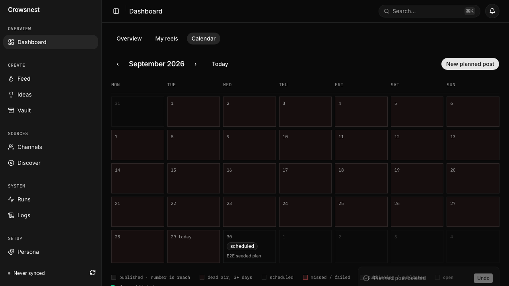 `mine-seed.ts plan`; delete removes the scheduled badge, Undo brings it back (no confirm: the plan has no video) (browse script, production `server.ts` on a spare port, temp DB, Graph answered offline by `graph-offline.mjs`) |
| E2E-11 | P2 | 4 | boundary | offline | Only the newest 100 own posts load | Dev server up, own channel set, 101 `own_posts` rows seeded in the fixture DB. | Arrive on `/?tab=reels`. Act: count the rendered post rows, `data-testid="mine-post-row"` (shared). | Exactly 100 `data-testid="mine-post-row"` elements render; the 101st (oldest) seeded post is absent, because `getOwnPosts({ limit: 100 })` caps the load. | `scripts/e2e/mine-e2e-11.sh` | 🟢 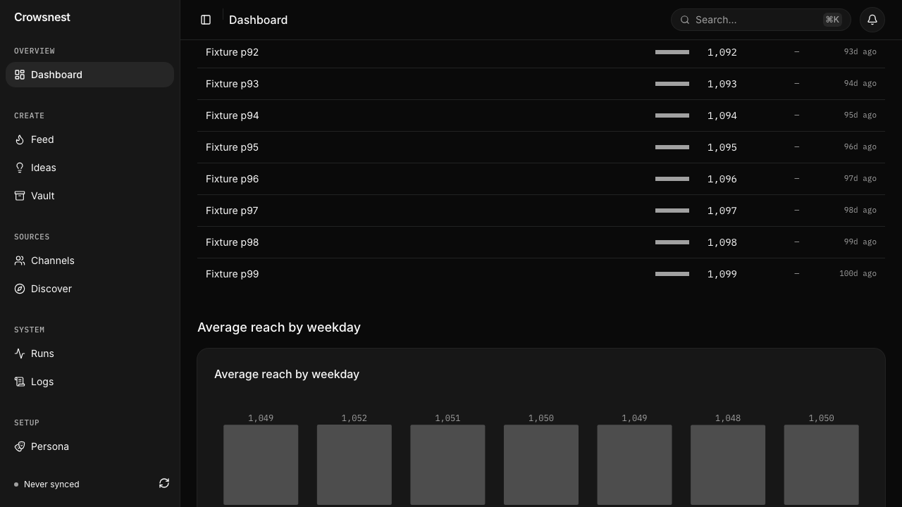 `mine-seed.ts posts-101`; exactly 100 rows, "Fixture p100" absent (browse script, production `server.ts` on a spare port, temp DB, Graph answered offline by `graph-offline.mjs`) |
| E2E-12 | P1 | 8 | happy | live | Upload a video to a plan and publish it now | Dev server up, own channel set, a real Graph token and the five `S3_*` variables set, dry run on, one scheduled plan seeded this month. | Arrive on `/?tab=calendar`. Act: click the plan's day, `data-testid="mine-calendar-day"`; click Upload and schedule, `data-testid="mine-plan-open-publish"`; attach an mp4 to `data-testid="publish-dialog-file"`; type a caption into `data-testid="publish-dialog-caption"`; leave `data-testid="publish-dialog-time"` blank; click `data-testid="publish-dialog-submit"`. | `data-testid="publish-dialog-dry-run"` banner shows before submit; after the refresh the day panel shows `data-testid="mine-plan-published"` and the cell shows `data-testid="mine-calendar-published"`. | `none` (live: needs a real Graph token and storage bucket) | 🟡 blocked: Graph token rejected and no storage bucket, release gate |
| E2E-13 | P1 | 8 | auth | offline | Publish without a token or bucket names what is missing and still saves the draft | Dev server up, own channel set, `IG_GRAPH_TOKEN` and every `S3_*` variable unset, one scheduled plan seeded this month. | Arrive on `/?tab=calendar`. Act: click the plan's day, `data-testid="mine-calendar-day"`; click `data-testid="mine-plan-open-publish"`; type a caption into `data-testid="publish-dialog-caption"`; close with `data-testid="publish-dialog-cancel"`; reopen with `data-testid="mine-plan-open-publish"`. | `data-testid="publish-dialog-not-configured"` names `IG_GRAPH_TOKEN`, `IG_GRAPH_USER_ID`, and the `S3_*` variables; `data-testid="publish-dialog-submit"` is disabled; on reopen `data-testid="publish-dialog-caption"` still holds the caption. | `scripts/e2e/mine-e2e-13.sh` | 🟢 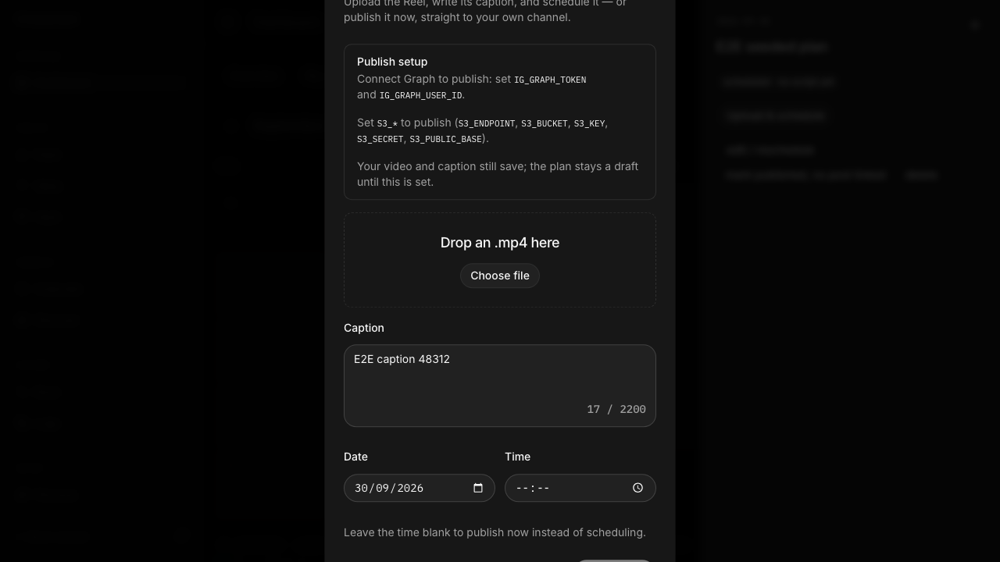 `mine-seed.ts no-graph`; the panel names IG_GRAPH_TOKEN, IG_GRAPH_USER_ID, and the five S3_* names, submit disabled, the caption survives close and reopen (browse script, production `server.ts` on a spare port, temp DB, Graph answered offline by `graph-offline.mjs`) |
| E2E-14 | P1 | 9 | happy | offline | Move between Dashboard tabs and keep the tab across a reload | Dev server up, shared e2e seed (own channel set). | Arrive on `/`. Act: click `data-testid="dashboard-tab-reels"`; reload; click `data-testid="dashboard-tab-calendar"`; click `data-testid="dashboard-tab-overview"`. | `assert_url_contains "tab=reels"` after the click and still after the reload; `assert_url_contains "tab=calendar"` with `data-testid="mine-calendar-day"` present; `assert_url_contains "tab=overview"` with no `data-testid="mine-calendar-day"` present. | `scripts/e2e/mine-e2e-14.sh` | 🟢 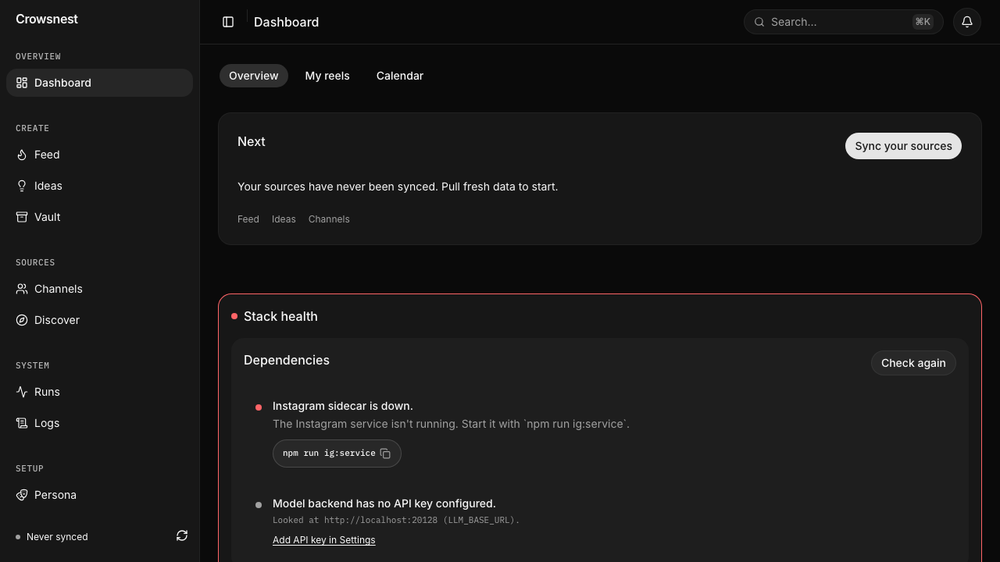 `mine-seed.ts` variant per the script (browse script, production `server.ts` on a spare port, temp DB, Graph answered offline by `graph-offline.mjs`) |
| E2E-15 | P1 | 9,6 | happy | offline | An old `/mine` link lands on Calendar at its month, and month navigation stays on Calendar | Dev server up, shared e2e seed. | Arrive on `/mine?month=2026-08`. Act: click the calendar's next-month control (link labelled "Next month", selected by its `aria-label`); click the previous-month control ("Previous month"). | `assert_url_contains "tab=calendar"` and `"month=2026-08"` on arrival, with `data-testid="mine-calendar-day"` `data-id="2026-08-15"` present; after next month `assert_url_contains "tab=calendar"` and `"month=2026-09"`; after previous `"month=2026-08"` and `tab=calendar` again. | `scripts/e2e/mine-e2e-15.sh` | 🟢 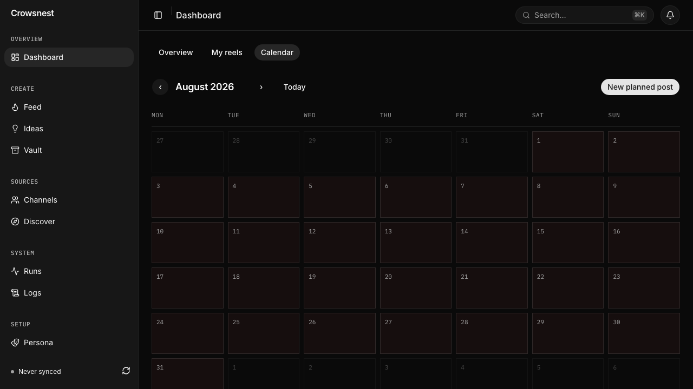 `mine-seed.ts` variant per the script (browse script, production `server.ts` on a spare port, temp DB, Graph answered offline by `graph-offline.mjs`) |
| E2E-16 | P1 | 10 | happy | offline | Pick a reel from the list and see the URL remember it | Dev server up, own channel set, three seeded reels and one carousel with snapshots, junk token. | Arrive on `/?tab=reels`. Act: count `data-testid="reels-picker-item"`; click the second item (scope by its `data-id`); reload. | Three `data-testid="reels-picker-item"` present (the carousel is not one); `assert_url_contains "reel="` with the second reel's id, still after the reload; `data-testid="reels-summary-tile"` present for that reel. | `scripts/e2e/mine-e2e-16.sh` | 🟢  `mine-seed.ts` variant per the script (browse script, production `server.ts` on a spare port, temp DB, Graph answered offline by `graph-offline.mjs`) |
| E2E-17 | P1 | 11 | happy | offline | Read a reel's full insight panel | Dev server up, own channel set, one reel snapshot with `views` 120,000, `reach` 80,997, shares 1,112, every other metric set, junk token. | Arrive on `/?tab=reels`. Act: click the reel, `data-testid="reels-picker-item"`. | Four `data-testid="reels-summary-tile"`; five `data-testid="reels-interaction"`; six `data-testid="reels-impact-row"` with `assert_text "estimated"` and `assert_text "1.4%"`; three `data-testid="reels-action-row"`; three `data-testid="reels-unavailable"`; `data-testid="reels-measured-at"` present. | `scripts/e2e/mine-e2e-17.sh` | 🟢  `mine-seed.ts` variant per the script (browse script, production `server.ts` on a spare port, temp DB, Graph answered offline by `graph-offline.mjs`) |
| E2E-18 | P1 | 12 | happy | offline | See a reel's views over time against the typical reel | Dev server up, own channel set, selected reel with snapshots at hours 1, 2, 5, two other reels with snapshots at hours 1 and 2, junk token. | Arrive on `/?tab=reels`. Act: click the selected reel, `data-testid="reels-picker-item"`. | `data-testid="reels-views-chart"` present; `assert_text "Your typical reel"` reads the legend. Point positions are checked in ACTION-24, not by pixel. | `scripts/e2e/mine-e2e-18.sh` | 🟢  `mine-seed.ts` variant per the script (browse script, production `server.ts` on a spare port, temp DB, Graph answered offline by `graph-offline.mjs`) |
| E2E-19 | P1 | 13 | happy | offline | Read the account-wide audience and switch its tabs | Dev server up, own channel set, seeded account-wide follower split and engaged audience results, junk token. | Arrive on `/?tab=reels`. Act: click `data-testid="reels-audience-tab-age"`, `data-testid="reels-audience-tab-country"`, `data-testid="reels-audience-tab-gender"`. | `data-testid="reels-follower-split"` present; `assert_text "Whole account, not this reel"` holds on each tab. | `scripts/e2e/mine-e2e-19.sh` | 🟢 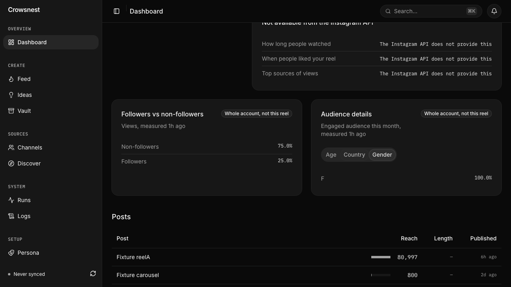 `mine-seed.ts` variant per the script (browse script, production `server.ts` on a spare port, temp DB, Graph answered offline by `graph-offline.mjs`) |
| E2E-20 | P2 | 14 | happy | live | Scheduled measurement advances a new reel's measured time with no click | Dev server up and left running over an hour, own channel set, a real Graph token, a reel posted within 72 hours. | Arrive on `/?tab=reels`. Act: click the reel, `data-testid="reels-picker-item"`; note `data-testid="reels-measured-at"`; wait past the next hourly run; reload. | `data-testid="reels-measured-at"` reads a later time than before; `data-testid="reels-views-chart"` is present with the new point. | `none` (live: needs a real Graph token and an hour of runtime) | 🟡 blocked: Graph token rejected, release gate |
| E2E-21 | P2 | 9,10 | invalid | offline | Junk `tab` and `reel` values fall back instead of erroring | Dev server up, own channel set, seeded reels, junk token. | Arrive on `/?tab=nonsense`. Act: open `/?tab=reels&reel=does-not-exist`. | First: `data-testid="dashboard-tab-overview"` is the selected tab and no `data-testid="reels-picker-item"` renders. Second: `data-testid="reels-summary-tile"` shows the newest reel, whose `data-testid="reels-picker-item"` is the selected one. | `scripts/e2e/mine-e2e-21.sh` | 🟢  `mine-seed.ts` variant per the script (browse script, production `server.ts` on a spare port, temp DB, Graph answered offline by `graph-offline.mjs`) |
| E2E-22 | P2 | 10 | empty | offline | An account with no reels shows an empty picker and still lists its posts | Dev server up, own channel set, own posts seeded with no reel among them, junk token. | Arrive on `/?tab=reels`. Act: read the picker and the Posts section. | No `data-testid="reels-picker-item"` and no `data-testid="reels-summary-tile"`; `assert_text` reads the picker's empty copy; at least one `data-testid="mine-post-row"`. | `scripts/e2e/mine-e2e-22.sh` | 🟢 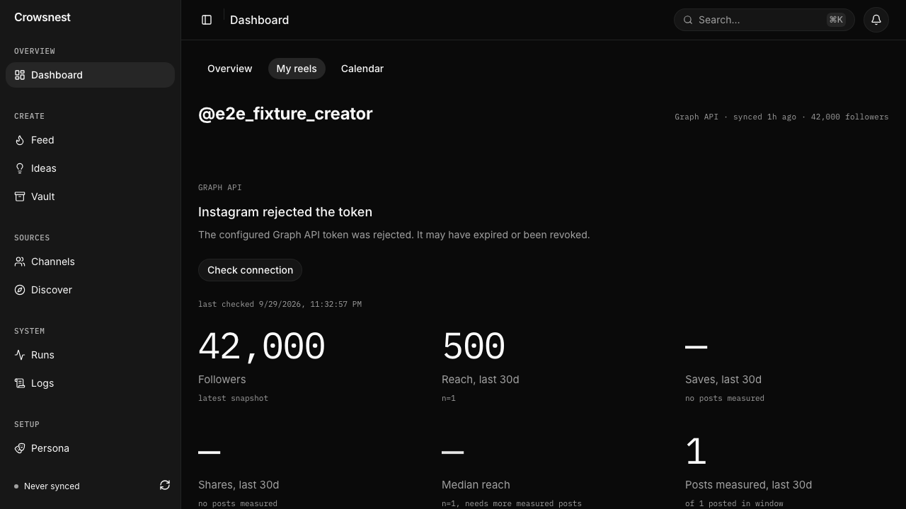 `mine-seed.ts` variant per the script (browse script, production `server.ts` on a spare port, temp DB, Graph answered offline by `graph-offline.mjs`) |
| E2E-23 | P1 | 11 | boundary | offline | Reach of zero turns every derived rate into a dash | Dev server up, own channel set, one reel snapshot with `reach` 0 and nonzero shares, likes, saves, reposts, comments, junk token. | Arrive on `/?tab=reels`. Act: click the reel, `data-testid="reels-picker-item"`. | Each derived `data-testid="reels-impact-row"` (all but Skip rate) reads a dash; `assert_text "0%"` does not match within `data-testid="reels-impact-row"`. | `scripts/e2e/mine-e2e-23.sh` | 🟢 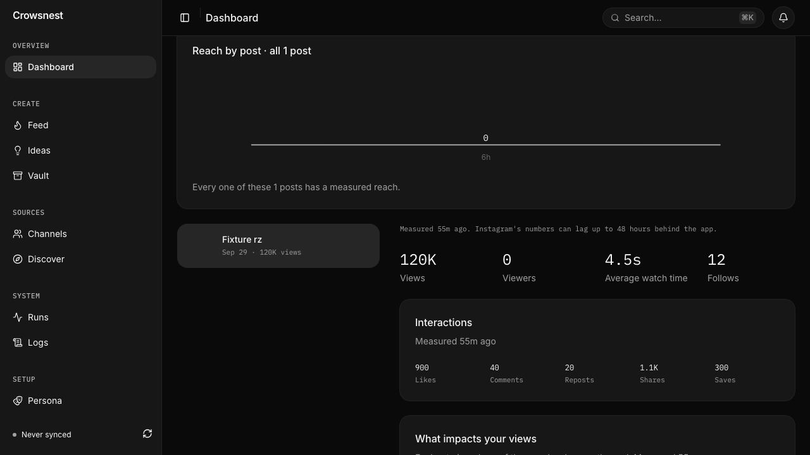 `mine-seed.ts` variant per the script (browse script, production `server.ts` on a spare port, temp DB, Graph answered offline by `graph-offline.mjs`) |
| E2E-24 | P2 | 13 | failure | offline | An account under the engagement threshold explains why Audience details is empty | Dev server up, own channel set, a seeded audience refusal for lack of volume, junk token. | Arrive on `/?tab=reels`. Act: click `data-testid="reels-audience-tab-age"`. | `assert_text "100"` reads the threshold explanation inside the Audience details block; no chart renders under `data-testid="reels-audience-tab-age"`. | `scripts/e2e/mine-e2e-24.sh` | 🟢 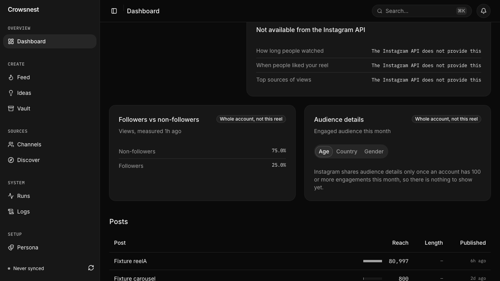 `mine-seed.ts` variant per the script (browse script, production `server.ts` on a spare port, temp DB, Graph answered offline by `graph-offline.mjs`) |
| E2E-25 | P1 | 7,10 | auth | offline | A rejected token keeps stored reel insights visible under the connect panel | Dev server up, own channel set, seeded reels and snapshots, junk token. | Arrive on `/?tab=reels`. Act: click the first `data-testid="reels-picker-item"`. | `data-testid="mine-connect-panel"` renders above the picker; `data-testid="reels-summary-tile"` and `data-testid="reels-measured-at"` still show the stored values. | `scripts/e2e/mine-e2e-25.sh` | 🟢 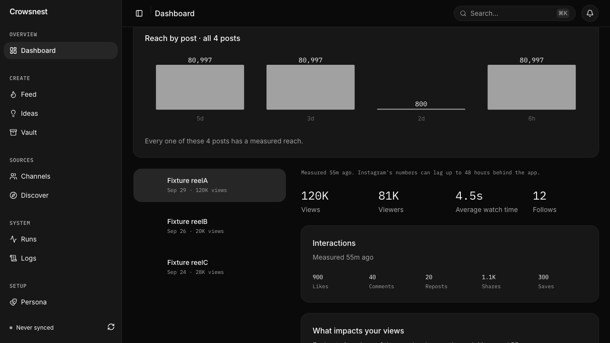 `mine-seed.ts` variant per the script (browse script, production `server.ts` on a spare port, temp DB, Graph answered offline by `graph-offline.mjs`) |
| E2E-26 | P2 | 9 | repeat | offline | Clicking the active tab again changes nothing | Dev server up, shared e2e seed. | Arrive on `/?tab=calendar`. Act: click `data-testid="dashboard-tab-calendar"` twice. | `assert_url_contains "tab=calendar"` after both clicks; exactly one `data-testid="dashboard-tab-calendar"` and one calendar grid render (the `data-testid="mine-calendar-day"` count equals the month's day cells, not double). | `scripts/e2e/mine-e2e-26.sh` | 🟢 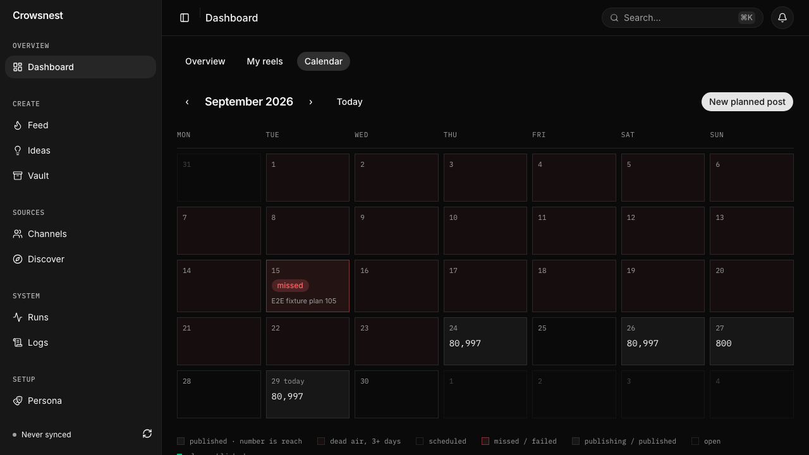 `mine-seed.ts` variant per the script (browse script, production `server.ts` on a spare port, temp DB, Graph answered offline by `graph-offline.mjs`) |

Not checkable by hand:

- The live journeys E2E-04, E2E-06, E2E-12, and E2E-20 need a real, valid Graph token (E2E-12 also a storage bucket); the current token is rejected, so they stay 🟡 with that named dependency when run. The connect panel's live "Measure now" write path is also exercised at the action layer (ACTION-12, ACTION-13).
- E2E-04's connected state (a token that returns ok) cannot be reached with a seeded fixture alone, since the tiles gate on a live token check; only the rejected-token stacking of E2E-08 and E2E-25 is reachable offline.
- The E2E-19 and E2E-24 seeds write `own_account_breakdowns` rows, and E2E-24's refusal writes the `own_audience_fetch_error` app setting, per `02-architecture.md`.

## 4. security-lite

mine has no license gate, no sidecar call, and no cross-tenant surface to test; crowsnest is single-user with no tenants. Its threat surface is the Graph API credentials, the calls made with them, and the one redirect it owns.

| ID | P | Threat | Claim | Setup | Steps | Expected | Result |
| --- | --- | --- | --- | --- | --- | --- | --- |
| SEC-01 | P1 | Secret handling | The Graph token and account id (`IG_GRAPH_TOKEN`, `IG_GRAPH_USER_ID`) are read through the secrets store by the server-side Graph client only and never rendered into the page or returned in an action's success payload. | Dashboard showing, Graph token set. | 1. Inspect the server-rendered HTML and the network payloads `checkGraphTokenAction`/`measureOwnChannelAction` return. 2. Search for the raw token value. | The raw token value never appears in the HTML or in any action's returned JSON; only derived state (`configured`, `state`, `username`) is exposed. | 🟢 pass (browser): fetched the stored `IG_GRAPH_TOKEN` value from the db's `secrets` table (read-only) and confirmed it does not appear anywhere in the rendered `/mine` HTML (see test-shots/SEC-01.png) |
| SEC-02 | P2 | No buyer data leaving the box | Own-channel data (`own_posts`, `own_post_insights`, `own_comments`) is written only from the Graph API's own response and is never sent to any other configured provider (the LLM proxy, the transcript provider, or the instagrapi sidecar). | A completed measurement. | 1. Trace `measureOwnChannelAction`'s calls. 2. Confirm no LLM proxy, transcript provider, or sidecar call is made during a measurement. | The only outbound call during a measurement is to the Graph API; nothing is sent to another provider. | 🟢 pass (source trace): `graph-actions.ts`'s full import list is `drizzle-orm`, the db, the logger, `graph/client`, `graph/errors`, and `queries/own-channel`, no llm, transcript, or ig client import anywhere in the module. The Measure now button that triggers this action does not render in this sandbox (the Graph token is currently connected and the account already measured, same as MINE-03/04), so a live browser trigger was not reachable without invalidating the token, which those rows already declined to do |
| SEC-03 | P1 | Secret handling | No Dashboard tab renders the Graph token or user id into HTML, an RSC payload, or an action result. | Graph token set; seeded reels. | 1. Open `/?tab=overview`, `/?tab=reels`, `/?tab=calendar`. 2. Search each response body and each action payload for the raw token. | The raw token appears nowhere; only derived state reaches the client. | 🟢 pass (curl): with the e2e seed's junk token in `secrets`, `/?tab=overview`, `/?tab=reels`, and `/?tab=calendar` each contain the token string 0 times |
| SEC-04 | P1 | Secret handling | The token never reaches a log line, including scheduler and failed-request logs. | Graph mock returning an error body that echoes the token; scheduler tick and manual measure both run. | 1. Run a tick and `measureOwnChannelAction()`. 2. Grep the captured logger output for the raw token. | No match; the token shows as `<redacted>` where the error body carried it (`redactToken`). | 🟢 covered by vitest (green), `own-measure.security.test.ts`: real client, stubbed `fetch` echoing the token in an error body; no log line and no result carries it |
| SEC-05 | P1 | Secret handling | A token set in Settings > API keys wins over `.env.local` for the manual measure and the scheduler alike, with no restart. | `.env.local` holds token A; Settings holds token B. | 1. Run `checkGraphTokenAction()` and one scheduler tick with the Graph client mocked to record its token. | Both calls use token B. | 🟢 covered by vitest (green), `client.test.ts`: `fetchAccount` and `checkToken` send the Settings token, not the `.env.local` one; the scheduler reads the same `getSecret` path |
| SEC-06 | P2 | No buyer data leaving the box | Scheduled measurement calls only `graph.instagram.com`, and sends nothing to the LLM proxy, transcript provider, or sidecar. | Outbound fetch spied. | 1. Run one scheduler tick. | Every outbound request's host is `graph.instagram.com`. | 🟢 covered by vitest (green), `own-measure.security.test.ts`: every stubbed request's host is `graph.instagram.com` |
| SEC-07 | P2 | Input handling (redirect) | The `/mine` redirect forwards only a valid `month` and stays on the same origin, so a crafted link cannot smuggle params or an off-site target. | None. | 1. Open `/mine?month=2026-08&next=https://evil.example&tab=overview`. 2. Open `/mine?month=<script>`. | First lands on `/?tab=calendar&month=2026-08`; second on `/?tab=calendar`; both stay on `localhost:3001`. | 🟢 covered by vitest (green), `month-param.test.ts`; also driven on the dev server: `/mine?month=2026-08&next=https://evil.example` redirects to `/?tab=calendar&month=2026-08` |

Security-lite has no rows for a license gate, a sidecar shared token, or cross-tenant leakage, since mine calls no sidecar and enforces no license of its own.
