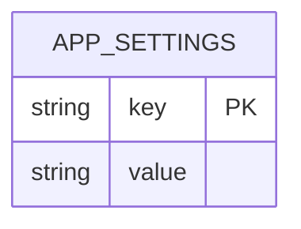
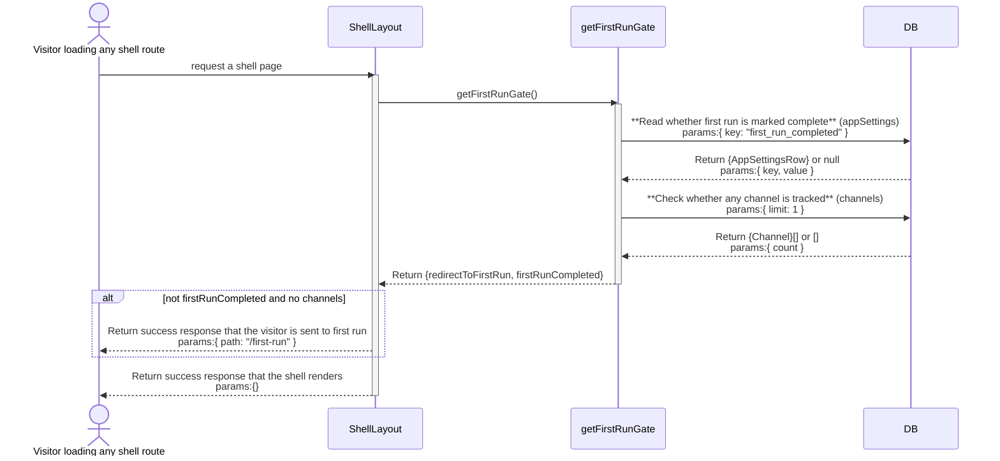
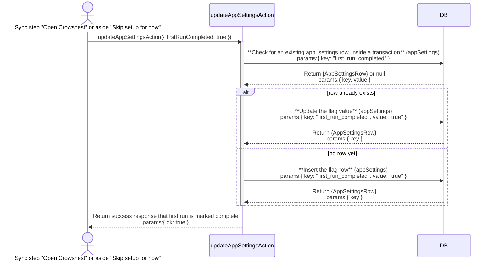

# onboarding: architecture

`documents/architect/core-components/onboarding/`

Status: shipped and in daily use, but two secret prompt defects in `kai kit init` (an empty `IG_PASSWORD`, a plaintext `ANTHROPIC_API_KEY` echo) block a clean buyer install.

## 1. Module structure

### The terminal half (`src/cli/kai.ts`)

| File | Export | Role |
| --- | --- | --- |
| `src/cli/kai.ts` | `cmdKitInit` | The `kai kit init` command. Requires a cached entitlement, writes `.env.local`, prompts for the Instagram account and the optional Anthropic key, creates the database, and hands off to `kai up`. |
| `src/cli/kai.ts` | `ask` | The one shared prompt helper. Its `secret: true` path hides typing on a real TTY by overriding `readline`'s `_writeToOutput`; both known onboarding defects live in this one function. |
| `src/cli/kai.ts` | `setEnv` | Replaces `NAME=...` in `.env.local`'s text in place, keeping surrounding comments and ordering, so a re run edits rather than overwrites. |

### The in-app half (`src/app/first-run/`, `src/components/first-run/`)

| File | Export | Role |
| --- | --- | --- |
| `src/app/first-run/page.tsx` | (default export, the route) | The `/first-run` route, a top level route deliberately outside `(shell)`, no sidebar, no topbar. `force-dynamic`; reads live settings and Instagram status on every visit; redirects a finished install back to `/`. |
| `src/components/first-run/onboarding-flow.tsx` | `OnboardingFlow` | The five screen client flow. Holds the current step in memory (`useState`), renders each step, and owns the persistent "Skip setup for now" control. |
| `src/components/first-run/onboarding-view.ts` | `canVerifyHandles`, `ONBOARDING_STEPS`, `ONBOARDING_STEP_COUNT`, `stepIndex`, `stepNavState` | Pure step ordering logic, kept out of the JSX so node only vitest can cover it. `onboarding-view.test.ts` is its test. |
| `src/components/first-run/welcome-step.tsx` | `WelcomeStep` | The unnumbered welcome screen. |
| `src/components/first-run/focus-step.tsx` | `FocusStep` | `01 FOCUS`. Saves the niche through `saveNicheSettingsAction`. |
| `src/components/first-run/connect-step.tsx` | `ConnectStep` | `02 INSTAGRAM`. The one real credential screen; wired to `getIgStatusAction`, `igLoginAction`, and its two factor and challenge branches. |
| `src/components/first-run/sources-step.tsx` | `SourcesStep` | `03 CHANNELS`. A handle in, handle out list; commits through `addChannelAction` on Continue. |
| `src/components/first-run/first-sync-step.tsx` | `FirstSyncStep` | `04 FIRST SYNC`. A thin wrapper around the shared `useSyncProgress` / `<SyncProgressPanel>`. |
| `src/server/queries/first-run-gate.ts` | `shouldRedirectToFirstRun`, `getFirstRunGate` | The route guard. `shouldRedirectToFirstRun` is the pure rule; `getFirstRunGate` is the async reader that runs it against the database. |
| `src/app/(shell)/layout.tsx` | (default export, the layout) | The caller of the gate. Redirects a fresh install to `/first-run` before any other shell query runs. |
| `src/components/settings/onboarding-section.tsx` | `OnboardingSection` | The "Replay first run" Settings control, which clears `first_run_completed` so the flow can be seen again. |

## 2. ER diagram

Onboarding owns no table of its own. It reads and writes `app_settings`, a plain key and value table shared by the whole app, and writes `channels` rows through the same `addChannelAction` the Channels page uses. `channels` is owned and diagrammed by [ig-sync](../ig-sync/02-architecture.md#2-er-diagram); it is not repeated here.

The keys onboarding cares about are `first_run_completed` (the flag the gate reads), and `niche_profile` and `niche_keywords` (written by the focus step, read back by Settings' Niche Profile section and by `services/remix.ts`). None of these keys are foreign keys; `app_settings` has no relation to any other table.

## 3. Indexes

`app_settings` carries no index beyond its `key` primary key (`src/server/db/schema.ts`). Every read onboarding does against it, the gate's flag check, the focus step's niche read, is a primary key lookup or a small `IN` list on that same key.

## 4. Data flow

**Terminal half, `kai kit init`.** `cmdKitInit` requires a cached entitlement first (`readEntitlement`, from the earlier `kai login`). It copies `.env.local` from `.env.example` (or edits it in place if present), prompts for `IG_USERNAME` then `IG_PASSWORD` (the latter through `ask(..., { secret: true })`, asked only when a username was given), generates `IG_SERVICE_TOKEN` if it is still the `change-me` placeholder, prompts for an optional `ANTHROPIC_API_KEY` (also `secret: true`), and asks for `VAULT_PATH` (default `~/.crowsnest/vault`), creating that directory. It writes `.env.local` at mode `0600` and `chmod`s it again (the file holds the Instagram password), then runs the database migrations and bootstrap through `node`/`tsx` directly, and finally hands off to `kai up`.

**The gate.** `src/app/(shell)/layout.tsx` calls `getFirstRunGate` before any other read. The rule (`shouldRedirectToFirstRun`) is compound on purpose: not `firstRunCompleted` and no channels tracked. A database that already has a `channels` row, a seeded dev database, or one that predates the flag, is treated as done even with the flag unset, so a real production database is never routed back into the wizard. Once `first_run_completed` is true it decides alone and stays true even if every channel is later removed. On a match the layout redirects to `/first-run` and the shell never renders.

**In-app half, `/first-run`.** `page.tsx` is the other half of that gate: it reads `getSettings()`, and if `firstRunCompleted` is already true it redirects straight to `/` rather than re running answered steps. Otherwise it reads the niche settings and the live Instagram status (`getIgStatusAction`) in parallel and renders `OnboardingFlow`. The five screens each write through an existing server action, not a new one: focus saves through `saveNicheSettingsAction`; connect signs in through `igLoginAction` and its `igChallengeChooseAction`, `igChallengeCodeAction`, `igTwoFactorAction` branches, read back through `getIgStatusAction`; sources commits through `addChannelAction` (idempotent per handle) only on Continue; sync runs the shared sync progress panel, then `updateAppSettingsAction({ firstRunCompleted: true })`.

**Finishing.** Both the sync step's "Open Crowsnest" and the aside's "Skip setup for now" write `first_run_completed` through the generic `updateAppSettingsAction` and then navigate to `/`. A plain link would bounce straight back through the gate on the zero channel install this screen exists for, so the flag write is what actually ends first run. "Skip" is deliberately available throughout, because the sources step's Continue only lights up once a real handle is added, and someone without one otherwise has nowhere to go.

## 5. Sequence: the first run gate check

## 6. Sequence: finishing first run

## 7. Key decisions

- **Two independent halves, joined only by `.env.local` and one flag.** The CLI never imports the app and the app never shells the CLI. The terminal half exists because the Instagram sidecar needs credentials on disk before the server can even reach it; the in-app half exists to get an empty install to a tracked channel and a first sync.
- **`/first-run` is its own top level route, not a `(shell)` child.** The shell's sidebar, topbar, and failure strip have nothing to orient here, and the shell's own gate would otherwise have to special case its way around itself. The flow is a full bleed two column screen instead.
- **The gate is compound, not just the flag.** This is the whole reason the gate exists: a real database with channels must never be routed back into a wizard. See `first-run-gate.ts`'s module doc.
- **Step state lives in memory, not the URL.** Nothing about which step the user is on needs to survive a reload independently of what each step already persisted server side; a reload mid flow re lands on welcome and re asks a question or two whose answers are already saved.
- **Every step reuses an existing server action.** No step introduces its own action; the connect step in particular shares Settings' Instagram surface rather than a copy, so re establishing a session later goes through the same code.
- **The connect step shows only the one real fact it has, the connected handle.** Follower and post counts are not shown because `getIgStatusAction` carries no such fields; per the no fabricated data rule, a capability the app lacks does not appear in the UI.

## 8. Open, not verified

- **The sidecar won't start onboarding bug** (`evidence/10-onboarding-bugs.md`, tracked as `ONB-1` in [05-backlog-to-enhance.md](05-backlog-to-enhance.md)): `kai kit init`'s masked `IG_PASSWORD` prompt returned empty on a real TTY, so `.env.local` was written with `IG_PASSWORD=` (length 0) while `IG_USERNAME` saved fine. The Instagram sidecar then refuses to start, "IG_USERNAME and IG_PASSWORD must be set together", exit 78 `EX_CONFIG`, and launchd's keepalive crash loops it, so port 8765 never comes up and Instagram sync is dead for the buyer with no onboarding time warning. Root cause is `ask`'s `secret` path in `src/cli/kai.ts`, which hides the terminal echo by overriding `readline`'s `_writeToOutput`; on a real TTY the value read back is empty. This is a hard blocker for a clean buyer install.
- **The plaintext key echo** (`evidence/10-onboarding-bugs.md`, tracked as `ONB-2`): the same `ask({ secret: true })` path fails to suppress the echo for the `ANTHROPIC_API_KEY` prompt on this TTY, so the key is visible on screen and lands in terminal scrollback. The key is still entered and saved correctly; the defect is only that it is not hidden. Not a functional blocker, a security and UX defect.
- **No Graph API path exists in the app today.** The panel for the user's own channel's Graph token was proposed but never built; the burner Instagram identity the sidecar reads and any future Graph token must never share code or an environment variable prefix. See [01-concept-brief.md](01-concept-brief.md).
- **A live Instagram connect through the `/first-run` connect step against real credentials has not been proven end to end** while `ONB-1` leaves the sidecar down on a real buyer install; the connect step's service down branch is what a buyer hitting `ONB-1` actually sees.
- **The dashboard redesign** (moving Instagram login and key entry into the dashboard with live validation) is tracked as `ENH-1` in [05-backlog-to-enhance.md](05-backlog-to-enhance.md) and is not built.
