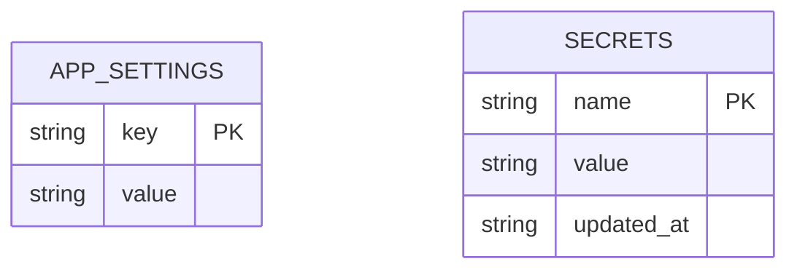
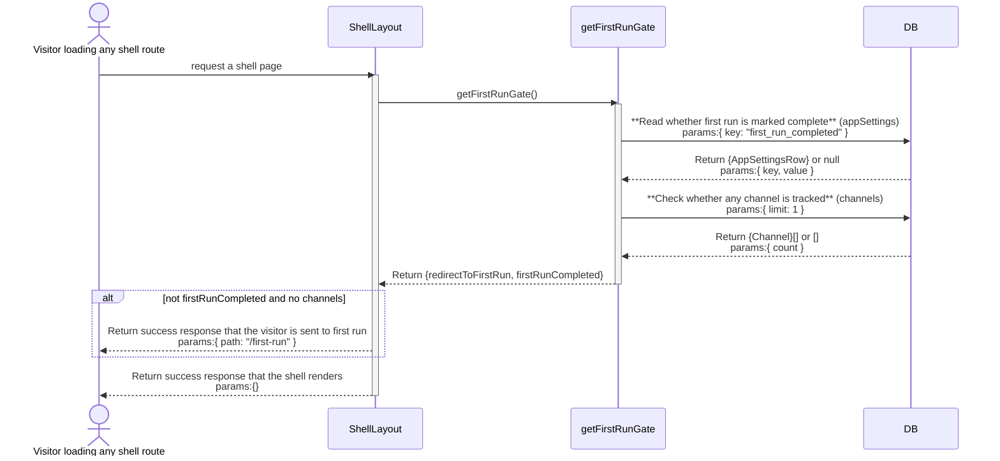
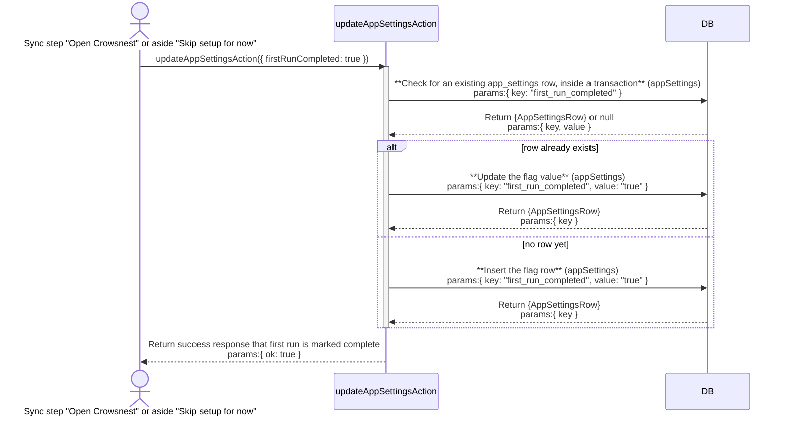
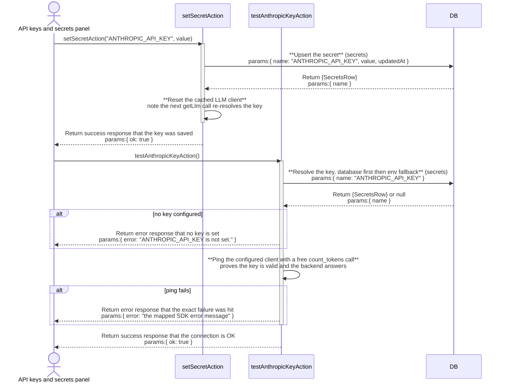
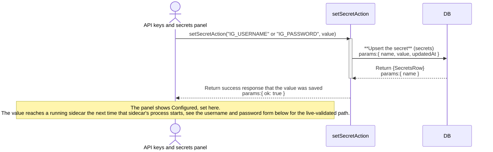
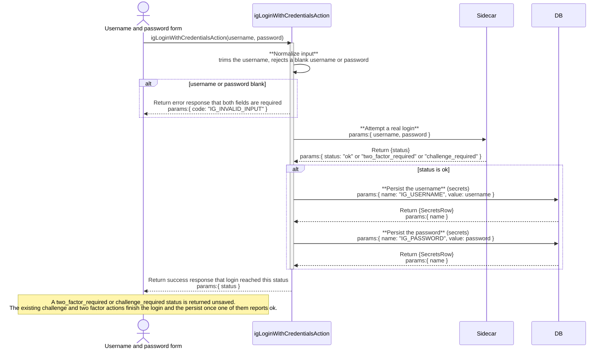
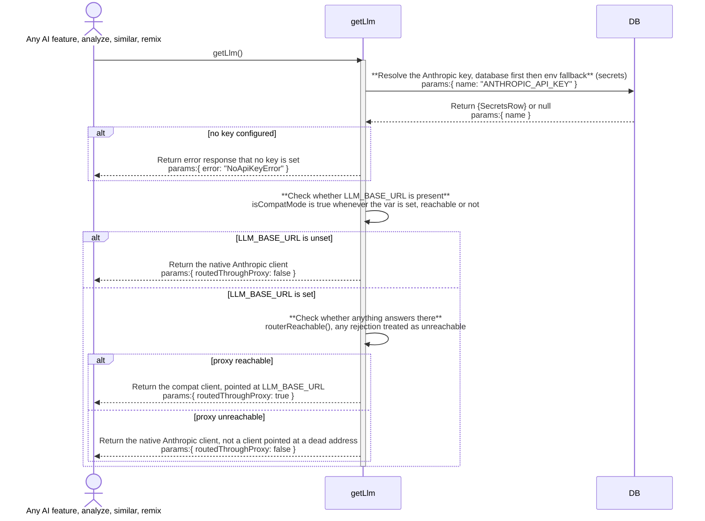

# onboarding: architecture

`documents/architect/core-components/onboarding/`

Status: shipped and in daily use. `kai kit init`'s two secret prompt defects (an empty `IG_PASSWORD`, a plaintext `ANTHROPIC_API_KEY` echo) are fixed, and the dashboard-side credential and LLM-routing path (ENH-1) is built: a live-validated username/password Instagram login, a launchd job that carries secrets to the packaged sidecar, and an LLM client that falls back to a direct Anthropic connection when the local proxy is unreachable.

## 1. Module structure

### The terminal half (`src/cli/kai.ts`)

| File | Export | Role |
| --- | --- | --- |
| `src/cli/kai.ts` | (top level, `isMain` guard) | Respawns itself with `spawnSync`, `cwd` pinned to `appRoot`, before any `@/`-aliased import can resolve against the wrong project root, whenever the actual CLI (not a test importing this file) is invoked from a directory other than `appRoot`. Forwards `process.argv`, inherits stdio, and exits with the child's real status or a signal-derived code, so `kai` behaves the same run from any working directory. |
| `src/cli/kai.ts` | `cmdKitInit` | The `kai kit init` command. Requires a cached entitlement, writes `.env.local`, prompts for the Instagram account and the optional Anthropic key, creates the database, and hands off to `kai up`. |
| `src/cli/kai.ts` | `ask` | The one shared prompt helper. Its `secret: true` path hides typing on a real TTY by overriding `readline`'s `_writeToOutput`. |
| `src/cli/kai.ts` | `setEnv` | Replaces `NAME=...` in `.env.local`'s text in place, keeping surrounding comments and ordering, so a re run edits rather than overwrites. |

### The in-app half (`src/app/first-run/`, `src/components/first-run/`)

| File | Export | Role |
| --- | --- | --- |
| `src/app/first-run/page.tsx` | (default export, the route) | The `/first-run` route, a top level route deliberately outside `(shell)`, no sidebar, no topbar. `force-dynamic`; reads live settings and Instagram status on every visit; redirects a finished install back to `/`. |
| `src/components/first-run/onboarding-flow.tsx` | `OnboardingFlow` | The five screen client flow. Holds the current step in memory (`useState`), renders each step, and owns the persistent "Skip setup for now" control. |
| `src/components/first-run/onboarding-view.ts` | `canVerifyHandles`, `ONBOARDING_STEPS`, `ONBOARDING_STEP_COUNT`, `stepIndex`, `stepNavState` | Pure step ordering logic, kept out of the JSX so node only vitest can cover it. `onboarding-view.test.ts` is its test. |
| `src/components/first-run/welcome-step.tsx` | `WelcomeStep` | The unnumbered welcome screen. |
| `src/components/first-run/focus-step.tsx` | `FocusStep` | `01 FOCUS`. Saves the niche through `saveNicheSettingsAction`. |
| `src/components/first-run/connect-step.tsx` | `ConnectStep` | `02 INSTAGRAM`. The one real credential screen; wired to `getIgStatusAction`, `igLoginAction`, `igLoginWithCredentialsAction`, and the shared two factor and challenge branches. See the fuller row below. |
| `src/components/first-run/sources-step.tsx` | `SourcesStep` | `03 CHANNELS`. A handle in, handle out list; commits through `addChannelAction` on Continue. Each typed or pasted token is validated with the shared `normalizeHandle` (`src/lib/handle.ts`) at add time, before it joins the pending list; a malformed token is rejected inline and never queued, so it cannot sit there while a well-formed handle beside it gets written as a real `channels` row on a Continue that doesn't advance. |
| `src/components/first-run/first-sync-step.tsx` | `FirstSyncStep` | `04 FIRST SYNC`. A thin wrapper around the shared `useSyncProgress` / `<SyncProgressPanel>`. Its `started`/`onStarted` props (state lifted to `OnboardingFlow`) gate that: `useSyncProgress()` reflects the latest `sync_jobs` row anywhere in the app by design, so before this step has actually launched a run, that hook's `progress` is ignored and "Run first sync" always renders, regardless of a pre-existing terminal or running job (the case reached via Settings > Replay first run). |
| `src/server/queries/first-run-gate.ts` | `shouldRedirectToFirstRun`, `getFirstRunGate` | The route guard. `shouldRedirectToFirstRun` is the pure rule; `getFirstRunGate` is the async reader that runs it against the database. |
| `src/app/(shell)/layout.tsx` | (default export, the layout) | The caller of the gate. Redirects a fresh install to `/first-run` before any other shell query runs. |
| `src/components/settings/onboarding-section.tsx` | `OnboardingSection` | The "Replay first run" Settings control, which clears `first_run_completed` so the flow can be seen again. |

### Credential storage and LLM routing (ENH-1)

Feature descriptions 5 and 6 in `03-feature-description.md`. These files carry the credential-save-and-validate path and the LLM key/route-resolution path; several are shared with Settings rather than owned by onboarding alone, since the first-run connect step and Settings' equivalent panels are the same code.

| File | Export | Role |
| --- | --- | --- |
| `src/server/secrets/store.ts` | `MANAGED_SECRETS`, `getSecret`, `setSecret`, `clearSecret`, `secretStatus`, `getOrCreateServiceToken` | The db-backed secret store: a value saved here wins over the matching env var (db-first, env-fallback). Plaintext in sqlite, never returned to the browser or logged. |
| `src/server/actions/secrets-actions.ts` | `setSecretAction`, `clearSecretAction`, `getSecretStatusAction`, `regenerateServiceTokenAction` | Settings' write/read surface over the store. Every export returns `{ ok }` or a `SecretStatus[]` (configured/source only), never a value. |
| `src/components/settings/secrets-section.tsx` | `SecretsSection` | The "API keys & secrets" panel. Anthropic key: save, then a separate live "Test". Groq key and both Instagram credential rows: save only, no live check. |
| `src/server/actions/settings-actions.ts` | `testAnthropicKeyAction` | The Anthropic key's live check: a real, free `count_tokens` call through the configured client, reporting the exact mapped failure on error. |
| `src/server/llm/client.ts` | `getLlm`, `hasLlmKey`, `isCompatMode`, `resetLlmClient`, `NoApiKeyError`, `AnthropicLlmClient`, `CompatLlmClient` | The one LLM client. `getLlm()` is async: it resolves the key through `getSecret` (throws `NoApiKeyError` if unset), then, only when `isCompatMode()` is true, awaits `routerReachable().catch(() => false)` before deciding which client to hand back. Reachable: `CompatLlmClient`, pointed at `LLM_BASE_URL`, same as before. Unreachable, or `LLM_BASE_URL` unset: the native `AnthropicLlmClient`, calling Anthropic directly. `isCompatMode()` is unchanged code (`Boolean(process.env.LLM_BASE_URL)`) but now means only "a proxy address is configured," not "every call routes through it." `resetLlmClient()` is called on every secret save so a new key takes effect without a restart; reachability itself is checked once per cached-client lifetime, not on every call, so a proxy that comes back up mid-session is not picked back up until the next secret save or process restart, a documented trade-off (see the `ponytail:` comment above `getLlm()`). |
| `src/server/config.ts` | `config` | Validates env once at boot. `LLM_BASE_URL` has no default *here* (only `.env.example` sets one); `config.ts` never treats it as required. |
| `.env.example` | (template) | Ships `LLM_BASE_URL=http://localhost:20128` uncommented, and `kai kit init` copies this file into every fresh `.env.local` without touching that line, so a proxy address is present by default even though the Kit installer never installs 9router. `getLlm()`'s reachability check is what keeps that default from breaking a keyed install with no 9router running. |
| `src/server/llm/router-control.ts` | `startRouter`, `stopRouter`, `routerReachable`, `routerPidAlive`, `waitForRouterHealthy`, `routerBin` (internal) | Process supervisor for the local 9router proxy, pid-tracked, never a broad kill. Reachability is a plain HTTP GET against `LLM_BASE_URL`, any response counting as reachable. The internal `routerBin()` resolves which binary `startRouter()` spawns: the `ROUTER_BIN` env var first, then `which 9router` on `PATH`, then a hardcoded Homebrew path as the last resort, so a plain `npm install -g 9router` (whose global bin directory is on `PATH` for essentially every shell setup) works without anyone having to set `ROUTER_BIN` by hand. |
| `src/server/actions/router-actions.ts` | `startRouterAction`, `stopRouterAction`, `getRouterStatusAction` | Settings' 9router driver. `getRouterStatusAction` also makes one cooldown-gated auto-restart attempt when `routerAutoManage` is on and the proxy is unreachable. `startRouterAction`'s failure message is `PATH`-aware: it names the resolution order `routerBin()` just tried (`ROUTER_BIN`, then `PATH`, then `/opt/homebrew/bin/9router`), points at `npm install -g 9router` when nothing was found there, and names the log file to check. |
| `src/components/settings/router-section.tsx` | `RouterSection` | Start/Stop/Restart/Check controls for 9router, plus the "Auto-manage" toggle, exposed as `router-status-badge`, `router-check-button`, and `router-start-button` test ids. Requires the `9router` binary to already be installed; none of these controls install it, but the start-failure copy from `router-actions.ts` above tells the user how to. |
| `src/components/status/dependency-status.ts` | `classifySidecarStatus`, `classifyLlmStatus`, `bothHealthy` | Pure classification of the sidecar and LLM backend into `up`/`down`/`reachable_unverified`/`not_configured`/`unknown`. `reachable_unverified` exists specifically because a proxy's `count_tokens` route can answer 200 without proving the model behind it generates anything. |
| `src/components/remix/generation-blocked.tsx` | `GenerationBlocked` (default export) | The Remix studio's blocked panel, keyed on a "no key" vs "proxy down" reason, with a link to Settings. |
| `src/server/sidecar/control.ts` | `startSidecar`, `stopSidecar`, `sidecarPidAlive`, `childEnv` (internal) | The dev-invoked Instagram sidecar process manager, driven by Settings' Start/Stop buttons. `childEnv()` injects `IG_SERVICE_TOKEN`, `IG_USERNAME`, `IG_PASSWORD`, `IG_PROXY`, and `IG_DEVICE_SEED` from the secrets store into the spawned child's environment, the same shape `service-darwin.ts`'s `igEnv()` below now uses for the packaged path. Spawns via `uv run python -m crowsnest_ig`, so it depends on `uv` being on the machine, which a packaged buyer install does not guarantee; that is why the packaged path below needs its own, `uv`-free injection rather than reusing this one. |
| `src/server/actions/sidecar-actions.ts` | `startSidecarAction`, `stopSidecarAction`, `sidecarProcessAliveAction` | Settings' sidecar driver over `control.ts`. Idempotent (a no-op success if the sidecar already answers); polls health after spawning rather than trusting `spawn()` alone. |
| `src/cli/service-darwin.ts` | `services`, `start`, `stop`, `running`, `plist`, `pinDbPathEnv`, `igEnv` (internal), `xmlEscape` (internal) | The packaged buyer path: writes and loads launchd plists for both long-lived processes. `services()` is async and, for `com.crowsnest.ig`, awaits the internal `igEnv()`, which lazily `import()`s the secrets store (deferred so it loads only after `pinDbPathEnv()` has already pinned `CROWSNEST_DB_PATH`) and injects `IG_SERVICE_TOKEN`, `IG_USERNAME`, `IG_PASSWORD`, `IG_PROXY`, and `IG_DEVICE_SEED` into the plist's `EnvironmentVariables`, omitting any value that isn't set rather than writing an empty string. `pinDbPathEnv()` runs at module load, before that lazy import, so `kai`'s CLI process (invokable from any directory) and the spawned server agree on one absolute database path. `plist()` runs every interpolated value, program args, cwd, env keys and values, the label, the log path, through one `xmlEscape` pass, so a credential containing `&`, `<`, `>`, or a quote can no longer produce invalid XML that `launchctl bootstrap` would reject outright. `start()`/`stop()` are async because `services()` is. |
| `services/ig/crowsnest_ig/config.py` | `load_config`, `load_env_file`, `Config` | The sidecar's own env loader. Reads its own process environment first, then `.env.local` (an already-set variable always wins over the file). Has no code path to the app's sqlite database or secrets store; `IG_USERNAME`/`IG_PASSWORD` arrive at process start either from `service-darwin.ts`'s launchd `EnvironmentVariables` or, for a dev-only sidecar, from `control.ts`'s `childEnv()`. |
| `src/server/actions/ig-actions.ts` | `igLoginAction`, `igLoginBySessionAction`, `igLoginWithCredentialsAction`, `getIgStatusAction` | `igLoginAction()` takes no arguments by design ("no action ever accepts a password"), signing in with whatever is already in the sidecar's own environment. `igLoginBySessionAction` persists the pasted `sessionid` before the sidecar call resolves, a deliberate exception for a value that expires and gets replaced routinely. `igLoginWithCredentialsAction(username, password)` is the opposite order: it calls the sidecar's real login first and only calls `setSecret` for `IG_USERNAME`/`IG_PASSWORD` when that login reports `"ok"` for this call; a rejected login, or a blank username or password, changes nothing in the store. A `two_factor_required`/`challenge_required` result is returned unsaved, since the sidecar already remembers the pending credentials from this call's own `/login` request and the existing `igChallengeChooseAction`/`igChallengeCodeAction`/`igTwoFactorAction` finish the login and the persist once one of them reports `"ok"`. |
| `src/components/settings/instagram-section.tsx` | `InstagramSection` | Settings' Instagram panel: the session-token path (live-validated on Connect), the env-based "Connect" button, and a "Sign in with a username and password" form that calls `igLoginWithCredentialsAction`, reusing the same two-factor and challenge branches the other login paths already share. `credentialsPending` holds the typed pair in memory only until a two-factor or challenge step resolves the pending login, and is cleared on cancel or failure so a rejected password is never carried into a later attempt. |
| `src/components/first-run/connect-step.tsx` | `ConnectStep` | `/first-run`'s `02 INSTAGRAM` step. Same `igLoginAction()` / `getIgStatusAction()` / `igLoginWithCredentialsAction()` surface as Settings, including its own username/password form and the same `credentialsPending` handling for the two-factor and challenge branches. |

## 2. ER diagram

Onboarding owns no table of its own. It reads and writes `app_settings`, a plain key and value table shared by the whole app, and writes `channels` rows through the same `addChannelAction` the Channels page uses. `channels` is owned and diagrammed by [ig-sync](../ig-sync/02-architecture.md#2-er-diagram); it is not repeated here. The credential and LLM-routing path (ENH-1, features 5 and 6) touches one more shared, ownerless table, `secrets`.

The keys onboarding cares about are `first_run_completed` (the flag the gate reads), and `niche_profile` and `niche_keywords` (written by the focus step, read back by Settings' Niche Profile section and by `services/remix.ts`). None of these keys are foreign keys; `app_settings` has no relation to any other table.

`secrets` (`src/server/db/schema.ts`) holds the eight `MANAGED_SECRETS` rows, one of which, `ANTHROPIC_API_KEY`, is what `getLlm()` resolves before every AI call, and two of which, `IG_USERNAME` and `IG_PASSWORD`, are the credential pair ENH-1's live-validated login path is about. It carries no foreign key and no relation to `app_settings` or to any other table; the two tables are drawn side by side above because both feed the credential and routing path, not because they reference each other.

## 3. Indexes

`app_settings` carries no index beyond its `key` primary key (`src/server/db/schema.ts`). Every read onboarding does against it, the gate's flag check, the focus step's niche read, is a primary key lookup or a small `IN` list on that same key.

| Table | Index | Notes |
| --- | --- | --- |
| `app_settings` | (none, `key` PK) | Every read is a primary-key lookup or a small `IN` list on that same key. |
| `secrets` | (none, `name` PK) | Every read (`getSecret`, `secretStatus`) is a primary-key lookup or the eight-entry `MANAGED_SECRETS` scan; no other index exists. |

## 4. Data flow

**Terminal half, `kai kit init`.** `cmdKitInit` requires a cached entitlement first (`readEntitlement`, from the earlier `kai login`). It copies `.env.local` from `.env.example` (or edits it in place if present), prompts for `IG_USERNAME` then `IG_PASSWORD` (the latter through `ask(..., { secret: true })`, asked only when a username was given), generates `IG_SERVICE_TOKEN` if it is still the `change-me` placeholder, prompts for an optional `ANTHROPIC_API_KEY` (also `secret: true`), and asks for `VAULT_PATH` (default `~/.crowsnest/vault`), creating that directory. It writes `.env.local` at mode `0600` and `chmod`s it again (the file holds the Instagram password), then runs the database migrations and bootstrap through `node`/`tsx` directly, and finally hands off to `kai up`.

**The gate.** `src/app/(shell)/layout.tsx` calls `getFirstRunGate` before any other read. The rule (`shouldRedirectToFirstRun`) is compound on purpose: not `firstRunCompleted` and no channels tracked. A database that already has a `channels` row, a seeded dev database, or one that predates the flag, is treated as done even with the flag unset, so a real production database is never routed back into the wizard. Once `first_run_completed` is true it decides alone and stays true even if every channel is later removed. On a match the layout redirects to `/first-run` and the shell never renders.

**In-app half, `/first-run`.** `page.tsx` is the other half of that gate: it reads `getSettings()`, and if `firstRunCompleted` is already true it redirects straight to `/` rather than re running answered steps. Otherwise it reads the niche settings and the live Instagram status (`getIgStatusAction`) in parallel and renders `OnboardingFlow`. The five screens each write through an existing server action, not a new one: focus saves through `saveNicheSettingsAction`; connect signs in through `igLoginAction` and its `igChallengeChooseAction`, `igChallengeCodeAction`, `igTwoFactorAction` branches, read back through `getIgStatusAction`; sources validates each handle with `normalizeHandle` before it joins the pending list, then commits through `addChannelAction` (idempotent per handle) only on Continue; sync only trusts `useSyncProgress()` once it has launched a run itself (`started`, lifted to `OnboardingFlow` alongside `channelIds` so it survives the rail nav unmounting the step), then finishes with `updateAppSettingsAction({ firstRunCompleted: true })`.

**Responsive aside layout.** `OnboardingFlow`'s aside (`src/components/first-run/onboarding-flow.tsx`) adapts its content to the viewport width. Below the md breakpoint the aside becomes a compact header showing the Crowsnest wordmark and a single line of context ("n steps - about a minute" on welcome, or "step label - n / TOTAL" on numbered steps), stacked above the main flow panel. At md and above the aside becomes a fixed rail on the left, showing the oversized ghost step numeral (a neutral visual texture filling the rail's negative space), the tagline "Watch the channels you compete with" with supporting copy, and the step progress spine - a vertical line threading through numbered navigation buttons for steps 01 through 04. The spine and full navigation are rendered with `hidden md:flex`, and the compact header is `md:hidden`, so each viewport sees only the layout that matches its width.

**Finishing.** Both the sync step's "Open Crowsnest" and the aside's "Skip setup for now" write `first_run_completed` through the generic `updateAppSettingsAction` and then navigate to `/`. A plain link would bounce straight back through the gate on the zero channel install this screen exists for, so the flag write is what actually ends first run. "Skip" is deliberately available throughout, because the sources step's Continue only lights up once a real handle is added, and someone without one otherwise has nowhere to go.

**Credential save and validate (ENH-1).** `SecretsSection` calls `setSecretAction`, which writes straight into `secrets` through `setSecret`; nothing about that write itself distinguishes the Anthropic key from an Instagram credential. What differs is what happens after. For `ANTHROPIC_API_KEY`, saving resets the cached LLM client (`resetLlmClient()`), so the very next `getLlm()` call re-reads the new value, and a separate "Test" button runs `testAnthropicKeyAction`, a real `count_tokens` ping that reports success or the exact mapped failure. For Instagram, three paths exist side by side: the plain "API keys & secrets" rows for `IG_USERNAME`/`IG_PASSWORD` still only ever update the row, with no live check at save time; the session-token path, `igLoginBySessionAction`, persists `IG_SESSIONID` and immediately attempts a real sidecar login with it; and the username/password form, `igLoginWithCredentialsAction`, calls the sidecar's real login first and persists `IG_USERNAME`/`IG_PASSWORD` only once that login reports `"ok"`, so a wrong password is validated and rejected before it is ever saved. Whichever path saves a credential, it still only reaches a sidecar the *next* time that sidecar's process starts (in dev, `control.ts`'s `childEnv()`; packaged, `service-darwin.ts`'s `igEnv()`, both read below) or, for the credentials-form path, the moment the login itself succeeds against the sidecar already running.

**Delivering credentials to the packaged sidecar (ENH-1).** A saved `IG_USERNAME`/`IG_PASSWORD` (or `IG_SERVICE_TOKEN`/`IG_PROXY`/`IG_DEVICE_SEED`) reaches the sidecar a real buyer runs through `src/cli/service-darwin.ts`. `services()` awaits `igEnv()`, which lazily loads the secrets store and returns only the values that are actually set; `start()` writes that into the `com.crowsnest.ig` plist's `EnvironmentVariables` and reloads it with `launchctl bootstrap`. Every value written into the plist's XML, program arguments, the working directory, the label, the log path, and every env key and value, passes through one `xmlEscape` pass first, so a password containing `&`, `<`, `>`, or a quote cannot produce invalid plist XML that `launchctl bootstrap` would otherwise reject outright, silently leaving the old plist (and old credentials) in place. `pinDbPathEnv()` runs before any of this, at module load, so the CLI process (invocable from any directory) and the server it configures agree on one absolute `CROWSNEST_DB_PATH`, regardless of the caller's own working directory.

**LLM key and route resolution (ENH-1).** `getLlm()` is the one gate every AI call passes through: it throws `NoApiKeyError` if `getSecret("ANTHROPIC_API_KEY")` is empty (the keyless-degrade path). With a key present, it checks `isCompatMode()` (`Boolean(process.env.LLM_BASE_URL)`); when that is false it hands back the native `AnthropicLlmClient` directly. When it is true, `getLlm()` awaits `routerReachable().catch(() => false)`: reachable, it hands back `CompatLlmClient` pointed at `LLM_BASE_URL`, same as before; unreachable, it falls back to the native `AnthropicLlmClient` instead of a client pointed at a dead address. Because `.env.example` ships `LLM_BASE_URL` already set to `http://localhost:20128` and `kai kit init` never removes it, every fresh install still has a proxy address configured by default, but a key alone is now sufficient to get working AI features when nothing is listening there. The resulting client is cached; reachability is re-checked only when `resetLlmClient()` runs (every secret save) or the process restarts, not on every call, so a 9router that comes back up mid-session is not picked back up automatically until then. Settings' 9router section can still start, stop, restart, or auto-manage the proxy for whoever wants the routed path back once 9router is actually running.

## 5. Sequence: the first run gate check

## 6. Sequence: finishing first run

## 7. Sequence: saving and validating a credential

Two shapes exist side by side today. The Anthropic key gets a save plus a real, separate, opt-in check:

Setting `IG_USERNAME`/`IG_PASSWORD` straight through "API keys & secrets" is still a blind save, with no login attempt of its own:

The username and password form on Settings' Instagram panel and `/first-run`'s connect step takes the opposite order, validating against a real sidecar login before it ever writes to `secrets`:

Whichever path saves `IG_USERNAME`/`IG_PASSWORD`, the value it leaves behind still only reaches a running sidecar process the next time that process starts, through `service-darwin.ts`'s `igEnv()` for the packaged path or `control.ts`'s `childEnv()` for the dev path, both read in section 1 above. The credentials-form path above is the one exception: the login it validates against is the sidecar already running, so success there means the account is connected immediately, not just configured for the next restart.

## 8. Sequence: resolving the LLM key and route

The result is cached (`cachedClient`), so this whole check runs once per cache lifetime, not on every AI call: a proxy that recovers mid-session is not picked back up automatically, only on the next `resetLlmClient()` (every secret save) or process restart. Nothing in the dashboard's dependency status badge reflects this branch either, it still derives `routedThroughProxy` from `isCompatMode()`'s presence check alone, not from which client `getLlm()` actually handed back on the last call, so the badge can read "routed through proxy" even on a call that fell back to a direct connection; that gap is `ENH-2` in [05-backlog-to-enhance.md](05-backlog-to-enhance.md), see section 10.

## 9. Key decisions

- **Two independent halves, joined only by `.env.local` and one flag.** The CLI never imports the app and the app never shells the CLI. The terminal half exists because the Instagram sidecar needs credentials on disk before the server can even reach it; the in-app half exists to get an empty install to a tracked channel and a first sync.
- **`/first-run` is its own top level route, not a `(shell)` child.** The shell's sidebar, topbar, and failure strip have nothing to orient here, and the shell's own gate would otherwise have to special case its way around itself. The flow is a full bleed two column screen instead.
- **The gate is compound, not just the flag.** This is the whole reason the gate exists: a real database with channels must never be routed back into a wizard. See `first-run-gate.ts`'s module doc.
- **Step state lives in memory, not the URL.** Nothing about which step the user is on needs to survive a reload independently of what each step already persisted server side; a reload mid flow re lands on welcome and re asks a question or two whose answers are already saved.
- **Every step reuses an existing server action.** No step introduces its own action; the connect step in particular shares Settings' Instagram surface rather than a copy, so re establishing a session later goes through the same code.
- **The connect step shows only the one real fact it has, the connected handle.** Follower and post counts are not shown because `getIgStatusAction` carries no such fields; per the no fabricated data rule, a capability the app lacks does not appear in the UI.
- **A secret save is db-first, env-fallback, and, for the Anthropic key only, resets the cached client on write.** This is what lets a key set in Settings take effect on the very next call with no restart; it applies to `ANTHROPIC_API_KEY` specifically because `getLlm()` is the one place the client is cached, not to any of the other seven managed secrets.
- **The live check on a secret is opt-in, separate from save, and exists for two of the eight managed secrets today.** `ANTHROPIC_API_KEY` gets a "Test" button, and Instagram gets two live-checked paths, the session-token form and the username/password form; the plain "API keys & secrets" rows for `IG_USERNAME`/`IG_PASSWORD` still save blind. The username/password form closes that gap without breaking the "no action ever accepts a password" rule `ig-actions.ts` already enforces, by validating first and persisting only on `"ok"`.
- **Username/password login validates before it persists, the opposite order from the session-token path.** `igLoginWithCredentialsAction` only calls `setSecret` when the sidecar's own login answers `"ok"` for that call; `igLoginBySessionAction` persists `IG_SESSIONID` first, a deliberate, narrower risk for a value that expires and gets replaced routinely, not a pattern the credentials path copies.
- **Two sidecar process managers exist, and both now wire credentials into the child.** `src/server/sidecar/control.ts` (the dev/Settings Start button, `uv`-dependent) and `src/cli/service-darwin.ts` (the packaged buyer path, launchd) each inject the secrets store's values into the process they start, `control.ts` through `childEnv()`, `service-darwin.ts` through its own `igEnv()`. They stay two separate implementations because they start the sidecar two different ways, not because only one of them matters.
- **`isCompatMode()` is still presence, not reachability, but `getLlm()` no longer stops there.** Whether `LLM_BASE_URL` is merely set decides only whether a reachability check happens at all; `routerReachable()` is what actually decides which client `getLlm()` hands back. The dashboard's status badge is the one place that still reads `isCompatMode()` alone (`ENH-2`).
- **A handle is validated at add time, not at Continue.** `SourcesStep.addHandles` runs each token through `normalizeHandle` (shared with the server via `src/lib/handle.ts`, a pure, dependency-free module so the client bundle never pulls in the server-only sync engine) before it ever joins the pending list. A malformed token is rejected inline; it cannot sit in the list and let a well-formed handle beside it get written as a real `channels` row on a Continue that itself never advances (`ONB-3`).
- **The first-sync step trusts `useSyncProgress()` only after it has launched a run itself.** The hook's no-argument form deliberately answers "what is the latest `sync_jobs` row anywhere," which is what lets the sidebar and Settings surface a run started elsewhere. Read straight into `FirstSyncStep`, that same answer let a pre-existing terminal or running job (the case Settings > Replay first run reaches on any used install) hide "Run first sync" and make "Open Crowsnest" clickable before the channels just added were ever synced. `started`/`onStarted`, lifted to `OnboardingFlow` next to `channelIds`, gate it: before `started`, the hook's progress is ignored outright (`ONB-4`).
- **A dead proxy degrades once per cache lifetime, not once per call.** `getLlm()`'s reachability check runs only while `cachedClient` is empty; a proxy that comes back up mid-session is not noticed again until a secret save or a restart clears the cache. Called out inline in `client.ts` as a `ponytail:` comment rather than solved with a per-call check.

## 10. Open, not verified

- **No Graph API path exists in the app today.** The panel for the user's own channel's Graph token was proposed but never built; the burner Instagram identity the sidecar reads and any future Graph token must never share code or an environment variable prefix. See [01-concept-brief.md](01-concept-brief.md).
- **`ENH-2`: the dashboard's AI status badge can read "routed through proxy" after a call actually fell back to a direct connection.** `routedThroughProxy` (`dependency-status.ts`) is derived from `isCompatMode()`'s presence check, the same test `getLlm()` uses to decide whether to check reachability at all, not from which client `getLlm()` actually returned on the last call. See section 8.
- **`ENH-3`: Settings' Instagram section has no shared busy flag between its session-token form and its username/password form.** The two can be submitted at the same time; the first-run connect step already blocks both behind one busy flag, Settings does not yet.
- **`ENH-4`: one credentials-login branch can double-write the secrets store and leave a stale field.** When `igLoginWithCredentialsAction` returns an immediate `"ok"`, the server action has already persisted `IG_USERNAME`/`IG_PASSWORD`; a caller that also calls `setSecretAction` again for that same result writes it twice. Separately, the connect step's challenge-failure branch clears `credentialsPending` but leaves the typed password sitting in its input field.
