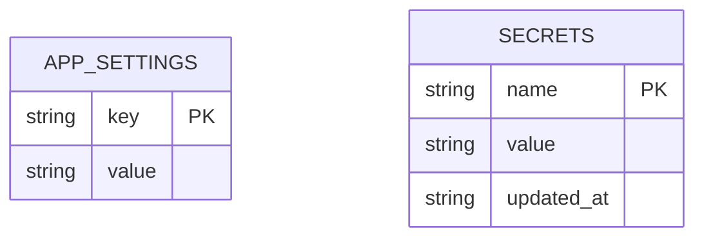
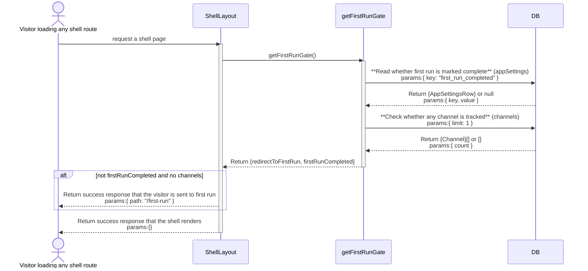
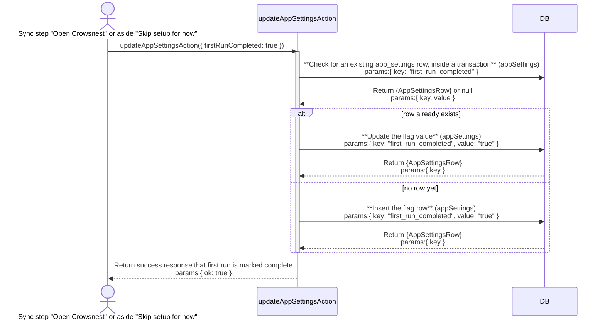
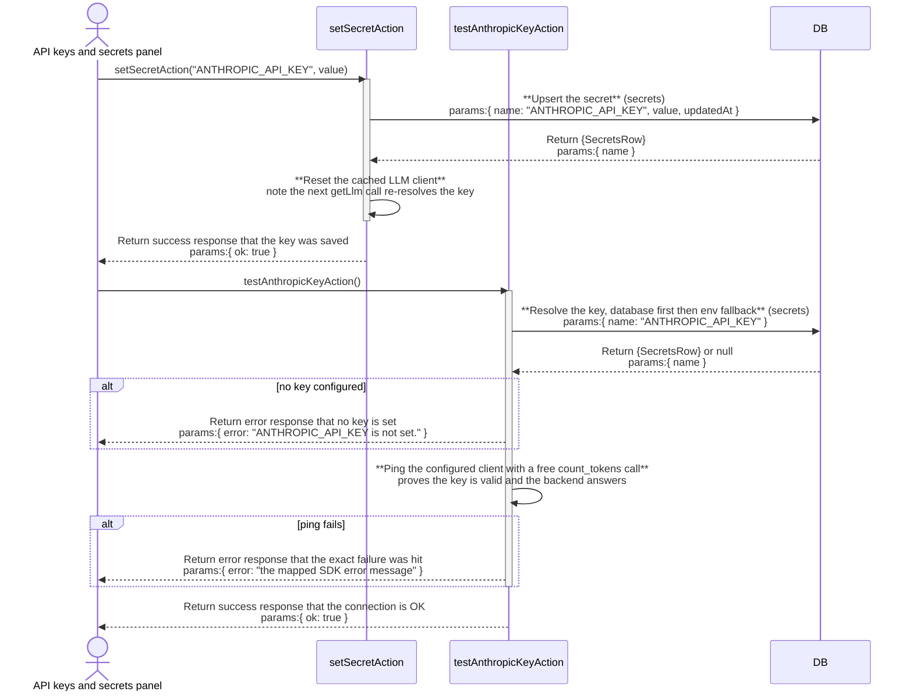
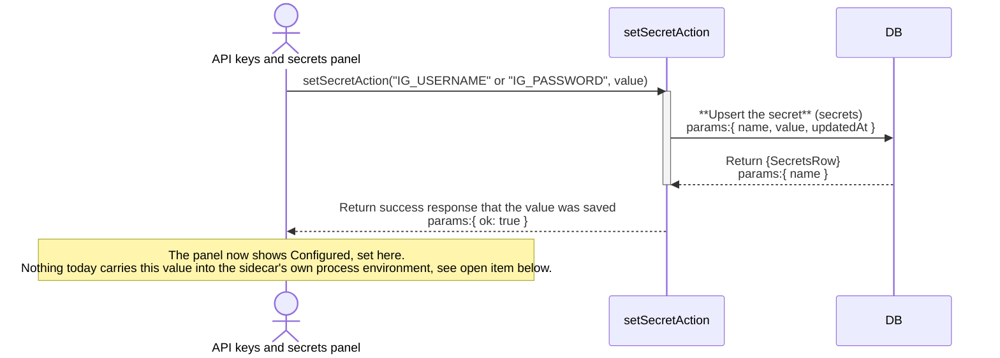
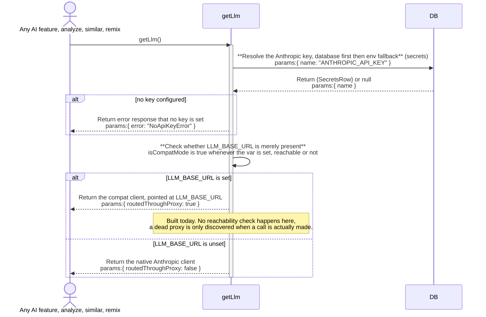

# onboarding: architecture

`documents/architect/core-components/onboarding/`

Status: shipped and in daily use, but two secret prompt defects in `kai kit init` (an empty `IG_PASSWORD`, a plaintext `ANTHROPIC_API_KEY` echo) block a clean buyer install.

## 1. Module structure

### The terminal half (`src/cli/kai.ts`)

| File | Export | Role |
| --- | --- | --- |
| `src/cli/kai.ts` | `cmdKitInit` | The `kai kit init` command. Requires a cached entitlement, writes `.env.local`, prompts for the Instagram account and the optional Anthropic key, creates the database, and hands off to `kai up`. |
| `src/cli/kai.ts` | `ask` | The one shared prompt helper. Its `secret: true` path hides typing on a real TTY by overriding `readline`'s `_writeToOutput`; both known onboarding defects live in this one function. |
| `src/cli/kai.ts` | `setEnv` | Replaces `NAME=...` in `.env.local`'s text in place, keeping surrounding comments and ordering, so a re run edits rather than overwrites. |

### The in-app half (`src/app/first-run/`, `src/components/first-run/`)

| File | Export | Role |
| --- | --- | --- |
| `src/app/first-run/page.tsx` | (default export, the route) | The `/first-run` route, a top level route deliberately outside `(shell)`, no sidebar, no topbar. `force-dynamic`; reads live settings and Instagram status on every visit; redirects a finished install back to `/`. |
| `src/components/first-run/onboarding-flow.tsx` | `OnboardingFlow` | The five screen client flow. Holds the current step in memory (`useState`), renders each step, and owns the persistent "Skip setup for now" control. |
| `src/components/first-run/onboarding-view.ts` | `canVerifyHandles`, `ONBOARDING_STEPS`, `ONBOARDING_STEP_COUNT`, `stepIndex`, `stepNavState` | Pure step ordering logic, kept out of the JSX so node only vitest can cover it. `onboarding-view.test.ts` is its test. |
| `src/components/first-run/welcome-step.tsx` | `WelcomeStep` | The unnumbered welcome screen. |
| `src/components/first-run/focus-step.tsx` | `FocusStep` | `01 FOCUS`. Saves the niche through `saveNicheSettingsAction`. |
| `src/components/first-run/connect-step.tsx` | `ConnectStep` | `02 INSTAGRAM`. The one real credential screen; wired to `getIgStatusAction`, `igLoginAction`, and its two factor and challenge branches. |
| `src/components/first-run/sources-step.tsx` | `SourcesStep` | `03 CHANNELS`. A handle in, handle out list; commits through `addChannelAction` on Continue. |
| `src/components/first-run/first-sync-step.tsx` | `FirstSyncStep` | `04 FIRST SYNC`. A thin wrapper around the shared `useSyncProgress` / `<SyncProgressPanel>`. |
| `src/server/queries/first-run-gate.ts` | `shouldRedirectToFirstRun`, `getFirstRunGate` | The route guard. `shouldRedirectToFirstRun` is the pure rule; `getFirstRunGate` is the async reader that runs it against the database. |
| `src/app/(shell)/layout.tsx` | (default export, the layout) | The caller of the gate. Redirects a fresh install to `/first-run` before any other shell query runs. |
| `src/components/settings/onboarding-section.tsx` | `OnboardingSection` | The "Replay first run" Settings control, which clears `first_run_completed` so the flow can be seen again. |

### Credential storage and LLM routing (features A and B)

Feature descriptions 5 and 6 in `03-feature-description.md`. These files carry the credential-save-and-validate path and the LLM key/route-resolution path; several are shared with Settings rather than owned by onboarding alone, since the first-run connect step and Settings' equivalent panels are the same code.

| File | Export | Role |
| --- | --- | --- |
| `src/server/secrets/store.ts` | `MANAGED_SECRETS`, `getSecret`, `setSecret`, `clearSecret`, `secretStatus`, `getOrCreateServiceToken` | The db-backed secret store: a value saved here wins over the matching env var (db-first, env-fallback). Plaintext in sqlite, never returned to the browser or logged. |
| `src/server/actions/secrets-actions.ts` | `setSecretAction`, `clearSecretAction`, `getSecretStatusAction`, `regenerateServiceTokenAction` | Settings' write/read surface over the store. Every export returns `{ ok }` or a `SecretStatus[]` (configured/source only), never a value. |
| `src/components/settings/secrets-section.tsx` | `SecretsSection` | The "API keys & secrets" panel. Anthropic key: save, then a separate live "Test". Groq key and both Instagram credential rows: save only, no live check. |
| `src/server/actions/settings-actions.ts` | `testAnthropicKeyAction` | The Anthropic key's live check: a real, free `count_tokens` call through the configured client, reporting the exact mapped failure on error. |
| `src/server/llm/client.ts` | `getLlm`, `hasLlmKey`, `isCompatMode`, `resetLlmClient`, `NoApiKeyError`, `AnthropicLlmClient`, `CompatLlmClient` | The one LLM client. `getLlm()` resolves the key through `getSecret` (throws `NoApiKeyError` if unset) and picks `CompatLlmClient` over the native one whenever `isCompatMode()` is true. `resetLlmClient()` is called on every secret save so a new key takes effect without a restart. |
| `src/server/config.ts` | `config` | Validates env once at boot. `LLM_BASE_URL` has no default *here* (only `.env.example` sets one); `config.ts` never treats it as required. |
| `.env.example` | (template) | Ships `LLM_BASE_URL=http://localhost:20128` uncommented, and `kai kit init` copies this file into every fresh `.env.local` without touching that line, so a proxy address is present by default even though the Kit installer never installs 9router. |
| `src/server/llm/router-control.ts` | `startRouter`, `stopRouter`, `routerReachable`, `routerPidAlive`, `waitForRouterHealthy` | Process supervisor for the local 9router proxy, pid-tracked, never a broad kill. Reachability is a plain HTTP GET against `LLM_BASE_URL`, any response counting as reachable. |
| `src/server/actions/router-actions.ts` | `startRouterAction`, `stopRouterAction`, `getRouterStatusAction` | Settings' 9router driver. `getRouterStatusAction` also makes one cooldown-gated auto-restart attempt when `routerAutoManage` is on and the proxy is unreachable. |
| `src/components/settings/router-section.tsx` | `RouterSection` | Start/Stop/Restart/Check controls for 9router, plus the "Auto-manage" toggle. Requires the `9router` binary to already be installed; none of these controls install it. |
| `src/components/status/dependency-status.ts` | `classifySidecarStatus`, `classifyLlmStatus`, `bothHealthy` | Pure classification of the sidecar and LLM backend into `up`/`down`/`reachable_unverified`/`not_configured`/`unknown`. `reachable_unverified` exists specifically because a proxy's `count_tokens` route can answer 200 without proving the model behind it generates anything. |
| `src/components/remix/generation-blocked.tsx` | `GenerationBlocked` (default export) | The Remix studio's blocked panel, keyed on a "no key" vs "proxy down" reason, with a link to Settings. |
| `src/server/sidecar/control.ts` | `startSidecar`, `stopSidecar`, `sidecarPidAlive`, `childEnv` (internal) | The dev-invoked Instagram sidecar process manager, driven by Settings' Start/Stop buttons. `childEnv()` (lines 20-32) already injects `IG_SERVICE_TOKEN`, `IG_USERNAME`, `IG_PASSWORD`, `IG_PROXY`, and `IG_DEVICE_SEED` from the secrets store into the spawned child's environment. Spawns via `uv run python -m crowsnest_ig`, so it depends on `uv` being on the machine, which a packaged buyer install does not guarantee. |
| `src/server/actions/sidecar-actions.ts` | `startSidecarAction`, `stopSidecarAction`, `sidecarProcessAliveAction` | Settings' sidecar driver over `control.ts`. Idempotent (a no-op success if the sidecar already answers); polls health after spawning rather than trusting `spawn()` alone. |
| `src/cli/service-darwin.ts` | `services`, `start`, `stop`, `running` | The packaged buyer path: writes and loads launchd plists for both long-lived processes. `services()` (line 32-37) hardcodes `env: {}` for `com.crowsnest.ig`, unlike `control.ts`'s `childEnv()` above, so this is the process a real Kit install's sidecar actually runs under, and it receives no credentials this way at all. |
| `services/ig/crowsnest_ig/config.py` | `load_config`, `load_env_file`, `Config` | The sidecar's own env loader. Reads its own process environment first, then `.env.local` (an already-set variable always wins over the file). Has no code path to the app's sqlite database or secrets store; `IG_USERNAME`/`IG_PASSWORD` are the only place it can get credentials from. |
| `src/server/actions/ig-actions.ts` | `igLoginAction`, `igLoginBySessionAction`, `getIgStatusAction` | `igLoginAction()` takes no arguments by design ("no action ever accepts a password"), signing in with whatever is already in the sidecar's own environment. `igLoginBySessionAction` is the one credential path that is both typed in the browser and live-validated: it persists the pasted `sessionid` as a managed secret and makes a real sidecar login attempt immediately. |
| `src/components/settings/instagram-section.tsx` | `InstagramSection` | Settings' Instagram panel: the session-token path (live-validated on Connect) and the env-based "Connect" button (calls `igLoginAction()`, no fields to type a username or password). |
| `src/components/first-run/connect-step.tsx` | `ConnectStep` | `/first-run`'s `02 INSTAGRAM` step. Same `igLoginAction()`/`getIgStatusAction()` surface as Settings; same absence of a username/password field. |

## 2. ER diagram

Onboarding owns no table of its own. It reads and writes `app_settings`, a plain key and value table shared by the whole app, and writes `channels` rows through the same `addChannelAction` the Channels page uses. `channels` is owned and diagrammed by [ig-sync](../ig-sync/02-architecture.md#2-er-diagram); it is not repeated here. The credential and LLM-routing path (features A and B) touches one more shared, ownerless table, `secrets`.

The keys onboarding cares about are `first_run_completed` (the flag the gate reads), and `niche_profile` and `niche_keywords` (written by the focus step, read back by Settings' Niche Profile section and by `services/remix.ts`). None of these keys are foreign keys; `app_settings` has no relation to any other table.

`secrets` (`src/server/db/schema.ts`) holds the eight `MANAGED_SECRETS` rows, one of which, `ANTHROPIC_API_KEY`, is what `getLlm()` resolves before every AI call, and two of which, `IG_USERNAME` and `IG_PASSWORD`, are the credential pair feature A is about. It carries no foreign key and no relation to `app_settings` or to any other table; the two tables are drawn side by side above because both feed the credential and routing path, not because they reference each other.

## 3. Indexes

`app_settings` carries no index beyond its `key` primary key (`src/server/db/schema.ts`). Every read onboarding does against it, the gate's flag check, the focus step's niche read, is a primary key lookup or a small `IN` list on that same key.

| Table | Index | Notes |
| --- | --- | --- |
| `app_settings` | (none, `key` PK) | Every read is a primary-key lookup or a small `IN` list on that same key. |
| `secrets` | (none, `name` PK) | Every read (`getSecret`, `secretStatus`) is a primary-key lookup or the eight-entry `MANAGED_SECRETS` scan; no other index exists. |

## 4. Data flow

**Terminal half, `kai kit init`.** `cmdKitInit` requires a cached entitlement first (`readEntitlement`, from the earlier `kai login`). It copies `.env.local` from `.env.example` (or edits it in place if present), prompts for `IG_USERNAME` then `IG_PASSWORD` (the latter through `ask(..., { secret: true })`, asked only when a username was given), generates `IG_SERVICE_TOKEN` if it is still the `change-me` placeholder, prompts for an optional `ANTHROPIC_API_KEY` (also `secret: true`), and asks for `VAULT_PATH` (default `~/.crowsnest/vault`), creating that directory. It writes `.env.local` at mode `0600` and `chmod`s it again (the file holds the Instagram password), then runs the database migrations and bootstrap through `node`/`tsx` directly, and finally hands off to `kai up`.

**The gate.** `src/app/(shell)/layout.tsx` calls `getFirstRunGate` before any other read. The rule (`shouldRedirectToFirstRun`) is compound on purpose: not `firstRunCompleted` and no channels tracked. A database that already has a `channels` row, a seeded dev database, or one that predates the flag, is treated as done even with the flag unset, so a real production database is never routed back into the wizard. Once `first_run_completed` is true it decides alone and stays true even if every channel is later removed. On a match the layout redirects to `/first-run` and the shell never renders.

**In-app half, `/first-run`.** `page.tsx` is the other half of that gate: it reads `getSettings()`, and if `firstRunCompleted` is already true it redirects straight to `/` rather than re running answered steps. Otherwise it reads the niche settings and the live Instagram status (`getIgStatusAction`) in parallel and renders `OnboardingFlow`. The five screens each write through an existing server action, not a new one: focus saves through `saveNicheSettingsAction`; connect signs in through `igLoginAction` and its `igChallengeChooseAction`, `igChallengeCodeAction`, `igTwoFactorAction` branches, read back through `getIgStatusAction`; sources commits through `addChannelAction` (idempotent per handle) only on Continue; sync runs the shared sync progress panel, then `updateAppSettingsAction({ firstRunCompleted: true })`.

**Finishing.** Both the sync step's "Open Crowsnest" and the aside's "Skip setup for now" write `first_run_completed` through the generic `updateAppSettingsAction` and then navigate to `/`. A plain link would bounce straight back through the gate on the zero channel install this screen exists for, so the flag write is what actually ends first run. "Skip" is deliberately available throughout, because the sources step's Continue only lights up once a real handle is added, and someone without one otherwise has nowhere to go.

**Credential save and validate (feature A).** `SecretsSection` calls `setSecretAction`, which writes straight into `secrets` through `setSecret`; nothing about the write itself distinguishes the Anthropic key from an Instagram credential. What differs is what happens after. For `ANTHROPIC_API_KEY`, saving resets the cached LLM client (`resetLlmClient()`), so the very next `getLlm()` call re-reads the new value, and a separate "Test" button runs `testAnthropicKeyAction`, a real `count_tokens` ping that reports success or the exact mapped failure. For `IG_USERNAME`/`IG_PASSWORD`, saving only ever updates the row: no code path reads it back into a running sidecar process. The one Instagram credential that is both typed in the browser and live-checked today is the session-token path, `igLoginBySessionAction`, which persists `IG_SESSIONID` and immediately attempts a real sidecar login with it. Username-and-password login has no such action; `igLoginAction()` takes no credential arguments and only ever signs in with whatever is already sitting in the sidecar process's own environment.

**LLM key and route resolution (feature B).** `getLlm()` is the one gate every AI call passes through: it throws `NoApiKeyError` if `getSecret("ANTHROPIC_API_KEY")` is empty (the keyless-degrade path), and otherwise decides between `AnthropicLlmClient` and `CompatLlmClient` purely on `isCompatMode()`, which is `Boolean(process.env.LLM_BASE_URL)`. Because `.env.example` ships that variable already set to `http://localhost:20128` and `kai kit init` never removes it, every fresh install is in compat mode by default, whether or not a 9router process is listening there. `getLlm()` performs no reachability check of its own; a dead proxy is only discovered when a real call is made and fails, which `dependency-status.ts` and the Remix studio's blocked panel then classify and report. Settings' 9router section can start, stop, restart, or auto-manage the proxy, but nothing in this path falls back to calling Anthropic directly when the proxy is absent or unreachable.

## 5. Sequence: the first run gate check

## 6. Sequence: finishing first run

## 7. Sequence: saving and validating a credential

Two shapes exist side by side today. The Anthropic key gets a save plus a real, separate, opt-in check:

`IG_USERNAME`/`IG_PASSWORD` get only the save, with nothing on the other end today:

The gap the second diagram ends on is the same one `service-darwin.ts` creates: the packaged sidecar's launchd job is given `env: {}`, so this saved row never reaches the process that would actually use it. `src/server/sidecar/control.ts`'s `childEnv()` already shows the shape the fix needs, injecting the same secrets into a spawned sidecar's environment, but that path is the `uv`-dependent dev launcher, not the launchd job a buyer's Kit install runs. Closing this gap, whether by threading the same secrets into the launchd plist's `EnvironmentVariables`, or by giving username/password its own live-validated action the way `igLoginBySessionAction` already does for the session token, is open, not built; see section 10.

## 8. Sequence: resolving the LLM key and route

What feature B needs and does not have yet: a third branch, taken when `LLM_BASE_URL` is set but `routerReachable()` says nothing answers there and a valid key exists, that falls through to the native `AnthropicLlmClient` instead of handing back a compat client pointed at a dead address. `getLlm()` has no such branch today, and nothing calls `routerReachable()` from inside it; that check currently exists only for Settings' 9router status panel and its own auto-restart. Whether the fallback lives inside `getLlm()` itself, or one level up in whichever server action calls it, is an open implementation decision; see section 10.

## 9. Key decisions

- **Two independent halves, joined only by `.env.local` and one flag.** The CLI never imports the app and the app never shells the CLI. The terminal half exists because the Instagram sidecar needs credentials on disk before the server can even reach it; the in-app half exists to get an empty install to a tracked channel and a first sync.
- **`/first-run` is its own top level route, not a `(shell)` child.** The shell's sidebar, topbar, and failure strip have nothing to orient here, and the shell's own gate would otherwise have to special case its way around itself. The flow is a full bleed two column screen instead.
- **The gate is compound, not just the flag.** This is the whole reason the gate exists: a real database with channels must never be routed back into a wizard. See `first-run-gate.ts`'s module doc.
- **Step state lives in memory, not the URL.** Nothing about which step the user is on needs to survive a reload independently of what each step already persisted server side; a reload mid flow re lands on welcome and re asks a question or two whose answers are already saved.
- **Every step reuses an existing server action.** No step introduces its own action; the connect step in particular shares Settings' Instagram surface rather than a copy, so re establishing a session later goes through the same code.
- **The connect step shows only the one real fact it has, the connected handle.** Follower and post counts are not shown because `getIgStatusAction` carries no such fields; per the no fabricated data rule, a capability the app lacks does not appear in the UI.
- **A secret save is db-first, env-fallback, and, for the Anthropic key only, resets the cached client on write.** This is what lets a key set in Settings take effect on the very next call with no restart; it applies to `ANTHROPIC_API_KEY` specifically because `getLlm()` is the one place the client is cached, not to any of the other seven managed secrets.
- **The live check on a secret is opt-in, separate from save, and exists for exactly one of the eight managed secrets today.** Only `ANTHROPIC_API_KEY` gets a "Test" button and only the session-token Instagram path gets a login attempt at save time; the other six, including `IG_USERNAME`/`IG_PASSWORD`, save blind. Feature A's job is to close that gap without breaking the "no action ever accepts a password" rule `ig-actions.ts` already enforces.
- **Two separate sidecar process managers exist, and only one of them wires credentials into the child.** `src/server/sidecar/control.ts` (the dev/Settings Start button, `uv`-dependent) injects the secrets store's values into the spawned process; `src/cli/service-darwin.ts` (the packaged buyer path, launchd) does not. Any fix has to either extend the launchd plist's env the same way, or replace the blind write with a live-validated action, not just copy `childEnv()`'s logic somewhere it still won't run for a buyer.
- **`isCompatMode()` is presence, not reachability.** Whether `LLM_BASE_URL` is merely set, not whether anything answers there, decides whether every AI call goes through a proxy. Combined with `.env.example` shipping that variable pre-filled, this is why a key alone is not sufficient today: feature B's contract is that it should be.

## 10. Open, not verified

- **The sidecar won't start onboarding bug** (`evidence/10-onboarding-bugs.md`, tracked as `ONB-1` in [05-backlog-to-enhance.md](05-backlog-to-enhance.md)): `kai kit init`'s masked `IG_PASSWORD` prompt returned empty on a real TTY, so `.env.local` was written with `IG_PASSWORD=` (length 0) while `IG_USERNAME` saved fine. The Instagram sidecar then refuses to start, "IG_USERNAME and IG_PASSWORD must be set together", exit 78 `EX_CONFIG`, and launchd's keepalive crash loops it, so port 8765 never comes up and Instagram sync is dead for the buyer with no onboarding time warning. Root cause is `ask`'s `secret` path in `src/cli/kai.ts`, which hides the terminal echo by overriding `readline`'s `_writeToOutput`; on a real TTY the value read back is empty. This is a hard blocker for a clean buyer install.
- **The plaintext key echo** (`evidence/10-onboarding-bugs.md`, tracked as `ONB-2`): the same `ask({ secret: true })` path fails to suppress the echo for the `ANTHROPIC_API_KEY` prompt on this TTY, so the key is visible on screen and lands in terminal scrollback. The key is still entered and saved correctly; the defect is only that it is not hidden. Not a functional blocker, a security and UX defect.
- **No Graph API path exists in the app today.** The panel for the user's own channel's Graph token was proposed but never built; the burner Instagram identity the sidecar reads and any future Graph token must never share code or an environment variable prefix. See [01-concept-brief.md](01-concept-brief.md).
- **A live Instagram connect through the `/first-run` connect step against real credentials has not been proven end to end** while `ONB-1` leaves the sidecar down on a real buyer install; the connect step's service down branch is what a buyer hitting `ONB-1` actually sees.
- **The dashboard redesign is partially built, tracked as `ENH-1` in [05-backlog-to-enhance.md](05-backlog-to-enhance.md).** The Anthropic key (save plus live test) and the Instagram session-token path (save plus live login attempt) are done. Username-and-password Instagram login from the dashboard is not: saving `IG_USERNAME`/`IG_PASSWORD` through "API keys & secrets" produces a "Configured" row that no running sidecar process ever reads. See sections 7 and 9.
- **The launchd job for the packaged Instagram sidecar passes no environment variables** (`src/cli/service-darwin.ts`, `services()`, the `com.crowsnest.ig` entry's `env: {}`). This is the exact seam feature A has to close for username/password: a value saved as a managed secret has no path into this process today. `src/server/sidecar/control.ts`'s `childEnv()` shows the injection shape already working for the separate, `uv`-dependent dev launcher, but nothing connects that shape to the launchd plist a buyer's install actually runs.
- **`isCompatMode()` treats `LLM_BASE_URL` being set as reachable, with no check.** Because `.env.example` ships that variable pre-filled and `kai kit init` never removes it, every fresh install routes through a proxy address by default, whether or not 9router is running there. Closing this is feature B's core problem, not yet built: `getLlm()` has no fallback to a direct Anthropic connection when the proxy is unreachable, and no code (`getLlm()` or a caller) currently calls `routerReachable()` before deciding which client to hand back.
- **No backlog id exists yet for "AI works with a valid key and no 9router running."** `03-feature-description.md` section 6 states this as a behavior contract, not a fact yet true of the running app: today a valid key with an unreachable proxy fails as a clearly labeled "down" state, never a silent success.
