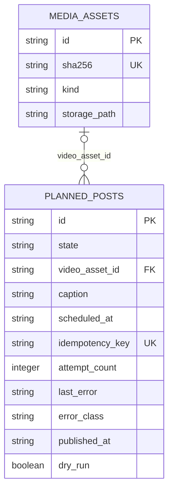
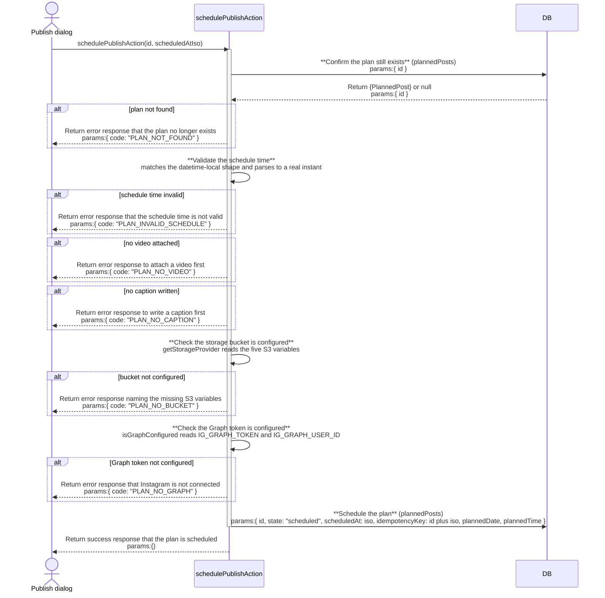
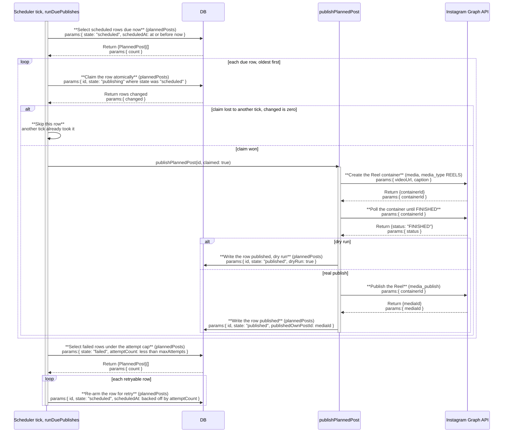

# publish: architecture

`documents/architect/core-components/publish/`

Status: shipped. The instagrapi fallback path is a seam only, off by default and unbuilt; launchd hardening for the scheduler is not built.

## 1. Module structure

| File | Export | Role |
| --- | --- | --- |
| `src/server/db/schema.ts` | `plannedPosts` (extended) | Adds `videoAssetId`, `caption`, `scheduledAt`, `idempotencyKey`, `attemptCount`, `lastError`, `errorClass`, `publishedAt`, `dryRun` to the table [mine](../mine/02-architecture.md) already owned, and widens `state` to include `publishing` and `failed`. |
| `src/server/queries/planned-posts.ts` | `PlannedPostState` (widened), `PlannedPostRow` (extended), `getPlannedPosts`, `getPlannedPostById` | `PlannedPostState` grows to `draft \| scheduled \| publishing \| missed \| published \| failed`. `toRow` keeps `published`, `publishing`, and `failed` as stored, never re-deriving them to `missed`; only a plain `scheduled` row with a past `plannedDate` still derives to `missed`. |
| `src/server/publish/storage-provider.ts` | `StorageProvider`, `S3StorageProvider`, `getStorageProvider` | The public-URL seam. `S3StorageProvider` signs its own PUT/DELETE requests by hand (AWS4-HMAC-SHA256), since the repo has no AWS SDK dependency. `getStorageProvider()` returns `null` when any of the five `S3_*` variables is missing. |
| `src/server/graph/client.ts` | `createReelContainer`, `pollReelContainer`, `publishReel` (added to the existing client) | The three Graph Reels publish steps, built on the same `graphRequest` transport, token redaction, and `GraphApiError` classification the existing read-only Insights calls already use. |
| `src/server/graph/errors.ts` | `GraphApiError`, `GraphErrorCode`, `GraphErrorClass` (extended) | Adds `GRAPH_CONTAINER_FAILED` and `GRAPH_TIMEOUT` to the existing code list, each mapped to an `errorClass` (`container`, `timeout`) the publish service and scheduler store directly. |
| `src/server/services/publish-post.ts` | `publishPlannedPost`, `PublishPostResult`, `PublishErrorClass` | Publishes exactly one claimed row: upload, create container, poll, publish (skipped on dry run), delete the uploaded object, write the terminal state. Idempotent on a row already `published` or `failed`; a `publishing` row is only acted on with `claimed: true`. |
| `src/server/services/publish-scheduler.ts` | `runDuePublishes`, `startPublishScheduler`, `defaultBackoffMs`, `DEFAULT_MAX_ATTEMPTS` | One tick: claim due `scheduled` rows with the atomic `UPDATE`, hand each claimed row to `publishPlannedPost`, then re-arm `failed` rows under the attempt cap with a backed-off `scheduledAt`. `startPublishScheduler` wraps it in a reentrancy-guarded `setInterval`. |
| `server.ts` | (entry point, not exported) | The only place `startPublishScheduler()` is called, guarded so a scheduler start failure never stops the HTTP server from listening. Never runs under tests or the CLI. |
| `src/server/actions/planned-post-actions.ts` | `uploadPlanVideoAction`, `setPlanCaptionAction`, `schedulePublishAction`, `cancelScheduledPublishAction`, `publishNowAction`, `retryFailedPublishAction` (added to the existing action set) | The six lifecycle writes. Every precondition (video attached, caption written, bucket configured, Graph configured) is checked and named at this layer before any state changes. |
| `src/components/mine/publish-dialog.tsx` | `PublishDialog` | Upload an mp4, write a caption, pick a date and time, then Schedule (a date and time are set) or Publish now (they are not). Renders the not-configured and dry-run surfaces inline. |
| `src/components/mine/confirm-dialog.tsx` | `ConfirmDialog` | A designed destructive confirm shared by "cancel scheduled publish" and "delete a plan carrying a video", replacing the browser's native confirm. |
| `src/components/mine/mine-calendar.tsx` | `MineCalendar` (extended) | Renders the publish lifecycle on the calendar cell (scheduled/publishing/failed/published) and the day detail panel (scheduled-at line, publishing pulse, failed error plus Retry, published mark), and owns opening `PublishDialog` and `ConfirmDialog`. |
| `src/app/(shell)/mine/page.tsx` | `MinePage` (extended) | Resolves `bucketConfigured`, `graphConfigured`, and the dry-run flag once per page load and passes them into `MineCalendar`, mirroring `envDefaultsDryRun()` in `publish-post.ts` so the dialog's dry-run banner and `publish-post.ts`'s own default agree without a second source of truth. |

## 2. ER diagram

`planned_posts`' other relationships (`script_id`, `remix_session_id`, `source_video_id`, and the un-declared `published_own_post_id` link to `own_posts`) belong to mine and are drawn in the [mine ER diagram](../mine/02-architecture.md#2-er-diagram); this diagram covers only the columns publish added. `media_assets` is shown as a stub entity, its full shape owned by the media store, not by this component; publish only holds a nullable reference to it through `video_asset_id`.

## 3. Indexes

| Table | Index | Notes |
| --- | --- | --- |
| planned_posts | planned_posts_idempotency_key | Unique on `idempotencyKey` (`postId:scheduledAt`). Makes a stale scheduler tick and a fresh reschedule structurally unable to both claim the same publish attempt, a guarantee the atomic claim's `WHERE state='scheduled'` alone does not give across a reschedule. |

`planned_posts_date`, the plain index on `plannedDate` the calendar's month-range read uses, is documented in [mine's architecture doc](../mine/02-architecture.md#3-indexes); publish writes through it (`schedulePublishAction` keeps `plannedDate`/`plannedTime` in sync with `scheduledAt`) but did not add it.

## 4. Data flow

**Attach and write.** `uploadPlanVideoAction` takes the uploaded mp4 as `FormData`, buffers it to a temp file, and hands it to the existing content-addressed media store (`getAssetStore().put`), the same seam every other asset in crowsnest goes through; no new media infrastructure exists for publish. `setPlanCaptionAction` trims and caps the caption at Instagram's 2200-character ceiling before it is ever stored, so a caption Graph would reject never reaches the schedule step.

**Schedule.** `schedulePublishAction` checks, in order, that the schedule time parses, a video is attached, a caption is written, the storage bucket is configured, and the Graph token is configured, refusing with a distinct error code at the first one that fails and touching no row until every check passes. On success it writes `state: "scheduled"`, `scheduledAt` (the real instant, converted from the browser's local `datetime-local` value), and `idempotencyKey`, and keeps `plannedDate`/`plannedTime` in sync so the plan still renders on the calendar's month grid.

**The scheduler tick.** `runDuePublishes` selects `scheduled` rows whose `scheduledAt` has passed, oldest first, capped at 10 per tick. For each candidate it claims the row with the single atomic `UPDATE ... SET state='publishing' WHERE id=? AND state='scheduled'`; zero rows changed means another tick already took it, and the candidate is skipped, never retried in the same tick. A successful claim is handed to `publishPlannedPost(id, { claimed: true })`. After the claim pass, the tick separately re-arms `failed` rows under the attempt cap back to `scheduled` at a backed-off time, entirely independent of the claim pass above.

**The publish itself.** `publishPlannedPost` resolves the plan's video to a real local path (verified against disk, not just the database row), uploads it through the configured storage provider, creates a Reel container against the resulting public URL, polls the container until Instagram reports `FINISHED` (bounded at 30 attempts, 2 seconds apart), then either stops there on a dry run or calls the final publish edge. The uploaded object is deleted in every case, success, dry run, or failure, inside a `finally` block; a delete failure is logged and swallowed, since it must never flip an otherwise-successful publish to failed. Every precondition and every failure writes a terminal `failed` state with an `errorClass` and a `lastError`; there is no path that leaves a row silently stuck mid-attempt from `publishPlannedPost`'s own logic; the "stuck in publishing" state described in the key decisions below can only happen if the whole process is killed between the claim and this function's own terminal write.

**Publish now.** `publishNowAction` runs the same preconditions as scheduling, then claims the row itself with an atomic `UPDATE ... WHERE state IN ('draft','scheduled','failed')`, exactly the same no-double-publish guard the scheduler uses, before calling `publishPlannedPost` directly with `claimed: true`.

## 5. Sequence: scheduling a publish

## 6. Sequence: the scheduler tick

The container-creation and polling steps above can each throw a typed `GraphApiError`; `publishPlannedPost` catches either and writes `failed` with that error's `errorClass` instead of reaching the dry-run or real-publish branch, a path this diagram omits for readability but the error-class table in [01-concept-brief](01-concept-brief.md#3-key-concepts) covers.

## 7. Key decisions

- **The Graph API, not instagrapi, is the primary publish path.** Reels are URL-based on the Graph API (create a container against a public URL, poll, publish); instagrapi drives Instagram's private mobile API and would mean a second live session, on the creator's real account, carrying the same ban risk the burner-account sidecar already accepts for reading. A Graph-API-first design keeps the one real, valuable account off the private API entirely.
- **A pluggable public-URL provider, not a binary upload endpoint.** Because the Graph API fetches from a URL, something has to host the file publicly for the few minutes a container needs it. An S3-compatible bucket (Cloudflare R2 by default, since the Kit's own worker already uses that account) is the smallest correct answer; the object is deleted the moment the container has consumed it, so the bucket never accumulates published videos.
- **Hand-rolled SigV4, not the AWS SDK.** The repository has no AWS SDK dependency, and a presigned-PUT-and-DELETE client is a few dozen lines of well-defined signing logic, not a reason to add a large dependency for one seam. This is called out in `storage-provider.ts` as the one corner of that file that is not cut for brevity, since a wrong signature is a silent 403 rather than a compile error.
- **The atomic claim, not a lock table, is the concurrency guarantee.** `UPDATE ... WHERE state='scheduled'` returning zero rows changed is the entire mechanism behind "never publish twice"; no separate lock row, no in-memory mutex. The same shape backs `publishNowAction`'s claim, so a scheduled tick and a hand click racing the same row cannot both win.
- **`claimed` is a caller assertion, not a re-derived fact.** `publishPlannedPost` trusts `claimed: true` from a caller that itself just won the atomic claim; it does not re-check the claim inside the function, because the claim already happened at the caller and re-checking would only be racing against itself. A row that reaches `publishing` any other way (a crashed process) is left alone by every caller that does not pass `claimed: true`, rather than guessed at.
- **Retry is scheduler policy, publish-post never retries itself.** `publishPlannedPost` writes `failed` and stops; deciding whether that failure gets another attempt, and when, is entirely `runDuePublishes`'s job, kept in one place rather than duplicated into every caller of the publish service.
- **Dry run exercises the whole real path except the last call.** Running upload, container creation, and polling for real, and only skipping `media_publish`, means a dry run proves everything except the one irreversible step, rather than mocking the transport and hoping the real path behaves the same way.
- **Not-configured is a named, disableable state, never a fabricated success.** `schedulePublishAction` and `publishNowAction` both check the bucket and the Graph token before touching the row, and the dialog disables its one primary action and states exactly which variable is missing, following the same pattern `GraphConnectPanel` already established for mine's read-only Insights.

## 8. Open, not verified

- **Whether a live Reel publish against a real Business or Creator account behaves exactly as this document describes**, including Instagram's actual container processing time and its real rate-limit behavior under repeated scheduling. The client, the polling loop, and the error classification are read from code and from the Graph API's documented shape; Round 0's evidence is a dry-run capture, not a completed live publish.
- **Whether a process killed between the atomic claim and `publishPlannedPost`'s own terminal write leaves a `publishing` row that nothing currently re-claims.** The claimed-flag guard is confirmed by reading the code; no automatic recovery path re-arms a row stuck in `publishing` after a crash, and this is not exercised by a real kill-and-restart in this rewrite (see [05-backlog-to-enhance](05-backlog-to-enhance.md)).
