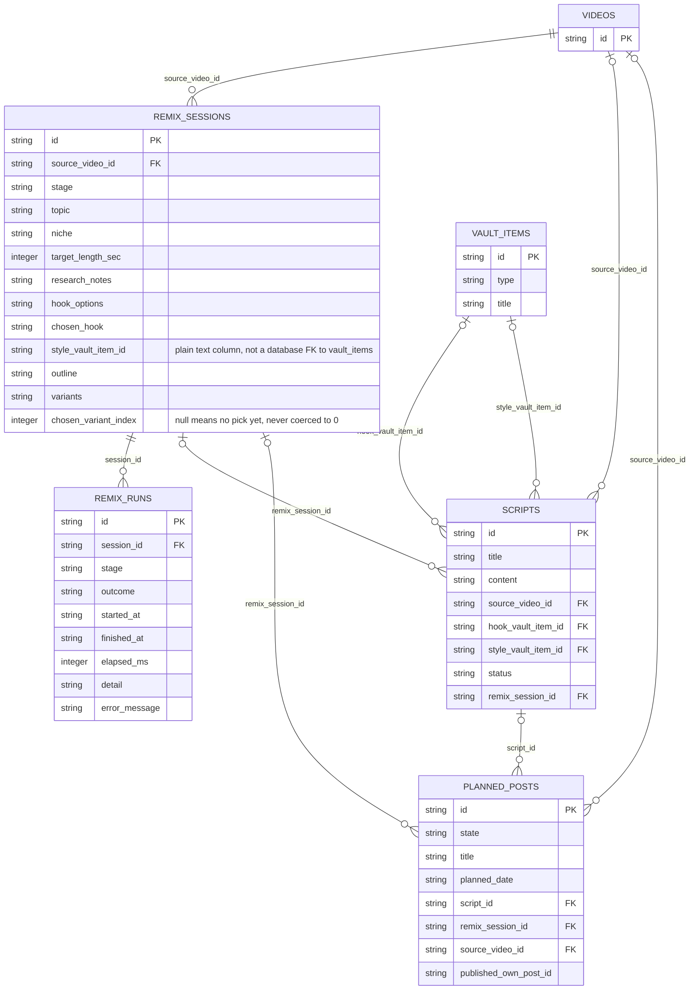
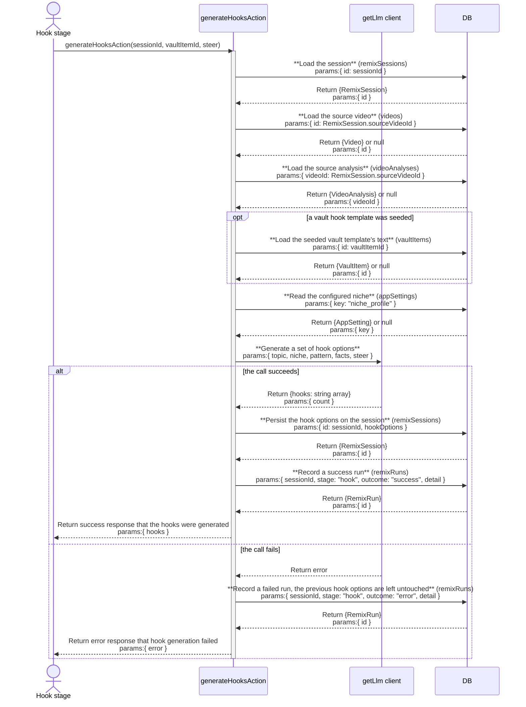

# remix: architecture

`documents/architect/core-components/remix/`

Status: shipped and in daily use, with three known bugs open (a failed research assembly can strand the stage on its loading skeleton, regenerating the outline leaves stale script variants in place with no warning, and Quick Remix is not blocked when the model proxy is down the way the other generation controls are).

## 1. Module structure

### The client shell and stages (`src/components/remix/`)

| File | Export | Role |
| --- | --- | --- |
| `remix-studio.tsx` | `RemixStudio` | The client shell. Holds the session row in local state, tracks the active stage versus the furthest reached, owns Back, Restart, Continue, and Quick Remix, and re reads the run log after each generation. |
| `stage-prompt.tsx` | `StagePrompt` | The topic, niche chip, target length, and Quick Remix button. |
| `stage-research.tsx` | `StageResearch` | Renders the assembled research and the editable facts box. |
| `stage-hook.tsx` | `StageHook` | Generates and picks a hook; the vault seed select and the option cards. |
| `stage-style.tsx` | `StageStyle` | Generates and edits the outline; the structure select and the beat rows. |
| `stage-script.tsx` | `StageScript` | Generates, edits, saves, and plans the three script variants. |
| `stage-finish.tsx` | `StageFinish` | The read only summary and the "Finish and open studio" button. |
| `stepper.tsx` | `STAGES`, `STAGE_ORDER`, `Stepper` | The six stage segments; `STAGE_ORDER` is the array `RemixStudio` indexes into for Back, Continue, and the furthest-stage gate. |
| `context-rail.tsx` | `ContextRail` | The source video panel shown on every stage. |
| `run-log.tsx` | `RunLog` | Renders the run log rows the studio fetched. |
| `run-log-view.ts` | `runTone`, `runToneLabel`, `formatRunElapsed`, `isConnectionFailure`, `isProxyLikelyDown` | Pure view logic, unit tested separately from the component: classifies a run as success, partial, or failed, and decides whether the last few runs look like the model proxy is unreachable. |
| `generation-blocked.tsx` | `GenerationBlocked` | The block panel a generation stage swaps its whole surface for, on a missing key or an inferred proxy-down state. |
| `steer-box.tsx` | (component) | The note field under a generation stage's results that reruns the generation with the note folded in. |
| `grounded-in.tsx` | (component) | The line naming which inputs a generation call will actually use. |
| `autosave.ts` | `autosave` | Wraps a fire-and-forget server action call so a failed background save surfaces as a toast instead of vanishing silently. |
| `deep-link.ts` | `resolveDeepLinkSeed` | Pure, unit tested mapping from a vault template card's `?hook=` / `?style=` query params to which stage the studio opens on and which session fields to seed. |

### The server side (`src/server/`)

| File | Export | Role |
| --- | --- | --- |
| `services/remix.ts` | `getOrCreateSession`, `updateStage`, `buildResearch`, `generateHooks`, `generateOutline`, `generateVariants`, `saveScript`, `finishRemix`, `quickRemix`, `seedSessionFromIdea`, `getRemixSession`, `getNicheProfile` | All real logic. Fully unit tested (`remix.test.ts`). |
| `services/prompts/remix-prompts.ts` | `HOOK_SYSTEM`, `OUTLINE_SYSTEM`, `SCRIPT_SYSTEM`, `buildHookUser`, `buildOutlineUser`, `buildScriptUser` | The system and user prompt builders for the three generation stages, plain strings with no framework dependency. |
| `actions/remix-actions.ts` | `getOrCreateSessionAction`, `updateStageAction`, `buildResearchAction`, `generateHooksAction`, `generateOutlineAction`, `generateVariantsAction`, `saveScriptAction`, `finishRemixAction`, `quickRemixAction`, `getRemixRunLogAction`, `deleteScriptAction` | Thin `"use server"` wrappers, one per stage action, each returning a discriminated `{ ok }` result and mapping `NoApiKeyError` to the "add your key" message. |
| `queries/remix-runs.ts` | `getRemixRunLog`, `RemixRunRow` | Read only run-log query, newest first by `startedAt`. `remix.ts` is the only writer of `remixRuns`. |
| `db/schema.ts` | `remixSessions`, `remixRuns` | The two tables remix owns outright; it also writes `scripts` and `plannedPosts`, owned jointly with the vault and the plan. |
| `app/(shell)/feed/[videoId]/remix/page.tsx` | (page) | The server entry. Loads the video detail, gets or creates the session, and reads the vault hooks, vault styles, saved posts, and niche in one `Promise.all`, then hands them to the studio. Resolves the `?hook=` / `?style=` deep-link params from a vault template card. |
| Reads from | `services/similar.ts` (`getSimilarOutliers`), `services/persona.ts` (`getPersona`), `services/analyze.ts` (`rowToAnalysis`), `llm/client.ts` (`getLlm`, `hasLlmKey`), `lib/script-title.ts` (`deriveScriptTitle`) | Upstream services remix calls into but does not own. |

## 2. ER diagram

`remixSessions.styleVaultItemId` is a plain text column with no `.references()` call in `schema.ts`, so it carries no database foreign key even though it holds a `vault_items.id` by convention; only `scripts.styleVaultItemId` is a real, enforced reference to `vault_items`. `scripts.hookVaultItemId` is always written null today: `remixSessions.chosenHook` stores the picked hook's raw text, not a vault item id, so nothing currently links a saved script back to the vault hook that shaped it.

## 3. Indexes

| Table | Index | Notes |
| --- | --- | --- |
| remix_runs | remix_runs_session_started | Plain index on `(session_id, started_at)`; backs the run log's newest-first read per session. |
| planned_posts | planned_posts_date | Plain index on `planned_date`; backs the calendar's date-ordered read, shared with every other writer of this table, not remix specific. |

`remix_sessions` and `scripts` carry no indexes beyond their primary key. `getOrCreateSession` finds the latest session for a video with a plain `WHERE source_video_id = ? ORDER BY updated_at DESC LIMIT 1` scan rather than an index; the table is expected to stay small, one row per remixed video, so this has not needed one.

## 4. Data flow

**Session.** One `remix_sessions` row per source video. `getOrCreateSession` reuses the latest by `sourceVideoId` or inserts a fresh row at stage `prompt`. The row is a mutable scratchpad: `topic`, `niche`, `targetLengthSec`, `researchNotes` (JSON), `hookOptions` (JSON), `chosenHook` (raw text), `styleVaultItemId`, `outline` (JSON stringified into a text column), `variants` (JSON), and `chosenVariantIndex`. Every stage autosaves into it through `updateStage`, which sets only the fields present in a partial patch, so nullable fields like `styleVaultItemId` and `chosenVariantIndex` can be cleared, not just set.

**Research.** `buildResearch` makes no model call. It reads the source `video_analyses` row, a transcript excerpt capped at 500 characters, and the top 5 similar outliers, writes them to `researchNotes`, and returns them. That is why the research stage works with no key and the proxy down.

**Generation.** `generateHooks`, `generateOutline`, and `generateVariants` each read the session, build a prompt from `remix-prompts.ts` (grounded in the source's `hookType`, structure segments, and why it worked, plus topic, niche, and facts, with the persona appended), call the model via `getLlm()`, persist the result to its own column, and record a `remix_runs` row inside their own try/catch so a row lands on both success and failure. Variants generate in parallel via `Promise.allSettled`; a rejected slot becomes an error at its index and only successful slots persist. A single-slot regenerate reads and rewrites just that slot. `isProxyLikelyDown` scans the last three run log rows for a connection failure to decide the generation-blocked posture.

**Finish.** `finishRemix` is the one durable non-generation write and is idempotent. It finds the most recent `planned_posts` row linked to the session, runs `reconcileAttachedScript` (writes a `scripts` row matching the current chosen variant, or reuses a matching one), then reuses that plan or inserts a new undated draft plan, and returns its post id for the link into `/mine/{postId}/studio`.

**Quick Remix.** `quickRemix` runs research, then hooks (auto picking the first), then outline, then variants, sequentially, and lands the session at stage `script`, every earlier stage still reachable.

## 5. Sequence: generating a set of hooks

`generateOutline` and `generateVariants` follow the same shape: load the session, load whatever the prompt needs (analysis, a seeded vault style item for outline, the session's own outline for variants), call the model, persist on success, and record a run row on both outcomes. `generateVariants` differs only in that it calls the model up to three times in parallel through `Promise.allSettled` rather than once, and a whole-set call replaces the persisted `variants` array with whichever slots succeeded while a single-slot regenerate writes only that one slot.

## 6. Key decisions

- **One session per source video, reused on return.** Mirrors analyze's cache-or-create shape. Resuming where the buyer left off is the intended UX, so `getOrCreateSession` keys on `sourceVideoId` and orders by `updatedAt`.
- **`remix_runs` is its own table, not a JSON column.** A run log is an append-only sequence of independent facts; a JSON blob would mean reading the whole history to append one row and would race the session's own frequent field writes. It is the studio's status surface, and it survives a Restart (which only resets `stage`) and a reload by construction.
- **The session is disposable; the script and plan carry copies.** `saveScript` and `reconcileAttachedScript` copy the chosen variant's text into `scripts.content`, so a deleted session costs only the "which run made this" provenance, since the foreign key is `set null`.
- **`chosenHook` and `chosenVariantIndex` never fabricate a default.** `chosenHook` stores raw text, not a vault item id, so nothing links a saved script back to a seeding vault hook. `chosenVariantIndex` null is a real state, never coerced to 0, so finish shows an explicit "(no variant picked yet)" rather than plausible words the buyer never chose.
- **Proxy down is inferred from the run log, not a live ping.** A connection style error in the last three attempts marks the generation stages blocked; the next success clears it.
- **All logic lives in `remix.ts`; actions are thin wrappers.** The service is fully unit tested (`remix.test.ts`); the `"use server"` layer only maps errors and shapes results.

## 7. Open, not verified

- **Whether a truly concurrent double finish on a session with no plan can both insert.** `finishRemix` reads the most recent linked plan before deciding to insert, and there is no unique constraint on `planned_posts.remix_session_id` backing that read; two finishes racing at the database level, rather than the disabled-button case one browser tab already prevents, have not been proven safe.
- **Whether the known bugs in [05-backlog-to-enhance.md](05-backlog-to-enhance.md) reproduce exactly as described against a live LLM proxy.** The stuck research skeleton, the stale-variants-after-outline-regenerate gap, and Quick Remix skipping the proxy-down block are read from the code paths involved, not from a reproduced run against a real proxy outage.
- **Whether a Kit-installed buyer's remix generation completes end to end against the real Anthropic API with no local proxy.** This depends on the [llm layer](../llm/01-concept-brief.md), whose own open questions cover the no-proxy path.
