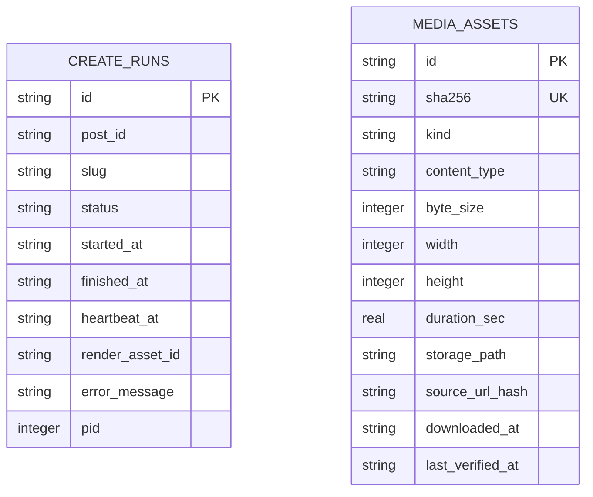
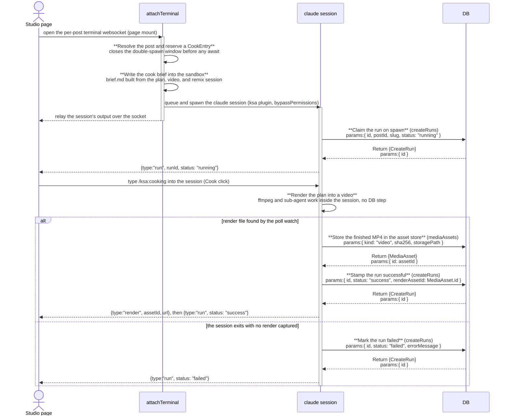

# studio: architecture

`documents/architect/core-components/studio/`

Status: shipped and in daily use for the cook, publish, and save to calendar loop; a few of the live displays do not survive a reload (see backlog).

## 1. Module structure

| File | Export | Role |
| --- | --- | --- |
| `src/app/(shell)/mine/[postId]/studio/page.tsx` | (route) | `force-dynamic` so `getStudioBrief` re-reads the plan and video on every visit; a post id with no plan is a 404. |
| `src/server/queries/studio.ts` | `getStudioBrief`, `StudioBrief`, `StudioRemix` | Composes the brief from three existing single record loaders: the plan (`getPlannedPostById`), the source video detail (`getVideoDetail`), and the remix session the plan came from (`getRemixSession` plus that session's own video analysis, loaded by `sourceVideoId` rather than reused from `video`, in case a hand edited plan points at a different source video than the remix used). |
| `src/components/studio/studio-screen.tsx` | `StudioScreen` | The three pane shell. Renders the Brief pane server side (title, video kind chip, score badge, script line, source outlier link, per beat Visual direction or "Frame pass not run."), then mounts `StudioPanel`. |
| `src/components/studio/studio-panel.tsx` | `StudioPanel` | The client pane pair. Owns the Cook and Stop button, the run pill, the elapsed clock, the captured render, and the Publish and Save to calendar controls. Renders only what the terminal websocket reports; it never starts a session itself. |
| `src/components/studio/terminal-pane.tsx` | `TerminalPane`, `TerminalHandle` | The xterm.js pane. Opens the per post websocket on mount, before any user action, and relays keystrokes and output. Forwards `render` and `run` server frames up to the panel through `onRender`/`onRun`. |
| `src/server/terminal/ws.ts` | `attachTerminal` | The server side of that websocket. Resolves the post, reserves a `CookEntry`, writes `brief.md`, queues and spawns the cook session, claims and updates the `create_runs` row, watches for the render, and keeps the session alive across a detached socket. |
| `src/server/terminal/session.ts` | `createTerminalSession`, `scrubbedTerminalEnv`, `TerminalSession` | Spawns the `claude` binary under `node-pty` with a scrubbed environment (every `CLAUDE_CODE_*` key stripped, so the child never inherits this process's own session markers). |
| `src/server/terminal/harness-profile.ts` | `buildHarnessArgs`, `buildCookProfile`, `KSA_PLUGIN_DIR`, `COOK_SETTING_SOURCES` | Builds the CLI arguments for a cook session: `--permission-mode bypassPermissions`, `--setting-sources ""` (loads no settings files, so no inherited hook fires), `--plugin-dir` pointed at the `ksa` plugin, `--model` from `COOK_MODEL`. |
| `src/server/terminal/cook-queue.ts` | `runOnCookQueue` | One process wide `p-queue` (`COOK_CONCURRENCY`, default 2) so simultaneous cooks degrade gracefully instead of starting unbounded pty processes at once. |
| `src/server/terminal/session-registry.ts` | `CookEntry`, `getCookEntry`, `putCookEntry`, `dropCookEntry`, `setCookEntryWs`, `writeCookInput`, `flushCookInput` | The per postId registry that lets a session, its watchdog, and its render watch outlive the socket that spawned it. Input typed before the session's first output (the REPL prompt) is queued, not dropped, and flushed on first output or a fallback timer. |
| `src/server/terminal/render-watch.ts` | `watchForRender`, `pruneOldRenders`, `rendersRoot` | Polls the renders directory every 700ms for this post's `video.mp4`, firing once its size holds steady across two ticks. Polling, not `fs.watch`, because macOS's recursive FSEvents watcher can miss the event that lands right after it attaches. |
| `src/server/terminal/resolve-post.ts` | `getPlannedPostTitleById` | Resolves a post's title, which the sandbox path is derived from. |
| `src/server/studio/write-brief.ts` | `writeBrief` | Serializes the cook's richer `brief.md` (chosen hook and variant, persona, source transcript, per beat layout) into the run sandbox, preferring the remix's chosen script variant over the plan's attached script row. |
| `src/server/studio/paths.ts` | `slugify`, `sandboxDir`, `rendersDir`, `rendersRoot` | Path helpers under `config.WORKSPACE_ROOT`, where `brief.md` and the render land. |
| `src/server/actions/create-run-actions.ts` | `startCreateRunAction`, `stopCreateRunAction`, `getPublishStateAction` | `startCreateRunAction` claims a `running` row (called from inside the spawn task, not from a user click). `stopCreateRunAction` signals the tracked pid's process group and marks the row canceled. `getPublishStateAction` is the mount time gate the panel reads to survive a reload. |
| `src/server/queries/create-runs.ts` | `getCreateRun`, `getLatestCreateRunForPost`, `updateCreateRun`, `reconcileOrphanCreateRuns` | The `create_runs` query layer. `reconcileOrphanCreateRuns` runs once at server startup and fails any `running`/`waiting` row whose pid is no longer alive, since a cook's pid dies with the server process that spawned it. |
| `src/app/api/media/[assetId]/route.ts` | `GET`, `HEAD` | Serves the captured render (and every other stored asset) from `MEDIA_ROOT` with byte range support; a missing row or a missing file is always a bare 404. |
| `src/app/(shell)/runs/page.tsx`, `src/app/(shell)/runs/[runId]/page.tsx` | (routes) | The Runs screen, which lists and details `create_runs` rows alongside sync and remix runs through `queries/runs.ts`. Owned by [background jobs](../../shared/background-jobs.md), not by the studio. |

## 2. ER diagram

`create_runs.post_id` and `create_runs.render_asset_id` are plain text columns with no `.references()` call in `schema.ts`, unlike most cross table columns in this schema, so there is no drizzle enforced foreign key from `create_runs` to `planned_posts` or to `media_assets`, and no relationship line is drawn above. The link is enforced only at the application layer: `getLatestCreateRunForPost` filters `create_runs` by `postId`, and `getPublishStateAction` reads `render_asset_id` and hands it straight to `/api/media/{assetId}`.

## 3. Indexes

| Table | Index | Notes |
| --- | --- | --- |
| create_runs | create_runs_post | Plain index on `post_id`; backs `getLatestCreateRunForPost` and the Runs screen's per post lookup. |
| create_runs | create_runs_started | Plain index on `started_at`; orders the Runs screen's job history. |
| media_assets | media_assets_sha256 | Unique on `sha256`; a re download or re render of identical bytes collapses to one row and one file, so cache headers can be immutable. |

`create_runs` carries no unique index: a post can accumulate many rows over repeated page visits, since a fresh spawn happens on every terminal websocket attach, not only on a click of Cook.

## 4. Data flow

**Brief.** The route awaits `getStudioBrief(postId)`, 404s on null, and passes the result to `StudioScreen`, which renders the Brief entirely server side. No external service is touched; the brief is a database read.

**Spawn, not Cook click.** Mounting the studio page mounts `TerminalPane`, which opens the per post websocket immediately, before the user has clicked anything. On the server, `attachTerminal` reserves a `CookEntry` for the postId synchronously (closing the double spawn window), awaits `writeBrief` into the sandbox, then queues the spawn on `runOnCookQueue`. The queued task spawns the `claude` binary under `node-pty` with the `ksa` plugin loaded, and fires `startCreateRunAction` the moment the pty exists, claiming a `running` `create_runs` row and pushing it back as a `{type:"run",...}` frame. This claim happens on every fresh attach, independent of whether Cook has been clicked; a page reload that reopens the socket claims a fresh row. A second attach for the same post while one is already live reattaches to the existing `CookEntry` instead of spawning a second session.

**Cook click.** The Cook button's only job is `inject("/ksa:cooking")`, which sends the slash command as plain input over the already open socket. `writeCookInput` holds any input that arrives before the session's first output (the REPL prompt has not printed yet) and flushes it once real output proves the REPL is listening, or on an 8 second fallback timer, so a fast click right after mount is never swallowed. The panel's own elapsed clock starts counting from the first `run` frame it sees, which in the common case arrives from the spawn above, not from the click.

**Render and publish gate.** When `render-watch` finds the MP4 (its size steady across two 700ms polls), `ws.ts` stores it via the asset store, updates the run to `success` with the `render_asset_id`, and sends a `render` frame that fills the Output rail. Publish is gated two ways: the live `render` capture, and `getPublishStateAction`, which the panel reads once on mount off the latest run's stored `render_asset_id` so Publish survives a reload. Save to calendar has the stricter gate, it needs the live in session `render`, so a reload disables it while Publish stays on.

**Watchdog and waiting.** A 6 hour watchdog (`COOK_WATCHDOG_MS`) kills a hung session. A separate check flips the run to `waiting` once output has been quiet past 20 seconds (`WAITING_IDLE_MS`) while the row is still `running`, clearing the watchdog while a human is expected to be reading a prompt; any new output flips it back to `running` and re-arms the watchdog. Both checks re-read the row before writing, so a `Stop` that already wrote `canceled` in the same window is never stomped back to `running` or `waiting`.

**Stop.** `stopCreateRunAction` signals the tracked pid's whole process group (`process.kill(-pid)`) so ffmpeg and sub-agent children die with the cook, then marks the row `canceled` whether or not a live process was found, a run whose process already exited still ends canceled rather than stuck at `running`.

**Publish and save.** Publish opens a native confirm, then `inject("/ksa:serve")`; the app writes nothing and the button does not change. Save to calendar calls `markPlanPublishedAction(postId, null)` in a transition.

## 5. Sequence: one cook run

Every arrow between the UI and the Worker after the initial mount crosses the same websocket `attachTerminal` set up; there is no second request. `Terminal` is shown active only for its own synchronous setup, the ongoing relay of keystrokes and output is the same connection, described in prose above rather than redrawn per frame.

## 6. Key decisions

- **The session spawns on socket attach, not on the Cook click.** Mounting the terminal pane opens the websocket immediately, and the server spawns the cook and claims a `create_runs` row right then. Cook only types a slash command into an already running session. This is proven by a passing test (`ws.test.ts`, "claims a create_runs row when the cook spawns and sends a running run frame"), which calls `attachTerminal` directly with no Cook click involved.
- **A cook outlives its socket.** The session, watchdog, render watch, and teardown controller live in a `session-registry` `CookEntry` keyed by postId, not in the socket's closure. Closing a tab detaches the viewer; it never kills the cook. A later attach for the same post reattaches and re-sends the latest run status rather than spawning a second.
- **Publish gates on a persisted `render_asset_id`, not client state.** The render is captured into the asset store and stamped on the run row, so `getPublishStateAction` can re-enable Publish after a reload from the database alone.
- **`brief.md` is written from real columns only.** `writeBrief` prefers the remix's chosen variant over the plan's attached script row, and omits any section with no backing field rather than printing an invented hook, angle, or outline. A layout row in the old flat shape is treated as absent, not pinned onto beats it never described.
- **Save to calendar marks with a null own post id.** `markPlanPublishedAction(postId, null)` is the legal "it went out, I'm not linking it" call; it stores `state: "published"` directly, so the plan reads as published even with no linked own post (B-01, fixed). The own post id is still recorded when one is given.
- **No settings files, no plugin except `ksa`.** `--setting-sources ""` loads no settings.json at any scope, so no inherited SessionStart hook fires inside the cook session, and every `CLAUDE_CODE_*` environment key is stripped before spawn so the child never mistakes itself for a nested session of the one that spawned it.

## 7. Open, not verified

Per [05-backlog-to-enhance](05-backlog-to-enhance.md) and [04-test-cases](04-test-cases.md):

- **B-06**, a reload during a live cook loses the panel's pill and clock (the session continues server side and still gates Publish); the reattach path re-sends the latest status, but the panel does not restore the live view.
- **B-13**, after a reload Publish stays enabled off the stored render while Save to calendar disables (no live capture), so the two disagree.
- **B-17b**, the on screen brief omits the remix hook and chosen variant; they reach only the cook's `brief.md`.
- **Whether the pill and Stop button can appear before Cook is ever clicked.** Because the session spawns and claims a running row on socket attach, and the panel renders the pill and switches to Stop whenever `run !== null` regardless of the client side `started` flag, a run frame that arrives while the user is still reading the brief would show a pill and a Stop button with no Cook click having happened. This follows from reading `ws.ts` and `studio-panel.tsx` together but has not been observed against the running app.
- No frame pass is wired up in this build, so Visual direction reads "Frame pass not run." for essentially all real plans, and the per beat rows are unverifiable by hand.
