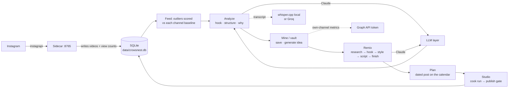

# High-level architecture

The whole crowsnest system in one view: what runs on the buyer's Mac, how the core loop moves
data through it, and where it reaches past the local machine. This is the map; each component
under `core-components/` and each cross-cutting reference under `shared/` carries the detail,
and this document links to them rather than repeating them.

## The one-sentence shape

Crowsnest is a single-user desktop product that runs entirely on the buyer's own Mac: a Next.js
app and a local SQLite database, fed by an Instagram sidecar, calling a language model with the
buyer's own key, and installed and supervised by a small CLI (`kai`). There is no server
crowsnest owns and no second seat. The four things that reach off the machine (generation, own-
channel metrics, transcripts, and the sidecar's Instagram fetch) all degrade to a labeled
unavailable state rather than blocking the app; that contract is owned in full by
[external-services](shared/external-services.md).

## The pieces

| Piece | What it is | Runs as | Detail |
| --- | --- | --- | --- |
| **Next.js app** | The UI and the server actions behind it — feed, video detail, remix studio, calendar, studio runs, mine, settings. | A Node process on `localhost:3000`, launched through a custom `server.ts`. | Every component's `03-feature-description.md` |
| **SQLite database** | The single source of truth. Videos, analyses, saved posts, remix sessions, scripts, planned posts, create/cook runs, saved views, the niche. | A file at `data/crowsnest.db` (WAL mode), state symlinked to `~/.kai/state`. | [data-model](shared/data-model.md), [persistence](shared/persistence.md) |
| **Instagram sidecar** | A local service (instagrapi) that logs in as the buyer, tracks channels, and pulls posts, reels, and view counts that feed outlier scoring. | A background service on `localhost:8765` under launchd, authed by `IG_SERVICE_TOKEN`, credentialed by `IG_USERNAME`/`IG_PASSWORD`. | [ig-sync](core-components/ig-sync/01-concept-brief.md), [background-jobs](shared/background-jobs.md) |
| **LLM layer** | The language-model calls behind analysis and remix, using the buyer's `ANTHROPIC_API_KEY` (optionally through a local proxy). | In-process in the Next.js app. | [llm](core-components/llm/01-concept-brief.md) |
| **Kit / `kai` CLI** | Install, license gate, and lifecycle: `login`, `kit init`, `up`, `start`, `stop`, `status`, `doctor`, `update`. | A CLI (`src/cli/kai.ts`) plus launchd agents for the app and the sidecar. | [kit](core-components/kit/01-concept-brief.md), [packaging-and-release](shared/packaging-and-release.md) |

## The core loop, end to end

The one paragraph, drawn as data flow. An outlier appears because the sidecar synced a tracked
channel; the buyer analyzes it; a remix takes that analysis through its stages to a script on a
dated plan; the studio cooks that plan into a rendered video; the buyer publishes it or marks it
handled.

Everything in the loop reads and writes the same local database, so a service being down removes
only the one step that needs it and leaves the rest working (see the degradation contract in
[external-services](shared/external-services.md)). The sidecar is the only writer of new videos;
the LLM is needed only by analyze and remix; the Graph token only by the own-channel metrics on
the mine page; a transcript only by analysis of a video that has none stored.

## Where the machine reaches off-box

Five external dependencies, each with a defined down-state. The full table (what needs it, what
the user sees when it is down, whether the rest of the loop keeps working) lives in
[external-services](shared/external-services.md); the one-line summary:

- **Instagram** (via the sidecar) — new videos. Down → the feed goes stale, never errors.
- **Anthropic API key** — every generation and every analysis. Missing → those surfaces show a
  block/alert; everything else works.
- **LLM proxy** (optional local override) — routes generation. Down → generation stages block,
  inferred from the run log, not pinged.
- **Graph API token** — own-channel metrics on the mine page. Missing → a connect panel; history
  still shows.
- **Transcript providers** (whisper.cpp local, or Groq) — a transcript for a video that has none.
  None reachable → analyze dead-ends; a stored transcript sidesteps it entirely.

Polar sits outside the loop: it gates the download and activates the license once, at install
and `kai login`, and is never called again by the running app (see [kit](core-components/kit/02-architecture.md)).

## Cross-cutting references (`shared/`)

The concerns that cut across every component, each owned once so the component docs can link
rather than re-explain:

| Reference | Owns the question |
| --- | --- |
| [data-model](shared/data-model.md) | What tables exist and how they relate |
| [persistence](shared/persistence.md) | What survives a reload; server vs URL vs client state |
| [background-jobs](shared/background-jobs.md) | The sidecar sync and the cook run — the two async jobs |
| [external-services](shared/external-services.md) | The five off-box dependencies and their down-states |
| [status-and-failures](shared/status-and-failures.md) | The shell failure strip and how errors surface |
| [navigation-and-shell](shared/navigation-and-shell.md) | The app shell, the first-run gate, routing |
| [interaction-model](shared/interaction-model.md) | The shared arrive / act / finish pattern |
| [data-contracts](shared/data-contracts.md) | The shapes passed between server and client |
| [packaging-and-release](shared/packaging-and-release.md) | How a Kit is built, gated, and shipped |
| [db-recovery](shared/db-recovery.md) | Restoring the database after a bad migration |
| [glossary](shared/glossary.md) | The terms this documentation set uses |

## Platform boundaries

Apple Silicon only in v0.2: `install.sh` refuses a real Intel Mac with a refund pointer, and the
one OS-specific module is `src/cli/service-darwin.ts` (launchd). Intel, Windows, and Linux are
scoped as one new platform file each, not a rewrite. Instagram is the only tracked source today;
the `platform` column stays in the schema so TikTok or YouTube Shorts is additive. Both are in
[roadmap](../business-requirement/roadmap.md) as later work, entirely in packaging and the
sidecar, not in the loop above.
