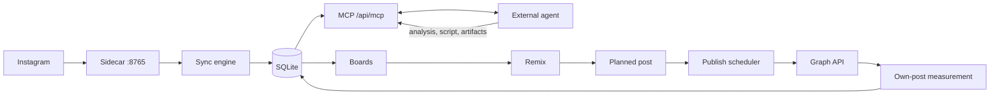

# Architecture overview

Crowsnest is a single-user product that runs on the user's own Mac. One Electron app, Lead Studio, owns a local SQLite database and runs crowsnest's server code in its main process. A Python sidecar fetches Instagram. An external agent (Claude or Codex) does the reasoning over MCP. A small CLI (`kai`) installs and supervises the packaged Kit. There is no server that crowsnest operates and no second seat.

This page is the map. Each part has its own page with the data it holds, its boundaries and its invariants.

## The shell

The app is Orca's workspace (terminal, chat, browser tab, split panes, the agent table) under the Lead Studio identity; see [app](app.md). The Next.js screens (Tuần này, Feed, Kênh, Khám phá, Cài đặt) are deleted; Lead Studio boards replace them one step at a time. Their data, server actions and MCP tools remain. See [DESIGN.md](../../DESIGN.md).

## The parts

| Part | What it is |
| --- | --- |
| [app](app.md) | The Electron app: the workspace, the server in its main process, the MCP port and `cn-media:`. |
| [ig-sync](ig-sync.md) | The Python sidecar and the Node sync engine that fill the feed with videos and scores. |
| [discover](discover.md) | A curated directory of creators to follow, and the first-run seed picker. |
| [feed](feed.md) | The ranked outlier feed, filter bar, saved views and the video detail page. |
| [analyze](analyze.md) | Stores a video's analysis. Authored by the external agent through MCP. |
| [remix](remix.md) | The six-stage studio that turns an analyzed video into a script. |
| [mine](mine.md) | The user's own channel: the Tuần này week planner and Graph measurement. |
| [publish](publish.md) | Scheduled and immediate publishing of a planned post through the Graph API. |
| [mcp](mcp.md) | The in-process MCP server that exposes the data and the keyless remix chain to an agent. |
| [onboarding](onboarding.md) | The first-run gate and credential entry between `kai up` and a working feed. |
| [kit](kit.md) | The `kai` CLI, license gate, packaging, update and launchd services. |

Cross-cutting pages:

- [data](data.md): tables, persistence rules, multi-account model, database recovery.
- [jobs-and-failures](jobs-and-failures.md): the background jobs and how failure is shown.
- [external-services](external-services.md): every dependency that can be down, and what happens then.
- [glossary](glossary.md): the terms used across the docs.

## Process model

In development the app starts with `pnpm dev` and the sidecar with `pnpm run ig:service`. An installed Kit runs two launchd agents instead (`src/kai-cli/service-darwin.ts`).

| Process | What runs inside |
| --- | --- |
| Lead Studio app | The window, the workspace, and crowsnest's `src/server` in the main process: the MCP on a free 127.0.0.1 port written to `<userData>/mcp.port`, `cn-media:` assets, and the timers below. It opens the checkout's `data/crowsnest.db`. |
| Instagram sidecar | `services/ig`, instagrapi on `127.0.0.1:8765`, authed by a shared token from the secrets store. The only code that logs in to Instagram. |
| Headless server (Kit only) | `server.ts`: the same MCP at `/api/mcp` and all three timers on `PORT`, with no window, under the `com.crowsnest.server` LaunchAgent. |

There is no separate worker process. Background work runs inside the app:

- **Pulls** run only when the operator presses Pull on a Settings > Sources card: the IG sidecar card runs a library sweep, the Instagram Graph card measures the user's own posts on a call budget. Nothing pulls on a timer or on start (`src/server/services/connector-status.ts`).
- **Publish scheduler** claims due scheduled posts and publishes them. The app starts it only with `LEAD_STUDIO_PUBLISH_JOBS=1` (`src/server/start.ts`).
- **Frame pass** spawns the local Claude Code CLI with a read-only tool allowlist to read sampled frames of one video (`src/server/services/claude-task.ts`).

A scheduler that fails to start never stops its host (`startJobs` in `src/server/start.ts`).

## How data flows

1. A sync reads recent posts per tracked channel through the sidecar and writes `videos` rows with an outlier score against the channel's own baseline.
2. The app reads those rows directly from SQLite in its main process.
3. An agent reads the same data over MCP, reasons in its own process, and writes back an analysis, a remix script or a content artifact. The boards and the MCP tools call the same query and service functions.
4. A script is attached to a planned post. The publish scheduler sends it to the user's own account through the Graph API. Pull on the Instagram Graph card then reads performance back.

## System-wide invariants

- **Crowsnest holds data and runs deterministic actions; the agent reasons.** No core flow needs a model key. See [decision 0002](../decisions/0002-data-and-action-brain.md).
- **Everything degrades, nothing blocks.** A down service removes the one feature that needs it and leaves the rest working. See [external-services](external-services.md).
- **One writer per kind of data.** Only the sync engine writes `videos` and `channels` stats. Only a Graph measurement writes the `own_*` tables. Own posts never enter the outlier feed (`src/server/db/schema.ts`).
- **Rows are soft-deleted when anything hangs off them.** Videos and channels carry `deletedAt`; nothing is hard-deleted by a sync.
- **Actions never throw across the boundary.** Server actions return `ActionResult` (`src/server/lib/action-result.ts`), so the caller lands on a success or an error.
- **Secrets stay server-side.** They are sealed by the macOS Keychain or come from the environment, are read only through a connector manifest, are never returned to the renderer, and are redacted from logs ([connectors](connectors.md), `src/server/lib/logger.ts`).
- **Only forward migrations.** There is no down migration, and `db:migrate` backs up first. See [data](data.md).
- **Settings have one reader.** User-editable settings are read through `src/server/settings/index.ts` (database over environment over default). Fixed startup config lives in `src/server/config.ts`, and some modules read their own env overrides directly.

## Platform

Apple Silicon only. The Kit bundle targets `darwin-arm64` (`packaging/platforms.json`) and the one OS-specific module is `src/kai-cli/service-darwin.ts`. Instagram is the only tracked platform; the `platform` column stays text so another source is additive.
