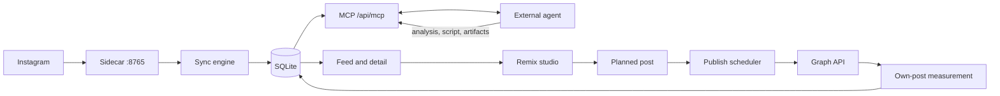

# Architecture overview

Crowsnest is a single-user product that runs on the buyer's own Mac. A Next.js app owns a local SQLite database. A Python sidecar fetches Instagram. An external agent (Claude or Codex) does the reasoning over MCP. A small CLI (`kai`) installs and supervises the two long-lived processes. There is no server that crowsnest operates and no second seat.

This page is the map. Each part has its own page with the data it holds, its boundaries and its invariants.

## The shell

The sidebar has three items: Tuần này (`/`), Nguồn (`/feed`, with link tabs Feed, Kênh at `/channels`, and Khám phá at `/channels/discover`), and Cài đặt (`/settings`, with tabs Cấu hình and Nhật ký sự cố, the latter holding Log at `/logs` and Lần chạy at `/runs`). The rail and tab definitions are `src/components/layout/nav-items.ts` and `section-tabs.tsx`. The Persona, Ideas, Vault, and Dashboard screens and `/mine` are gone: their paths redirect to `/` (`next.config.ts`), and their data and MCP tools remain. See [DESIGN.md](../../DESIGN.md).

## The parts

| Part | What it is |
| --- | --- |
| [ig-sync](ig-sync.md) | The Python sidecar and the Node sync engine that fill the feed with videos and scores. |
| [discover](discover.md) | A curated directory of creators to follow, and the first-run seed picker. |
| [feed](feed.md) | The ranked outlier feed, filter bar, saved views and the video detail page. |
| [analyze](analyze.md) | Stores a video's analysis. Authored by the external agent through MCP. |
| [remix](remix.md) | The six-stage studio that turns an analyzed video into a script. |
| [mine](mine.md) | The user's own channel: the Tuần này week planner and Graph measurement. |
| [publish](publish.md) | Scheduled and immediate publishing of a planned post through the Graph API. |
| [mcp](mcp.md) | The in-process MCP server that exposes the data and the keyless remix chain to an agent. |
| [onboarding](onboarding.md) | The first-run gate and credential entry between `kai up` and a working feed. |
| [kit](kit.md) | The `kai` CLI, license gate, packaging, update and launchd services. |

Cross-cutting pages:

- [data](data.md): tables, persistence rules, multi-account model, database recovery.
- [jobs-and-failures](jobs-and-failures.md): the background jobs and how failure is shown.
- [external-services](external-services.md): every dependency that can be down, and what happens then.
- [glossary](glossary.md): the terms used across the docs.

## Process model

Two launchd agents run on an installed Kit (`src/cli/service-darwin.ts`). In development the same two processes start by hand (`npm run dev`, `npm run ig:service`).

| Process | Label | What runs inside |
| --- | --- | --- |
| Next server | `com.crowsnest.server` | `server.ts` on port 3000, loopback only when packaged. Serves the UI and server actions, serves `/api/mcp` in the same process, and boots three timers (below). |
| Instagram sidecar | `com.crowsnest.ig` | `services/ig`, instagrapi on `127.0.0.1:8765`, authed by a shared token from the secrets store. The only code that logs in to Instagram. |

There is no separate worker process. Background work runs inside the Next server:

- **Sync scheduler** starts a library sweep when the `syncCadenceMinutes` setting has elapsed since the newest `sync_jobs` row.
- **Publish scheduler** claims due scheduled posts and publishes them.
- **Own-measure scheduler** measures the user's own posts through the Graph API on a call budget.
- **Frame pass** spawns the local Claude Code CLI with a read-only tool allowlist to read sampled frames of one video (`src/server/services/claude-task.ts`).

A scheduler that fails to start never stops the server from listening (`server.ts`).

## How data flows

1. A sync reads recent posts per tracked channel through the sidecar and writes `videos` rows with an outlier score against the channel's own baseline.
2. The feed and detail pages read those rows directly from SQLite.
3. An agent reads the same data over MCP, reasons in its own process, and writes back an analysis, a remix script or a content artifact. The app UI and the MCP tools call the same query and service functions.
4. A script is attached to a planned post. The publish scheduler sends it to the user's own account through the Graph API. The own-measure scheduler then reads performance back.

## System-wide invariants

- **Crowsnest holds data and runs deterministic actions; the agent reasons.** No core flow needs a model key. See [decision 0002](../decisions/0002-data-and-action-brain.md).
- **Everything degrades, nothing blocks.** A down service removes the one feature that needs it and leaves the rest working. See [external-services](external-services.md).
- **One writer per kind of data.** Only the sync engine writes `videos` and `channels` stats. Only a Graph measurement writes the `own_*` tables. Own posts never enter the outlier feed (`src/server/db/schema.ts`).
- **Rows are soft-deleted when anything hangs off them.** Videos and channels carry `deletedAt`; nothing is hard-deleted by a sync.
- **Actions never throw across the boundary.** Server actions return `ActionResult` (`src/server/lib/action-result.ts`), so the client lands on a success or an error toast.
- **Secrets stay server-side.** They live in the `secrets` table or the environment, are never returned to the browser, and are redacted from logs (`src/server/secrets/store.ts`, `src/server/lib/logger.ts`).
- **Only forward migrations.** There is no down migration, and `db:migrate` backs up first. See [data](data.md).
- **Settings have one reader.** User-editable settings are read through `src/server/settings/index.ts` (database over environment over default). Fixed startup config lives in `src/server/config.ts`, and some modules read their own env overrides directly.

## Platform

Apple Silicon only. The Kit bundle targets `darwin-arm64` (`packaging/platforms.json`) and the one OS-specific module is `src/cli/service-darwin.ts`. Instagram is the only tracked platform; the `platform` column stays text so another source is additive.
