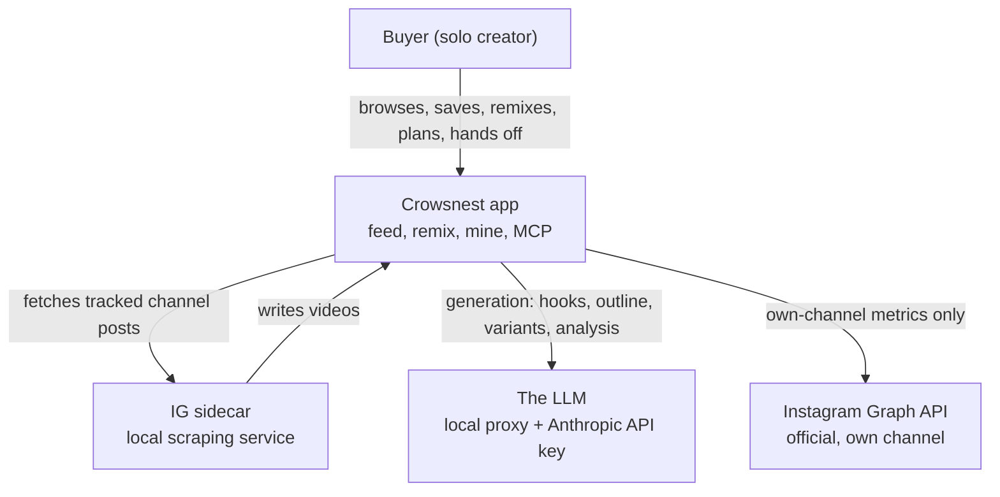

# Crowsnest concept and research

## Index

| § | Section | Covers |
| --- | --- | --- |
| 0 | Document control | Document id, version, audience |
| 1 | Executive summary | What crowsnest does for a solo creator, and where the product stands |
| 2 | The problem | Tracking Instagram outliers by hand, and why the app exists to replace that |
| 3 | Who it serves | The persona: a solo creator running crowsnest alone, on one Mac |
| 4 | Actor model | The buyer, the app, the IG sidecar, the LLM |
| 5 | The core loop | Feed, sync, analyze, remix, the MCP handoff, and where the app's own boundary sits |
| 6 | Market context | The buyer's market, the Kit distribution model, and what is still open |
| 7 | Sources | Every product-description file and archive brief used above |

---

## 0. Document control

| Field | Content |
| --- | --- |
| Document ID | CN-BRD-01-CONCEPT |
| Version / Status | v0.2 / Draft |
| Date | 2026-09-02 |
| Audience | The solo founder who runs crowsnest daily, anyone evaluating whether a behavior is intended, and a future buyer of the Kit |
| Product context | Crowsnest is a $99 one-time Mac Kit. It tracks Instagram creators, surfaces viral outliers, analyzes them with a language model, and runs a remix pipeline that turns an outlier into a script. Local-first, single local user, Instagram only, Apple Silicon only in this version. |
| Reference documents | `docs/product-description/` (goal.md, README.md, foundations/, feed/, remix/, studio/, mine/, cross-cutting/, glossary.md); `documents/archive-do-not-read/product/{V1-BRIEF.md,v1-scope.md,WAVE2-BRIEF.md}` for scope framing only; `documents/architect/shared/packaging-and-release.md` for the Kit; `character-spec.md` at HEAD (checked, see the note in section 3) |
| Change log | v0.2 (2026-09-02): first authored concept research for crowsnest, migrated from the product-description prose into `documents/business-requirement/brd/crowsnest/`. |

---

## 1. Executive summary

Crowsnest is, from the buyer's side, a single tool that closes the loop from "something on Instagram beat its own channel" to "I have a script in my own voice, dated on my calendar, and a brief ready to hand off for production." It is sold once, for $99, as a Mac Kit: a buyer gets a Polar license key, runs one install command, and the app runs entirely on their own machine against their own local database. There is no server crowsnest owns, no subscription, and no account beyond the license check.

The product description in `docs/product-description/` frames this precisely as a state chart: a single local user moves through the outlier feed, a video's detail page, the remix studio, and the calendar and channel dashboard called "mine", with clicks, generations, and one background sync, then hands the finished remix off through crowsnest's MCP server for production. That path, feed to remix to script to planned post to the MCP handoff, is what the product itself calls the core loop, and it is the entire subject of this document.

As of v0.2, the core loop and the Kit that installs it are both shipped and in daily use by the founder. The product description that grounds this research (`docs/product-description/README.md`) states its own purpose plainly: there is no single place that says, in plain language, what happens when the user does X, and what happens if they stop halfway. This concept research, and the use case document that follows it, are that plain-language account, reshaped for a business audience rather than a product one.

**What is solid.** The core loop, all six remix stages, the sidecar sync, the MCP handoff, and the Kit's install and licensing are described end to end in the source material and are running product, not a plan. **What is thin by design.** Onboarding (first run setup) and the settings and logs surfaces are explicitly out of scope for the product description and are documented only as a gate the shell redirects to; see the roadmap for what is planned there.

---

## 2. The problem

A solo creator who wants to post well on Instagram needs to know what already works, on channels other than their own. Doing that by hand means opening a dozen competitor and reference accounts, scrolling for anything that clearly beat that account's usual numbers, working out why it worked, and then trying to write something similar in your own voice. Nothing about that process is saved, compared, or repeatable. It is a manual habit, not a tool.

Two problems follow from doing this by hand, and they are the two halves of what crowsnest replaces:

1. **Finding the outlier is a scanning problem.** A single post's raw view count means little on its own; what matters is whether it beat that account's own baseline. Without a computed score, a creator either eyeballs it or ends up assuming an account's biggest post is automatically its best idea. Crowsnest computes an outlier score for every tracked post, "how far a video outperforms its own channel's baseline, shown as a multiplier," and ranks and filters the feed on it (`glossary.md`, `feed/feed.md`).
2. **Turning it into a script is a rebuilding problem.** Even once a creator has spotted a post that worked, rebuilding its hook, its structure, and its pacing in their own voice, from a phone, by hand, is slow and easy to skip. Crowsnest's remix studio takes one source video through six stages, research, hook, style, script, and finish, and produces a script and a dated plan without the creator writing the analysis themselves (`remix/remix-overview.md`).

The founder's own framing of the one job crowsnest does states this directly: "Find a video that beat its channel's own baseline. Take its hook, its script and its layout. Rebuild it in Kai's style. Everything either serves that or gets out of the way." (`documents/archive-do-not-read/product/V1-BRIEF.md`, used here for scope framing only). That one sentence is the problem and the product in one line: a solo creator, alone, needs a repeatable way to find what beat a baseline and rebuild it, instead of scrolling and guessing.

A rule that runs through the whole product and is worth stating as part of the problem itself: a research tool that shows a number the user cannot trust is worthless. Crowsnest's own product rule is that a value it does not have renders as a dash, never a fabricated zero or an invented figure (V1-BRIEF.md, and echoed throughout `docs/product-description/`, for example the engagement rate and reach figures in `feed/feed.md` and `glossary.md`). Solving "find and rebuild an outlier" with a tool that sometimes lies would not solve the problem; it would just move the guessing from the feed to the tool.

---

## 3. Who it serves

**The persona.** Crowsnest serves one kind of user: a solo content creator who posts on their own Instagram channel and wants to learn from other accounts, competitors and references alike, without doing the scanning by hand. The product description names this user directly and repeatedly as "the solo founder who runs it" (`README.md`), and the scope decisions are explicit that there is "one person, one machine... no roles or plans" (`README.md`, scope decisions). The archived V1 brief and scope documents, used here only for framing, name this same user as Kai and describe exactly the daily habit crowsnest replaces: opening the app in the morning, seeing which watched posts beat their own channel overnight, reading why one worked, saving it, and turning it into a script (`documents/archive-do-not-read/product/v1-scope.md`).

The buyer of the $99 Kit is the same persona, one step removed: another solo creator who wants the same daily habit on their own channel and their own tracked list, running the same app on their own Mac. Nothing in the product description or the Kit's packaging suggests a team, a client-facing use, or a second seat; the license is a single Polar key per machine and the app has no concept of a second user (`documents/architect/shared/packaging-and-release.md`).

> **Note on the persona source.** This document's sourcing instructions point at `character-spec.md` at HEAD for persona detail. Reading it directly: the file is an unfilled visual character-design reference chart (a "character identity fixed reference chart" template, in Vietnamese, for locking down a drawn character's eyes, hair, palette, and pose sheet). Every field in it is blank; nothing is locked. It describes a drawn character's appearance, not a buyer's needs, and carries no information this document can ground a claim on. The persona above is grounded instead in `docs/product-description/README.md`, the scope decisions, and the archived V1 briefs, which do describe the actual person crowsnest is built for.

**What this persona needs**, drawn from the product description rather than assumed:

- A ranked view of outliers across tracked channels, not a raw firehose (`feed/feed.md`).
- An analysis of hook type, structure, and format behind the score, not the score alone (`feed/analysis.md`).
- A way to turn what worked into a version of your own without leaving the tool (`remix/remix-overview.md`).
- A place to hold the resulting idea until it is scheduled and made, and a way to see the gaps in their own posting rhythm (`mine/calendar.md`, `mine/posts-and-metrics.md`).
- A tool that keeps working when something it depends on does not: the app degrades rather than blocks when Instagram sync stalls, the language model proxy is down, or their own channel's Graph token has expired (`foundations/interaction-model.md`).

---

## 4. Actor model

Crowsnest's actors are simpler than a multi-role enterprise product, because there is exactly one human in the loop. Four actors matter for the core loop; two more sit at the edges and are named for completeness.

**The buyer.** The single human user described in section 3. Every action in the core loop is theirs: opening the feed, clicking Remix, generating a hook, finishing a remix, and handing it off through the MCP server. There is no second role, no approval step, and no permission grid, because the product description's own scope decision states there are "no roles or plans" (`README.md`).

**The app.** Crowsnest itself: the Next.js surface under `src/app/(shell)`, its server actions and queries, and its local database. Internally it runs two kinds of engine the buyer never addresses directly: the read side that renders the feed, detail, and calendar pages as direct server reads; and the write side that saves, plans, and finishes a remix through server actions that always return a result rather than throwing (`foundations/interaction-model.md`, `foundations/background-jobs.md`). At its outer edge it exposes an MCP server that hands a finished remix off to a producing tool.

**The IG sidecar.** A local service the app talks to over localhost, which fetches posts from the buyer's tracked channels and writes them as videos. It is the only writer of the feed's contents; the buyer never triggers a sync per video, and when the sidecar is not running, the feed goes stale rather than erroring (`foundations/background-jobs.md`). It is a local process the buyer's own Kit installs and runs, not a service crowsnest hosts.

**The LLM.** Every generation in the core loop, research assembly aside, calls a language model through a local proxy, gated separately by an Anthropic API key. The two are distinct dependencies with distinct failure faces: no key blocks generation outright as a configuration state, while a key with an unreachable proxy fails on the connection and is inferred from recent failures in the run log (`cross-cutting/external-services.md`). Analysis of a video and every remix generation stage depend on this actor; browsing, saving, and planning do not.

**Secondary externals.** Two more systems sit at the edge of the loop and are named for completeness, not because they carry the same weight as the four above. The **Instagram Graph API** is the official, token-gated path the buyer's own channel is measured through, entirely separate from the sidecar's tracked-channel scraping; when its token is invalid, only the buyer's own metrics are unavailable, and planning and the MCP handoff still work (`cross-cutting/external-services.md`). **Polar**, the license vendor, sits outside the app entirely and is checked once at install and again at each `kai kit init`, not on every run (`documents/architect/shared/packaging-and-release.md`).

---

## 5. The core loop

**Objective.** This section describes the loop the buyer runs, end to end, from the feed to the handoff for production. It is the same loop the product description calls "the core loop": the path from an outlier in the feed, through a remix into a script, into a planned post, and out through crowsnest's MCP server to the tool that produces the reel (`glossary.md`). The detailed step-by-step flows, main, alternate, and error, are authored in the companion use case document (`02-use-case.md`); this section gives the shape.

### 5.1 Find (the feed)

The buyer opens the feed, a ranked grid of outlier posts from every tracked channel. It opens by default on a seeded "High Conviction" view that keeps only the strongest recent outliers, because the point of the tool is the outliers, not the archive (`feed/feed.md`). Everything the buyer changes about the view lives in the URL, so the feed itself commits nothing.

**Output.** A post worth a closer look, opened on its detail page.

### 5.2 Sync (the IG sidecar, in the background)

The feed's contents exist because the IG sidecar ran, not because the buyer asked for a sync per post. A sync run reads a window of recent posts per tracked channel (30 days back, at most 200 items, by default) and writes new videos; it can also soft-remove a video that vanished from the source, which cascades a saved post away and nulls a planned post's link rather than breaking it (`foundations/background-jobs.md`, `foundations/data-model.md`). The buyer never watches this run happen; they only see its result, a feed that is current, or stale if the sidecar is not running.

**Output.** New outliers appear in the feed on their own schedule, not on demand.

### 5.3 Analyze (turn a video into an outlier worth acting on)

On the detail page the buyer analyzes an unanalyzed video with one click. Analysis needs a transcript, made on demand if none is stored, and the Anthropic API key; it writes back a hook type, structure beats, format and style tags, and a "why it worked" note (`feed/analysis.md`). Analysis is the gate almost everything downstream sits behind: saving to the vault, generating an idea, and remixing all need it first.

**Output.** An analyzed video, ready to remix.

### 5.4 Remix (turn the outlier into a script)

The remix studio takes the analyzed video through six stages in order: prompt (topic and length), research (assembled locally, no model call), hook (generate and choose), style (an outline built from a structure), script (three variants, pick one), and finish (`remix/remix-overview.md`). Autosave runs throughout, so leaving mid-remix loses nothing; the session simply resumes at its furthest stage. Finishing is the one durable commit: it creates a planned post, undated, carrying the chosen script (`remix/stage-finish.md`).

**Output.** A planned post on the buyer's own calendar, with a script attached.

### 5.5 Hand off for production (leave crowsnest for the producer)

A finished remix is a planned post carrying a script. From there it leaves crowsnest through the MCP server the running app exposes at `/api/mcp`: an MCP client (the Reel Factory, or any other) calls the read tools to pull the post, its script, and the source video's local media path, and produces the reel outside crowsnest (`documents/architect/core-components/mcp/01-concept-brief.md`). crowsnest is upstream of production: it decides what to make and writes the script and the brief, it does not render video. The buyer can mark the plan published by hand in the calendar, which is crowsnest's own database and makes no network call.

**Output.** A brief handed off to the producer, and a plan the buyer can mark handled in the calendar, on their own terms.

### 5.6 Where crowsnest's boundary sits

Crowsnest's own job stops at the MCP handoff; what the producing tool makes from the brief, and whether it reaches Instagram, is outside this app's own database (`documents/architect/core-components/mcp/01-concept-brief.md`). First run onboarding (license, Instagram login, keys) is a gate the shell redirects to until it is done, not part of the loop described here; see the roadmap for its planned redesign.

---

## 6. Market context

Crowsnest sells into the same market its persona comes from: solo creators and small teams who post on Instagram and want an edge from watching what already works elsewhere, without hand-scanning a dozen accounts a day. The product description does not assert a market-size figure, and this document does not invent one; the honest claim is narrower and grounded in what shipped: a $99, one-time, Mac-only Kit, sold through Polar, aimed at a single buyer running the tool for their own channel (`documents/architect/shared/packaging-and-release.md`).

**Distribution and licensing.** The Kit installs with one command, gated by a Polar license key checked before the tarball is served and again by size and checksum after download. It bundles its own Node, Python, and package manager, so a buyer installs nothing else (`packaging/CHANGELOG.md`, referenced by `documents/architect/shared/packaging-and-release.md`). This is a distribution model, not a subscription: the buyer pays once and runs the Kit locally from then on.

**What is out of scope for now.** Apple Silicon is the only supported architecture; Intel Macs, Windows, and Linux are stated as future, not present (`documents/architect/shared/packaging-and-release.md`). Instagram is the only tracked platform; TikTok and YouTube Shorts filters were removed from the shipped UI specifically because the backend could not back them, and ingesting either platform is future work, not a current capability (`documents/archive-do-not-read/product/V1-BRIEF.md`, used for scope framing only).

**What this document does not claim.** The source material grounding this research does not discuss Instagram's terms of service, data protection law, or any regulatory regime crowsnest's tracked-channel sidecar sync operates under. Unlike a regulated data export, nothing here confirms or denies a compliance posture for scraping reference channels; that question is open and is not resolved by inventing an answer. What is grounded is narrower and factual: the buyer's own channel is measured only through the official, token-gated Instagram Graph API, kept distinct in the product description from the sidecar's tracked-channel fetching (`cross-cutting/external-services.md`).

---

## 7. Sources

**Product description (the precise source of truth, `docs/product-description/`)**

- `goal.md`, `README.md`, `glossary.md`: purpose, method, template, and the shared vocabulary.
- `foundations/{data-model,interaction-model,navigation-and-shell,background-jobs}.md`: the four nouns and their states, the five phases, the shell, and the sidecar lifecycle.
- `feed/{feed,analysis,video-detail,quick-preview,filters-and-saved-views,keep-this-post,save-to-vault,generate-idea}.md`: the outlier feed and everything reached from a video's detail page.
- `remix/{remix-overview,stage-prompt,stage-research,stage-hook,stage-style,stage-script,stage-finish}.md`: the six-stage remix studio.
- `studio/{studio-overview,cook-run,publish}.md`: the since-removed in-app cook run and publish gate (kept only as historical source material; the loop now hands off through the MCP server).
- `mine/{mine-overview,calendar,plan-dialog,posts-and-metrics}.md`: the calendar and the buyer's own channel dashboard.
- `cross-cutting/{external-services,status-and-failures,persistence}.md`: how the app degrades when a service is down, and what is saved when.

**Archive (scope framing only, not a source of feature detail)**

- `documents/archive-do-not-read/product/V1-BRIEF.md`: the one job, the no-fabricated-data rule, the locked visual rules, and the Instagram-only decision.
- `documents/archive-do-not-read/product/v1-scope.md`: the one-paragraph statement of what V1 is, the planner ruling, and the multi-platform cut.
- `documents/archive-do-not-read/product/WAVE2-BRIEF.md`: the same no-fabricated-data rule restated for the second build wave.

**Packaging and other repo material**

- `documents/architect/shared/packaging-and-release.md`, `packaging/CHANGELOG.md`: the Kit, its licensing, and its Apple-Silicon-only v1 scope.
- `character-spec.md` at commit HEAD: checked directly for this document; found to be an unfilled visual character-design template with no persona content (see the note in section 3).

Verified against this repo commit `4f26fb9` for every product-description claim above.
